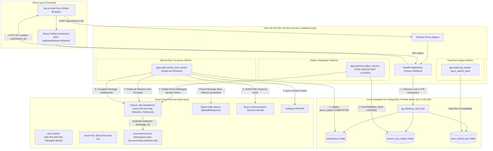
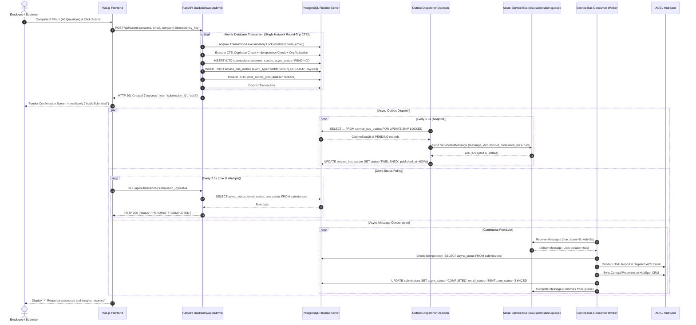
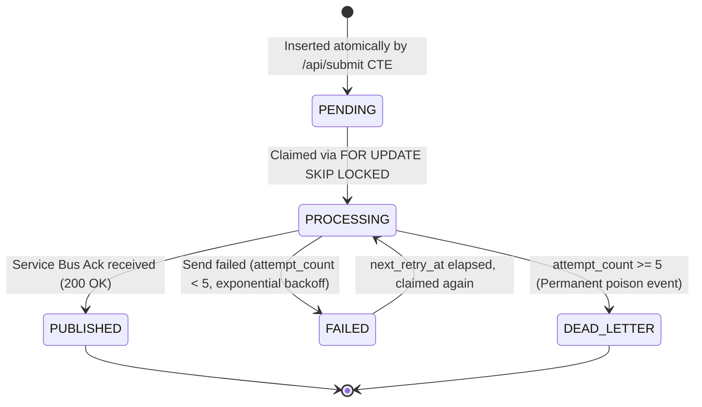

# NIWI — Azure Service Bus Asynchronous Processing Architecture Specification

## 1. Executive Summary & Architectural Overview

The NIWI organisational assessment platform has undergone an enterprise architectural transition from synchronous and database-polled execution to a **durable, highly available Transactional Outbox Pattern backed by Azure Service Bus**.

Under this target architecture:
1. **Zero Data Loss Guarantee:** PostgreSQL remains the immutable transactional source of truth. The HTTP submission request never completes and never sends an acknowledgment to the client until the audit submission and the outbox event are committed atomically inside the single database transaction.
2. **Decoupled Background Processing:** CPU-heavy score report generation, HTML email template compilation, Azure Communication Services (ACS) delivery, and third-party HubSpot CRM synchronization are fully decoupled from the client request-response lifecycle.
3. **Enterprise Message Broker Integration:** Microsoft Azure Service Bus (Standard SKU, East Asia) provides guaranteed FIFO delivery, built-in 10-minute duplicate detection, PeekLock message leasing, and dead-letter queueing (DLQ) for poison messages.
4. **Cloud-Native Identity:** All authentication between application container instances, PostgreSQL, Azure Key Vault, and Azure Service Bus uses **Azure Managed Identity** (`DefaultAzureCredential`) with zero hardcoded credentials, connection strings, or SAS keys.

---

## 2. High-Level Architecture Diagram



---

## 3. End-to-End Submission & Processing Lifecycle (Sequence Diagram)



---

## 4. Azure Service Bus Infrastructure Specification

The Azure Service Bus deployment operates under existing enterprise resources verified via live probes:

| Property | Value | Architectural Purpose |
|---|---|---|
| **Subscription** | Microsoft Azure Sponsorship (`e2d35239-5448-45ae-b156-d3309a9052a9`) | Subscription scope |
| **Resource Group** | `Aakash_ML` | Infrastructure resource container |
| **Namespace FQDN** | `niwi-bus.servicebus.windows.net` | Service Bus namespace hostname |
| **SKU** | Standard | Supports Queues, Topics, Duplicate Detection, Sessions |
| **Region** | East Asia (Hong Kong) | Co-located in same Azure region as PostgreSQL Flexible Server |
| **Target Queue** | `niwi-submission-queue` | Ingestion queue for submission lifecycle events |
| **Authentication Mode** | Azure Managed Identity (`DefaultAzureCredential`) | Token-based IAM authentication (Zero static credentials) |
| **System-Assigned MI Client ID** | `1f4b521a-e3ea-4b6a-b796-62f550008e49` | Host VM Managed Identity Principal |
| **Directory (Tenant) ID** | `ea77fe37-fd2c-4294-87c3-8746bce6625a` | Microsoft Entra ID tenant |
| **Duplicate Detection Window** | 10 minutes | Broker-level duplicate prevention using `message_id` |
| **Max Delivery Count** | 10 | Max processing attempts before auto-dead-lettering |
| **Lock Duration (PeekLock)** | 1 minute | Message processing lease window |
| **Dead-Letter Queue (DLQ)** | `niwi-submission-queue/$deadletterqueue` | Isolation queue for poison or unparseable messages |

---

## 5. Transactional Outbox Pattern Schema & Mechanics

### 5.1 Outbox Table Definition (`service_bus_outbox`)

The `service_bus_outbox` table resides in the same database (`nd_audit`) on the same server (`20.2.146.109`):

```sql
CREATE TABLE IF NOT EXISTS service_bus_outbox (
    id UUID PRIMARY KEY DEFAULT gen_random_uuid(),
    event_type VARCHAR(100) NOT NULL,
    aggregate_id UUID NOT NULL,
    payload JSONB NOT NULL,
    status VARCHAR(50) NOT NULL DEFAULT 'PENDING',
    attempt_count INT NOT NULL DEFAULT 0,
    max_attempts INT NOT NULL DEFAULT 5,
    next_retry_at TIMESTAMP WITH TIME ZONE DEFAULT NOW(),
    created_at TIMESTAMP WITH TIME ZONE DEFAULT NOW(),
    published_at TIMESTAMP WITH TIME ZONE,
    locked_until TIMESTAMP WITH TIME ZONE,
    locked_by VARCHAR(255),
    last_error TEXT
);

CREATE INDEX IF NOT EXISTS idx_outbox_pending_polling 
ON service_bus_outbox (status, next_retry_at) 
WHERE status IN ('PENDING', 'FAILED');

CREATE INDEX IF NOT EXISTS idx_outbox_aggregate 
ON service_bus_outbox (aggregate_id);

CREATE INDEX IF NOT EXISTS idx_outbox_status 
ON service_bus_outbox (status);
```

### 5.2 Outbox State Lifecycle



### 5.3 Lock Contention Elimination (`FOR UPDATE SKIP LOCKED`)

Multiple dispatcher processes or cluster nodes safely poll the outbox table concurrently using:
```sql
SELECT id, event_type, aggregate_id, payload, attempt_count
FROM service_bus_outbox
WHERE status IN ('PENDING', 'FAILED')
  AND next_retry_at <= NOW()
  AND (locked_until IS NULL OR locked_until < NOW())
ORDER BY created_at ASC
LIMIT 10
FOR UPDATE SKIP LOCKED;
```
- **Zero Lock Waiting:** Any row currently locked by another worker is instantly skipped without blocking.
- **Crash Lease Protection:** If a dispatcher node terminates abruptly during transmission, the row's `locked_until` lease (60 seconds) expires automatically, allowing peer workers to reclaim and publish it.

---

## 6. Message Envelope & Wire Format Specification

Messages dispatched to `niwi-submission-queue` strictly conform to the following AMQP envelope structure:

### 6.1 AMQP Envelope Properties

| Message Property | Field Value | Purpose |
|---|---|---|
| `message_id` | `outbox-{outbox_id}` or `sub-{sub_id}-{event_type}` | Enforces native 10-minute duplicate detection on Azure Service Bus |
| `correlation_id` | `{submission_id}` | End-to-end tracing and correlation across worker logs |
| `content_type` | `application/json` | Wire format identifier |
| `application_properties["event_type"]` | `SUBMISSION_CREATED` | Event routing key |
| `application_properties["aggregate_id"]` | `{submission_id}` | Entity key |

### 6.2 JSON Payload Schema (`SUBMISSION_CREATED`)

```json
{
  "submission_id": "d44d1906-85af-4b64-8125-b5b514eb2a6e",
  "name": "Alex Mercer",
  "company_name": "Acme Innovations Ltd",
  "email": "alex.mercer@acme.com",
  "organization_id": "7ae58337-c938-44da-a266-0556545c58f5",
  "submission_source": "DIRECT",
  "idempotency_key": "idemp-065d64be-86eb-46c5-8f64-42ea2d6776b2",
  "email_job_payload": {
    "name": "Alex Mercer",
    "email": "alex.mercer@acme.com",
    "company_name": "Acme Innovations Ltd",
    "scores": {
      "overall_avg": 76.5,
      "overall_level": "Level 3 — Advancing"
    }
  },
  "crm_job_payload": {
    "data": {
      "name": "Alex Mercer",
      "email": "alex.mercer@acme.com",
      "company_name": "Acme Innovations Ltd",
      "designation": "Director of Engineering"
    },
    "score_data": {
      "overall_avg": 76.5,
      "overall_level": "Level 3 — Advancing"
    }
  }
}
```

---

## 7. Message Settlement & Failure Handling Model

The consumer worker (`app.tasks.service_bus_worker`) operates strictly under the **At-Least-Once Delivery** contract with **At-Most-Once Side-Effects** via idempotency guards.

| Scenario | Action Taken | Broker Settlement | Outcome |
|---|---|---|---|
| **Successful Processing** | Email generated/sent, CRM synced, DB updated | `receiver.complete_message(msg)` | Message deleted from queue. |
| **Idempotent Replay** | Submission already has `async_status='COMPLETED'` | `receiver.complete_message(msg)` | Work skipped; message deleted. |
| **Transient Error** (DB timeout, SMTP 5xx) | Error caught and logged | `receiver.abandon_message(msg)` | Message lock released immediately; redelivered after backoff. |
| **Poison / Malformed Payload** | JSON decode fails, invalid schema | `receiver.dead_letter_message(msg, reason="JSONDecodeError")` | Message immediately moved to DLQ; does not block queue. |
| **Delivery Count Exceeded** | `delivery_count >= 10` | `receiver.dead_letter_message(msg, reason="MaxDeliveryCountExceeded")` | Automatic or explicit routing to DLQ for administrator triage. |

---

## 8. Concurrency & Idempotency Safeguards

To prevent race conditions under burst load (50–100 concurrent submissions):
1. **Advisory Lock on Normalized Email:**
   `SELECT pg_advisory_xact_lock(hashtext(norm_email))` is executed within the submission transaction. Concurrent submissions with identical email addresses are strictly serialized, ensuring `duplicate_check` is race-free under PostgreSQL's default `READ COMMITTED` isolation level.
2. **Idempotency Key Conflict Recovery:**
   Submissions enforce a unique partial index on `idempotency_key`. If parallel network requests carry the same key, the second request yields `existing_idempotent_id` via fallback lookup and returns HTTP 200 without creating duplicate database rows or duplicate outbox events.
3. **Database Pre-Warmed Connection Pooling:**
   `init_connection_pool(minconn=10, maxconn=10)` pre-establishes warm SSL connections on Uvicorn startup, eliminating 1,500 ms TCP/TLS round-trips over the Chicago-to-Hong Kong WAN link during peak traffic bursts.
4. **Statement Timeouts:**
   All connection pool checkouts enforce `SET statement_timeout = '15000'` (15 seconds), preventing stuck queries from starving the pool.

---

## 9. Dual-Run & Graceful Migration Strategy

To ensure zero downtime during rollout and instantaneous rollback capability:
1. **Dual Insertion:** During transition, `/api/submit` inserts into **both** `service_bus_outbox` and `post_submit_jobs`.
2. **Supervisord Orchestration:** Supervisord runs:
   - `nginx` (port 80)
   - `uvicorn` (FastAPI backend, port 8000)
   - `job_worker` (legacy worker)
   - `outbox_dispatcher` (new Service Bus dispatcher)
   - `service_bus_worker` (new Service Bus consumer)
3. **Feature Flag Control:**
   - `ENABLE_SERVICE_BUS_PIPELINE`: When `true`, outbox events are published and processed via Azure Service Bus.
   - `ENABLE_LEGACY_JOB_WORKER`: When `true`, legacy jobs continue to be serviced.
4. **Decommissioning Path:** Once Azure Service Bus metrics demonstrate 100% operational success over 30 production days, `post_submit_jobs` and legacy worker can be phased out cleanly without database downtime.

