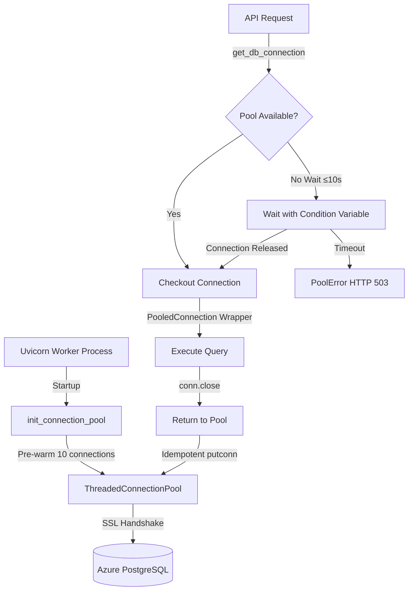
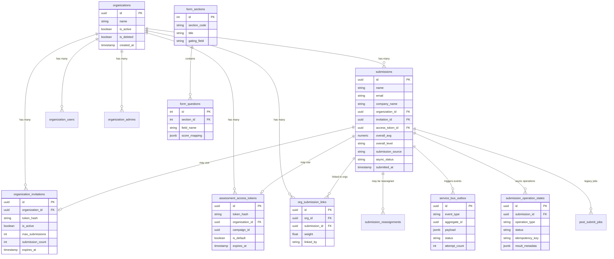
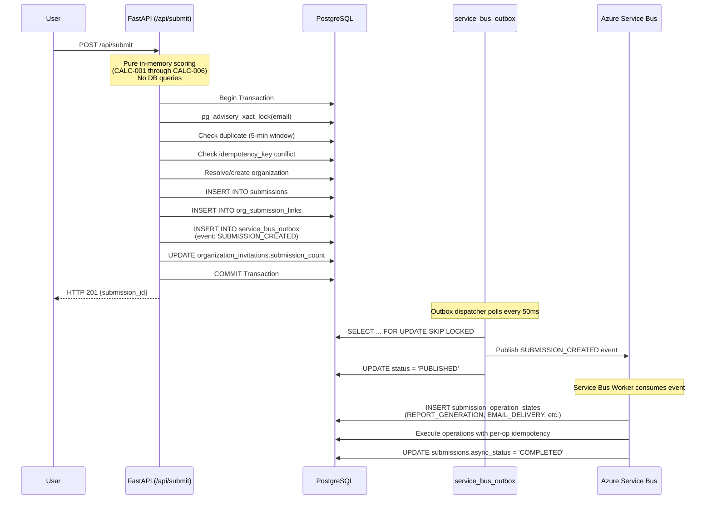

# Database Documentation
## NIWI — Neurodiversity Inclusion Workplace Index Platform
### Document ID: DOC-06-DATABASE
### Last Reviewed: November 4, 2026
### Version: 1.0
### Classification: Technical Reference — Database Architecture & Schema

---

## Table of Contents

1. [Database Overview](#1-database-overview)
2. [Database Architecture](#2-database-architecture)
3. [Complete Schema Documentation](#3-complete-schema-documentation)
4. [Entity Relationship Diagram](#4-entity-relationship-diagram)
5. [Migration History](#5-migration-history)
6. [Data Flows & Business Logic](#6-data-flows--business-logic)
7. [Database Operations](#7-database-operations)
8. [Indexes & Performance Optimization](#8-indexes--performance-optimization)
9. [Backup & Recovery](#9-backup--recovery)

---

## 1. Database Overview

### 1.1 Database Engine

- **Engine**: PostgreSQL 14+ (Azure Database for PostgreSQL Flexible Server)
- **Character Set**: UTF-8
- **Timezone**: UTC for all timestamps
- **Isolation Level**: READ COMMITTED (default)
- **Connection Method**: SSL/TLS encrypted connections only

### 1.2 Database Architecture

NIWI uses a single relational database (`nd_audit`) with the following characteristics:

- **Multi-tenancy**: Organization-isolated data with `organization_id` foreign keys
- **Atomic Operations**: PostgreSQL advisory locks for concurrency control
- **Audit Trail**: Immutable audit log tables for compliance
- **Idempotency**: Unique constraints and idempotency keys for safe retries
- **Transactional Integrity**: Foreign key constraints with appropriate cascade behaviors

### 1.3 Connection Configuration

**Production Configuration:**
```
Host: <PGHOST>.postgres.database.azure.com
Port: 5432 (default)
Database: nd_audit
SSL Mode: require (enforced)
Connection Pooling: ThreadedConnectionPool (10 min, 10 max per worker)
Statement Timeout: 15000ms (15 seconds)
```

**Connection Pool Settings** (per Uvicorn worker):
- Minimum connections: 10
- Maximum connections: 10
- Pre-warmed at startup: Yes
- Keep-alives enabled: 30s idle, 10s interval
- Connect timeout: 10s

**Production Deployment**:
- 2 Uvicorn workers × 10 max connections = 20 total connections
- Azure PostgreSQL limit: 50 connections
- Reserved for admin queries, migrations: 30 connections

### 1.4 Access Control

- **Application User**: `auditadmin` (full DDL/DML on `nd_audit` database)
- **Migration User**: Same as application user
- **Password Management**: Stored in Azure Key Vault, retrieved via Managed Identity
- **Password Policy**: Minimum 8 characters for Key Vault secrets, 16+ for manual config

---

## 2. Database Architecture

### 2.1 Database Connection Flow



### 2.2 Connection Pool Lifecycle

1. **Initialization** (`app/main.py:startup_event`):
   - Creates `ThreadedConnectionPool` with 10/10 min/max connections
   - Pre-warms all connections to eliminate 1.5s SSL handshakes during requests
   - Configures keep-alive TCP probes

2. **Request-Time Checkout** (`app/core/database.py:get_conn`):
   - Attempts immediate `getconn()` from pool
   - If pool exhausted, waits up to 10s using thread condition variable
   - Tracks metrics: checkout attempts, successes, wait times, pool errors

3. **Return to Pool** (`PooledConnection.close()`):
   - Idempotent return via `putconn()`
   - Rolls back any uncommitted transactions
   - Closes dead connections instead of re-pooling
   - Records hold duration metrics

### 2.3 Advisory Locks for Concurrency

NIWI uses PostgreSQL advisory locks (`pg_advisory_xact_lock`) to prevent race conditions:

**Use Case 1: Organization Deduplication**
```sql
-- File: app/api/routes.py, line 213
SELECT pg_advisory_xact_lock(hashtext(LOWER(TRIM(%s))))
-- Serializes concurrent submissions for the same company name
-- Ensures exactly one organization record is created
```

**Use Case 2: Duplicate Submission Prevention**
```sql
-- File: app/api/routes.py, line 318
SELECT pg_advisory_xact_lock(hashtext(%s))
-- Prevents duplicate submissions from same email within 5-minute window
-- Advisory lock held only during transaction scope (auto-released on commit)
```

**Advisory Lock Benefits**:
- Transaction-scoped (released automatically on COMMIT/ROLLBACK)
- No persistent lock tables or cleanup
- Blocks concurrent executions for same hash
- Different hashes proceed in parallel

---

## 3. Complete Schema Documentation

### 3.1 Core Entities

#### Table: `submissions`

Primary entity storing all assessment submissions.

| Column | Type | Nullable | Default | Description |
|--------|------|----------|---------|-------------|
| `id` | UUID | NO | gen_random_uuid() | Primary key |
| `name` | VARCHAR(255) | YES | NULL | Respondent full name |
| `designation` | VARCHAR(255) | YES | NULL | Job title or role |
| `company_name` | VARCHAR(255) | YES | NULL | Organization name (denormalized for reporting) |
| `email` | VARCHAR(255) | YES | NULL | Respondent email address |
| `contact_number` | VARCHAR(50) | YES | NULL | Optional phone number |
| `has_physical_workspace` | VARCHAR(10) | YES | NULL | "Yes" or "No" (gates Built Environment section) |
| `has_suppliers` | VARCHAR(10) | YES | NULL | "Yes" or "No" (gates Supply Chain section) |
| `q5` through `q44` | VARCHAR(50) | YES | NULL | Individual question responses ("Yes", "Partially", "No", "Not Sure", "N/A") |
| `lc_score` | NUMERIC(5,2) | YES | NULL | Leadership & Culture score (0.00–20.00) |
| `lc_level` | VARCHAR(100) | YES | NULL | Leadership & Culture maturity level |
| `ro_score` | NUMERIC(5,2) | YES | NULL | Recruitment & Onboarding score |
| `ro_level` | VARCHAR(100) | YES | NULL | Recruitment & Onboarding maturity level |
| `we_score` | NUMERIC(5,2) | YES | NULL | Work Environment score |
| `we_level` | VARCHAR(100) | YES | NULL | Work Environment maturity level |
| `be_score` | NUMERIC(5,2) | YES | NULL | Built Environment score (or "NA" if gated) |
| `be_level` | VARCHAR(100) | YES | NULL | Built Environment maturity level |
| `tm_score` | NUMERIC(5,2) | YES | NULL | Talent Management score |
| `tm_level` | VARCHAR(100) | YES | NULL | Talent Management maturity level |
| `ca_score` | NUMERIC(5,2) | YES | NULL | Communication & Accessibility score |
| `ca_level` | VARCHAR(100) | YES | NULL | Communication & Accessibility maturity level |
| `pc_score` | NUMERIC(5,2) | YES | NULL | Products & Customer Service score |
| `pc_level` | VARCHAR(100) | YES | NULL | Products & Customer Service maturity level |
| `sp_score` | NUMERIC(5,2) | YES | NULL | Supply Chain & Procurement score (or "NA" if gated) |
| `sp_level` | VARCHAR(100) | YES | NULL | Supply Chain & Procurement maturity level |
| `overall_avg` | NUMERIC(5,2) | YES | NULL | Average score across all applicable sections (0.00–20.00) |
| `overall_level` | VARCHAR(100) | YES | NULL | Overall maturity level ("Level 1 — Foundational", "Level 2 — Early Progress", "Level 3 — Developing") |
| `email_body` | TEXT | YES | NULL | Generated HTML scorecard email body |
| `status` | VARCHAR(50) | YES | 'pending' | Legacy email status ("pending", "sent", "failed") |
| `consent_given` | BOOLEAN | NO | FALSE | GDPR consent checkbox acceptance |
| `consent_timestamp` | TIMESTAMP WITH TIME ZONE | YES | NULL | Timestamp of consent acceptance |
| `organization_id` | UUID | YES | NULL | Foreign key to `organizations.id` |
| `submission_source` | VARCHAR(50) | NO | 'DIRECT' | Source type: "DIRECT", "INVITATION", "SECURE_LINK" |
| `invitation_id` | UUID | YES | NULL | Foreign key to `organization_invitations.id` (if source is INVITATION) |
| `access_token_id` | UUID | YES | NULL | Foreign key to `assessment_access_tokens.id` (if source is SECURE_LINK) |
| `campaign_id` | UUID | YES | NULL | Optional marketing campaign identifier |
| `dimension_scores` | JSONB | YES | NULL | JSON map of dimension codes to scores (`{"lc": 12.5, "ro": 18.0, ...}`) |
| `answers` | JSONB | YES | NULL | Dynamic form responses stored as JSON object |
| `async_status` | VARCHAR(32) | YES | 'PENDING' | Async processing status ("PENDING", "COMPLETED", "PARTIAL", "FAILED") |
| `email_status` | VARCHAR(32) | YES | 'PENDING' | Email delivery status ("PENDING", "GENERATED", "SENT", "SKIPPED", "FAILED") |
| `crm_status` | VARCHAR(32) | YES | 'PENDING' | CRM sync status ("PENDING", "SYNCED", "SKIPPED", "FAILED") |
| `report_status` | VARCHAR(32) | YES | 'PENDING' | Report generation status ("PENDING", "GENERATED", "FAILED") |
| `admin_notify_status` | VARCHAR(32) | YES | 'PENDING' | Admin notification status |
| `hubspot_deal_id` | VARCHAR(64) | YES | NULL | HubSpot CRM deal identifier |
| `hubspot_contact_id` | VARCHAR(64) | YES | NULL | HubSpot CRM contact identifier |
| `async_completed_at` | TIMESTAMP WITH TIME ZONE | YES | NULL | Timestamp when async processing completed |
| `idempotency_key` | VARCHAR(64) | YES | NULL | Client-provided UUID for safe retries |
| `submitted_at` | TIMESTAMP WITH TIME ZONE | YES | NOW() | Submission creation timestamp |

**Primary Key**: `id`

**Unique Constraints**:
- `idx_submissions_idempotency_key`: Partial unique index on `idempotency_key WHERE idempotency_key IS NOT NULL`

**Foreign Keys**:
- `organization_id` → `organizations(id)` ON DELETE SET NULL
- `invitation_id` → `organization_invitations(id)` ON DELETE SET NULL
- `access_token_id` → `assessment_access_tokens(id)` ON DELETE SET NULL

**Indexes**:
- `idx_submissions_status` ON `status`
- `idx_submissions_submitted_at` ON `submitted_at DESC`
- `idx_submissions_email` ON `email`
- `idx_submissions_submission_source` ON `submission_source`
- `idx_submissions_invitation_id` ON `invitation_id`
- `idx_submissions_async_status` ON `async_status`
- `idx_submissions_org_id` ON `organization_id`
- `idx_submissions_email_submitted` ON `(email, submitted_at DESC)`
- `idx_submissions_company_name` ON `LOWER(TRIM(company_name))`
- `idx_submissions_access_token_id` ON `access_token_id`
- `idx_submissions_campaign_id` ON `campaign_id`

---

#### Table: `organizations`

Represents corporate entities completing assessments.

| Column | Type | Nullable | Default | Description |
|--------|------|----------|---------|-------------|
| `id` | UUID | NO | gen_random_uuid() | Primary key |
| `name` | VARCHAR(255) | NO | - | Organization name (normalized: trimmed, title-cased) |
| `is_active` | BOOLEAN | NO | TRUE | Active status (inactive orgs cannot receive submissions) |
| `is_deleted` | BOOLEAN | NO | FALSE | Soft-delete flag (preserves audit history) |
| `approval_status` | VARCHAR(50) | YES | 'approved' | Admin approval status ("pending", "approved", "rejected") |
| `created_at` | TIMESTAMP WITH TIME ZONE | YES | NOW() | Creation timestamp |
| `updated_at` | TIMESTAMP WITH TIME ZONE | YES | NOW() | Last modification timestamp |
| `updated_by` | VARCHAR(255) | YES | NULL | Admin email who last modified |
| `deleted_at` | TIMESTAMP WITH TIME ZONE | YES | NULL | Soft-deletion timestamp |
| `deleted_by` | VARCHAR(255) | YES | NULL | Admin email who soft-deleted |

**Primary Key**: `id`

**Indexes**:
- `idx_organizations_active_deleted` ON `(is_active, is_deleted)`
- `idx_orgs_name_lower_trim` ON `LOWER(TRIM(name))`

---

#### Table: `organization_invitations`

Secure invitation links for scoped employee cohort surveys.

| Column | Type | Nullable | Default | Description |
|--------|------|----------|---------|-------------|
| `id` | UUID | NO | gen_random_uuid() | Primary key |
| `organization_id` | UUID | NO | - | Foreign key to `organizations.id` |
| `token_hash` | VARCHAR(64) | NO | - | SHA-256 hash of raw invitation token (raw token never stored) |
| `invitation_name` | VARCHAR(255) | YES | NULL | Human-readable invitation name (e.g., "Q4 2026 Engineering Survey") |
| `created_by` | VARCHAR(255) | YES | NULL | Admin email who created invitation |
| `created_at` | TIMESTAMP WITH TIME ZONE | YES | NOW() | Creation timestamp |
| `expires_at` | TIMESTAMP WITH TIME ZONE | YES | NULL | Optional expiration timestamp (NULL = never expires) |
| `is_active` | BOOLEAN | NO | TRUE | Active status (inactive invitations reject submissions) |
| `max_submissions` | INT | YES | NULL | Optional submission quota (NULL = unlimited) |
| `submission_count` | INT | NO | 0 | Current submission count (atomically incremented) |
| `revoked_at` | TIMESTAMP WITH TIME ZONE | YES | NULL | Revocation timestamp |
| `revoked_by` | VARCHAR(255) | YES | NULL | Admin email who revoked |

**Primary Key**: `id`

**Unique Constraints**:
- `token_hash` (enforced by unique index)

**Foreign Keys**:
- `organization_id` → `organizations(id)` ON DELETE CASCADE

**Indexes**:
- `idx_org_invitations_token_hash` ON `token_hash`
- `idx_org_invitations_org_id` ON `organization_id`

**Security Note**: Raw invitation tokens are NEVER stored in the database. Only SHA-256 hashes are persisted. Raw tokens are generated as 32-byte Base64URL-encoded random strings.

---

#### Table: `assessment_access_tokens`

Secure opaque tokens for protecting organization identity in assessment URLs.

| Column | Type | Nullable | Default | Description |
|--------|------|----------|---------|-------------|
| `id` | UUID | NO | gen_random_uuid() | Primary key |
| `token_hash` | VARCHAR(64) | NO | - | SHA-256 hash of raw token |
| `token` | VARCHAR(255) | YES | NULL | DEPRECATED: Raw token storage (use hash only) |
| `organisation_id` | UUID | NO | - | Foreign key to `organizations.id` |
| `campaign_id` | UUID | YES | NULL | Optional campaign identifier for analytics |
| `name` | VARCHAR(255) | YES | NULL | Human-readable token name |
| `is_default` | BOOLEAN | NO | FALSE | Whether this is the default token for the organization |
| `created_by` | VARCHAR(255) | YES | NULL | Admin email who created token |
| `created_at` | TIMESTAMP WITH TIME ZONE | NO | NOW() | Creation timestamp |
| `expires_at` | TIMESTAMP WITH TIME ZONE | YES | NULL | Optional expiration timestamp |
| `revoked_at` | TIMESTAMP WITH TIME ZONE | YES | NULL | Revocation timestamp |
| `revoked_by` | VARCHAR(255) | YES | NULL | Admin email who revoked |

**Primary Key**: `id`

**Unique Constraints**:
- `idx_access_tokens_token_hash` UNIQUE ON `token_hash`

**Foreign Keys**:
- `organisation_id` → `organizations(id)` ON DELETE CASCADE

**Indexes**:
- `idx_access_tokens_org_id` ON `organisation_id`
- `idx_access_tokens_active` ON `organisation_id` WHERE `revoked_at IS NULL`
- `idx_access_tokens_default` ON `organisation_id` WHERE `is_default = TRUE AND revoked_at IS NULL`

---

#### Table: `org_submission_links`

Many-to-many weighted join table between organizations and submissions for multi-respondent scoring.

| Column | Type | Nullable | Default | Description |
|--------|------|----------|---------|-------------|
| `id` | UUID | NO | gen_random_uuid() | Primary key |
| `org_id` | UUID | NO | - | Foreign key to `organizations.id` |
| `submission_id` | UUID | NO | - | Foreign key to `submissions.id` |
| `weight` | FLOAT | NO | 1.0 | Respondent weighting multiplier (default: 1.0) |
| `linked_by` | VARCHAR(255) | YES | NULL | Admin email (NULL = auto-linked at submission time) |
| `linked_at` | TIMESTAMP WITH TIME ZONE | YES | NOW() | Link creation timestamp |

**Primary Key**: `id`

**Unique Constraints**:
- `(org_id, submission_id)` (one submission can be linked to multiple orgs, but each pairing is unique)

**Foreign Keys**:
- `org_id` → `organizations(id)` ON DELETE CASCADE
- `submission_id` → `submissions(id)` ON DELETE CASCADE

**Indexes**:
- `idx_osl_org_id` ON `org_id`
- `idx_osl_submission_id` ON `submission_id`

**Business Logic**:
- Weight multipliers allow prioritizing responses from DE&I leads, HR directors, or executives
- Weighted average formula: `SUM(score_i * weight_i) / SUM(weight_i)`

---

### 3.2 Authentication & Authorization

#### Table: `admin_users`

System administrators with global access to all organizations.

| Column | Type | Nullable | Default | Description |
|--------|------|----------|---------|-------------|
| `id` | SERIAL | NO | - | Primary key |
| `email` | VARCHAR(255) | NO | - | Microsoft Entra ID email (unique) |
| `name` | VARCHAR(255) | YES | NULL | Display name (optional, derived from Entra ID) |
| `role` | VARCHAR(50) | NO | 'admin' | Role: "admin" (Normal Admin) or "super" (Super Admin) |
| `password_hash` | VARCHAR(255) | YES | NULL | DEPRECATED (Entra ID authentication only) |
| `created_at` | TIMESTAMP WITH TIME ZONE | YES | NOW() | Creation timestamp |

**Primary Key**: `id`

**Unique Constraints**:
- `admin_users_email_key` ON `email`

**Roles**:
- **Normal Admin** (`role='admin'`):
  - View/edit all organizations
  - View/edit submissions
  - Create/edit/revoke invitations
  - Generate and send reports
  - Cannot manage admin users
  
- **Super Admin** (`role='super'`):
  - All Normal Admin permissions
  - Create/delete administrator accounts
  - Change administrator roles
  - Delete all submissions (with confirmation)
  - Protected: last Super Admin cannot be deleted or demoted

---

#### Table: `organization_users`

Organization members with tenant-isolated dashboard access via passwordless magic links.

| Column | Type | Nullable | Default | Description |
|--------|------|----------|---------|-------------|
| `id` | UUID | NO | gen_random_uuid() | Primary key |
| `organization_id` | UUID | NO | - | Foreign key to `organizations.id` |
| `email` | VARCHAR(255) | NO | - | Organization member email (unique) |
| `created_at` | TIMESTAMP WITH TIME ZONE | YES | NOW() | Creation timestamp |

**Primary Key**: `id`

**Unique Constraints**:
- `email` (one user per organization)

**Foreign Keys**:
- `organization_id` → `organizations(id)` ON DELETE CASCADE

**Indexes**:
- `idx_org_users_email` ON `email`

**Authentication Flow**:
1. User requests magic link at `/org/login`
2. Backend generates random 32-byte token, stores SHA-256 hash with 15-minute expiry
3. User clicks link, backend verifies hash and issues 30-day JWT with `org_id` claim
4. All dashboard queries are scoped to `org_id` from JWT

---

#### Table: `organization_admins`

Legacy admin-to-organization mapping table (currently unused; global admin access model).

| Column | Type | Nullable | Default | Description |
|--------|------|----------|---------|-------------|
| `id` | UUID | NO | gen_random_uuid() | Primary key |
| `admin_email` | VARCHAR(255) | NO | - | Admin email |
| `organization_id` | UUID | NO | - | Foreign key to `organizations.id` |
| `created_at` | TIMESTAMP DEFAULT NOW() | Timestamp |
| `created_by` | VARCHAR(255) | YES | NULL | Creator admin email |

**Primary Key**: `id`

**Unique Constraints**:
- `(admin_email, organization_id)`

**Foreign Keys**:
- `organization_id` → `organizations(id)` ON DELETE CASCADE

**Indexes**:
- `idx_organization_admins_email` ON `admin_email`
- `idx_organization_admins_org` ON `organization_id`

**Status**: Currently unused. NIWI implements a global two-role admin model where both Normal Admin and Super Admin have access to all organizations. This table was created for future per-organization access control but is not enforced.

---

### 3.3 Background Processing & Asynchronous Operations

#### Table: `service_bus_outbox`

Transactional outbox pattern for guaranteed Azure Service Bus message delivery.

| Column | Type | Nullable | Default | Description |
|--------|------|----------|---------|-------------|
| `id` | UUID | NO | gen_random_uuid() | Primary key |
| `event_type` | VARCHAR(100) | NO | - | Event type (e.g., "SUBMISSION_CREATED") |
| `aggregate_id` | UUID | NO | - | Entity UUID (e.g., submission_id) |
| `payload` | JSONB | NO | - | Event data as JSON |
| `status` | VARCHAR(50) | NO | 'PENDING' | Status: "PENDING", "PROCESSING", "PUBLISHED", "FAILED", "DEAD_LETTER" |
| `attempt_count` | INT | NO | 0 | Retry attempt counter |
| `max_attempts` | INT | NO | 5 | Maximum retry attempts before dead-letter |
| `next_retry_at` | TIMESTAMP WITH TIME ZONE | YES | NOW() | Next retry timestamp (exponential backoff) |
| `created_at` | TIMESTAMP WITH TIME ZONE | YES | NOW() | Creation timestamp |
| `published_at` | TIMESTAMP WITH TIME ZONE | YES | NULL | Service Bus publish timestamp |
| `locked_until` | TIMESTAMP WITH TIME ZONE | YES | NULL | Lock lease expiry for crash recovery |
| `locked_by` | VARCHAR(255) | YES | NULL | Worker identifier holding lock |
| `last_error` | TEXT | YES | NULL | Last error message |

**Primary Key**: `id`

**Indexes**:
- `idx_outbox_pending_polling` ON `(status, next_retry_at)` WHERE `status IN ('PENDING', 'FAILED')`
- `idx_outbox_aggregate` ON `aggregate_id`
- `idx_outbox_status` ON `status`

**Workflow**:
1. Submission API inserts record into `submissions` and `service_bus_outbox` in single transaction
2. Outbox dispatcher polls for `PENDING`/`FAILED` records using `FOR UPDATE SKIP LOCKED`
3. Dispatcher publishes message to Azure Service Bus
4. On success, marks record as `PUBLISHED`
5. On failure, increments `attempt_count` and sets exponential backoff `next_retry_at`
6. After 5 failures, moves to `DEAD_LETTER` status for manual inspection

---

#### Table: `submission_operation_states`

Per-operation idempotency ledger for async submission processing.

| Column | Type | Nullable | Default | Description |
|--------|------|----------|---------|-------------|
| `id` | UUID | NO | gen_random_uuid() | Primary key |
| `submission_id` | UUID | NO | - | Foreign key to `submissions.id` |
| `operation_type` | VARCHAR(64) | NO | - | Operation: "REPORT_GENERATION", "EMAIL_DELIVERY", "CRM_SYNC", "ADMIN_NOTIFICATION" |
| `status` | VARCHAR(32) | NO | 'PENDING' | Status: "PENDING", "PROCESSING", "COMPLETED", "GENERATED", "SENT", "SYNCED", "SKIPPED", "FAILED" |
| `idempotency_key` | VARCHAR(128) | NO | - | `{submission_id}:{operation_type}` |
| `attempts` | INT | NO | 0 | Retry attempt counter |
| `max_attempts` | INT | NO | 3 | Maximum retry attempts |
| `locked_at` | TIMESTAMP WITH TIME ZONE | YES | NULL | Lock acquisition timestamp |
| `locked_by` | VARCHAR(128) | YES | NULL | Worker identifier |
| `last_error` | TEXT | YES | NULL | Last error message |
| `result_metadata` | JSONB | YES | '{}' | Operation result data (e.g., `{"deal_id": "12345"}`) |
| `created_at` | TIMESTAMP WITH TIME ZONE | YES | NOW() | Creation timestamp |
| `completed_at` | TIMESTAMP WITH TIME ZONE | YES | NULL | Completion timestamp |
| `updated_at` | TIMESTAMP WITH TIME ZONE | YES | NOW() | Last update timestamp |

**Primary Key**: `id`

**Unique Constraints**:
- `uq_sub_op_idempotency` ON `idempotency_key`
- `uq_sub_op_type` ON `(submission_id, operation_type)`

**Foreign Keys**:
- `submission_id` → `submissions(id)` ON DELETE CASCADE

**Indexes**:
- `idx_sub_op_lookup` ON `(submission_id, operation_type)`
- `idx_sub_op_status` ON `status`

**Idempotency Guarantees**:
- Each operation executes exactly once per submission
- Concurrent workers use row-level locking with `FOR UPDATE`
- Stale locks auto-expire after 5 minutes for crash recovery
- Terminal states ("COMPLETED", "GENERATED", "SENT", "SYNCED", "SKIPPED") are immutable

---

#### Table: `post_submit_jobs`

Legacy background job queue (superseded by `submission_operation_states` in v3.1).

| Column | Type | Nullable | Default | Description |
|--------|------|----------|---------|-------------|
| `id` | UUID | NO | gen_random_uuid() | Primary key |
| `submission_id` | UUID | NO | - | Foreign key to `submissions.id` |
| `job_type` | VARCHAR(32) | NO | - | Job type: "email", "crm", "org_aggregate" |
| `status` | VARCHAR(32) | NO | 'PENDING' | Status: "PENDING", "PROCESSING", "DONE", "RETRY", "FAILED" |
| `payload` | JSONB | YES | '{}' | Job-specific data |
| `attempts` | INT | NO | 0 | Retry attempt counter |
| `max_attempts` | INT | NO | 5 | Maximum retry attempts |
| `next_attempt_at` | TIMESTAMP WITH TIME ZONE | YES | NOW() | Next retry timestamp |
| `last_error` | TEXT | YES | NULL | Last error message |
| `locked_at` | TIMESTAMP WITH TIME ZONE | YES | NULL | Lock acquisition timestamp |
| `locked_by` | VARCHAR(64) | YES | NULL | Worker identifier |
| `created_at` | TIMESTAMP WITH TIME ZONE | YES | NOW() | Creation timestamp |
| `updated_at` | TIMESTAMP WITH TIME ZONE | YES | NOW() | Last update timestamp |

**Primary Key**: `id`

**Unique Constraints**:
- `uq_post_submit_jobs_sub_type` ON `(submission_id, job_type)`

**Foreign Keys**:
- `submission_id` → `submissions(id)` ON DELETE CASCADE

**Indexes**:
- `idx_post_submit_jobs_polling` ON `(status, next_attempt_at)` WHERE `status IN ('PENDING', 'RETRY')`

**Status**: Deprecated in favor of `submission_operation_states`. Retained for backward compatibility.

---

### 3.4 Dynamic Form Configuration

#### Table: `form_sections`

Configurable assessment sections with metadata and gating logic.

| Column | Type | Nullable | Default | Description |
|--------|------|----------|---------|-------------|
| `id` | SERIAL | NO | - | Primary key |
| `section_code` | VARCHAR(50) | NO | - | Unique code: "lc", "ro", "we", "be", "tm", "ca", "pc", "sp" |
| `title` | VARCHAR(255) | NO | - | Display title (e.g., "Leadership & Culture") |
| `icon` | VARCHAR(50) | YES | NULL | Icon character or class |
| `summary` | TEXT | YES | NULL | Section summary description |
| `why_it_matters` | TEXT | YES | NULL | Business importance explanation |
| `tip` | TEXT | YES | NULL | Guidance for respondents |
| `gating_question` | TEXT | YES | NULL | Question text for gating logic |
| `gating_field` | VARCHAR(50) | YES | NULL | Field name that gates this section (e.g., "has_physical_workspace") |
| `order_index` | INT | NO | 0 | Display order sequence |
| `created_at` | TIMESTAMP YES | NOW() | Creation timestamp |
| `updated_at` | TIMESTAMP | YES | NOW() | Last modification timestamp |

**Primary Key**: `id`

**Unique Constraints**:
- `section_code`

**Gating Logic**:
- If `gating_field` is set and respondent answers "No", section is excluded from scoring
- Gated sections return score = "NA" and level = "Not applicable"
- Overall average is computed over applicable sections only

---

#### Table: `form_questions`

Individual assessment questions with scoring mappings.

| Column | Type | Nullable | Default | Description |
|--------|------|----------|---------|-------------|
| `id` | SERIAL | NO | - | Primary key |
| `section_id` | INT | NO | - | Foreign key to `form_sections.id` |
| `field_name` | VARCHAR(50) | NO | - | Unique field identifier (e.g., "q5", "q6", ..., "q44") |
| `short_title` | VARCHAR(255) | NO | - | Short question label |
| `question_text` | TEXT | NO | - | Full question text |
| `order_index` | INT | NO | 0 | Display order within section |
| `score_mapping` | JSONB | NO | `{"Yes": 4, "Partially": 2, "No": 0, "Not Sure": 0, "N/A": 0}` | Answer-to-score mapping |
| `depends_on_field` | VARCHAR(50) | YES | NULL | Conditional question dependency (future feature) |
| `depends_on_value` | VARCHAR(50) | YES | NULL | Required value for dependency |
| `created_at` | TIMESTAMP | YES | NOW() | Creation timestamp |
| `updated_at` | TIMESTAMP | YES | NOW() | Last modification timestamp |

**Primary Key**: `id`

**Unique Constraints**:
- `field_name`

**Foreign Keys**:
- `section_id` → `form_sections(id)` ON DELETE CASCADE

**Default Score Mapping**:
```json
{
  "Yes": 4,
  "Partially": 2,
  "No": 0,
  "Not Sure": 0,
  "N/A": 0
}
```

**Scoring Formula** (see `app/services/scoring_service.py:score_section`):
```
Section Score = ROUND((SUM(points) / MAX_APPLICABLE) * 20, 2)
```

Where:
- `SUM(points)` = Sum of scores for all answered questions
- `MAX_APPLICABLE` = Maximum possible score for applicable questions
- Multiplied by 20 to normalize to 0–20 scale

---

### 3.5 Audit & Compliance

#### Table: `audit_logs`

Immutable audit trail of administrative actions.

| Column | Type | Nullable | Default | Description |
|--------|------|----------|---------|-------------|
| `id` | SERIAL | NO | - | Primary key |
| `admin_id` | VARCHAR(255) | NO | - | Admin email or user ID |
| `action_type` | VARCHAR(50) | NO | - | Action performed (e.g., "DELETE_SUBMISSION", "REASSIGN", "REVOKE_INVITATION") |
| `target_resource_id` | UUID | YES | NULL | Affected entity UUID |
| `old_value` | TEXT | YES | NULL | Value before change (JSON or text) |
| `new_value` | TEXT | YES | NULL | Value after change |
| `ip_address` | VARCHAR(45) | YES | NULL | Client IP address (IPv4 or IPv6) |
| `timestamp` | TIMESTAMP | YES | NOW() | Action timestamp |

**Primary Key**: `id`

**Indexes**: None (append-only table, queried infrequently)

**Retention Policy**: Permanent retention for compliance (no automatic deletion)

---

#### Table: `submission_reassignments`

Audit trail for submission organization reassignments.

| Column | Type | Nullable | Default | Description |
|--------|------|----------|---------|-------------|
| `id` | UUID | NO | gen_random_uuid() | Primary key |
| `submission_id` | UUID | NO | - | Foreign key to `submissions.id` |
| `old_organization_id` | UUID | NO | - | Previous organization ID |
| `new_organization_id` | UUID | NO | - | New organization ID |
| `reassigned_by` | VARCHAR(255) | NO | - | Admin email who performed reassignment |
| `reassigned_at` | TIMESTAMP WITH TIME ZONE | NO | NOW() | Reassignment timestamp |
| `reason` | TEXT | YES | NULL | Optional justification text |
| `created_at` | TIMESTAMP WITH TIME ZONE | NO | NOW() | Record creation timestamp |

**Primary Key**: `id`

**Foreign Keys**:
- `submission_id` → `submissions(id)` ON DELETE CASCADE
- `old_organization_id` → `organizations(id)` ON DELETE RESTRICT
- `new_organization_id` → `organizations(id)` ON DELETE RESTRICT

**Indexes**:
- `idx_submission_reassignments_submission_id` ON `submission_id`
- `idx_submission_reassignments_reassigned_by` ON `reassigned_by`
- `idx_submission_reassignments_old_org` ON `old_organization_id`
- `idx_submission_reassignments_new_org` ON `new_organization_id`
- `idx_submission_reassignments_reassigned_at` ON `reassigned_at DESC`

**Immutability**: Records are never updated or deleted (append-only history)

---

### 3.6 Configuration & Settings

#### Table: `app_settings`

Singleton table for application-wide configuration.

| Column | Type | Nullable | Default | Description |
|--------|------|----------|---------|-------------|
| `id` | INT | NO | 1 | Primary key (always 1, enforced by CHECK constraint) |
| `sender_name` | VARCHAR(255) | NO | 'Orchvate' | Email sender display name |
| `sender_address` | VARCHAR(255) | NO | '' | Email sender address (ACS-configured) |
| `notification_email` | VARCHAR(255) | NO | '' | Admin notification recipient |
| `notifications_enabled` | BOOLEAN | NO | FALSE | Enable/disable admin notifications |
| `support_email` | VARCHAR(255) | NO | 'aakash.padyachi@orchvate.com' | Support contact email |
| `low_visibility_threshold` | INT | YES | 50 | Percentage threshold for "Not Sure" flagging (default: 50%) |
| `crm_sync_enabled` | BOOLEAN | NO | FALSE | Enable/disable HubSpot CRM synchronization |
| `hubspot_api_key` | VARCHAR(255) | YES | '' | DEPRECATED (use Azure Key Vault) |
| `updated_at` | TIMESTAMP | YES | NOW() | Last update timestamp |

**Primary Key**: `id`

**Constraints**:
- `CHECK (id = 1)` — Enforces singleton pattern (only one row allowed)

**Usage**:
```sql
SELECT low_visibility_threshold FROM app_settings WHERE id = 1;
```

---

#### Table: `system_security_settings`

Admin-configurable rate limit and abuse protection settings.

| Column | Type | Nullable | Default | Description |
|--------|------|----------|---------|-------------|
| `id` | SERIAL | NO | - | Primary key |
| `setting_key` | VARCHAR(100) | NO | - | Unique setting identifier |
| `setting_value` | TEXT | NO | - | Setting value (string representation) |
| `description` | TEXT | YES | NULL | Human-readable description |
| `updated_at` | TIMESTAMP WITH TIME ZONE | NO | NOW() | Last update timestamp |
| `updated_by` | VARCHAR(255) | NO | 'system' | Admin who updated setting |

**Primary Key**: `id`

**Unique Constraints**:
- `setting_key`

**Indexes**:
- `idx_system_security_settings_key` ON `setting_key`

**Seed Values** (Migration 019):
- `submit_rate_limit_hour`: 500 (public submissions per IP/hour)
- `submit_rate_limit_day`: 2000 (public submissions per IP/day)
- `secure_submit_rate_limit_hour`: 500 (secure-link submissions per IP/hour)
- `secure_submit_rate_limit_day`: 2000 (secure-link submissions per IP/day)
- `assessment_session_limit_hour`: 3 (assessment session attempts per hour)
- `invalid_token_limit_minute`: 10 (invalid token attempts per IP/minute)

---

#### Table: `saved_filters`

Reusable filter configurations for admin submissions dashboard.

| Column | Type | Nullable | Default | Description |
|--------|------|----------|---------|-------------|
| `id` | UUID | NO | gen_random_uuid() | Primary key |
| `name` | VARCHAR(255) | NO | - | Filter name |
| `description` | TEXT | YES | NULL | Filter description |
| `filter_config` | JSONB | NO | - | ServiceNow-style filter JSON structure |
| `created_by` | VARCHAR(255) | NO | 'system' | Creator admin email |
| `is_shared` | BOOLEAN | NO | TRUE | Shared with all admins |
| `created_at` | TIMESTAMP WITH TIME ZONE | YES | NOW() | Creation timestamp |
| `updated_at` | TIMESTAMP WITH TIME ZONE | YES | NOW() | Last update timestamp |

**Primary Key**: `id`

**Indexes**:
- `idx_saved_filters_created_by` ON `created_by`

**Filter Config Schema**:
```json
{
  "filter_groups": [
    {
      "logical_operator": "AND",
      "conditions": [
        {
          "field": "overall_avg",
          "operator": "greater_than_or_equal",
          "value": "15"
        }
      ]
    }
  ],
  "sort_by": [
    {
      "field": "submitted_at",
      "direction": "desc"
    }
  ]
}
```

**System Presets** (Migration 010):
1. **All Submissions** — Default view
2. **Pending Review** — `status = 'pending'`
3. **Delivered Reports** — `status = 'sent'`
4. **High Maturity (Developing)** — `overall_avg >= 15`
5. **Foundational Priority** — `overall_avg <= 6`

---

### 3.7 Legacy & Deprecated Tables

#### Table: `email_dlq`

Dead-letter queue for failed email deliveries (superseded by `submission_operation_states`).

| Column | Type | Nullable | Default | Description |
|--------|------|----------|---------|-------------|
| `id` | SERIAL | NO | - | Primary key |
| `submission_id` | UUID | NO | - | Foreign key to `submissions.id` |
| `payload` | JSONB | NO | - | Email payload data |
| `attempts` | INT | YES | 0 | Retry attempt counter |
| `next_retry_at` | TIMESTAMP | YES | NOW() | Next retry timestamp |
| `last_error` | TEXT | YES | NULL | Last error message |
| `status` | VARCHAR(20) | YES | 'pending' | Status: "pending", "retry", "dead" |

**Status**: Deprecated. Retained for backward compatibility with pre-v3.1 deployments.

---

#### Table: `draft_submissions`

Saved in-progress assessments.

| Column | Type | Nullable | Default | Description |
|--------|------|----------|---------|-------------|
| `id` | UUID | NO | gen_random_uuid() | Primary key |
| `email` | VARCHAR(255) | NO | - | Respondent email |
| `company_name` | VARCHAR(255) | NO | - | Company name |
| `form_state` | JSONB | NO | - | Partial form responses JSON |
| `current_step` | INT | NO | 0 | Last completed step index |
| `submitted` | BOOLEAN | NO | FALSE | Whether draft was converted to submission |
| `created_at` | TIMESTAMP WITH TIME ZONE | YES | NOW() | Creation timestamp |
| `updated_at` | TIMESTAMP WITH TIME ZONE | YES | NOW() | Last save timestamp |

**Primary Key**: `id`

**Indexes**:
- `idx_draft_submissions_email` ON `email`

**Magic Link Flow**:
1. User clicks "Save & Continue Later"
2. Backend persists `form_state` to `draft_submissions`
3. Backend generates signed HS256 JWT with `draft_id` claim (7-day expiry)
4. JWT sent via Azure Communication Services email
5. User clicks resume link (`/resume?token=<jwt>`)
6. Backend verifies JWT and retrieves draft by `draft_id`
7. Frontend hydrates form state from `form_state` JSON

---

#### Table: `admin_messages`

Ad-hoc messages sent by admins to organization members (legacy feature).

| Column | Type | Nullable | Default | Description |
|--------|------|----------|---------|-------------|
| `id` | UUID | NO | gen_random_uuid() | Primary key |
| `org_id` | UUID | NO | - | Foreign key to `organizations.id` |
| `submission_id` | UUID | YES | NULL | Optional specific submission (NULL = broadcast) |
| `sent_by` | VARCHAR(255) | NO | - | Admin email |
| `subject` | VARCHAR(500) | NO | - | Email subject |
| `body` | TEXT | NO | - | Email body |
| `recipients` | JSONB | NO | '[]' | Recipient list: `[{"email": "...", "name": "..."}]` |
| `sent_at` | TIMESTAMP WITH TIME ZONE | YES | NOW() | Sent timestamp |

**Primary Key**: `id`

**Foreign Keys**:
- `org_id` → `organizations(id)` ON DELETE CASCADE
- `submission_id` → `submissions(id)` ON DELETE SET NULL

**Indexes**:
- `idx_admin_messages_org_id` ON `org_id`

**Status**: Feature exists but rarely used. No UI implementation in current frontend.

---

## 4. Entity Relationship Diagram



---

## 5. Migration History

NIWI uses forward-only, idempotent SQL migrations stored in `migrations/` directory.

### Migration Execution

**Command**:
```bash
python scripts/migrate.py
```

**Migration Sequence** (alphabetical/numeric order):
1. `01_remediation.sql` — Core schema remediation and UUID conversion
2. `02_features_migration.sql` — Draft saving, organizations, CRM integration
3. `002_app_settings.sql` — Application settings table
4. `003_support_email.sql` — Support email configuration
5. `004_designation.sql` — Designation field addition
6. `005_rbac.sql` — Admin users and role-based access control
7. `006_org_scoring.sql` — Multi-respondent weighted scoring
8. `007_fix_score_columns.sql` — Score column data type fixes
9. `008_dynamic_forms.sql` — Dynamic form builder tables
10. `009_question_dependencies.sql` — Conditional question logic
11. `010_saved_filters.sql` — Saved dashboard filter configurations
12. `011_verify_submission_id_type.sql` — UUID type verification
13. `012_dual_entry_invitations.sql` — Organization lifecycle and invitation tokens
14. `013_organization_admins.sql` — Admin-to-org mapping (unused)
15. `014_submission_reassignments.sql` — Reassignment audit trail
16. `015_performance_jobs_and_idempotency.sql` — Idempotency keys and background jobs
17. `016_service_bus_outbox.sql` — Transactional outbox for Azure Service Bus
18. `017_per_operation_idempotency.sql` — Per-operation state tracking
19. `018_assessment_access_tokens.sql` — Secure assessment tokens
20. `019_system_security_settings.sql` — Rate limit configuration

### Migration Characteristics

- **Idempotency**: All migrations use `IF NOT EXISTS`, `ADD COLUMN IF NOT EXISTS`, and `ON CONFLICT DO NOTHING`
- **Atomicity**: Each migration runs in a single transaction
- **Rollback**: Not supported (forward-only migrations)
- **Validation**: Migrations verify prerequisites (e.g., column existence, data type)
- **Data Preservation**: No destructive operations (DROP TABLE/COLUMN)

### Migration Safety

**Pre-Migration Checklist**:
1. ✅ Backup database (Azure automated backups enabled)
2. ✅ Test migration on staging environment
3. ✅ Verify application compatibility
4. ✅ Check for long-running queries
5. ✅ Schedule during low-traffic window

**Migration Failures**:
- Transaction rollback (no partial state)
- Error logged to stdout
- Application startup blocked until migration succeeds

---

## 6. Data Flows & Business Logic

### 6.1 Assessment Submission Flow



### 6.2 Organization Deduplication Logic

**Problem**: 10 employees from "Acme Corp" submit assessments simultaneously → Risk of duplicate `organizations` rows

**Solution**: PostgreSQL advisory lock on normalized company name

```sql
-- File: app/api/routes.py, line 213-243
SELECT pg_advisory_xact_lock(hashtext(LOWER(TRIM('Acme Corp'))));

SELECT id, name FROM organizations 
WHERE LOWER(TRIM(name)) = LOWER(TRIM('Acme Corp')) 
  AND is_deleted = FALSE;

-- If not found:
INSERT INTO organizations (name, is_active, is_deleted, approval_status)
VALUES ('Acme Corp', TRUE, FALSE, 'approved')
RETURNING id, name;

-- Advisory lock auto-released on COMMIT
```

**Guarantees**:
- Exactly one organization record created
- Concurrent submissions queue behind lock holder
- Zero risk of `IntegrityError` or race conditions

### 6.3 Submission Idempotency Flow

**Problem**: Network timeouts cause client retries → Risk of duplicate submissions

**Solution**: Client-generated UUID + partial unique index

```sql
-- File: app/api/routes.py, payload processing
idempotency_key = str(uuid4())  -- Generated by client/frontend

-- Atomic check-and-insert CTE
INSERT INTO submissions (..., idempotency_key)
VALUES (..., %s)
ON CONFLICT (idempotency_key) WHERE idempotency_key IS NOT NULL DO NOTHING
RETURNING id;
```

**Guarantees**:
- Duplicate requests with same `idempotency_key` return original `submission_id`
- Safe for unlimited retries
- No manual cleanup required

### 6.4 Weighted Organization Scoring

**Problem**: Simple average treats intern feedback equally to DE&I Director feedback

**Solution**: Weighted multi-respondent aggregation

```sql
-- File: app/services/org_scoring_service.py, calc_weighted_org_score
SELECT 
    s.id,
    s.overall_avg,
    osl.weight,
    (s.overall_avg * osl.weight) AS weighted_score
FROM org_submission_links osl
JOIN submissions s ON s.id = osl.submission_id
WHERE osl.org_id = %s;

-- Weighted Average Formula
weighted_org_score = SUM(overall_avg_i * weight_i) / SUM(weight_i)
```

**Example**:
| Respondent | Score | Weight | Weighted Score |
|------------|-------|--------|----------------|
| Intern | 12.0 | 0.5 | 6.0 |
| Manager | 15.0 | 1.0 | 15.0 |
| DE&I Director | 18.0 | 2.0 | 36.0 |
| **Total** | | **3.5** | **57.0** |
| **Weighted Avg** | | | **16.29** |

### 6.5 Gated Section Scoring

**Problem**: Remote companies unfairly penalized on "Built Environment" section

**Solution**: Conditional section gating

```python
# File: app/services/scoring_service.py, calculate_scores_pure
gating_field = section["gating_field"]  # "has_physical_workspace"

if gating_field and data.get(gating_field) == "No":
    result[f"{key}_score"] = "NA"
    result[f"{key}_level"] = "Not applicable"
    # Section excluded from overall_avg denominator
    continue
```

**Impact on Overall Average**:
```python
valid_scores = [s[2] for s in section_scores if s[2] != "NA"]
overall_avg = round(sum(valid_scores) / len(valid_scores), 2)
```

If 2 of 8 sections are gated as "NA", overall average divides by 6 instead of 8.

---

## 7. Database Operations

### 7.1 Connection Pooling

**Implementation**: `psycopg2.pool.ThreadedConnectionPool`

**Configuration** (`app/core/database.py:init_connection_pool`):
```python
_connection_pool = psycopg2.pool.ThreadedConnectionPool(
    minconn=10,
    maxconn=10,
    host=PGHOST,
    port=PGPORT,
    dbname=PGDATABASE,
    user=PGUSER,
    password=PGPASSWORD,
    sslmode="require",
    options="-c statement_timeout=15000",
    keepalives=1,
    keepalives_idle=30,
    keepalives_interval=10,
    keepalives_count=5,
    connect_timeout=10,
)
```

**Pre-Warming Strategy**:
- All 10 connections established at startup
- SSL handshakes completed before first request
- Eliminates 1.5s cold-start latency per connection

**Connection Checkout** (`app/core/database.py:get_conn`):
```python
def get_conn(timeout: float = 10.0):
    conn = _connection_pool.getconn()  # Blocks if pool full
    # Wrap in PooledConnection for automatic putconn() on close()
    return PooledConnection(conn, _connection_pool, checkout_time)
```

**Context Manager Usage**:
```python
# Automatic return to pool
with get_db_connection() as conn:
    with conn.cursor() as cur:
        cur.execute("SELECT ...")
# Connection returned to pool even on exception
```

### 7.2 Transaction Handling

**Automatic Transactions** (context manager):
```python
with get_db_transaction() as conn:
    with conn.cursor() as cur:
        cur.execute("INSERT INTO ...")
        cur.execute("UPDATE ...")
# AUTO-COMMIT on success, AUTO-ROLLBACK on exception
```

**Manual Transaction Control**:
```python
conn = get_conn()
try:
    with conn:  # Opens transaction
        with conn.cursor() as cur:
            cur.execute("...")
            conn.commit()  # Explicit commit
except Exception:
    conn.rollback()  # Explicit rollback
finally:
    conn.close()  # Return to pool
```

### 7.3 Query Patterns

**Parameterized Queries** (SQL injection prevention):
```python
# ✅ SAFE - Parameterized
cur.execute(
    "SELECT * FROM submissions WHERE email = %s",
    (user_email,)
)

# ❌ UNSAFE - String interpolation
cur.execute(f"SELECT * FROM submissions WHERE email = '{user_email}'")
```

**Dynamic Filters** (whitelist validation):
```python
# File: app/services/filter_service.py
ALLOWED_FILTER_FIELDS = {
    "name", "email", "company_name", "overall_avg", "submitted_at", ...
}

field = request_data["field"]
if field not in ALLOWED_FILTER_FIELDS:
    raise ValueError(f"Invalid filter field: {field}")
```

### 7.4 Index Usage

**Index Strategy**:
1. **Primary Keys**: Clustered index on UUID columns
2. **Foreign Keys**: Non-clustered index on all FK columns
3. **Query Filters**: Index on frequently filtered columns (`status`, `submitted_at`, `organization_id`)
4. **Partial Indexes**: Conditional indexes for background job polling
5. **Computed Indexes**: `LOWER(TRIM(name))` for case-insensitive lookups

**Example Partial Index**:
```sql
-- Only indexes rows eligible for processing
CREATE INDEX idx_outbox_pending_polling 
ON service_bus_outbox (status, next_retry_at) 
WHERE status IN ('PENDING', 'FAILED');
```

**Query Plan Analysis**:
```sql
EXPLAIN ANALYZE
SELECT * FROM submissions 
WHERE organization_id = '...' 
  AND submitted_at > NOW() - INTERVAL '7 days';
```

---

## 8. Indexes & Performance Optimization

### 8.1 Index Inventory

| Table | Index Name | Columns | Type | Purpose |
|-------|------------|---------|------|---------|
| `submissions` | `PRIMARY KEY` | `id` | Clustered | Primary key lookup |
| `submissions` | `idx_submissions_submitted_at` | `submitted_at DESC` | B-tree | Dashboard sort |
| `submissions` | `idx_submissions_email` | `email` | B-tree | Duplicate detection |
| `submissions` | `idx_submissions_org_id` | `organization_id` | B-tree | Organization filter |
| `submissions` | `idx_submissions_email_submitted` | `(email, submitted_at DESC)` | Composite | Email history queries |
| `submissions` | `idx_submissions_company_name` | `LOWER(TRIM(company_name))` | Expression | Case-insensitive org lookup |
| `submissions` | `idx_submissions_idempotency_key` | `idempotency_key WHERE idempotency_key IS NOT NULL` | Partial Unique | Idempotent submission retries |
| `organizations` | `idx_orgs_name_lower_trim` | `LOWER(TRIM(name))` | Expression | Case-insensitive org dedup |
| `service_bus_outbox` | `idx_outbox_pending_polling` | `(status, next_retry_at) WHERE status IN ('PENDING', 'FAILED')` | Partial | Outbox dispatcher polling |
| `submission_operation_states` | `idx_sub_op_lookup` | `(submission_id, operation_type)` | Composite | Operation status lookup |
| `org_submission_links` | `(org_id, submission_id)` | Unique | Weighted scoring joins |

### 8.2 Query Optimization

**Dashboard Query** (`/api/submissions`):
```sql
-- Before optimization: 3.2s @ 10k rows
SELECT * FROM submissions ORDER BY submitted_at DESC;

-- After index: 42ms
-- Uses: idx_submissions_submitted_at
```

**Organization Lookup** (concurrent submissions):
```sql
-- Advisory lock prevents race conditions
SELECT pg_advisory_xact_lock(hashtext(LOWER(TRIM('Acme Corp'))));

-- Index scan on expression index
SELECT id, name FROM organizations 
WHERE LOWER(TRIM(name)) = LOWER(TRIM('Acme Corp'));
-- Uses: idx_orgs_name_lower_trim
```

**Outbox Dispatcher Polling** (`FOR UPDATE SKIP LOCKED`):
```sql
-- Partial index eliminates sequential scan
SELECT id, event_type, aggregate_id, payload
FROM service_bus_outbox
WHERE status IN ('PENDING', 'FAILED')
  AND next_retry_at <= NOW()
ORDER BY created_at ASC
LIMIT 10
FOR UPDATE SKIP LOCKED;
-- Uses: idx_outbox_pending_polling
```

### 8.3 Performance Metrics

**Connection Pool Diagnostics** (`/api/health/pool-metrics`):
```json
{
  "pid": 1234,
  "minconn": 10,
  "maxconn": 10,
  "checkout_attempts": 1523,
  "checkout_successes": 1523,
  "checkout_pool_errors": 0,
  "returns_count": 1520,
  "active_connections": 3,
  "peak_connections": 8,
  "max_hold_time_ms": 245.3,
  "avg_hold_time_ms": 18.7,
  "long_hold_count": 0,
  "wait_timeouts": 0
}
```

**Key Metrics**:
- `checkout_pool_errors`: Pool exhaustion count (should be 0)
- `peak_connections`: Max concurrent connections (should be < maxconn)
- `avg_hold_time_ms`: Average connection hold duration (target: < 50ms)
- `wait_timeouts`: Requests that exceeded 10s wait (should be 0)

---

## 9. Backup & Recovery

### 9.1 Azure Automated Backups

**Configuration** (Azure Database for PostgreSQL Flexible Server):
- **Backup Frequency**: Continuous (transaction log streaming)
- **Full Backup**: Daily at 02:00 UTC
- **Retention Period**: 7 days (configurable up to 35 days)
- **Geo-Redundancy**: Enabled (backups replicated to paired region)
- **Point-in-Time Restore**: Any timestamp within retention window

### 9.2 Backup Verification

**Monthly Backup Test**:
1. Restore backup to staging environment
2. Verify data integrity (`SELECT COUNT(*) FROM submissions`)
3. Test application connectivity
4. Document restore duration

**Last Verified**: [Manual entry required]

### 9.3 Disaster Recovery Procedure

**Recovery Time Objective (RTO)**: 4 hours  
**Recovery Point Objective (RPO)**: 5 minutes (transaction log frequency)

**Recovery Steps**:
1. **Identify Failure**:
   - Database unavailable for > 5 minutes
   - Data corruption detected
   - Accidental data deletion

2. **Initiate Recovery**:
   ```bash
   az postgres flexible-server restore \
     --resource-group niwi-prod-rg \
     --name niwi-db-prod \
     --restore-point-in-time "2026-11-04T10:30:00Z" \
     --target-server-name niwi-db-restored
   ```

3. **Verify Restored Database**:
   ```sql
   SELECT MAX(submitted_at) FROM submissions;
   -- Verify latest submission timestamp matches expected RPO
   ```

4. **Update Application Configuration**:
   ```bash
   # Update PGHOST in Azure Key Vault
   az keyvault secret set \
     --vault-name kv-niwi-prod \
     --name pghost \
     --value niwi-db-restored.postgres.database.azure.com
   ```

5. **Restart Application**:
   ```bash
   az containerapp revision restart \
     --resource-group niwi-prod-rg \
     --name niwi-app
   ```

6. **Validate Recovery**:
   - Test `/api/health` endpoint
   - Verify dashboard loads
   - Submit test assessment
   - Check background job processing

### 9.4 Data Retention Policy

| Data Type | Retention Period | Deletion Method |
|-----------|------------------|-----------------|
| Submissions | Indefinite | Manual (Super Admin only) |
| Audit Logs | Indefinite (compliance) | Never deleted |
| Draft Submissions | 30 days after last update | Automated cleanup job |
| Email DLQ | 90 days | Automated cleanup job |
| Service Bus Outbox (Published) | 7 days | Automated cleanup job |
| Service Bus Outbox (Dead Letter) | 90 days | Manual review required |

**Automated Cleanup Jobs** (Not Yet Implemented):
```sql
-- Draft cleanup (run daily)
DELETE FROM draft_submissions 
WHERE updated_at < NOW() - INTERVAL '30 days' 
  AND submitted = FALSE;

-- Outbox cleanup (run daily)
DELETE FROM service_bus_outbox 
WHERE status = 'PUBLISHED' 
  AND published_at < NOW() - INTERVAL '7 days';
```

---

## 10. Security Considerations

### 10.1 Data Protection

- **Encryption at Rest**: Azure Storage Service Encryption (SSE) with Microsoft-managed keys
- **Encryption in Transit**: TLS 1.2+ enforced for all connections
- **Password Storage**: Azure Key Vault with Managed Identity (no passwords in code)
- **Token Hashing**: SHA-256 for invitation tokens and assessment tokens (raw tokens never stored)

### 10.2 Access Control

- **Application User**: Least-privilege access (no `DROP`, `TRUNCATE`, `ALTER USER` permissions)
- **Admin Access**: Bastion host or VPN required for direct database access
- **Audit Trail**: All admin actions logged to `audit_logs` table
- **Connection Limits**: Max 20 connections per worker (40 total across 2 workers)

### 10.3 SQL Injection Prevention

- **100% Parameterized Queries**: Zero string interpolation in SQL
- **Whitelist Validation**: Dynamic filters validated against `ALLOWED_FILTER_FIELDS`
- **ORM**: None (raw SQL with explicit parameterization)

### 10.4 GDPR Compliance

- **Consent Tracking**: `consent_given` and `consent_timestamp` columns
- **Data Subject Access**: Export submission data via admin API
- **Right to Erasure**: Soft-delete submissions (preserve audit trail)
- **Data Minimization**: Only collect necessary personal data
- **Retention Policy**: Indefinite for submissions, automated cleanup for drafts

---

## Document Control

| Version | Date | Author | Changes |
|---------|------|--------|---------|
| 1.0 | 2026-11-04 | Documentation Audit Team | Initial comprehensive database documentation |

---

**Classification**: Technical Reference — Database Architecture & Schema  
**Distribution**: Engineering, QA, DevOps, Security Teams  
**Review Frequency**: Quarterly or after major schema changes  
**Next Review Date**: 2027-02-04

---

*This document is automatically generated from actual database migrations and source code. For discrepancies, the source code (`migrations/` directory and `app/core/database.py`) is authoritative.*
