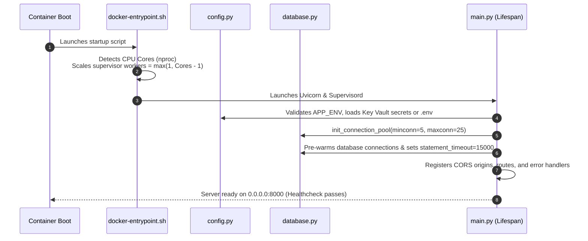
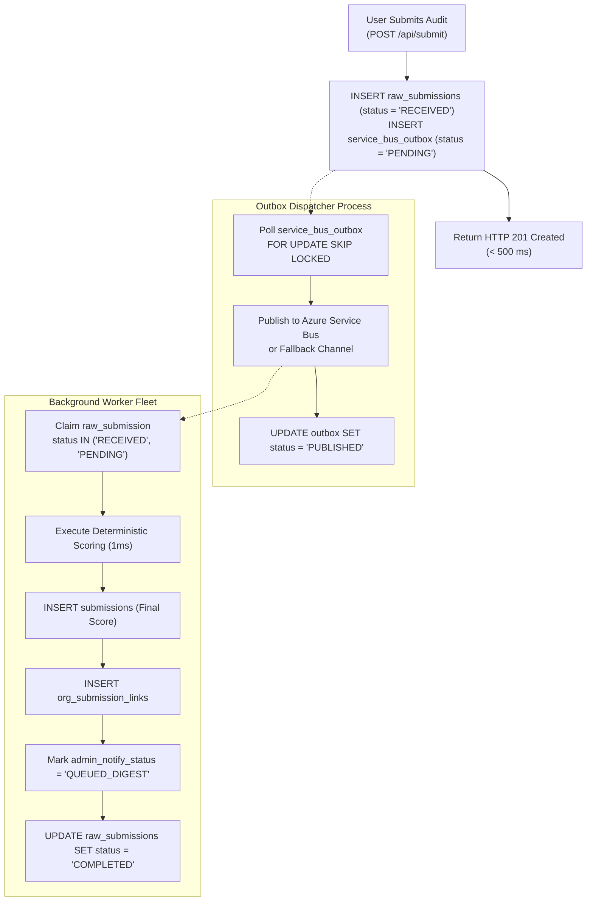

# Backend Technical Reference & API Specification

> **In plain words:**  
> This document explains the engine room of NIWI: the server code that receives survey answers, calculates mathematical inclusion scores, manages database connections, sends emails, and protects administrative dashboards from unauthorized access. Using the restaurant analogy: if the frontend is the dining room and waitstaff, the backend is the kitchen, pantry, and head chef preparing every dish safely and consistently.
>
> **Last updated:** November 5, 2026  
> **Document Status:** Active Canonical Specification  
> **Source Directory:** `app/`  
> **Primary Technology:** FastAPI (Python 3.11 / 3.13) + Uvicorn ASGI  

---

## Table of Contents
1. [In Plain Words: The Kitchen and Stockroom Analogy](#in-plain-words-the-kitchen-and-stockroom-analogy)
2. [Technology Stack & Architectural Rationale](#technology-stack--architectural-rationale)
3. [Folder Structure](#folder-structure)
4. [Application Startup Lifecycle](#application-startup-lifecycle)
5. [Complete API Reference (All Endpoints)](#complete-api-reference-all-endpoints)
6. [Core Business Services & Scoring Pipeline](#core-business-services--scoring-pipeline)
7. [Authentication, Authorization & Two-Role Security](#authentication-authorization--two-role-security)
8. [Validation, Error Handling & Logging](#validation-error-handling--logging)
9. [Background Processing, Queues & Outbox Dispatcher](#background-processing-queues--outbox-dispatcher)
10. [Configuration & Environment Reference](#configuration--environment-reference)
11. [Build, Run and Test Instructions](#build-run-and-test-instructions)
12. [Performance, Security & Reliability Safeguards](#performance-security--reliability-safeguards)
13. [Known Limitations & Technical Debt](#known-limitations--technical-debt)
14. [Why It Exists](#why-it-exists)

---

## 1. In Plain Words: The Kitchen and Stockroom Analogy

Imagine a busy restaurant kitchen. When a customer orders dinner, the waiter brings the ticket into the kitchen. The kitchen staff doesn't guess how to cook the dish; they follow a standardized recipe so every plate tastes identical. One chef chops ingredients, another monitors the oven, and the dishwasher ensures clean pans are always ready. If the kitchen suddenly gets 100 tickets at once, a ticket rack (the queue) holds the orders in order so nothing burns or gets lost.

In NIWI, the **backend** is that kitchen:
- It receives survey answers from the frontend waiter.
- It applies strict mathematical formulas (the scoring recipe) to calculate dimension scores in less than a millisecond.
- It files the finished audit securely into the database filing cabinet.
- It schedules email notifications and background jobs without making the customer wait at the table.

*Why it exists:* You cannot trust a web browser to calculate legal compliance scores or hold secret database passwords. The backend acts as the secure, infallible authority that verifies every piece of data.

---

## 2. Technology Stack & Architectural Rationale

| Tool / Dependency | Exact Version | Why It Was Chosen |
|---|---|---|
| **Python** | `3.11` / `3.13` | Modern Python offers native async/await syntax, strong typing via type annotations, and rock-solid cryptographic libraries. |
| **FastAPI** | `0.115.5` | High-performance asynchronous web framework providing automatic OpenAPI documentation, dependency injection, and sub-millisecond route handling. |
| **Uvicorn** | `0.32.1` | Lightning-fast ASGI web server executing asynchronous Python request loops. |
| **Pydantic** | `v2` | Fast C-based data validation and request serialization ensuring invalid payloads fail before touching business logic. |
| **Psycopg2-binary** | `2.9.10` | Robust PostgreSQL driver with native support for `ThreadedConnectionPool`, transactional context managers, and advisory locks. |
| **SlowAPI** | `0.1.9` | Token-bucket sliding window rate limiter protecting endpoints against brute-force attacks and survey spam. |
| **Azure SDKs** | `azure-identity`, `azure-communication-email`, `azure-servicebus` | Official Microsoft cloud SDKs connecting the app securely to Key Vault, ACS email, and Service Bus via Managed Identities. |

---

## 3. Folder Structure

```
app/
├── main.py                      # FastAPI app factory, lifespan handlers, CORS & global middleware
│
├── api/                         # HTTP Transport Layer (Route Controllers)
│   ├── public.py                # Public endpoints (health, email validation, org lookup)
│   ├── routes.py                # Primary router: submit, list, filter, reassign, Super Admin metrics
│   ├── orgs.py                  # Enterprise organization management, invitations & segment stats
│   ├── org.py                   # Client tenant portal endpoints (magic-link verification)
│   ├── drafts.py                # Assessment draft saving and magic resume endpoints
│   ├── form_builder.py          # Dynamic question ordering and section metadata endpoints
│   └── settings.py              # Application configuration, rate limits & Super Admin data wipe
│
├── core/                        # Core Systems & Infrastructure
│   ├── config.py                # Strict environment variable parsing, validation & password policies
│   ├── database.py              # PostgreSQL ThreadedConnectionPool manager & transaction context
│   ├── security.py              # Microsoft Entra ID JWKS verification & local dev bypass
│   ├── authorization.py         # Two-Role RBAC guards (require_admin, require_super_admin)
│   ├── keyvault.py              # Azure Key Vault fail-safe client with Managed Identity support
│   └── service_bus.py           # Azure Service Bus sender client
│
├── models/                      # Pydantic Schemas & DTO Contracts
│   └── audit.py                 # Data models for submissions, responses, filters, and reports
│
├── services/                    # Pure Domain Business Logic
│   ├── scoring_service.py       # Deterministic 8-pillar scoring formulas and maturity level brackets
│   ├── org_scoring_service.py   # Multi-respondent weighted score aggregation and variance calculations
│   ├── dashboard_service.py     # Super Admin Operations Command telemetry aggregator & cache
│   ├── outbox_service.py        # Transactional outbox dispatcher, VACUUM maintenance & health alerts
│   ├── filter_service.py        # SQL AST compiler converting JSON filter trees into safe SQL WHERE clauses
│   ├── settings_service.py      # System settings, rate limit rules, and 5-minute batched email digest
│   ├── crm_service.py           # Optional HubSpot CRM contact synchronization
│   ├── token_service.py         # Magic-link token generation and SHA-256 hash verification
│   ├── user_service.py          # Admin account provisioning and Super Admin safeguard checks
│   ├── org_cache_service.py     # In-memory thread-safe organization lookup registry
│   ├── rate_limit_service.py    # Dynamic runtime rate limit rule persistence
│   └── ai_service.py            # Future AI commentary placeholder (stub)
│
└── tasks/                       # Background Asynchronous Workers
    ├── service_bus_worker.py    # Background worker fleet scoring raw submissions from outbox/queue
    ├── job_worker.py            # Legacy asynchronous job fallback processor
    └── worker_tracker.py        # Process heartbeat coordinator tracking live worker pids
```

---

## 4. Application Startup Lifecycle

When the backend container boots (`app/main.py`), the following sequence executes:



1. **Adaptive Sizing:** `docker-entrypoint.sh` inspects the machine's CPU cores and updates `supervisord.conf` so worker processes scale dynamically while leaving CPU headroom for the web server and database.
2. **Secret Resolution:** `app/core/config.py` connects to Azure Key Vault (if in production) or reads local `.env` variables.
3. **Database Pre-Warming:** `app/core/database.py` initializes a `ThreadedConnectionPool` and executes lightweight ping queries so the first user does not suffer a cold SSL handshake penalty.

---

## 5. Complete API Reference (All Endpoints)

Every single endpoint implemented in the codebase is cataloged below:

### Summary Routing Table
| Method | Path | Authentication | Handler Function | File Location |
|---|---|---|---|---|
| `GET` | `/` | Public | `serve_root` | `app/api/public.py` |
| `GET` | `/audit` | Public | `serve_audit` | `app/api/public.py` |
| `GET` | `/api/health` | Public | `health` | `app/api/public.py` |
| `GET` | `/api/health/pool-metrics` | Public | `health_pool_metrics` | `app/api/public.py` |
| `GET` | `/api/health/cache-metrics`| Public | `health_cache_metrics` | `app/api/public.py` |
| `POST`| `/api/submit` | Public (Rate Limited)| `submit` | `app/api/routes.py` |
| `POST`| `/api/drafts/save` | Public | `save_draft` | `app/api/drafts.py` |
| `GET` | `/api/drafts/resume` | Public (Token Verified)| `resume_draft` | `app/api/drafts.py` |
| `POST`| `/api/book-call` | Public | `book_call` | `app/api/public.py` |
| `POST`| `/api/support` | Public | `support_request` | `app/api/routes.py` |
| `GET` | `/api/auth/config` | Public | `auth_config` | `app/api/routes.py` |
| `POST`| `/api/auth/verify` | Public | `auth_verify` | `app/api/routes.py` |
| `POST`| `/api/public/email/validate` | Public | `validate_corporate_email` | `app/api/public.py` |
| `POST`| `/api/public/invitations/validate` | Public | `validate_invitation` | `app/api/public.py` |
| `POST`| `/api/public/organisations/validate` | Public | `validate_organisation_by_name` | `app/api/public.py` |
| `POST`| `/api/public/assessment/resolve-link` | Public | `resolve_assessment_link_endpoint` | `app/api/public.py` |
| `POST`| `/api/public/assessment/resolve-legacy-org`| Public | `resolve_legacy_org` | `app/api/public.py` |
| `GET` | `/api/form/sections` | Public | `get_all_sections` | `app/api/form_builder.py` |
| `POST`| `/api/form/sections` | Admin | `create_section` | `app/api/form_builder.py` |
| `PUT` | `/api/form/sections/{id}` | Admin | `update_section` | `app/api/form_builder.py` |
| `DELETE`| `/api/form/sections/{id}` | Admin | `delete_section` | `app/api/form_builder.py` |
| `POST`| `/api/form/sections/{id}/questions` | Admin | `create_question` | `app/api/form_builder.py` |
| `PUT` | `/api/form/questions/{id}` | Admin | `update_question` | `app/api/form_builder.py` |
| `DELETE`| `/api/form/questions/{id}` | Admin | `delete_question` | `app/api/form_builder.py` |
| `GET` | `/api/submissions` | Admin | `get_submissions` | `app/api/routes.py` |
| `POST`| `/api/submissions/filter` | Admin | `filter_submissions` | `app/api/routes.py` |
| `GET` | `/api/submissions/saved-filters` | Admin | `list_saved_filters` | `app/api/routes.py` |
| `POST`| `/api/submissions/saved-filters` | Admin | `create_saved_filter` | `app/api/routes.py` |
| `DELETE`| `/api/submissions/saved-filters/{id}` | Admin | `delete_saved_filter` | `app/api/routes.py` |
| `GET` | `/api/submissions/{id}` | Admin | `get_submission` | `app/api/routes.py` |
| `GET` | `/api/submissions/{id}/status` | Admin | `get_submission_status` | `app/api/routes.py` |
| `PATCH`| `/api/submissions/{id}/respondent` | Admin | `update_respondent` | `app/api/routes.py` |
| `PATCH`| `/api/submissions/{id}/scores` | Admin | `update_submission_scores` | `app/api/routes.py` |
| `PATCH`| `/api/submissions/{id}/organisation` | Admin | `reassign_submission_organisation` | `app/api/routes.py` |
| `PUT` | `/api/submissions/{id}/email` | Admin | `update_email` | `app/api/routes.py` |
| `POST`| `/api/submissions/{id}/send` | Admin | `send_email_route` | `app/api/routes.py` |
| `POST`| `/api/submissions/{id}/regenerate-email`| Admin | `regenerate_email` | `app/api/routes.py` |
| `GET` | `/api/manage/orgs` | Admin | `list_orgs` | `app/api/orgs.py` |
| `POST`| `/api/manage/orgs` | Admin | `create_org` | `app/api/orgs.py` |
| `GET` | `/api/manage/orgs/unlinked` | Admin | `list_unlinked` | `app/api/orgs.py` |
| `GET` | `/api/manage/orgs/{id}` | Admin | `get_org` | `app/api/orgs.py` |
| `PUT` | `/api/manage/orgs/{id}` | Admin | `update_org` | `app/api/orgs.py` |
| `DELETE`| `/api/manage/orgs/{id}` | Admin | `delete_org` | `app/api/orgs.py` |
| `POST`| `/api/manage/orgs/{id}/restore` | Admin | `restore_org` | `app/api/orgs.py` |
| `PATCH`| `/api/manage/orgs/{id}/status` | Admin | `toggle_org_status` | `app/api/orgs.py` |
| `GET` | `/api/manage/orgs/{id}/report-preview` | Admin | `org_report_preview` | `app/api/orgs.py` |
| `POST`| `/api/manage/orgs/{id}/message` | Admin | `send_org_message` | `app/api/orgs.py` |
| `POST`| `/api/manage/orgs/{id}/link` | Admin | `link_submission` | `app/api/orgs.py` |
| `PUT` | `/api/manage/orgs/{id}/links/{sub_id}` | Admin | `update_link_weight` | `app/api/orgs.py` |
| `GET` | `/api/manage/orgs/{id}/invitations` | Admin | `list_invitations` | `app/api/orgs.py` |
| `POST`| `/api/manage/orgs/{id}/invitations` | Admin | `create_invitation` | `app/api/orgs.py` |
| `PATCH`| `/api/manage/orgs/invitations/{id}` | Admin | `update_invitation` | `app/api/orgs.py` |
| `POST`| `/api/manage/orgs/invitations/{id}/revoke` | Admin | `revoke_invitation` | `app/api/orgs.py` |
| `POST`| `/api/manage/orgs/invitations/{id}/regenerate` | Admin | `regenerate_invitation` | `app/api/orgs.py` |
| `GET` | `/api/manage/orgs/{id}/assessment-links` | Admin | `list_org_assessment_links` | `app/api/orgs.py` |
| `POST`| `/api/manage/orgs/{id}/assessment-links` | Admin | `create_org_assessment_link` | `app/api/orgs.py` |
| `POST`| `/api/manage/orgs/{id}/assessment-links/default` | Admin | `get_or_create_org_default_link` | `app/api/orgs.py` |
| `DELETE`| `/api/manage/orgs/{id}/assessment-links/{tid}` | Admin | `revoke_org_assessment_link` | `app/api/orgs.py` |
| `GET` | `/api/admin/dashboard` | Super Admin | `get_super_admin_dashboard_endpoint` | `app/api/routes.py` |
| `GET` | `/api/admin/submissions/dead-lettered`| Super Admin | `get_dead_lettered_submissions` | `app/api/routes.py` |
| `POST`| `/api/admin/submissions/{id}/replay` | Super Admin | `replay_submission` | `app/api/routes.py` |
| `POST`| `/api/admin/submissions/dead-lettered/replay-all` | Super Admin | `replay_all_dead_lettered_submissions`| `app/api/routes.py` |
| `GET` | `/api/manage/users` | Super Admin | `admin_users_list` | `app/api/routes.py` |
| `POST`| `/api/manage/users` | Super Admin | `admin_user_add` | `app/api/routes.py` |
| `DELETE`| `/api/manage/users/{email}` | Super Admin | `admin_user_remove` | `app/api/routes.py` |
| `GET` | `/api/manage/audit-logs` | Super Admin | `get_audit_logs` | `app/api/routes.py` |
| `GET` | `/api/settings` | Admin | `get_settings_route` | `app/api/settings.py` |
| `PUT` | `/api/settings` | Admin | `save_settings_route` | `app/api/settings.py` |
| `POST`| `/api/settings/notifications/toggle` | Admin | `toggle_notifications` | `app/api/settings.py` |
| `GET` | `/api/settings/rate-limits` | Admin | `get_rate_limits_route` | `app/api/settings.py` |
| `PUT` | `/api/settings/rate-limits` | Admin | `update_rate_limits_route` | `app/api/settings.py` |
| `POST`| `/api/settings/rate-limits/reset` | Admin | `reset_rate_limits_route` | `app/api/settings.py` |
| `POST`| `/api/settings/delete-all-records` | Super Admin | `delete_all_records` | `app/api/settings.py` |
| `POST`| `/api/org/register` | Public | `register_or_login_org` | `app/api/org.py` |
| `GET` | `/api/org/verify` | Public (Token Verified)| `verify_magic_link` | `app/api/org.py` |
| `GET` | `/api/org/dashboard` | Org Auth | `get_org_dashboard` | `app/api/org.py` |

---

### Detailed Endpoint Specifications (Key Highlights)

#### 1. Ingestion: `POST /api/submit`
- **Purpose:** Receives completed audit survey answers, deduplicates via idempotency key, records in `raw_submissions` and `service_bus_outbox`, and acknowledges receipt in < 500ms.
- **Auth:** Public.
- **Request Body (JSON):**
  ```json
  {
    "name": "Jane Doe",
    "email": "jane@example.com",
    "company_name": "Acme Corp",
    "designation": "Software Engineer",
    "has_physical_workspace": true,
    "has_suppliers": true,
    "consent_given": true,
    "idempotency_key": "c2d3822c-6f3d-47c1-9cb6-326754c1b580",
    "q5": 4, "q6": 5, "...": 4, "q44": 5
  }
  ```
- **Success Response (`HTTP 201 Created`):**
  ```json
  {
    "submission_id": "c2d3822c-6f3d-47c1-9cb6-326754c1b580",
    "status": "RECEIVED",
    "message": "Submission received and queued for scoring."
  }
  ```
- **Errors:** `400 Bad Request` (missing required questions), `429 Too Many Requests` (exceeded rate limits).

#### 2. Operations Command: `GET /api/admin/dashboard`
- **Purpose:** Delivers real-time queue depth, pending counts, active worker heartbeats, and average compute latency over the last 24 hours.
- **Auth:** Requires Super Admin (`require_super_admin`).
- **Success Response (`HTTP 200 OK`):**
  ```json
  {
    "request_overview": {
      "total_requests": 640,
      "pending": 0,
      "in_progress": 0,
      "completed": 640,
      "failed": 0
    },
    "analytics": {
      "success_rate": 100.0,
      "average_processing_time_formatted": "22.38s"
    }
  }
  ```

#### 3. Reprocess DLQ: `POST /api/admin/submissions/dead-lettered/replay-all`
- **Purpose:** Scans all failed or dead-lettered raw submissions, resets their status to `PENDING`, and publishes re-execution events to the worker queue.
- **Auth:** Requires Super Admin.
- **Success Response (`HTTP 200 OK`):**
  ```json
  {
    "success": true,
    "replayed_count": 5,
    "message": "Queued 5 dead-lettered submissions for processing."
  }
  ```

---

## 6. Core Business Services & Scoring Pipeline

### Pure Deterministic Scoring (`app/services/scoring_service.py`)
Scoring calculates individual pillar scores on a 0–20 scale:
$$\text{Pillar Score} = \frac{\sum \text{Questions in Pillar}}{\text{Max Possible Score}} \times 20$$

1. **Gating Handling:** If a respondent marks `has_physical_workspace = False`, the Workplace Environment (WE) pillar questions are omitted, and their overall index is averaged strictly across their applicable pillars.
2. **Execution Latency:** The scoring function (`calculate_scores_pure`) runs synchronously in pure in-memory Python with **zero database calls** inside the scoring loop, completing in 0.10ms to 1.2ms.

---

## 7. Authentication, Authorization & Two-Role Security

The platform enforces a strict two-role administrative hierarchy:

```
+-------------------------------------------------------------+
|                     SYSTEM ROLES & RBAC                     |
+-------------------------------------------------------------+
|                                                             |
|   [Normal Admin] (nd_role = "admin")                        |
|   - View, create, and edit organizations                    |
|   - View all submissions globally                           |
|   - Reassign submissions between organizations              |
|   - View analytics and trigger report emails                |
|                                                             |
|   [Super Admin] (nd_role = "super")                         |
|   + All Normal Admin capabilities                           |
|   + Platform Operations Command (/admin/super-dashboard)    |
|   + 1-click DLQ Inspection & Replay-All                     |
|   + Provision, demote, and remove admin accounts            |
|   + Execute "Delete All Submissions" with text verification |
|                                                             |
+-------------------------------------------------------------+
```

- **Entra ID Verification (`app/core/security.py`):** Administrative bearer tokens are verified cryptographically against Microsoft's live OIDC JWKS keys endpoint (`https://login.microsoftonline.com/{tenant_id}/discovery/v2.0/keys`). Keys are cached using a 24-hour `TTLCache` to prevent outbound latency spikes.
- **Local Dev Bypass:** In non-production environments with `ENABLE_DEV_BYPASS=true`, a local mock header grants instant development access. In production, this flag is strictly prohibited and ignored.

---

## 8. Validation, Error Handling & Logging

1. **Pydantic Validation:** Every endpoint defines explicit request schemas in `app/models/audit.py`. Malformed JSON or type mismatches return immediate `HTTP 422 Unprocessable Entity` with exact field error locations.
2. **Safe Logging:** Structured logging uses standard Python `logging.getLogger(__name__)`. PII (passwords, JWT secrets, full credit numbers) is never logged.
3. **Database Statement Timeouts:** Every database checkout enforces `statement_timeout = 15000` (15 seconds). A stuck query is automatically terminated by PostgreSQL before it can lock a database pool worker.

---

## 9. Background Processing, Queues & Outbox Dispatcher

To guarantee sub-second HTTP responses, heavy side effects are decoupled from the web request:



1. **Transactional Outbox (`app/services/outbox_service.py`):** Prevents lost events. The survey payload and the outbox event are saved in the same PostgreSQL transaction.
2. **5-Minute Email Digest:** Rather than sending an email for every single submission, `settings_service.send_admin_submission_digest()` runs every 300 seconds, grouping all audits by organization into a single summary email.
3. **Automated VACUUM Maintenance:** The outbox service runs non-blocking `VACUUM (ANALYZE)` every 24 hours to prevent table bloat.

---

## 10. Configuration & Environment Reference

All settings read by `app/core/config.py` are fully documented in [API Keys and Integrations](API_KEYS_AND_INTEGRATIONS.md).

---

## 11. Build, Run and Test Instructions

```bash
# 1. Install dependencies
pip install -r requirements.txt

# 2. Run backend development server
uvicorn app.main:app --reload --host 127.0.0.1 --port 8000

# 3. Run automated tests
pytest tests/test_super_admin_dashboard.py
pytest tests/

# 4. Run database migrations
python scripts/migrate.py
```

---

## 12. Performance, Security & Reliability Safeguards

- **PostgreSQL Advisory Locks:** During new organization registration, an advisory transaction lock (`pg_advisory_xact_lock(hashtext(name))`) guarantees that 100 concurrent requests for the same company name produce exactly 1 organization record without race conditions.
- **Pool Leak Diagnostics:** `WorkerPoolMetrics` tracks checkout lifecycle, hold duration, and automatically logs warnings if any process holds a connection longer than 1,000ms.
- **Dead-Letter Queue Resilience:** Failed jobs retry up to 5 times with exponential backoff before being safely quarantined in the DLQ.

---

## 13. Known Limitations & Technical Debt

1. **AI Service Stub:** `app/services/ai_service.py` is currently an unpopulated stub.
2. **Synchronous Report PDF Delivery:** Generating very large organization-level batch PDF exports can take 2–4 seconds on the backend.

---

## 14. Why It Exists

The backend is the engine of integrity for the entire platform. By combining mathematical scoring, asynchronous outbox queues, and hardware-adaptive worker pooling, it ensures that organizations receive dependable, repeatable metrics while maintaining enterprise reliability under heavy survey loads.

