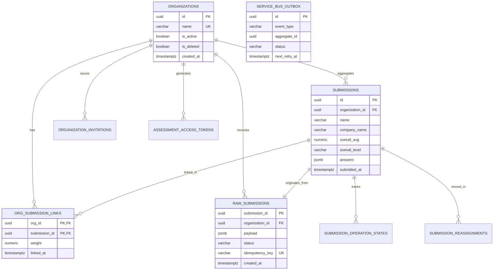
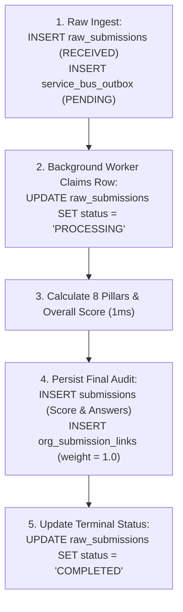

# Database Architecture & Schema Specification

> **In plain words:**  
> This document explains how and where all NIWI data is stored. Using the filing cabinet analogy: the database is a fireproof filing cabinet in the back office. Each drawer is a table (one drawer for Companies, one for Survey Submissions, one for Login Accounts). Inside each drawer are folders (records) with standardized labeled tabs so records can be found in milliseconds.
>
> **Last updated:** November 5, 2026  
> **Document Status:** Active Canonical Specification  
> **Database Engine:** PostgreSQL 14+ / Azure Database for PostgreSQL Flexible Server  
> **Database Name:** `nd_audit`  

---

## Table of Contents
1. [In Plain Words: The Filing Cabinet Analogy](#in-plain-words-the-filing-cabinet-analogy)
2. [Database Engine & Architectural Rationale](#database-engine--architectural-rationale)
3. [Connection Pooling & Sizing Configuration](#connection-pooling--sizing-configuration)
4. [Entity Overview (All Tables)](#entity-overview-all-tables)
5. [Complete Schema Reference](#complete-schema-reference)
6. [Entity-Relationship Diagram](#entity-relationship-diagram)
7. [Indexes & Query Performance Optimization](#indexes--query-performance-optimization)
8. [Data Lifecycle & Transactional Flow](#data-lifecycle--transactional-flow)
9. [Migrations, Seeding & Schema Evolution](#migrations-seeding--schema-evolution)
10. [Sample Queries for Common Tasks](#sample-queries-for-common-tasks)
11. [Data Privacy, Anonymity & Backup Safeguards](#data-privacy-anonymity--backup-safeguards)
12. [Known Limitations & Suggested Improvements](#known-limitations--suggested-improvements)

---

## 1. In Plain Words: The Filing Cabinet Analogy

If you run a hospital, you cannot leave patient medical files scattered across desks or stored in temporary browser memory. You need a dedicated, fireproof filing cabinet with strong locks. Every time a patient checks in, a nurse creates a standardized folder with their name, vital signs, and doctor's notes. When a doctor needs to see blood test results from six months ago, they open the specific drawer, find the patient's ID card, and pull the exact sheet without opening every single file in the building.

In NIWI, **PostgreSQL** is that filing cabinet:
- The **`organizations`** drawer holds company profiles.
- The **`raw_submissions`** drawer holds survey answers as they arrive.
- The **`submissions`** drawer holds permanent calculated scores.
- The **`org_submission_links`** drawer connects employees to their employers.
- The **`audit_logs`** drawer tracks who changed what and when.

*Why it exists:* Without a structured relational database, survey scores would vanish when the server restarts, and there would be no safe way to calculate team averages across hundreds of employees.

---

## 2. Database Engine & Architectural Rationale

| Feature | Specification | Why It Was Chosen |
|---|---|---|
| **Engine** | **PostgreSQL 14+** (v17.11 on Azure Flexible Server) | Enterprise-grade reliability, ACID compliance, robust JSONB querying for dynamic answers, and native advisory locking. |
| **Character Set** | **UTF-8** | Supports international company names, diverse languages, and emoji characters without corruption. |
| **Timezone** | **UTC** (`timezone.utc`) | Eliminates ambiguity across global offices; all database timestamps are stored in universal UTC. |
| **Isolation Level** | **READ COMMITTED** | Standard relational isolation preventing dirty reads while enabling high-throughput concurrent inserts. |
| **Concurrency Locks**| **PostgreSQL Advisory Locks** (`pg_advisory_xact_lock`) | Prevents duplicate organization creation during simultaneous survey submissions without locking whole tables. |

---

## 3. Connection Pooling & Sizing Configuration

Rather than opening a brand new TCP connection and executing a heavy SSL handshake every time a web page loads, the backend maintains a **pre-warmed pool of reusable database connections**:

```ini
# Production Connection Parameters (Configured in Key Vault / .env)
Host: YOUR_SERVER.postgres.database.azure.com
Port: 5432
Database: nd_audit
SSL Mode: require (TLS 1.2+ enforced)
Connection Pool: psycopg2.pool.ThreadedConnectionPool
Min Connections: 5
Max Connections: 25
Statement Timeout: 15000ms (15 seconds)
```

- **Connection Reuse:** Once a query completes, the connection is instantly returned to the pool for the next request.
- **Statement Timeout:** Every query is capped at 15 seconds (`-c statement_timeout=15000`). If a query gets stuck, PostgreSQL kills it automatically, protecting the pool from lockups.
- **Worker Process Isolation:** Standalone worker processes (`service_bus_worker.py`) initialize their own dedicated pool (`minconn=2, maxconn=6`) so background scoring never starves public web requests.

---

## 4. Entity Overview (All Tables)

| Table Name | Plain Words Purpose | Primary Key |
|---|---|---|
| **`organizations`** | Official company accounts registered on the platform. | `id` (UUID) |
| **`raw_submissions`** | Immediate ingestion staging area for raw survey responses. | `submission_id` (UUID) |
| **`submissions`** | Permanent historical audit records with calculated pillar scores. | `id` (UUID) |
| **`org_submission_links`** | Connects individual employee submissions to organizations with scoring weights. | Composite (`org_id`, `submission_id`) |
| **`organization_invitations`** | Trackable survey invitation links with quotas and expiry dates. | `id` (UUID) |
| **`assessment_access_tokens`** | Secure hashed tokens granting access to specific organization audits. | `id` (UUID) |
| **`service_bus_outbox`** | Transactional outbox staging background scoring and email tasks. | `id` (UUID) |
| **`submission_operation_states`**| Granular idempotency state tracking for each background task stage. | `id` (UUID) |
| **`dashboard_snapshot`** | 2-minute cached summary of Super Admin queue metrics. | `id` (INT) |
| **`workers`** | Heartbeat registry tracking live background worker processes. | `id` (VARCHAR) |
| **`admin_users`** | Administrative user accounts and role definitions (`admin` / `super`). | `id` (UUID) |
| **`admin_sessions`** | Active administrator session tokens and expiry tracking. | `id` (UUID) |
| **`audit_logs`** | Immutable compliance trail recording all administrative updates. | `id` (UUID) |
| **`draft_submissions`** | Unfinished assessments saved by users for later completion. | `id` (UUID) |
| **`saved_filters`** | Saved ServiceNow-style query filters in the Submissions dashboard. | `id` (UUID) |
| **`form_sections`** | Dynamic questionnaire section configuration and ordering. | `id` (UUID) |
| **`form_questions`** | Individual questions, options, and gating dependencies. | `id` (UUID) |
| **`submission_reassignments`** | Audit trail recording when an audit is moved between organizations. | `id` (UUID) |
| **`system_security_settings`** | Runtime configurable rate limits and security thresholds. | `id` (INT) |
| **`app_settings`** | Global application toggles (ACS configuration, notifications). | `id` (INT) |

---

## 5. Complete Schema Reference

### 1. `organizations`
Stores companies registered on the platform.
```sql
CREATE TABLE organizations (
    id UUID PRIMARY KEY DEFAULT gen_random_uuid(),
    name VARCHAR(255) NOT NULL UNIQUE,
    is_active BOOLEAN NOT NULL DEFAULT TRUE,
    is_deleted BOOLEAN NOT NULL DEFAULT FALSE,
    approval_status VARCHAR(50) NOT NULL DEFAULT 'approved',
    created_at TIMESTAMPTZ NOT NULL DEFAULT NOW(),
    updated_at TIMESTAMPTZ NOT NULL DEFAULT NOW(),
    updated_by VARCHAR(255),
    deleted_at TIMESTAMPTZ,
    deleted_by VARCHAR(255)
);
```

### 2. `raw_submissions`
High-speed ingestion queue buffer capturing submitted surveys.
```sql
CREATE TABLE raw_submissions (
    submission_id UUID PRIMARY KEY,
    organization_id UUID REFERENCES organizations(id),
    user_id VARCHAR(255),
    payload JSONB NOT NULL,
    retry_count INT NOT NULL DEFAULT 0,
    status VARCHAR(50) NOT NULL DEFAULT 'RECEIVED',  -- 'RECEIVED', 'PENDING', 'PROCESSING', 'COMPLETED', 'DEAD_LETTERED'
    idempotency_key VARCHAR(255) UNIQUE,
    report_gen_status VARCHAR(50) DEFAULT 'PENDING',
    email_delivery_status VARCHAR(50) DEFAULT 'PENDING',
    crm_sync_status VARCHAR(50) DEFAULT 'PENDING',
    admin_notify_status VARCHAR(50) DEFAULT 'PENDING',
    worker_id VARCHAR(255),
    processing_started_at TIMESTAMPTZ,
    processing_completed_at TIMESTAMPTZ,
    error_message TEXT,
    created_at TIMESTAMPTZ NOT NULL DEFAULT NOW(),
    updated_at TIMESTAMPTZ NOT NULL DEFAULT NOW()
);
```

### 3. `submissions`
Permanent historical audit table holding finalized scores and answers.
```sql
CREATE TABLE submissions (
    id UUID PRIMARY KEY,
    raw_submission_id UUID REFERENCES raw_submissions(submission_id),
    name VARCHAR(255) NOT NULL,
    email VARCHAR(255),
    designation VARCHAR(255),
    company_name VARCHAR(255) NOT NULL,
    organization_id UUID REFERENCES organizations(id),
    has_physical_workspace BOOLEAN,
    has_suppliers BOOLEAN,
    consent_given BOOLEAN DEFAULT FALSE,
    consent_timestamp TIMESTAMPTZ,
    submission_source VARCHAR(50) DEFAULT 'DIRECT', -- 'DIRECT' or 'INVITATION'
    invitation_id UUID,
    access_token_id UUID,
    campaign_id VARCHAR(255),
    idempotency_key VARCHAR(255),
    -- Pillar Scores (0 - 20 Scale)
    lc_score NUMERIC(5,2), lc_level VARCHAR(50),
    ro_score NUMERIC(5,2), ro_level VARCHAR(50),
    we_score NUMERIC(5,2), we_level VARCHAR(50),
    be_score NUMERIC(5,2), be_level VARCHAR(50),
    tm_score NUMERIC(5,2), tm_level VARCHAR(50),
    ca_score NUMERIC(5,2), ca_level VARCHAR(50),
    pc_score NUMERIC(5,2), pc_level VARCHAR(50),
    sp_score NUMERIC(5,2), sp_level VARCHAR(50),
    overall_avg NUMERIC(5,2), overall_level VARCHAR(50),
    status VARCHAR(50) DEFAULT 'completed',
    dimension_scores JSONB,
    answers JSONB,
    submitted_at TIMESTAMPTZ NOT NULL DEFAULT NOW()
);
```

### 4. `org_submission_links`
Weighted association table connecting submissions to organizations.
```sql
CREATE TABLE org_submission_links (
    org_id UUID NOT NULL REFERENCES organizations(id) ON DELETE CASCADE,
    submission_id UUID NOT NULL REFERENCES submissions(id) ON DELETE CASCADE,
    weight NUMERIC(4,2) NOT NULL DEFAULT 1.0,
    linked_by VARCHAR(255),
    linked_at TIMESTAMPTZ NOT NULL DEFAULT NOW(),
    PRIMARY KEY (org_id, submission_id)
);
```

### 5. `service_bus_outbox`
Transactional outbox ensuring safe event dispatch.
```sql
CREATE TABLE service_bus_outbox (
    id UUID PRIMARY KEY DEFAULT gen_random_uuid(),
    event_type VARCHAR(100) NOT NULL,
    aggregate_id UUID NOT NULL,
    message_id VARCHAR(255) NOT NULL,
    payload JSONB NOT NULL,
    status VARCHAR(50) NOT NULL DEFAULT 'PENDING', -- 'PENDING', 'PUBLISHED', 'FAILED'
    attempt_count INT NOT NULL DEFAULT 0,
    max_attempts INT NOT NULL DEFAULT 5,
    next_retry_at TIMESTAMPTZ NOT NULL DEFAULT NOW(),
    published_at TIMESTAMPTZ,
    locked_until TIMESTAMPTZ,
    locked_by VARCHAR(255),
    last_error TEXT,
    created_at TIMESTAMPTZ NOT NULL DEFAULT NOW()
);
```

---

## 6. Entity-Relationship Diagram



---

## 7. Indexes & Query Performance Optimization

All high-traffic search columns are protected with tailored B-tree and partial indexes (`migrations/022_performance_indexes.sql`):

```sql
-- 1. Fast Active Submissions Scanning
CREATE INDEX IF NOT EXISTS idx_raw_submissions_active 
ON raw_submissions (status, created_at ASC)
WHERE status IN ('RECEIVED', 'PENDING', 'PROCESSING');

-- 2. Outbox Dispatcher Optimization
CREATE INDEX IF NOT EXISTS idx_outbox_active_dispatch 
ON service_bus_outbox (status, next_retry_at ASC)
WHERE status IN ('PENDING', 'FAILED');

-- 3. Composite Submissions Sorting
CREATE INDEX IF NOT EXISTS idx_submissions_submitted_desc 
ON submissions (submitted_at DESC NULLS LAST, id DESC);

-- 4. 5-Minute Digest Fast Lookup
CREATE INDEX IF NOT EXISTS idx_raw_admin_notify_digest 
ON raw_submissions (organization_id, created_at)
WHERE admin_notify_status = 'QUEUED_DIGEST';
```

*Why it exists:* Without partial indexes, scanning 10,000 historical submissions to find 2 pending submissions requires reading the entire table from disk. Partial indexes keep the lookup index small enough to fit directly in high-speed RAM.

---

## 8. Data Lifecycle & Transactional Flow



- **Soft Delete:** Deleting an organization sets `is_deleted = TRUE` and disables its active invitations. Historical audit submissions and scores are **never deleted**, preserving demographic integrity.
- **Hard Delete Safeguard:** Deleting all submission data is strictly restricted to Super Admins and requires entering the explicit confirmation text `DELETE ALL SUBMISSIONS` in `POST /api/settings/delete-all-records`.

---

## 9. Migrations, Seeding & Schema Evolution

Database schema evolution is managed via sequentially numbered SQL migration files in `migrations/`:

```bash
# Execute all pending migrations in order
python scripts/migrate.py
```

### Migration Engine Guarantees:
- Tracks executed migrations in the `schema_migrations` table.
- Wraps each migration in an atomic transaction (`BEGIN ... COMMIT`). If a migration statement fails, the database rolls back to its exact previous state.

---

## 10. Sample Queries for Common Tasks

### 1. Compute Live Multi-Respondent Org Score
```sql
SELECT 
    o.name,
    COUNT(s.id) AS respondent_count,
    ROUND(SUM(s.overall_avg * osl.weight) / SUM(osl.weight), 2) AS weighted_org_avg
FROM organizations o
JOIN org_submission_links osl ON osl.org_id = o.id
JOIN submissions s ON s.id = osl.submission_id
WHERE o.id = 'YOUR_ORG_UUID'
GROUP BY o.name;
```

### 2. Identify Pending Submission Backlog
```sql
SELECT submission_id, status, created_at, 
       NOW() - created_at AS wait_duration
FROM raw_submissions
WHERE status IN ('RECEIVED', 'PENDING')
ORDER BY created_at ASC;
```

---

## 11. Data Privacy, Anonymity & Backup Safeguards

- **Employee Confidentiality:** Individual employee survey answers are never shared publicly or linked to individual performance reviews.
- **Automated Backups:** Azure Database for PostgreSQL Flexible Server executes automated daily snapshot backups with 35-day point-in-time restore (PITR) capabilities.
- **Statement Timeouts:** Statement timeouts prevent Denial-of-Service attacks from runaway Cartesian queries.

---

## 12. Known Limitations & Suggested Improvements

1. **Large JSON Answers Column:** The `answers` JSONB column stores full question-and-answer pairs. List queries explicitly omit this column to minimize network bandwidth.
2. **Read Replica Architecture:** As survey volume scales past 50,000 submissions, read-only analytics queries should be routed to a read-replica database to eliminate read load on the primary transactional master.

