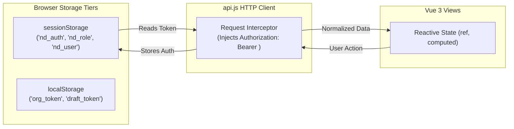
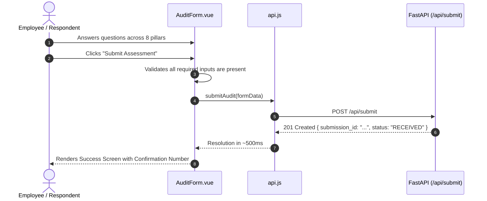

# Frontend Technical Architecture & UI Reference

> **In plain words:**  
> This document explains the part of NIWI that people see and interact with in their web browsers: the assessment forms, score dashboards, navigation menus, and admin charts. It uses the analogy of a high-street shop: the frontend is the glass display window and customer counter, while the backend is the kitchen and storeroom behind the swinging doors.
>
> **Last updated:** November 5, 2026  
> **Document Status:** Active Canonical Specification  
> **Source Directory:** `frontend/`  
> **Primary Technology:** Vue 3 (Composition API) + Vite 5  

---

## Table of Contents
1. [In Plain Words: The Shop-Window Analogy](#in-plain-words-the-shop-window-analogy)
2. [Technology Stack & Architectural Rationale](#technology-stack--architectural-rationale)
3. [Folder Structure](#folder-structure)
4. [Pages and Routes](#pages-and-routes)
5. [Core Reusable Components](#core-reusable-components)
6. [State Management & Data Flow](#state-management--data-flow)
7. [Talking to the Backend: API Gateway Pattern](#talking-to-the-backend-api-gateway-pattern)
8. [User Experience Workflows](#user-experience-workflows)
9. [Styling, Typography & Accessibility Standards](#styling-typography--accessibility-standards)
10. [Frontend Environment Variables](#frontend-environment-variables)
11. [Build, Run and Deploy Commands](#build-run-and-deploy-commands)
12. [Known Limitations & Future Improvements](#known-limitations--future-improvements)
13. [Why It Exists](#why-it-exists)

---

## 1. In Plain Words: The Shop-Window Analogy

If software were a high-street bakery, the **frontend** is everything the customer sees: the clean glass display cases, the chalk menu on the wall, the friendly order counter, and the cash register. When a customer points to a loaf of bread and places an order, the shop assistant takes the request and passes it through a service window to the bakers in the kitchen (the backend).

In NIWI, the frontend is the web application running right inside your browser (Google Chrome, Safari, Firefox, or Edge). It renders the 40 assessment questions, draws interactive radar charts, displays scoring breakdowns, and alerts users if they forgot to fill out a required question before sending their answers back to the server.

*Why it exists:* Without a clean, accessible frontend, users would have to send raw code and database queries by hand. The frontend turns complex organizational data into an intuitive, human-friendly experience.

---

## 2. Technology Stack & Architectural Rationale

| Layer / Tool | Exact Version in Code | Why It Was Chosen |
|---|---|---|
| **Framework** | **Vue 3** (`v3.4.21`, Composition API) | Vue's `<script setup>` syntax provides lightweight reactivity, instant reactivity updates, and superior performance compared to heavier enterprise frameworks. |
| **Build Tool** | **Vite 5** (`v5.1.4`) | Delivers sub-second Hot Module Replacement (HMR) during development and compiles production bundles via Rollup in under 15 seconds. |
| **Routing** | **Vue Router 4** (`v4.3.0`, History Mode) | Enables clean URLs (`/audit`, `/admin/submissions`) without hash bangs (`/#/`) and handles client-side authentication guards. |
| **Identity / SSO** | **@azure/msal-browser** (`v3.10.0`) | Official Microsoft Authentication Library connecting the administrative portal directly to Microsoft Entra ID (Azure AD). |
| **Data Visualizations** | **Chart.js** (`v4.4.2`) | High-performance HTML5 Canvas charting engine used to render 8-pillar spider/radar diagrams and submission volume timelines. |
| **Styling Engine** | **Custom Bespoke CSS & Modern Grid** | Zero external CSS framework bloat (no heavy Tailwind or Bootstrap runtime). Uses CSS custom properties (variables) for instant theme consistency and fluid responsiveness. |
| **PDF Generation** | **html2canvas** (`v1.4.1`) & **jspdf** (`v2.5.1`) | Renders executive scorecards in browser memory and exports pixel-perfect PDF documents for board meetings. |

---

## 3. Folder Structure

```
frontend/
├── index.html                   # HTML5 entry shell mounting #app
├── package.json                 # Locked dependencies and npm script commands
├── vite.config.js               # Vite build pipeline and local API proxy configuration
├── public/                      # Static uncompiled assets (favicon, logos, illustration graphics)
└── src/
    ├── main.js                  # Application entry point: initializes Vue, Router, and MSAL
    ├── api.js                   # Centralized Axios HTTP gateway & token interceptor
    ├── authConfig.js            # Microsoft Entra ID configuration & login request scopes
    ├── App.vue                  # Root layout component containing global header, nav & notifications
    │
    ├── router/
    │   └── index.js             # Client-side route declarations and navigation guards
    │
    ├── components/              # Reusable UI widgets
    │   ├── ScoreTable.vue       # 8-pillar transparent score and maturity table
    │   ├── SearchableSelect.vue # Typeahead searchable dropdown for company selection
    │   ├── AnimatedSelect.vue   # Smooth animated dropdown selector
    │   ├── ServiceNowFilterBuilder.vue # Multi-clause visual SQL query filter builder
    │   ├── RichEditor.vue       # WYSIWYG rich text editor for email templates
    │   └── SaveContinueButton.vue # Floating action button triggering draft save
    │
    ├── composables/             # Reusable Composition API state hooks
    │   └── useDraftSaving.js    # Logic for auto-saving drafts and handling resume links
    │
    └── views/                   # Full-page route views
        ├── AuditForm.vue        # 40-question public & invited audit assessment
        ├── ResumeDraft.vue      # Magic-link handler restoring saved drafts
        ├── BookCall.vue         # Executive consultation booking form
        ├── AdminLogin.vue       # Administrator login screen supporting Entra ID SSO & dev bypass
        ├── Overview.vue         # Primary admin dashboard showing submission aggregates
        ├── Submissions.vue      # Master submissions grid with real-time filtering & pagination
        ├── SubmissionDetail.vue # Single-submission deep-dive, score recalculation & email editor
        ├── Analytics.vue        # 8-pillar radar charts and demographic perception analysis
        ├── Organisations.vue    # Enterprise multi-respondent scoring, weighting & segments
        ├── SuperDashboard.vue   # Platform Operations Command (Queue telemetry & DLQ inspector)
        ├── FormBuilder.vue      # Dynamic question builder and section order manager
        ├── UserManagement.vue   # Admin account management and RBAC promotion/demotion
        ├── Settings.vue         # ACS configuration, rate limits & system toggles
        ├── Support.vue          # Public support ticketing and feedback form
        ├── OrgLogin.vue         # Client tenant login request (magic-link email trigger)
        ├── OrgVerify.vue        # Client tenant magic-link token verification
        └── OrgDashboard.vue     # Tenant-isolated organization reporting portal
```

---

## 4. Pages and Routes

The following routes are registered in `frontend/src/router/index.js`:

| Path | Component View | Plain Words Description | Access Guard | Primary Endpoints Called |
|---|---|---|---|---|
| `/` or `/audit` | `AuditForm.vue` | 40-question assessment with dynamic gating. | Public | `GET /api/form/sections`, `POST /api/submit`, `POST /api/drafts/save` |
| `/resume` | `ResumeDraft.vue` | Restores an in-progress draft from email magic link. | Public | `GET /api/drafts/resume` |
| `/book-a-call` | `BookCall.vue` | Consultation calendar request form. | Public | `POST /api/book-call` |
| `/portal` or `/GPadmin` | `AdminLogin.vue` | Microsoft Entra ID admin authentication portal. | Public | `GET /api/auth/config`, `POST /api/auth/verify` |
| `/admin/dashboard` | `Overview.vue` | Executive summary dashboard of submission volume. | Requires Admin | `GET /api/submissions`, `GET /api/manage/orgs` |
| `/admin/submissions` | `Submissions.vue` | Full searchable submissions table. | Requires Admin | `POST /api/submissions/filter`, `GET /api/submissions/saved-filters` |
| `/admin/submissions/:id`| `SubmissionDetail.vue`| Detailed view of an individual audit with score editor. | Requires Admin | `GET /api/submissions/{id}`, `PATCH /api/submissions/{id}/*` |
| `/admin/analytics` | `Analytics.vue` | Interactive 8-pillar spider charts and trends. | Requires Admin | `GET /api/submissions` |
| `/admin/organisations` | `Organisations.vue` | Enterprise accounts, weighted scores & segments. | Requires Admin | `GET /api/manage/orgs`, `GET /api/manage/orgs/{id}` |
| `/admin/super-dashboard`| `SuperDashboard.vue`| Real-time ingestion queue telemetry & DLQ replayer. | Requires Super Admin | `GET /api/admin/dashboard`, `POST /api/admin/submissions/*` |
| `/admin/form-builder` | `FormBuilder.vue` | Custom question creator and section reorderer. | Requires Admin | `GET /api/form/sections`, `POST /api/form/sections` |
| `/admin/users` | `UserManagement.vue` | Admin user provisioning and role assignment. | Requires Super Admin | `GET /api/manage/users`, `POST /api/manage/users` |
| `/admin/settings` | `Settings.vue` | Global email settings and rate limit sliders. | Requires Admin | `GET /api/settings`, `PUT /api/settings/rate-limits` |
| `/admin/support` | `Support.vue` | Administrator support ticketing view. | Requires Admin | `POST /api/support` |
| `/org/login` | `OrgLogin.vue` | Client tenant magic-link request screen. | Public | `POST /api/org/register` |
| `/org/verify` | `OrgVerify.vue` | Validates client magic token and stores auth. | Public | `GET /api/org/verify` |
| `/org/dashboard` | `OrgDashboard.vue` | Client tenant-isolated inclusion portal. | Requires Org Auth | `GET /api/org/dashboard` |

---

## 5. Core Reusable Components

### 1. `ScoreTable.vue`
- **What it does:** Renders a clean tabular scorecard showing all 8 pillars, respondent scores out of 20, percentage benchmarks, and colored maturity badges (Foundational, Early Progress, Developing, Proficient, Leading).
- **Props:** `scores` (Object containing pillar totals and averages), `showWeights` (Boolean).
- **Used in:** `SubmissionDetail.vue`, `Organisations.vue`.

### 2. `ServiceNowFilterBuilder.vue`
- **What it does:** A visual query builder allowing admins to construct complex, multi-condition queries (e.g., `Score > 15 AND Organization = 'Acme' OR Department = 'Engineering'`).
- **Emits:** `apply-filter` (delivers compiled query AST object to parent view).
- **Used in:** `Submissions.vue`.

### 3. `SearchableSelect.vue`
- **What it does:** An accessible, keyboard-navigable typeahead dropdown that queries existing organization names to prevent spelling discrepancies while allowing free-text creation.
- **Props:** `options` (Array of strings or objects), `modelValue` (v-model string).
- **Used in:** `AuditForm.vue`, `Organisations.vue`.

---

## 6. State Management & Data Flow



- **Administrative Authentication:** When an admin logs in via Entra ID, the resulting token is stored in `sessionStorage` (`nd_auth`). It automatically expires when the browser tab closes, eliminating persistent credential theft risks on shared computers.
- **Client Organization Member Authentication:** Magic-link tokens for client organization members are stored in `localStorage` (`org_token`).
- **Reactive State:** Components manage local state with Vue's `ref()` and `computed()`. Data is fetched upon route mounting via `onMounted()` hooks.
- **Hover Route Prefetching:** In `frontend/src/App.vue`, top navigation links include `@mouseenter="prefetchSubmissions"` and `@mouseenter="prefetchOrganisations"` handlers that fetch list data 200–500ms before the user finishes clicking, providing instant transitions.

---

## 7. Talking to the Backend: API Gateway Pattern

All HTTP traffic from the frontend is routed strictly through `frontend/src/api.js`.

### 1. Base URL Resolution
```javascript
const API_BASE = import.meta.env.VITE_API_BASE || "/api";
```
In development, Vite proxies `/api` to `http://127.0.0.1:8000`. In production, Nginx reverse-proxies `/api` directly to Uvicorn.

### 2. Request Authentication Interceptor
Before every outgoing request, `api.js` inspects `sessionStorage` and injects the authorization header:
```javascript
const token = sessionStorage.getItem("nd_auth");
if (token) {
  config.headers.Authorization = `Bearer ${token}`;
}
```

### 3. Response Normalization & 401 Handling
If any endpoint returns `HTTP 401 Unauthorized`:
1. `sessionStorage` is cleared of stale tokens.
2. The user is redirected immediately to the login portal (`/GPadmin`).
3. An accessible toast notification explains: *"Your session has expired. Please sign in again."*

---

## 8. User Experience Workflows

### Assessment Submission Workflow


---

## 9. Styling, Typography & Accessibility Standards

- **Brand Palette:**
  - Background Canvas: Warm Alabaster (`#FAF9F5`)
  - Primary Typography & Accents: Deep Midnight Navy (`#161057`)
  - Brand Action Color: Vibrant Violet / Purple (`#863BFF`)
  - Accent Gold: Subtle Sand (`#D4AF37`)
  - Success Green: Forest Jade (`#10B981`)
  - Warning Orange: Amber (`#F59E0B`)
- **Typography:**
  - Headings & Editorial Accents: **Fraunces** (Warm serif font)
  - Interface Labels, Inputs & Body: **DM Sans** (Clean, legible sans-serif font)
- **Accessibility (WCAG 2.1 AA Compliance):**
  - High color contrast ratios (minimum 4.5:1 on all text elements).
  - Explicit `aria-label` attributes on icon-only buttons.
  - Native `<button>` and `<input>` elements supporting standard keyboard navigation (`Tab`, `Enter`, `Space`).

---

## 10. Frontend Environment Variables

Configure these variables in `frontend/.env` or during container build:

| Variable | Description | Example Placeholder |
|---|---|---|
| `VITE_API_BASE` | Path prefix for backend API routes. | `/api` |
| `VITE_APP_URL` | Canonical public site address. | `https://niwi.orchvate.in/` |
| `VITE_MSAL_CLIENT_ID` | Microsoft Entra ID Application Client ID. | `00000000-0000-0000-0000-000000000000` |
| `VITE_MSAL_TENANT_ID` | Microsoft Entra ID Tenant ID. | `00000000-0000-0000-0000-000000000000` |

---

## 11. Build, Run and Deploy Commands

Run all frontend commands from the `frontend/` directory:

```bash
# 1. Install frontend dependencies
npm install

# 2. Run local development server (with Hot Module Replacement)
npm run dev
# Running on: http://localhost:5173

# 3. Compile optimized production build
npm run build
# Outputs minified assets to: frontend/dist/

# 4. Preview production build locally
npm run preview
```

---

## 12. Known Limitations & Future Improvements

1. **Client-Side PDF Generation Overhead:** `html2canvas` renders PDFs using client-side DOM rasterization. On older mobile phones, generating very long PDF reports can take 3–5 seconds. *Planned Improvement:* Move PDF rendering to backend headless Chromium or WeasyPrint.
2. **Offline Mode:** The survey currently requires an active internet connection. *Planned Improvement:* Implement a Service Worker to cache questions locally and sync submissions when connectivity resumes.

---

## 13. Why It Exists

The frontend is the bridge between human respondents and empirical organizational analytics. By prioritizing clean visual design, sensory-conscious color palettes, and zero-latency hover prefetching, NIWI ensures that employees with diverse cognitive styles can comfortably voice their experiences without cognitive fatigue or technical friction.

