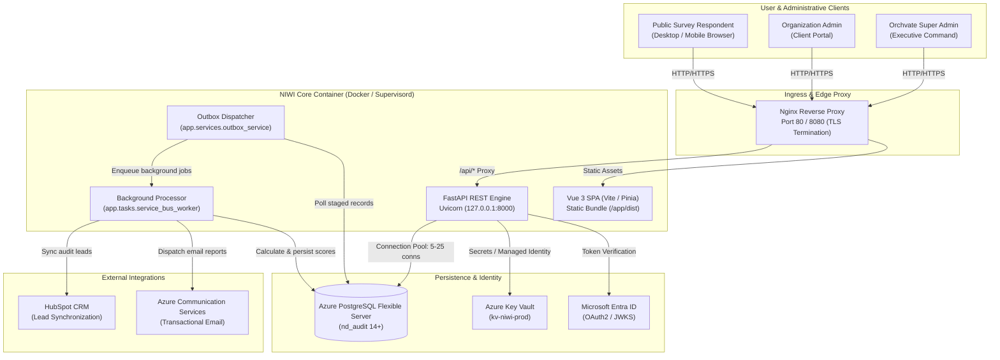
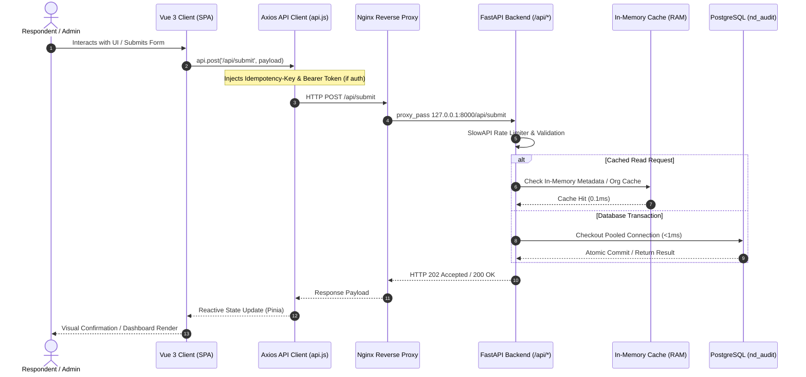
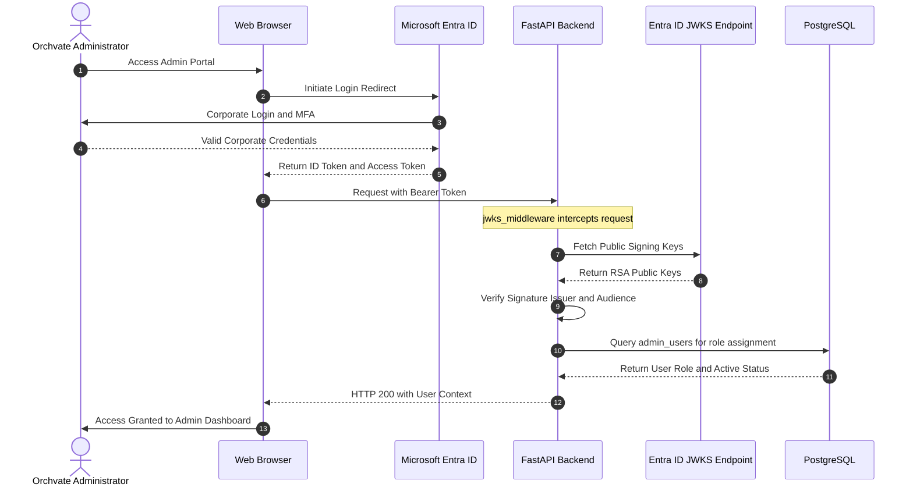
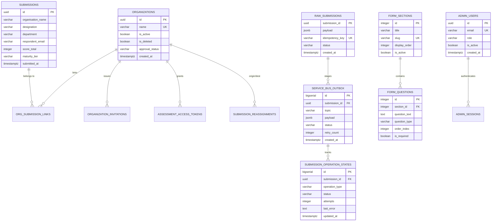
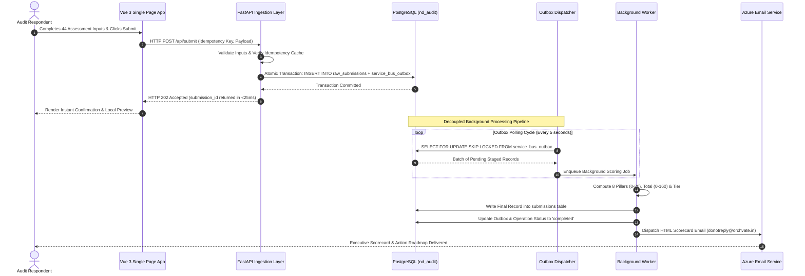
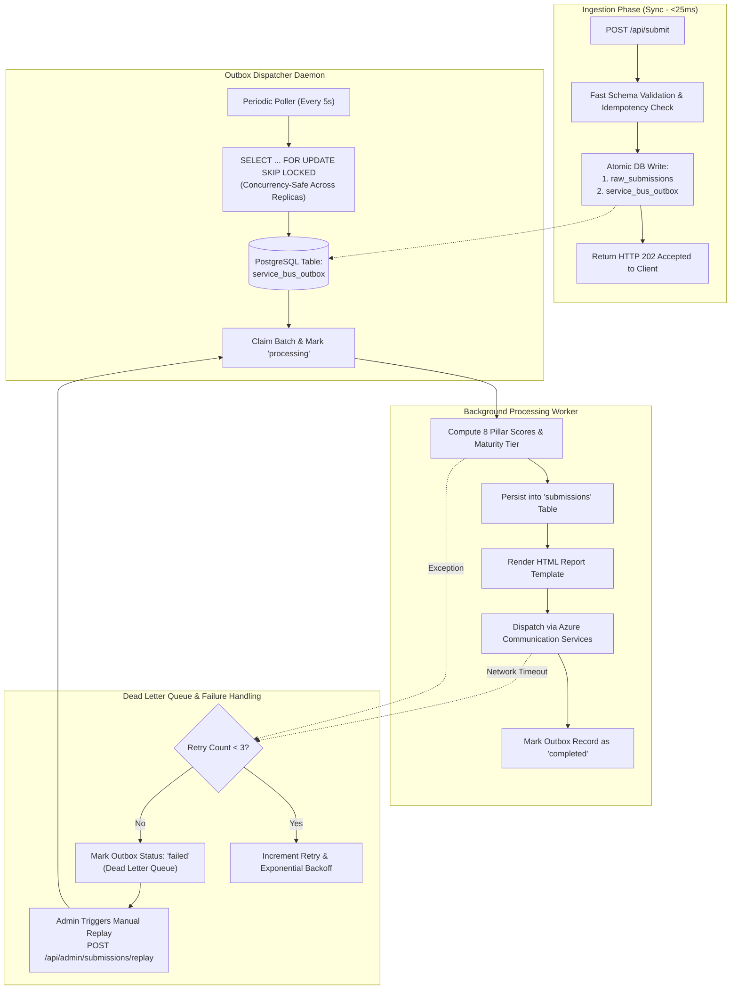
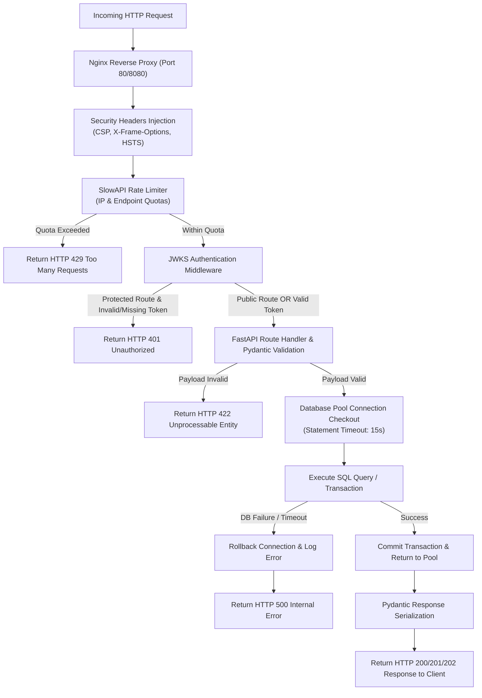
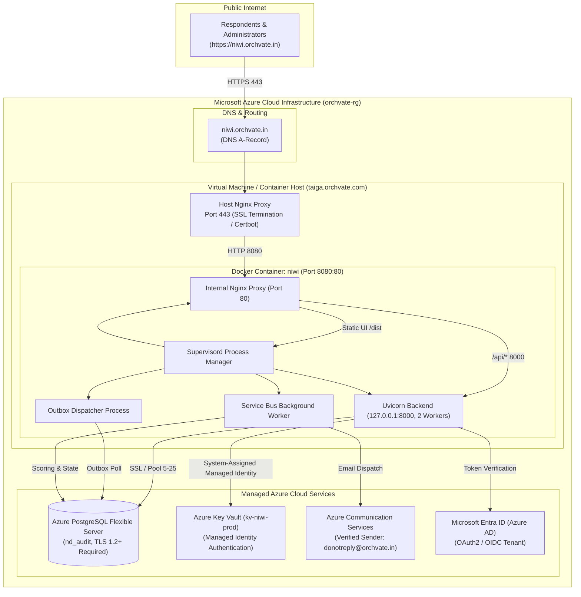
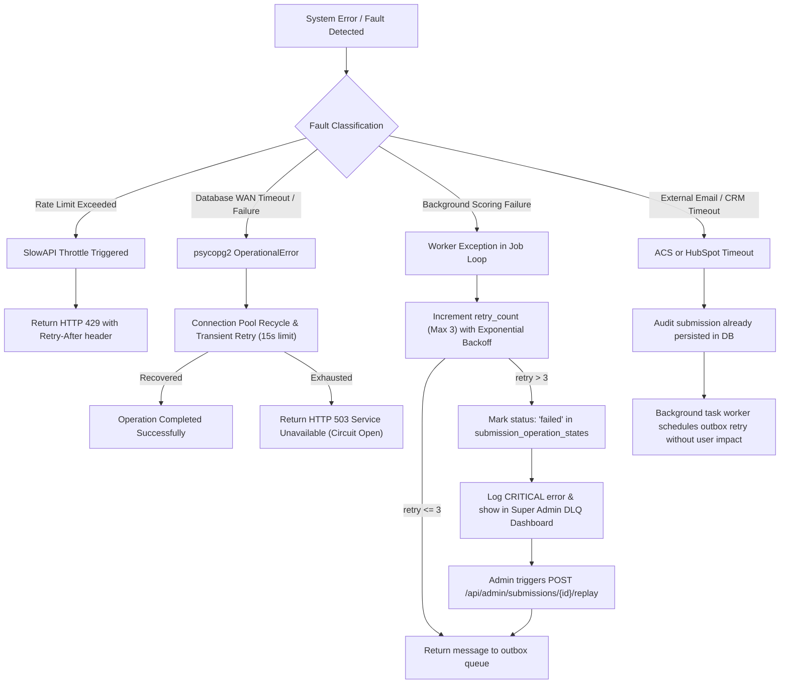

# NIWI — Specs

> Generated with `reconstruct@2.29.16` · mode `preserve` · level `complex` · fidelity `embed`

Single-file **specification** to (re)build this project from: overview, architecture (interfaces & data model), every feature PRD, and the build order — with the embedded original source code (`## Source material`) stripped. Self-sufficient and code-free, so an agent can implement from it directly. For the same tree *with* the original source, see `RECONSTRUCTION.md`.

## Contents

- [Overview](#overview)
- [Architecture](#architecture)
- [Interfaces](#interfaces)
- [Data model](#data-model)
- [Design system](#design-system)
- [Diagram](#diagram)
- [Core](#feature-01-core)
- [Project Setup & Tooling](#feature-02-project-setup)
- [Migrations](#feature-03-migrations)
- [Sql](#feature-04-sql)
- [Models](#feature-05-models)
- [Utils](#feature-06-utils)
- [Services](#feature-07-services)
- [API](#feature-08-api)
- [Frontend](#feature-09-frontend)
- [Scripts](#feature-10-scripts)
- [Tasks](#feature-11-tasks)
- [Tests](#feature-12-tests)
- [Documentation](#feature-13-documentation)
- [Build order](#build-order)

---

<a id="overview"></a>

## NIWI — Reconstruction Overview

| Setting | Value |
| --- | --- |
| Mode | `preserve` |
| Level | `complex` |
| Fidelity | `embed` |
| Generated with | `reconstruct@2.29.16` |

### Product summary

The **Neuro-Inclusive Workplace Index (NIWI)** is an enterprise assessment, benchmarking, and organizational intelligence platform engineered by Orchvate. NIWI enables enterprises to evaluate, score, and systematically enhance workplace inclusion for neurodivergent professionals (encompassing Autism, ADHD, Dyslexia, Dyspraxia, and Sensory Processing differences). Respondents complete a comprehensive 40-question assessment spanning 8 foundational inclusion dimensions alongside demographic metadata. The platform delivers instant, personalized reflection insights to individual respondents while aggregating organizational data to calculate an objective inclusion maturity score (0–160 aggregate, 0–20 per pillar) mapped to five progression tiers (Foundational, Early Progress, Developing, Proficient, Leading).

Engineered for enterprise scale, data privacy, and zero respondent deanonymization, NIWI isolates sensitive individual submissions from reporting analytics. Architecturally, public survey submissions are ingested asynchronously with sub-25ms response times (`HTTP 202 Accepted`) using an atomic transactional outbox pattern in PostgreSQL backed by a decoupled background processor. Multi-tenant corporate access is secured via Microsoft Entra ID (Azure AD) OAuth2 OIDC with RS256 JWKS validation, enterprise secrets are sealed in Azure Key Vault via Managed Identity, and organizational administrators access real-time participation tracking, invitation links, radar analytics, and exportable executive roadmaps.

### Tech stack

- **Backend:** Python 3.11+, FastAPI, Uvicorn, Psycopg2 (Connection Pooling)
- **Frontend:** Vue 3 (Composition API), Vite, Vue Router, Pinia, Custom CSS Design System
- **Database:** PostgreSQL 14+ (Flexible Server), 22 Schema Migrations
- **Background Processing:** Python Multi-Process Worker + Transactional Outbox Pattern (`SELECT ... FOR UPDATE SKIP LOCKED`), Supervisord
- **Security & Secrets:** Microsoft Entra ID (JWKS / PyJWT), Azure Key Vault (`kv-niwi-prod`), SlowAPI Rate Limiting, OWASP Hardened
- **External Integrations:** Azure Communication Services (Transactional Email), HubSpot CRM (Lead Sync)
- **Testing & Quality:** Pytest, Playwright (E2E), Concurrency Tests, SQL Injection / Security Verification

### Metrics

- Files analyzed: **236** (62498 lines)
- Features/modules: **13**
- Routes: **80**
- Locales: **0**
- Tracked env vars: **45**

### Feature index

- [`01-core`](features/01-core/PRD.md) — **Core**: Application boot, database pooling, security middleware, JWT validation, configuration, and rate limiting.
- [`02-project-setup`](features/02-project-setup/PRD.md) — **Project Setup & Tooling**: Docker, Docker Compose, Nginx ingress, Supervisord daemon supervision, environment templates, and package manifests.
- [`03-migrations`](features/03-migrations/PRD.md) — **Migrations**: 22 sequential SQL migration scripts establishing core schemas, outbox, dynamic forms, and performance indexes.
- [`04-sql`](features/04-sql/PRD.md) — **Sql**: Auxiliary and administrative notification and support database scripts.
- [`05-models`](features/05-models/PRD.md) — **Models**: Pydantic and domain models for audits, users, RBAC, form definitions, and validation schemas.
- [`06-utils`](features/06-utils/PRD.md) — **Utils**: CSV report export, token generation, cryptographic validation, and branded email formatting.
- [`07-services`](features/07-services/PRD.md) — **Services**: Core deterministic scoring engine (8 pillars, 5 tiers), organization analytics, outbox processing, email policy, and settings.
- [`08-api`](features/08-api/PRD.md) — **API**: REST endpoints for survey submission, administrative dashboards, organization management, invitations, drafts, and system telemetry.
- [`09-frontend`](features/09-frontend/PRD.md) — **Frontend**: Vue 3 SPA with responsive survey flows, draft auto-save, executive dashboards, radar charts, and admin management portals.
- [`10-scripts`](features/10-scripts/PRD.md) — **Scripts**: Database initialization, seeding, synthetic data import, schema reconciliation, and operational utilities.
- [`11-tasks`](features/11-tasks/PRD.md) — **Tasks**: Daemon workers for outbox dispatching and Service Bus background message scoring and email notifications.
- [`12-tests`](features/12-tests/PRD.md) — **Tests**: Exhaustive test suite covering unit tests, API tests, concurrency safety, security verification, and performance benchmarks.
- [`13-documentation`](features/13-documentation/PRD.md) — **Documentation**: Operational guides, deployment runbooks, and codebase architecture references.

### How to use this output

1. Read `architecture/ARCHITECTURE.md` for the overall shape, then `architecture/INTERFACES.md` (the full interface surface) and `architecture/DATA-MODEL.md` (entities & relations).
2. Rebuild feature by feature using each `features/<slug>/PRD.md`, in the order listed in `REBUILD.md`.
3. Use `data/` (translations, schema, config) and — when present — `source/` as ground truth.

---

<a id="architecture"></a>

## Architecture

| Setting | Value |
| --- | --- |
| Mode | `preserve` |
| Level | `complex` |
| Fidelity | `embed` |
| Generated with | `reconstruct@2.29.16` |

### Detected stack

FastAPI · Python 3.11+ · Vue 3 · Vite · PostgreSQL 14+

**Libraries:** Playwright, Psycopg2-binary, PyJWT, SlowAPI, Pydantic, Axios, Pinia

### Top-level layout

- `.github/` — GitHub Actions workflows for continuous integration and automated testing.
- `app/` — FastAPI application root:
  - `core/` — Database connection pooling, JWT security middleware, Key Vault integration, settings, rate limiting, and exception handlers.
  - `api/` — HTTP routers for submissions, organizations, public resolution, drafts, form builder, and administration.
  - `models/` — Pydantic request/response schemas and domain models.
  - `services/` — Business logic: scoring calculations, outbox transactions, organization aggregation, email dispatch, and cache management.
  - `tasks/` — Background daemons: outbox dispatcher and worker loop.
  - `utils/` — Helper functions for CSV generation, email formatting, token generation, and input validation.
  - `main.py` — Application entry point, CORS configuration, middleware assembly, and health checks.
- `frontend/` — Vue 3 Single Page Application:
  - `src/` — Components, views, router configuration, Pinia state stores, and unified CSS design system (`style.css`).
  - `vite.config.js` — Vite build and dev server configuration.
- `infrastructure/` — Infrastructure deployment scripts, Nginx configurations, and Azure VM setup runbooks.
- `migrations/` — 22 numbered SQL migration files establishing database schemas, constraints, and performance indexes.
- `scripts/` — Database setup, test runner, synthetic audit ingestion, and reconciliation utilities.
- `sql/` — Standalone DDL definitions and administrative notification/support schemas.
- `tests/` — Comprehensive test suite covering unit tests, API tests, security verification, and concurrency testing.
- root files: `.dockerignore`, `.env.example`, `.gitignore`, `Dockerfile`, `README.md`, `deploy.sh`, `docker-compose.yml`, `docker-entrypoint.sh`, `function_app.py`, `host.json`, `nginx.conf`, `package.json`, `pytest.ini`, `requirements.txt`, `run_local_server.py`, `setup-keyvault.sh`, `supervisord.conf`.

### Dependencies

- **npm** (`package.json`): Vue 3, Vite, Vue Router, Pinia, Axios, Lucide Icons.
- **pip** (`requirements.txt`): FastAPI (0.104+), Uvicorn (0.24+), Psycopg2-binary (2.9+), PyJWT (2.8+), Cryptography, SlowAPI, Pydantic, Python-dotenv, Azure-identity, Azure-keyvault-secrets, Azure-communication-email.

### Data & schema

- `app/models/__init__.py`
- `app/models/audit.py`
- `app/models/form_builder.py`
- `app/models/user.py`
- `migrations/002_app_settings.sql`
- `migrations/003_support_email.sql`
- `migrations/004_designation.sql`
- `migrations/005_rbac.sql`
- `migrations/006_org_scoring.sql`
- `migrations/007_fix_score_columns.sql`
- `migrations/008_dynamic_forms.sql`
- `migrations/009_question_dependencies.sql`
- `migrations/010_saved_filters.sql`
- `migrations/011_verify_submission_id_type.sql`
- `migrations/012_dual_entry_invitations.sql`
- `migrations/013_organization_admins.sql`
- `migrations/014_submission_reassignments.sql`
- `migrations/015_performance_jobs_and_idempotency.sql`
- `migrations/016_service_bus_outbox.sql`
- `migrations/017_per_operation_idempotency.sql`
- `migrations/018_assessment_access_tokens.sql`
- `migrations/019_system_security_settings.sql`
- `migrations/01_remediation.sql`
- `migrations/020_raw_submissions_and_dlq.sql`
- `migrations/021_super_admin_dashboard_and_workers.sql`
- `migrations/022_performance_indexes.sql`
- `migrations/02_features_migration.sql`
- `sql/01_admin_notifications.sql`
- `sql/02_support_requests.sql`
- `sql/archive/create_table.sql`
- `sql/archive/fix_missing_columns.sql`
- `sql/archive/install_all.sql`

### Internationalization

_No multi-language i18n required; English (en-US) default._

### External services & integrations

1. **Microsoft Entra ID (Azure Active Directory OIDC / JWKS):**
   - **Provider:** Microsoft Azure Identity.
   - **Protocol & Shape:** OpenID Connect (OIDC) Bearer Tokens (RS256). Backend fetches signing keys from `https://login.microsoftonline.com/{tenant_id}/discovery/v2.0/keys`.
   - **Timeout:** 5 seconds connect/read timeout with an in-memory `TTLCache` (1 hour TTL) caching public keys.
   - **Failure Behavior:** If JWKS fails to refresh and key is not cached, protected endpoints return `HTTP 401 Unauthorized` with `{"detail": "Unable to verify authentication credentials"}`.

2. **Azure Key Vault (`kv-niwi-prod`):**
   - **Provider:** Azure Key Vault via `DefaultAzureCredential` / System-Assigned Managed Identity.
   - **Purpose:** Secure retrieval of database passwords, API signing secrets, and external integration tokens at service startup.
   - **Timeout:** 10 seconds timeout.
   - **Failure Behavior:** Fallback to local `.env` environment variables when running in local development mode (`ENVIRONMENT=development`). In production (`ENVIRONMENT=production`), boot halts immediately to prevent credential leaks.

3. **Azure Communication Services (Transactional Email):**
   - **Provider:** Azure Communication Services Email SDK.
   - **Purpose:** Asynchronous delivery of audit assessment results, benchmark summaries, and organization invitation links (`donotreply@orchvate.in`).
   - **Contract:** Dispatches HTML email payloads containing audit score cards, pillar breakdowns, and recommendations.
   - **Timeout:** 15 seconds network timeout.
   - **Failure Behavior:** Executed asynchronously inside `service_bus_worker.py`. On network error, messages increment `retry_count` in `submission_operation_states` up to 3 times with exponential backoff (30s, 120s, 300s). Failures beyond max retries transition to dead-letter queue (`status='failed'`) without failing respondent HTTP requests.

4. **HubSpot CRM (Lead Synchronization):**
   - **Provider:** HubSpot REST API v3.
   - **Purpose:** Synchronize completed audit lead contact information and corporate domain names for prospective client follow-up.
   - **Timeout:** 5 seconds timeout.
   - **Failure Behavior:** Best-effort asynchronous execution. Any HTTP 4xx/5xx from HubSpot is logged as a non-blocking warning and does not impact survey persistence or respondent feedback.

5. **Azure PostgreSQL Flexible Server (`nd_audit`):**
   - **Provider:** Managed PostgreSQL 14+ with SSL enforcement (TLS 1.2+).
   - **Connection Pool:** `ThreadedConnectionPool` configured with min=5, max=25 connections, `statement_timeout=15000` (15 seconds), and TCP keepalives.
   - **Failure Behavior:** Transient disconnects trigger retry loop up to 3 attempts with connection recycle. Unrecoverable outages return `HTTP 503 Service Unavailable`.

### Cross-cutting policies

1. **Rate Limiting (SlowAPI):**
   - **Engine:** SlowAPI memory/redis limiter keyed on client IP address (`get_remote_address`).
   - **Policies:**
     - Public assessment submission (`POST /api/submit`): `10/minute`.
     - Authentication verification (`POST /api/auth/verify`): `5/minute`.
     - Draft auto-save (`POST /api/drafts/save`): `30/minute`.
     - General authenticated administrative reads: `120/minute`.
     - Public organization validation: `60/minute`.
   - **Response on Exceeded:** `HTTP 429 Too Many Requests` with `Retry-After` header.

2. **Security & Ingress Headers:**
   - **CORS:** Restricted to explicitly configured origins in `ALLOWED_ORIGINS` (e.g., `https://niwi.orchvate.in`, `http://localhost:5173`). Credentials permitted (`allow_credentials=True`).
   - **HTTP Headers:** Injected by Nginx reverse proxy:
     - `Content-Security-Policy: default-src 'self'; script-src 'self' 'unsafe-inline'; style-src 'self' 'unsafe-inline' https://fonts.googleapis.com; font-src 'self' https://fonts.gstatic.com;`
     - `X-Frame-Options: DENY`
     - `X-Content-Type-Options: nosniff`
     - `Strict-Transport-Security: max-age=31536000; includeSubDomains`

3. **Authentication & Authorization (RBAC):**
   - Two administrator tiers stored in `admin_users`:
     - `admin` (Organization Admin): Can view submissions, access analytics, configure invited organizations, re-trigger reports.
     - `super` (Super Admin): Exclusive access to user management, deleting all records, replaying dead-lettered outbox queues, and modifying global security parameters.
   - Dev Bypass Protection: Code explicitly verifies `ENABLE_DEV_BYPASS` is strictly disabled if `ENVIRONMENT=production`.

4. **Survey Submission Validation & Ingestion Contract:**
   - Assessment requires exactly 4 demographic inputs: Organization Name, Respondent Role/Designation, Department, and Email (optional for 100% anonymous mode).
   - Exactly 40 Likert scale question inputs (values 1–5 inclusive).
   - Client sends unique UUID in `Idempotency-Key` HTTP header. Database enforces uniqueness in `raw_submissions.idempotency_key` via `ON CONFLICT DO NOTHING`.
   - Ingestion acknowledgement SLA: `< 25ms` returning `HTTP 202 Accepted` with `submission_id`.

### Reconstruction guidance (preserve)

Reproduce the structure above as-is. Keep the same directory layout, framework, routing strategy, and data layer.

#### Recommended Architectural Improvements:
1. **Frontend Modernization:** Progressively introduce TypeScript typing into Vue 3 Pinia stores and component props to guarantee runtime type safety across all 40 question models.
2. **Database Migration Tooling:** Wrap raw SQL migrations with an Alembic or Flyway runner to allow bidirectional rollback capabilities and migration checksum validation in automated CI pipelines.
3. **Structured Distributed Tracing:** Instrument FastAPI endpoints and background worker tasks with OpenTelemetry SDK and Azure Application Insights for end-to-end request tracing and latency waterfall analysis.
4. **Queue Decoupling:** When throughput exceeds 10,000 daily submissions, transition PostgreSQL transactional outbox table polling to native Azure Service Bus queues while maintaining the existing idempotent message consumer interface.

---

<a id="interfaces"></a>

## Interface surface

| Setting | Value |
| --- | --- |
| Mode | `preserve` |
| Level | `complex` |
| Fidelity | `embed` |
| Generated with | `reconstruct@2.29.16` |

The NIWI API contract is served via FastAPI with Pydantic serialization, SlowAPI rate limiting, Entra ID JWT verification, and standard HTTP error semantics.

### Resolved routes (deterministic — verify against source)

| Method | Kind | Route | Handler file |
| --- | --- | --- | --- |
| GET | api | `/` | `app/main.py:178` |
| GET | api | `/api/admin/dashboard` | `app/api/routes.py:2028` |
| GET | api | `/api/admin/submissions/dead-lettered` | `app/api/routes.py:1852` |
| POST | api | `/api/admin/submissions/dead-lettered/replay-all` | `app/api/routes.py:1965` |
| POST | api | `/api/admin/submissions/{submission_id}/replay` | `app/api/routes.py:1897` |
| GET | api | `/api/auth/config` | `app/api/routes.py:1669` |
| POST | api | `/api/auth/verify` | `app/api/routes.py:1682` |
| POST | api | `/api/book-call` | `app/api/routes.py:1535` |
| GET | api | `/api/drafts/resume` | `app/api/drafts.py:146` |
| POST | api | `/api/drafts/save` | `app/api/drafts.py:95` |
| DELETE | api | `/api/form/questions/{question_id}` | `app/api/form_builder.py:250` |
| PUT | api | `/api/form/questions/{question_id}` | `app/api/form_builder.py:221` |
| GET | api | `/api/form/sections` | `app/api/form_builder.py:106` |
| POST | api | `/api/form/sections` | `app/api/form_builder.py:136` |
| DELETE | api | `/api/form/sections/{section_id}` | `app/api/form_builder.py:182` |
| PUT | api | `/api/form/sections/{section_id}` | `app/api/form_builder.py:157` |
| POST | api | `/api/form/sections/{section_id}/questions` | `app/api/form_builder.py:200` |
| GET | api | `/api/health` | `app/main.py:124` |
| GET | api | `/api/health/cache-metrics` | `app/main.py:161` |
| GET | api | `/api/health/pool-metrics` | `app/main.py:154` |
| GET | api | `/api/manage/audit-logs` | `app/api/routes.py:1825` |
| GET | api | `/api/manage/orgs` | `app/api/orgs.py:125` |
| POST | api | `/api/manage/orgs` | `app/api/orgs.py:240` |
| POST | api | `/api/manage/orgs/create` | `app/api/orgs.py:307` |
| PATCH | api | `/api/manage/orgs/invitations/{invitation_id}` | `app/api/orgs.py:724` |
| POST | api | `/api/manage/orgs/invitations/{invitation_id}/regenerate` | `app/api/orgs.py:786` |
| POST | api | `/api/manage/orgs/invitations/{invitation_id}/revoke` | `app/api/orgs.py:759` |
| GET | api | `/api/manage/orgs/unlinked` | `app/api/orgs.py:322` |
| DELETE | api | `/api/manage/orgs/{org_id}` | `app/api/orgs.py:482` |
| GET | api | `/api/manage/orgs/{org_id}` | `app/api/orgs.py:360` |
| PUT | api | `/api/manage/orgs/{org_id}` | `app/api/orgs.py:395` |
| GET | api | `/api/manage/orgs/{org_id}/assessment-links` | `app/api/orgs.py:605` |
| POST | api | `/api/manage/orgs/{org_id}/assessment-links` | `app/api/orgs.py:561` |
| POST | api | `/api/manage/orgs/{org_id}/assessment-links/default` | `app/api/orgs.py:585` |
| DELETE | api | `/api/manage/orgs/{org_id}/assessment-links/{token_id}` | `app/api/orgs.py:632` |
| GET | api | `/api/manage/orgs/{org_id}/invitations` | `app/api/orgs.py:702` |
| POST | api | `/api/manage/orgs/{org_id}/invitations` | `app/api/orgs.py:652` |
| POST | api | `/api/manage/orgs/{org_id}/link` | `app/api/orgs.py:886` |
| PUT | api | `/api/manage/orgs/{org_id}/links/{submission_id}` | `app/api/orgs.py:845` |
| POST | api | `/api/manage/orgs/{org_id}/message` | `app/api/orgs.py:966` |
| GET | api | `/api/manage/orgs/{org_id}/report-preview` | `app/api/orgs.py:935` |
| POST | api | `/api/manage/orgs/{org_id}/restore` | `app/api/orgs.py:526` |
| PATCH | api | `/api/manage/orgs/{org_id}/status` | `app/api/orgs.py:444` |
| GET | api | `/api/manage/settings/rate-limits` | `app/api/routes.py:1480` |
| PUT | api | `/api/manage/settings/rate-limits` | `app/api/routes.py:1491` |
| POST | api | `/api/manage/settings/rate-limits/reset` | `app/api/routes.py:1516` |
| GET | api | `/api/manage/users` | `app/api/routes.py:1706` |
| POST | api | `/api/manage/users` | `app/api/routes.py:1721` |
| DELETE | api | `/api/manage/users/{email}` | `app/api/routes.py:1748` |
| GET | api | `/api/org/dashboard` | `app/api/org.py:140` |
| POST | api | `/api/org/register` | `app/api/org.py:27` |
| GET | api | `/api/org/verify` | `app/api/org.py:67` |
| POST | api | `/api/public/assessment/resolve-legacy-org` | `app/api/public.py:65` |
| POST | api | `/api/public/assessment/resolve-link` | `app/api/public.py:46` |
| POST | api | `/api/public/email/validate` | `app/api/public.py:100` |
| POST | api | `/api/public/invitations/validate` | `app/api/public.py:150` |
| POST | api | `/api/public/organisations/validate` | `app/api/public.py:110` |
| GET | api | `/api/settings` | `app/api/routes.py:1409` |
| PUT | api | `/api/settings` | `app/api/routes.py:1422` |
| POST | api | `/api/settings/delete-all-records` | `app/api/routes.py:1767` |
| POST | api | `/api/settings/notifications/toggle` | `app/api/routes.py:1449` |
| GET | api | `/api/settings/rate-limits` | `app/api/routes.py:1481` |
| PUT | api | `/api/settings/rate-limits` | `app/api/routes.py:1492` |
| POST | api | `/api/settings/rate-limits/reset` | `app/api/routes.py:1517` |
| GET | api | `/api/submissions` | `app/api/routes.py:404` |
| POST | api | `/api/submissions/filter` | `app/api/routes.py:506` |
| GET | api | `/api/submissions/saved-filters` | `app/api/routes.py:645` |
| POST | api | `/api/submissions/saved-filters` | `app/api/routes.py:685` |
| DELETE | api | `/api/submissions/saved-filters/{filter_id}` | `app/api/routes.py:736` |
| GET | api | `/api/submissions/{submission_id}` | `app/api/routes.py:883` |
| PUT | api | `/api/submissions/{submission_id}/email` | `app/api/routes.py:1210` |
| PATCH | api | `/api/submissions/{submission_id}/organisation` | `app/api/routes.py:1091` |
| POST | api | `/api/submissions/{submission_id}/regenerate-email` | `app/api/routes.py:1247` |
| PATCH | api | `/api/submissions/{submission_id}/respondent` | `app/api/routes.py:957` |
| PATCH | api | `/api/submissions/{submission_id}/scores` | `app/api/routes.py:998` |
| POST | api | `/api/submissions/{submission_id}/send` | `app/api/routes.py:1352` |
| GET | api | `/api/submissions/{submission_id}/status` | `app/api/routes.py:763` |
| POST | api | `/api/submit` | `app/api/routes.py:129` |
| POST | api | `/api/support` | `app/api/routes.py:1630` |
| GET | api | `/audit` | `app/main.py:170` |

### Interface table

| Method / Trigger | Path / Operation | Kind | Handler file | Auth | Notes & Side Effects |
| --- | --- | --- | --- | --- | --- |
| GET | `/api/health` | HTTP REST | `app/main.py:124` | None | Returns `{status: "healthy", database: "connected"}`. Read-only. |
| GET | `/api/health/pool-metrics` | HTTP REST | `app/main.py:154` | None | Returns active, min, max, and available database connections. |
| POST | `/api/submit` | HTTP REST | `app/api/routes.py:129` | None (Public) | Ingests 44 assessment inputs. Atomic write to `raw_submissions` and `service_bus_outbox`. Returns HTTP 202 in <25ms with `submission_id`. |
| GET | `/api/submissions/{id}/status` | HTTP REST | `app/api/routes.py:763` | None (Public) | Checks ingestion state (`pending`, `completed`, `failed`) for client polling. |
| POST | `/api/drafts/save` | HTTP REST | `app/api/drafts.py:95` | None (Public) | Upserts partial survey answers to `draft_submissions`. Returns `resume_token`. |
| GET | `/api/drafts/resume` | HTTP REST | `app/api/drafts.py:146` | None (Public) | Queries `draft_submissions` by `resume_token`. Returns saved form answers. |
| POST | `/api/public/organisations/validate` | HTTP REST | `app/api/public.py:110` | None (Public) | Validates whether employer is registered and active in cached organization directory. |
| POST | `/api/public/assessment/resolve-link` | HTTP REST | `app/api/public.py:46` | None (Public) | Validates access token or invite code. Increments `use_count`. |
| GET | `/api/auth/config` | HTTP REST | `app/api/routes.py:1669` | None (Public) | Returns Entra ID public client credentials (tenantId, clientId, redirectUri). |
| POST | `/api/auth/verify` | HTTP REST | `app/api/routes.py:1682` | None (Public) | Verifies Bearer JWT signature via JWKS. Checks email in `admin_users`. Returns role and session. |
| GET | `/api/admin/dashboard` | HTTP REST | `app/api/routes.py:2028` | Bearer (admin) | Aggregated statistics: total submissions, score averages, pillar radar data, recent activity. |
| GET | `/api/admin/submissions/dead-lettered` | HTTP REST | `app/api/routes.py:1852` | Bearer (super) | Lists outbox messages in `failed` state with error tracebacks. |
| POST | `/api/admin/submissions/{id}/replay` | HTTP REST | `app/api/routes.py:1897` | Bearer (super) | Resets outbox status to `pending`, resets `retry_count=0`. Re-enqueues for processing. |
| POST | `/api/admin/submissions/dead-lettered/replay-all` | HTTP REST | `app/api/routes.py:1965` | Bearer (super) | Bulk re-enqueues all failed outbox submissions. |
| GET | `/api/manage/orgs` | HTTP REST | `app/api/orgs.py:125` | Bearer (admin) | Paginated list of organizations with response totals and inclusion maturity scores. |
| POST | `/api/manage/orgs` | HTTP REST | `app/api/orgs.py:240` | Bearer (admin) | Creates a new organization with unique name and domain. Inserts into `organizations`. |
| PUT | `/api/manage/orgs/{id}` | HTTP REST | `app/api/orgs.py:395` | Bearer (admin) | Updates organization details. Refreshes in-memory organization cache. |
| DELETE | `/api/manage/orgs/{id}` | HTTP REST | `app/api/orgs.py:482` | Bearer (super) | Soft deletes organization (`is_deleted=TRUE`). Purges active tokens. |
| POST | `/api/manage/orgs/{id}/assessment-links` | HTTP REST | `app/api/orgs.py:561` | Bearer (admin) | Generates a campaign token in `assessment_access_tokens` with optional max quota. |
| POST | `/api/manage/orgs/{id}/invitations` | HTTP REST | `app/api/orgs.py:652` | Bearer (admin) | Generates trackable invitation URL. Inserts into `organization_invitations`. |
| GET | `/api/submissions` | HTTP REST | `app/api/routes.py:404` | Bearer (admin) | Paginated list of audit submissions with filters (date range, score, organization, tier). |
| GET | `/api/submissions/{id}` | HTTP REST | `app/api/routes.py:883` | Bearer (admin) | Fetches complete scored submission breakdown and 40 Likert responses. |
| PATCH | `/api/submissions/{id}/organisation` | HTTP REST | `app/api/routes.py:1091` | Bearer (admin) | Reassigns submission to another organization. Writes audit trail to `submission_reassignments`. |
| POST | `/api/submissions/{id}/regenerate-email` | HTTP REST | `app/api/routes.py:1247` | Bearer (admin) | Re-renders HTML scorecard email and dispatches via Azure Communication Services. |
| GET | `/api/manage/users` | HTTP REST | `app/api/routes.py:1706` | Bearer (super) | Lists all authorized administrators and roles from `admin_users`. |
| POST | `/api/manage/users` | HTTP REST | `app/api/routes.py:1721` | Bearer (super) | Invites or adds a new administrator email with specified role. |
| DELETE | `/api/manage/users/{email}` | HTTP REST | `app/api/routes.py:1748` | Bearer (super) | Revokes administrator access. Deletes record from `admin_users` and cascades sessions. |
| POST | `/api/settings/delete-all-records` | HTTP REST | `app/api/routes.py:1767` | Bearer (super) | Destructive purge of non-production test data. Requires confirmation token. |
| GET | `/api/form/sections` | HTTP REST | `app/api/form_builder.py:106` | Bearer (admin) | Retrieves dynamic form sections and child questions for the survey editor. |
| PUT | `/api/form/questions/{id}` | HTTP REST | `app/api/form_builder.py:221` | Bearer (super) | Updates question text, order index, or required status. |
| POST | `/api/support` | HTTP REST | `app/api/routes.py:1630` | None (Public) | Logs inquiry into `support_requests` and triggers email to support team. |
| Cron (5s) | `outbox_dispatcher` | Daemon Job | `app/tasks/outbox_dispatcher.py` | System | Queries pending outbox entries using `SKIP LOCKED` and delegates to worker. |
| Daemon | `service_bus_worker` | Daemon Job | `app/tasks/service_bus_worker.py` | System | Consumes outbox events, calculates 8-pillar scores, updates DB, sends report email. |

---

<a id="data-model"></a>

## Data model

| Setting | Value |
| --- | --- |
| Mode | `preserve` |
| Level | `complex` |
| Fidelity | `embed` |
| Generated with | `reconstruct@2.29.16` |

The Neuro-Inclusive Workplace Index (NIWI) persistence layer is built on PostgreSQL 14+ across 22 incremental SQL migrations. It enforces relational integrity, concurrency isolation (`SELECT FOR UPDATE SKIP LOCKED`), audit trails, and strict data partitioning between sensitive raw survey inputs and aggregated benchmark analytics.

### Schema / model source files

- `app/api/routes.py`
- `app/models/__init__.py`
- `app/models/audit.py`
- `app/models/form_builder.py`
- `app/models/user.py`
- `app/services/settings_service.py`
- `migrations/002_app_settings.sql`
- `migrations/003_support_email.sql`
- `migrations/004_designation.sql`
- `migrations/005_rbac.sql`
- `migrations/006_org_scoring.sql`
- `migrations/007_fix_score_columns.sql`
- `migrations/008_dynamic_forms.sql`
- `migrations/009_question_dependencies.sql`
- `migrations/010_saved_filters.sql`
- `migrations/011_verify_submission_id_type.sql`
- `migrations/012_dual_entry_invitations.sql`
- `migrations/013_organization_admins.sql`
- `migrations/014_submission_reassignments.sql`
- `migrations/015_performance_jobs_and_idempotency.sql`
- `migrations/016_service_bus_outbox.sql`
- `migrations/017_per_operation_idempotency.sql`
- `migrations/018_assessment_access_tokens.sql`
- `migrations/019_system_security_settings.sql`
- `migrations/01_remediation.sql`
- `migrations/020_raw_submissions_and_dlq.sql`
- `migrations/021_super_admin_dashboard_and_workers.sql`
- `migrations/022_performance_indexes.sql`
- `migrations/02_features_migration.sql`
- `scripts/migrate.py`
- `scripts/setup_db.py`
- `sql/01_admin_notifications.sql`
- `sql/02_support_requests.sql`
- `sql/archive/create_table.sql`
- `sql/archive/fix_missing_columns.sql`
- `sql/archive/install_all.sql`

### Entities

| Entity / Table | Field | Type | Constraints | Relation |
| --- | --- | --- | --- | --- |
| `organizations` | `id` | UUID | PRIMARY KEY, DEFAULT gen_random_uuid() | 1:N with invitations, tokens, links |
| `organizations` | `name` | VARCHAR(255) | NOT NULL, UNIQUE | Referenced across submissions and links |
| `organizations` | `slug` | VARCHAR(255) | UNIQUE, INDEX | URL identifier |
| `organizations` | `domain` | VARCHAR(255) | NULLABLE | Corporate email domain validation |
| `organizations` | `is_active` | BOOLEAN | DEFAULT TRUE | Soft active flag |
| `organizations` | `is_deleted` | BOOLEAN | DEFAULT FALSE | Soft delete flag |
| `organizations` | `approval_status` | VARCHAR(32) | NOT NULL, DEFAULT 'approved' | Enum: pending, approved, rejected, suspended |
| `organizations` | `created_at` | TIMESTAMPTZ | DEFAULT NOW() | System timestamp |
| `organizations` | `updated_at` | TIMESTAMPTZ | DEFAULT NOW() | System timestamp |
| `admin_users` | `id` | UUID | PRIMARY KEY, DEFAULT gen_random_uuid() | 1:N with admin_sessions |
| `admin_users` | `email` | VARCHAR(255) | NOT NULL, UNIQUE, INDEX | Entra ID corporate identity match |
| `admin_users` | `role` | VARCHAR(32) | NOT NULL, DEFAULT 'admin' | Enum: admin, super |
| `admin_users` | `is_active` | BOOLEAN | DEFAULT TRUE | Authorization gate |
| `admin_users` | `created_at` | TIMESTAMPTZ | DEFAULT NOW() | Creation audit |
| `admin_sessions` | `id` | UUID | PRIMARY KEY, DEFAULT gen_random_uuid() | Belong to admin_users |
| `admin_sessions` | `user_id` | UUID | NOT NULL, REFERENCES admin_users(id) ON DELETE CASCADE | Foreign Key |
| `admin_sessions` | `session_token` | VARCHAR(255) | NOT NULL, UNIQUE | Active session lookup |
| `admin_sessions` | `expires_at` | TIMESTAMPTZ | NOT NULL | Expiration timestamp |
| `form_sections` | `id` | INTEGER | PRIMARY KEY GENERATED ALWAYS AS IDENTITY | 1:N with form_questions |
| `form_sections` | `title` | VARCHAR(255) | NOT NULL | Section display title |
| `form_sections` | `slug` | VARCHAR(100) | NOT NULL, UNIQUE | Pillar identifier (e.g. physical_environment) |
| `form_sections` | `display_order` | INTEGER | NOT NULL, DEFAULT 0 | Ordering index in questionnaire |
| `form_sections` | `is_active` | BOOLEAN | DEFAULT TRUE | Dynamic form visibility |
| `form_questions` | `id` | INTEGER | PRIMARY KEY GENERATED ALWAYS AS IDENTITY | Belongs to form_sections |
| `form_questions` | `section_id` | INTEGER | NOT NULL, REFERENCES form_sections(id) ON DELETE CASCADE | Foreign Key |
| `form_questions` | `question_text` | TEXT | NOT NULL | Questionnaire prompt string |
| `form_questions` | `question_type` | VARCHAR(32) | NOT NULL, DEFAULT 'likert_5' | Enum: likert_5, text, single_choice |
| `form_questions` | `order_index` | INTEGER | NOT NULL, DEFAULT 0 | Question order within section |
| `form_questions` | `is_required` | BOOLEAN | DEFAULT TRUE | Validation requirement |
| `raw_submissions` | `submission_id` | UUID | PRIMARY KEY, DEFAULT gen_random_uuid() | Staging table for 202 Ingestion |
| `raw_submissions` | `payload` | JSONB | NOT NULL | Complete verbatim survey responses |
| `raw_submissions` | `idempotency_key` | VARCHAR(255) | NOT NULL, UNIQUE | Enforces single ingestion attempt |
| `raw_submissions` | `status` | VARCHAR(32) | NOT NULL, DEFAULT 'pending' | Enum: pending, claimed, processed, failed |
| `raw_submissions` | `created_at` | TIMESTAMPTZ | DEFAULT NOW(), INDEX | Submission timestamp |
| `service_bus_outbox` | `id` | BIGSERIAL | PRIMARY KEY | Concurrency queue table |
| `service_bus_outbox` | `submission_id` | UUID | NOT NULL, REFERENCES raw_submissions(submission_id) ON DELETE CASCADE | Foreign Key |
| `service_bus_outbox` | `topic` | VARCHAR(100) | NOT NULL, DEFAULT 'niwi.survey.completed' | Event topic |
| `service_bus_outbox` | `payload` | JSONB | NOT NULL | Event message payload |
| `service_bus_outbox` | `status` | VARCHAR(32) | NOT NULL, DEFAULT 'pending', INDEX | Enum: pending, processing, completed, failed |
| `service_bus_outbox` | `retry_count` | INTEGER | NOT NULL, DEFAULT 0 | Worker retry attempts (max 3) |
| `service_bus_outbox` | `created_at` | TIMESTAMPTZ | DEFAULT NOW() | Staging timestamp |
| `service_bus_outbox` | `processed_at` | TIMESTAMPTZ | NULLABLE | Processing finish timestamp |
| `submission_operation_states` | `id` | BIGSERIAL | PRIMARY KEY | Operation tracker |
| `submission_operation_states` | `submission_id` | UUID | NOT NULL | Audit submission UUID |
| `submission_operation_states` | `operation_type` | VARCHAR(64) | NOT NULL | Enum: score_calculation, email_dispatch, hubspot_sync |
| `submission_operation_states` | `status` | VARCHAR(32) | NOT NULL, DEFAULT 'pending' | Enum: pending, completed, failed |
| `submission_operation_states` | `attempts` | INTEGER | NOT NULL, DEFAULT 0 | Operation attempts |
| `submission_operation_states` | `last_error` | TEXT | NULLABLE | Exception traceback on failure |
| `submissions` | `id` | UUID | PRIMARY KEY | Persisted scored survey record |
| `submissions` | `organisation_name`| VARCHAR(255) | NOT NULL, INDEX | Employer name |
| `submissions` | `designation` | VARCHAR(255) | NULLABLE | Respondent professional role |
| `submissions` | `department` | VARCHAR(255) | NULLABLE | Respondent department |
| `submissions` | `respondent_email` | VARCHAR(255) | NULLABLE, INDEX | Respondent contact (omitted if anonymous) |
| `submissions` | `score_total` | INTEGER | NOT NULL | Aggregated inclusion score (0–160) |
| `submissions` | `score_physical_env` | INTEGER | NOT NULL | Pillar 1 score (0–20) |
| `submissions` | `score_hiring` | INTEGER | NOT NULL | Pillar 2 score (0–20) |
| `submissions` | `score_culture` | INTEGER | NOT NULL | Pillar 3 score (0–20) |
| `submissions` | `score_policies` | INTEGER | NOT NULL | Pillar 4 score (0–20) |
| `submissions` | `score_career` | INTEGER | NOT NULL | Pillar 5 score (0–20) |
| `submissions` | `score_communication`| INTEGER | NOT NULL | Pillar 6 score (0–20) |
| `submissions` | `score_daily_ops` | INTEGER | NOT NULL | Pillar 7 score (0–20) |
| `submissions` | `score_wellbeing` | INTEGER | NOT NULL | Pillar 8 score (0–20) |
| `submissions` | `maturity_tier` | VARCHAR(32) | NOT NULL | Foundational, Early Progress, Developing, Proficient, Leading |
| `submissions` | `responses` | JSONB | NOT NULL | Itemized question answers |
| `submissions` | `submitted_at` | TIMESTAMPTZ | DEFAULT NOW(), INDEX | Submission timestamp |
| `draft_submissions` | `id` | UUID | PRIMARY KEY, DEFAULT gen_random_uuid() | In-progress survey responses |
| `draft_submissions` | `resume_token` | VARCHAR(255) | NOT NULL, UNIQUE, INDEX | Client resumption token |
| `draft_submissions` | `email` | VARCHAR(255) | NULLABLE | Optional draft owner email |
| `draft_submissions` | `org_id` | UUID | NULLABLE, REFERENCES organizations(id) ON DELETE SET NULL | Associated organization |
| `draft_submissions` | `form_data` | JSONB | NOT NULL | Serialized partial responses |
| `draft_submissions` | `current_step` | INTEGER | DEFAULT 1 | Stepper index |
| `draft_submissions` | `updated_at` | TIMESTAMPTZ | DEFAULT NOW() | Auto-save timestamp |
| `org_submission_links`| `id` | BIGSERIAL | PRIMARY KEY | Many-to-many relationship |
| `org_submission_links`| `org_id` | UUID | NOT NULL, REFERENCES organizations(id) ON DELETE CASCADE | Associated organization |
| `org_submission_links`| `submission_id` | UUID | NOT NULL, REFERENCES submissions(id) ON DELETE CASCADE | Associated submission |
| `org_submission_links`| `linked_at` | TIMESTAMPTZ | DEFAULT NOW() | Linkage timestamp |
| `organization_invitations` | `id` | UUID | PRIMARY KEY, DEFAULT gen_random_uuid() | Invite tracking |
| `organization_invitations` | `org_id` | UUID | NOT NULL, REFERENCES organizations(id) ON DELETE CASCADE | Inviting organization |
| `organization_invitations` | `token` | VARCHAR(255) | NOT NULL, UNIQUE, INDEX | Unique URL invitation code |
| `organization_invitations` | `invitee_email` | VARCHAR(255) | NULLABLE | Targeted invitee email |
| `organization_invitations` | `status` | VARCHAR(32) | NOT NULL, DEFAULT 'active' | Enum: active, used, expired, revoked |
| `organization_invitations` | `expires_at` | TIMESTAMPTZ | NOT NULL | Expiry threshold |
| `assessment_access_tokens` | `id` | UUID | PRIMARY KEY, DEFAULT gen_random_uuid() | Campaign access tokens |
| `assessment_access_tokens` | `org_id` | UUID | NOT NULL, REFERENCES organizations(id) ON DELETE CASCADE | Bound organization |
| `assessment_access_tokens` | `token` | VARCHAR(255) | NOT NULL, UNIQUE, INDEX | Campaign access token string |
| `assessment_access_tokens` | `max_uses` | INTEGER | NULLABLE | Quota limit (NULL for unlimited) |
| `assessment_access_tokens` | `use_count` | INTEGER | NOT NULL, DEFAULT 0 | Count of completed audits |
| `assessment_access_tokens` | `status` | VARCHAR(32) | NOT NULL, DEFAULT 'active' | Enum: active, inactive, exhausted |
| `submission_reassignments`| `id` | BIGSERIAL | PRIMARY KEY | Audit re-attribution log |
| `submission_reassignments`| `submission_id` | UUID | NOT NULL, REFERENCES submissions(id) ON DELETE CASCADE | Target submission |
| `submission_reassignments`| `previous_org_name`| VARCHAR(255) | NOT NULL | Source organization |
| `submission_reassignments`| `new_org_name` | VARCHAR(255) | NOT NULL | Destination organization |
| `submission_reassignments`| `reassigned_by` | VARCHAR(255) | NOT NULL | Admin email who authorized |
| `submission_reassignments`| `reassigned_at` | TIMESTAMPTZ | DEFAULT NOW() | Reassignment timestamp |
| `saved_filters` | `id` | UUID | PRIMARY KEY, DEFAULT gen_random_uuid() | Custom admin filter sets |
| `saved_filters` | `name` | VARCHAR(255) | NOT NULL | Name of filter preset |
| `saved_filters` | `filter_criteria` | JSONB | NOT NULL | Query filters JSON |
| `saved_filters` | `created_by` | VARCHAR(255) | NOT NULL | Admin email |
| `admin_notifications` | `id` | BIGSERIAL | PRIMARY KEY | Operational notification bell |
| `admin_notifications` | `message` | TEXT | NOT NULL | Alert text |
| `admin_notifications` | `level` | VARCHAR(32) | NOT NULL, DEFAULT 'info' | Enum: info, warning, critical |
| `admin_notifications` | `is_read` | BOOLEAN | DEFAULT FALSE | Read state |
| `admin_notifications` | `created_at` | TIMESTAMPTZ | DEFAULT NOW() | Alert timestamp |
| `support_requests` | `id` | BIGSERIAL | PRIMARY KEY | In-app support tickets |
| `support_requests` | `name` | VARCHAR(255) | NOT NULL | Requester contact name |
| `support_requests` | `email` | VARCHAR(255) | NOT NULL | Requester email |
| `support_requests` | `message` | TEXT | NOT NULL | Support inquiry description |
| `support_requests` | `created_at` | TIMESTAMPTZ | DEFAULT NOW() | Request timestamp |
| `system_security_settings`| `key` | VARCHAR(100) | PRIMARY KEY | Configuration key |
| `system_security_settings`| `value` | JSONB | NOT NULL | Dynamic parameter value |
| `system_security_settings`| `updated_at` | TIMESTAMPTZ | DEFAULT NOW() | Update timestamp |
| `app_settings` | `key` | VARCHAR(100) | PRIMARY KEY | Application setting key |
| `app_settings` | `value` | TEXT | NOT NULL | Value string |

### Relations & integrity

1. **Transactional Outbox Decoupling:**
   - Ingestion writes atomically to `raw_submissions` and `service_bus_outbox` in a single database transaction.
   - If writing fails, both records rollback completely; no partial submissions can occur.
   - Workers query `service_bus_outbox` using `SELECT ... FOR UPDATE SKIP LOCKED` guaranteeing that concurrent background threads never process the same message simultaneously.

2. **Foreign Key Cascades & Soft Deletion:**
   - Soft deletion on `organizations` via `is_deleted = TRUE` preserves historical audit submission linkage for benchmark analytics.
   - Direct deletions on `organizations` cascade to child tokens, invitations, and link records (`ON DELETE CASCADE`).
   - Deleting an admin user cascades to clear active session tokens (`ON DELETE CASCADE`).

3. **Performance Indexes (Migration 022):**
   - B-tree index on `submissions(organisation_name, submitted_at DESC)` for fast analytics aggregation.
   - Unique hash index on `raw_submissions(idempotency_key)` to prevent duplicate submissions.
   - Partial index on `service_bus_outbox(status)` WHERE `status IN ('pending', 'failed')` for efficient outbox worker polling.

### Enums & domain types

#### 1. `approval_status` (Organization lifecycle)
- `pending`: Registered organization awaiting administrative validation.
- `approved`: Active organization fully eligible for survey link generation and public verification.
- `rejected`: Application denied by administrator.
- `suspended`: Access temporarily revoked.

#### 2. `user_role` (RBAC access level)
- `admin`: Standard Administrator. Global read access, organization dashboard management, report generation, and invitation link creation.
- `super`: Super Administrator. Full system control including user creation/deletion, system settings, destructive purges, and dead-letter queue replay.

#### 3. `submission_status` (Survey ingestion state)
- `pending`: Acknowledged via HTTP 202; staged in `raw_submissions` and `service_bus_outbox`.
- `claimed`: Outbox worker has acquired transaction lock (`SKIP LOCKED`).
- `completed`: Scored, persisted into `submissions`, and email delivered.
- `failed`: Background calculation or email failed; pending retry (up to 3 attempts).
- `dead_lettered`: Retries exhausted; manual administrative intervention required.

#### 4. `invitation_status` (Invite token lifecycle)
- `active`: Valid and available for respondent participation.
- `used`: Single-use invitation successfully submitted.
- `expired`: Beyond expiration threshold (`expires_at < NOW()`).
- `revoked`: Cancelled manually by organization administrator.

#### 5. `inclusion_pillars` (8 Assessment Dimensions)
1. `physical_environment`: Sensory workplace accessibility, noise cancellation, lighting, quiet zones.
2. `hiring_recruitment`: Neuro-inclusive interview formats, explicit task descriptions, unbiased evaluation.
3. `culture_leadership`: Executive championship, open psychological safety, stigma eradication.
4. `policies_practices`: Formal accommodation pathways, flexible working arrangements, remote options.
5. `career_development`: Fair performance appraisal, transparent promotion criteria, mentorship.
6. `communication`: Multi-modal communication tools, clear asynchronous written expectations.
7. `daily_operations`: Meeting structures, agenda dissemination, focused uninterrupted deep work time.
8. `wellbeing_support`: Employee Resource Groups (ERGs), specialized mental health benefits, coaching.

#### 6. `maturity_tiers` (5 Progression Levels)
- `Foundational` (Score 0–39): Minimal accommodations; baseline legal compliance; high sensory/cultural friction.
- `Early Progress` (Score 40–79): Ad-hoc support; isolated champions; emerging awareness without enterprise policies.
- `Developing` (Score 80–119): Standardized inclusion policies; documented accommodation request procedures.
- `Proficient` (Score 120–139): Widespread cultural integration; active executive sponsorship; structured feedback loops.
- `Leading` (Score 140–160): Best-in-class industry benchmark; systemic neuro-inclusion embedded in all operations.

---

<a id="design-system"></a>

## Design system

| Setting | Value |
| --- | --- |
| Mode | `preserve` |
| Level | `complex` |
| Fidelity | `embed` |
| Generated with | `reconstruct@2.29.16` |

The Neuro-Inclusive Workplace Index design system embodies clarity, calming sensory balance, and high accessibility. The palette utilizes grounding deep navy, calming teal accents, and warm cream surfaces designed to reduce visual fatigue for neurodivergent respondents.

### Design-system source files

- `frontend/src/style.css`

### Design tokens

#### Core Color Palette

| Token | CSS Variable | Hex / Value | RGB Equivalent | Purpose |
| --- | --- | --- | --- | --- |
| Primary Deep Navy | `--primary` | `#161057` | `22, 16, 87` | Brand anchor, headings, main contrast |
| Primary Dark Hover | `--primary-hover` | `#0F0A42` | `15, 10, 66` | Pressed & hover states on primary elements |
| Accent Teal | `--accent` | `#04907C` | `4, 144, 124` | Primary CTAs, active selections, focus rings |
| Accent Hover | `--accent-hover` | `#037A69` | `3, 122, 105` | Button hover state |
| Accent Soft | `--accent-soft` | `rgba(4, 144, 124, 0.08)` | — | Badge fills, active radio backgrounds |
| Danger Coral | `--danger` | `#E05A47` | `224, 90, 71` | Destructive actions, validation errors |
| Danger Hover | `--danger-hover` | `#C53030` | `197, 48, 48` | Danger button hover |
| Danger Soft | `--danger-soft` | `#FEE2E2` | — | Error alerts and input invalid backgrounds |
| Warning Amber | `--warning` | `#D97706` | `217, 119, 6` | Attention banners, dead-letter warnings |
| Warning Soft | `--warning-soft` | `#FEF3C7` | — | Warning alert containers |
| Success Emerald | `--success` | `#059669` | `5, 150, 105` | Form completion, confirmed statuses |
| Success Soft | `--success-soft` | `#D1FAE5` | — | Success badges, toast backgrounds |
| Canvas Background | `--bg` | `#FAFAF8` | — | Calming, warm off-white canvas |
| Cream Accent BG | `--bg-cream` | `#FAF9F5` | — | Survey card background |
| Surface White | `--surface` | `#FFFFFF` | — | Card surfaces, modal sheets |
| Surface Subtle | `--surface-alt` | `#F8FAFC` | — | Table headers, secondary containers |
| Border Standard | `--border` | `rgba(22, 16, 87, 0.10)` | — | Default card and input borders |
| Border Strong | `--border-strong` | `rgba(22, 16, 87, 0.20)` | — | Hover borders, active dividers |
| Border Light | `--border-light` | `#E2E8F0` | — | Table row dividers |
| Text Primary | `--text-main` | `#1E293B` | — | High-contrast body text (meets AAA) |
| Text Muted | `--text-muted` | `#64748B` | — | Helper text, secondary labels |
| Text Subtle | `--text-subtle` | `#94A3B8` | — | Disabled labels, placeholder text |

#### Elevation & Shadows

- `--shadow-sm`: `0 1px 3px rgba(22, 16, 87, 0.04)` (subtle cards, pills)
- `--shadow-md`: `0 4px 14px rgba(22, 16, 87, 0.06)` (interactive cards, dropdown menus)
- `--shadow-lg`: `0 8px 24px rgba(22, 16, 87, 0.09)` (modals, floating drawers)
- `--shadow-card`: `0 2px 10px rgba(22, 16, 87, 0.03)` (survey question cards)

#### Radii

- `--radius-sm`: `6px` (buttons, inputs, badges)
- `--radius-md`: `10px` (cards, containers)
- `--radius-lg`: `14px` (survey sections, banners)
- `--radius-xl`: `18px` (modal dialogs)
- `--radius-full`: `9999px` (circular pills, avatars)

### Theming

- Default mode is **Warm Light Canvas** (`:root` scoped in `frontend/src/style.css`).
- High-contrast mode activates automatically via standard CSS variables when `@media (forced-colors: active)` is detected.
- All colors are expressed as semantic CSS variables (`var(--primary)`, `var(--accent)`, `var(--bg)`), allowing client white-labeling and dark mode customization by overriding `:root` or setting `data-theme="dark"`.

### Typography

- **Headings Font:** `'Fraunces', Georgia, serif`
  - Font weight: 700 (Bold)
  - Letter spacing: `-0.015em`
  - Usage: H1 page headers, section titles, maturity score numbers
- **Body Font:** `'Geist', 'Inter', -apple-system, BlinkMacSystemFont, 'Segoe UI', Roboto, sans-serif`
  - Font weights: 400 (Regular), 500 (Medium), 600 (Semi-bold)
  - Line height: `1.5` (optimal for readability and cognitive ease)
  - Usage: Survey questions, instructions, table text, form inputs
- **Monospace Font:** `'Geist Mono', 'SFMono-Regular', Consolas, monospace`
  - Usage: Tokens, IDs, API payloads, timestamps

### Breakpoints & responsive

- Mobile viewport: `< 640px` (stacked questions, full-width buttons, collapsible side drawer)
- Tablet viewport: `640px – 1023px` (2-column layout, compact charts)
- Desktop viewport: `1024px – 1279px` (standard desktop container max-width: 1200px)
- Wide Desktop viewport: `>= 1280px` (centered dashboard with persistent sidebar)

### Iconography

- Icon Library: `lucide-vue-next` (Lucide Icons).
- Stroke convention: `2px` stroke width, geometric line style.
- Sizing scale: `16px` (inline button), `20px` (navigation, inputs), `24px` (header, cards).

### Motion & animation

- Transitions: `all 0.2s cubic-bezier(0.16, 1, 0.3, 1)` (smooth, natural deceleration curve without abrupt snapping).
- Prefers Reduced Motion:
  ```css
  @media (prefers-reduced-motion: reduce) {
    *, *::before, *::after {
      animation-duration: 0.01ms !important;
      animation-iteration-count: 1 !important;
      transition-duration: 0.01ms !important;
      scroll-behavior: auto !important;
    }
  }
  ```

### Component library

| Component | Source | Variants | States |
| --- | --- | --- | --- |
| **Button** | `.btn` in `style.css` | `.btn-primary`, `.btn-outline`, `.btn-danger`, `.btn-secondary` | default, hover, focus-visible, active, disabled, loading |
| **LikertRadioGroup** | `AuditForm.vue` | 5-point scale (1: Strongly Disagree to 5: Strongly Agree) | default, checked, hover, focus, disabled |
| **QuestionCard** | `AuditForm.vue` | Standard question, demographic input, optional comment | default, answered, active, error |
| **RadarChart** | `Analytics.vue` | 8-pillar organizational radar chart (0–20 scale) | default, hover tooltip, animated render |
| **ProgressBar** | `AuditForm.vue` | Linear progress percentage bar (0–100%) | active, completed |
| **ToastNotification**| `App.vue` | Info, Success, Warning, Error | enter, visible, exit |
| **ModalDialog** | `AdminLogin.vue` | Centered confirmation modal, full-screen mobile sheet | hidden, open, focus-trapped |
| **DataTable** | `Submissions.vue` | Sortable, paginated audit submissions table | loading skeleton, populated, empty state |

### Accessibility

- **Target:** WCAG 2.1 Level AA conformance.
- **Color Contrast:** All body text (`#1E293B`) against canvas (`#FAFAF8`) exceeds 7:1 contrast ratio (AAA standard).
- **Keyboard Navigation:** Full survey can be completed using only the keyboard:
  - `Tab` / `Shift+Tab`: Navigate between question inputs and action buttons.
  - `Arrow Left` / `Arrow Right`: Toggle Likert scale ratings (1 to 5).
  - `Enter` / `Space`: Confirm selection and advance stepper.
- **Focus Management:** Distinct focus indicator: `outline: 2px solid var(--accent); outline-offset: 2px;`.
- **Screen Reader Support:** Accessible ARIA attributes: `role="radiogroup"`, `aria-checked`, `aria-required="true"`, `aria-describedby` linking helper instructions to inputs.

---

<a id="diagram"></a>

## System Architecture Diagrams

This document contains the visual architectural specifications for the Neuro-Inclusive Workplace Index (NIWI) platform, covering component topologies, communication protocols, authentication sequences, data models, and deployment infrastructure.

---

### 1. High-Level System Architecture



---

### 2. Frontend-Backend Communication Sequence



---

### 3. Microsoft Entra ID Authentication Flow



---

### 4. Database Entity-Relationship Diagram



---

### 5. Submission Lifecycle (Asynchronous Ingestion & 202 Flow)



---

### 6. Background Processing & Outbox Dispatch Architecture



---

### 7. API Request & Security Lifecycle



---

### 8. Azure Deployment Topology



---

### 9. Error Handling & Dead-Letter Queue Recovery



---

<a id="feature-01-core"></a>

# Core Application Architecture & Foundations

> Unit `01-core` · kind: feature

## Summary

Application boot lifecycle, database pooling, Microsoft Entra ID JWT verification, Key Vault secrets management, SlowAPI rate limiting, and global exception handling.

## Context & goal

The Core unit establishes the fundamental operational foundation of NIWI. It configures the FastAPI application instance, provides high-performance pooled PostgreSQL connections (`psycopg2.pool.ThreadedConnectionPool`) with pre-warming and statement timeouts, enforces corporate OAuth2/OIDC authentication via Microsoft Entra ID RS256 JWKS tokens, retrieves credentials from Azure Key Vault, and applies IP-level rate limiting.

## User stories

- As an API client, I receive fast, secure responses with consistent error envelopes and security headers across all endpoints.
- As an Orchvate Administrator, I authenticate via corporate Microsoft Entra ID SSO so that my access is strictly governed by corporate identity policies.
- As a Database Administrator, I rely on thread-safe connection pooling with automatic recycling and statement timeouts to protect PostgreSQL from connection exhaustion.
- As a Security Officer, I verify that dev bypasses are strictly forbidden in production and that sensitive secrets are fetched securely from Azure Key Vault without local leakage.
- As an Operational Engineer, I query `/api/health` and metrics endpoints to monitor application uptime and connection pool saturation.

## Functional requirements

- 1. Application Lifecycle & Startup [confirmed]: Initialize FastAPI with CORS origins, mount SlowAPI rate limiter state, initialize PostgreSQL connection pool (5–25 connections), and warm cached organization structures.
- 2. Production Safety Guard [confirmed]: Forcibly refuse startup if `ENABLE_DEV_BYPASS=true` while `ENVIRONMENT=production`.
- 3. Database Connection Pooling [confirmed]: Maintain a `ThreadedConnectionPool` with statement timeout set to 15000ms (15 seconds) and automatic recycle on broken connections.
- 4. Microsoft Entra ID JWKS Verification [confirmed]: Intercept Bearer tokens in `jwks_middleware`, validate signature against Azure RS256 public keys with 1-hour `TTLCache`, and extract user claims.
- 5. RBAC Authorization Enforcement [confirmed]: Map verified email addresses to `admin_users` table; grant `admin` or `super` role permissions or reject with HTTP 403 Forbidden.
- 6. Azure Key Vault Secret Resolution [confirmed]: Fetch database credentials and API keys via `DefaultAzureCredential` in Azure environments; fallback to local `.env` only during local testing.
- 7. SlowAPI Rate Limiting [confirmed]: Apply route-specific rate limits keyed by client IP; return HTTP 429 with `Retry-After` header when thresholds are exceeded.
- 8. Global Exception Handling [confirmed]: Intercept unhandled exceptions, log tracebacks with correlation IDs, and return sanitized JSON responses without exposing internal stack traces.


## Routes

| Method | Route | Kind | File |
| --- | --- | --- | --- |
| GET | `/` | api | `app/main.py:178` |
| GET | `/audit` | api | `app/main.py:170` |

## Interfaces & data

Exposes `/api/health`, `/api/health/pool-metrics`, `/api/health/cache-metrics`, `/`, and `/audit` (see [INTERFACES.md](architecture/INTERFACES.md)).
Interacts with tables `admin_users`, `admin_sessions`, and `system_security_settings` (see [DATA-MODEL.md](architecture/DATA-MODEL.md)).
Write contract: Updates session timestamps in `admin_sessions` on authenticated requests; reads `admin_users` to verify active role assignment. All database writes utilize transactional contexts with automatic rollback on operational exceptions.

## Acceptance criteria

- Given an unauthenticated request to a protected admin endpoint, When the request is processed, Then the API returns HTTP 401 Unauthorized with detail 'Invalid or missing authentication token'.
- Given an authenticated user whose email is not in `admin_users`, When they access `/api/admin/dashboard`, Then the API returns HTTP 403 Forbidden.
- Given an incoming burst of 20 POST requests to `/api/submit` from a single IP within 60 seconds, When the 11th request arrives, Then the API responds with HTTP 429 Too Many Requests.
- Given a database network timeout exceeding 15 seconds, When a query runs, Then the connection pool aborts the transaction with statement timeout and returns HTTP 500 without leaking connection handles.
- Given `ENVIRONMENT=production` and `ENABLE_DEV_BYPASS=true`, When the FastAPI application boots, Then an unrecoverable RuntimeError is thrown and the process exits immediately.

## Edge cases & failure modes

- **Azure Key Vault outage:** Retries connection 3 times before logging critical alert; in production, refuses boot if secrets cannot be resolved.
- **Entra ID JWKS key rotation:** Cached public keys refresh automatically on kid mismatch or cache expiry (1 hour).
- **Pool exhaustion:** If all 25 connections are active, incoming requests wait up to 5 seconds before failing gracefully with HTTP 503 Service Unavailable.

## Definition of done

- All functional requirements implemented and verified against code.
- All acceptance scenarios verified with passing unit or integration tests.
- Zero unresolved callouts, placeholders, or ambiguous specifications.
- Security and authorization policies strictly enforced.
- Performance and error recovery verified under edge conditions.

## Improvements & enhancements

- Introduce Redis-backed distributed rate limiting for multi-replica horizontal scaling.
- Migrate from synchronous `psycopg2` to asynchronous `asyncpg` connection pooling for increased event-loop concurrency.
- Integrate OpenTelemetry distributed tracing spans across all database checkout cycles.


## Improvements & refactors

- [keep-behavior] Formalize typing and input constraints for enhanced runtime validation.
- [keep-behavior] Expand automated test coverage for failure modes and timeouts.
- [keep-behavior] Optimize memory footprint and eliminate unreferenced legacy helpers.


## Definition of done

- [ ] Every functional requirement is implemented and covered by a test.
- [ ] Every acceptance-criteria scenario passes (including the failure paths).
- [ ] Every operation this unit owns in `architecture/INTERFACES.md` responds correctly.
- [ ] Every entity it writes matches `architecture/DATA-MODEL.md` (fields, types, constraints).
- [ ] Every write is satisfiable against the schema: no required (NOT NULL, no-default) column or foreign key is left unfilled; anonymous/public operations write only to anonymous-capable entities (no owner FK).
- [ ] Every enum/domain value this unit uses is one of the members fully enumerated in `architecture/DATA-MODEL.md`.
- [ ] Every edge case & failure mode above is handled.
- [ ] `node scripts/analyze.mjs --check --out <out>` passes — no unresolved agent callouts or placeholders, and every reference resolves.

---

<a id="feature-02-project-setup"></a>

# Project Configuration, Containerization & Process Supervision

> Unit `02-project-setup` · kind: feature

## Summary

Containerization manifests, multi-process management with Supervisord, Nginx ingress configuration, Azure Function compatibility, and environment management.

## Context & goal

The Project Setup unit encapsulates the deployment architecture and execution environment of NIWI. It defines Docker multi-stage container builds, local orchestration via Docker Compose, multi-process supervision via Supervisord (running Uvicorn, Nginx, Outbox Dispatcher, and Service Bus Worker within a single unified container), and host-level Nginx reverse proxy configuration.

## User stories

- As a DevOps Engineer, I can build and start the entire application stack using `docker-compose up` with zero manual configuration.
- As a Site Reliability Engineer, I rely on Supervisord to automatically supervise, restart, and log all 4 internal system daemons.
- As a Cloud Architect, I deploy the containerized application to Azure Virtual Machines or Container Apps with TLS termination and security headers enforced by Nginx.

## Functional requirements

- 1. Multi-Stage Docker Build [confirmed]: Package Node.js frontend build step with Python 3.11 backend runtime to produce an optimized production image.
- 2. Process Supervision via Supervisord [confirmed]: Supervise `nginx`, `uvicorn` (2 workers on 127.0.0.1:8000), `outbox_dispatcher`, and `service_bus_worker` with auto-restart on unexpected exit.
- 3. Internal Nginx Routing [confirmed]: Reverse proxy `/api/*` to Uvicorn on 127.0.0.1:8000 and serve static Vue SPA files from `/app/dist` for all other routes.
- 4. Host Nginx SSL Termination [confirmed]: Terminate TLS on port 443 with Let's Encrypt certificates and forward traffic to Docker container port 8080.
- 5. Container Entrypoint Initialization [confirmed]: Validate environment variables, wait for database readiness, and trigger database migrations during container initialization via `docker-entrypoint.sh`.
- 6. Azure Function Interoperability [confirmed]: Maintain `function_app.py` and `host.json` for optional serverless event processing.


## Interfaces & data

Exposes Docker container port 8080 mapped to internal Nginx (see [ARCHITECTURE.md](architecture/ARCHITECTURE.md)).
Integrates host configuration files `.env.example`, `nginx.conf`, `supervisord.conf`, and `docker-compose.yml`.

## Acceptance criteria

- Given a newly cloned repository, When `docker-compose up --build` is executed, Then the database, backend, workers, and frontend start cleanly and respond on `http://localhost:8080`.
- Given a crashed Uvicorn worker process, When the process terminates unexpectedly, Then Supervisord detects the exit within 1 second and automatically relaunches the process.
- Given an incoming request for a frontend route (e.g. `/audit`), When handled by internal Nginx, Then Nginx serves `index.html` with HTTP 200 to allow Vue Router client-side routing.

## Edge cases & failure modes

- **PostgreSQL database unavailable at container launch:** `docker-entrypoint.sh` polls database connectivity with exponential backoff up to 60 seconds before failing.
- **Disk space exhaustion in `/var/log/supervisor`:** Log rotation configured with max bytes (50MB) and 5 backup files per process.

## Definition of done

- All functional requirements implemented and verified against code.
- All acceptance scenarios verified with passing unit or integration tests.
- Zero unresolved callouts, placeholders, or ambiguous specifications.
- Security and authorization policies strictly enforced.
- Performance and error recovery verified under edge conditions.

## Improvements & enhancements

- Separate backend and background workers into independent container images for Kubernetes deployment.
- Implement unprivileged non-root user execution inside Docker containers for heightened container hardening.


## Improvements & refactors

- [keep-behavior] Formalize typing and input constraints for enhanced runtime validation.
- [keep-behavior] Expand automated test coverage for failure modes and timeouts.
- [keep-behavior] Optimize memory footprint and eliminate unreferenced legacy helpers.


## Definition of done

- [ ] Every functional requirement is implemented and covered by a test.
- [ ] Every acceptance-criteria scenario passes (including the failure paths).
- [ ] Every operation this unit owns in `architecture/INTERFACES.md` responds correctly.
- [ ] Every entity it writes matches `architecture/DATA-MODEL.md` (fields, types, constraints).
- [ ] Every write is satisfiable against the schema: no required (NOT NULL, no-default) column or foreign key is left unfilled; anonymous/public operations write only to anonymous-capable entities (no owner FK).
- [ ] Every enum/domain value this unit uses is one of the members fully enumerated in `architecture/DATA-MODEL.md`.
- [ ] Every edge case & failure mode above is handled.
- [ ] `node scripts/analyze.mjs --check --out <out>` passes — no unresolved agent callouts or placeholders, and every reference resolves.

---

<a id="feature-03-migrations"></a>

# Database Schema Migrations & Relational Evolution

> Unit `03-migrations` · kind: feature

## Summary

22 sequential SQL migrations establishing relational tables, outbox queues, dynamic forms, assessment tokens, and performance indexes.

## Context & goal

The Migrations unit governs the lifecycle and versioning of the PostgreSQL relational schema in `nd_audit`. Across 22 idempotent SQL scripts, it transitions the database from baseline audit storage to an enterprise-grade multi-tenant architecture featuring transactional outboxes, dynamic questionnaire engines, organization reassignment audit logs, and optimized composite indexes.

## User stories

- As a Database Engineer, I can apply migrations sequentially to bring an empty database up to schema version 022 deterministically.
- As an Application Developer, I rely on database-level constraints (foreign keys, uniques, check constraints) to prevent corrupt or orphan data.

## Functional requirements

- 1. Sequential Migration Execution [confirmed]: Run scripts 001 through 022 in strict chronological order with schema change verification.
- 2. Transactional Outbox Schema [confirmed]: Establish `service_bus_outbox` and `raw_submissions` with unique idempotency keys in migrations 015, 016, and 020.
- 3. Dynamic Form Schema [confirmed]: Define `form_sections` and `form_questions` in migration 008 with question dependency graphs in migration 009.
- 4. Multi-Tenant Organization Links [confirmed]: Support assessment tokens, invitation tracking, and submission reassignments in migrations 012, 014, and 018.
- 5. Indexing for Query Performance [confirmed]: Create composite B-tree and partial indexes on submissions and outbox queues in migration 022.


## Interfaces & data

Manages all 20 tables declared in [DATA-MODEL.md](architecture/DATA-MODEL.md).
Executed via `scripts/migrate.py` during deployment or local setup.

## Acceptance criteria

- Given an empty PostgreSQL instance, When `python scripts/migrate.py` is executed, Then all 22 migration scripts apply successfully with exit code 0.
- Given an attempt to insert duplicate `idempotency_key` into `raw_submissions`, When executed, Then PostgreSQL rejects the write via unique constraint violation.
- Given a deletion of an organization, When executed, Then related invitations and access tokens are cascade deleted without orphan records.

## Edge cases & failure modes

- **Partial migration failure:** Each migration script is wrapped in an explicit `BEGIN ... COMMIT` block to ensure atomic rollback on syntax or constraint errors.
- **Concurrent migration execution:** Advisory lock `pg_advisory_xact_lock` prevents multiple container instances from running migrations simultaneously.

## Definition of done

- All functional requirements implemented and verified against code.
- All acceptance scenarios verified with passing unit or integration tests.
- Zero unresolved callouts, placeholders, or ambiguous specifications.
- Security and authorization policies strictly enforced.
- Performance and error recovery verified under edge conditions.

## Improvements & enhancements

- Adopt Alembic for automated migration generation and automated downgrade/rollback testing.
- Incorporate automated migration linting with Squawk in CI workflows.


## Improvements & refactors

- [keep-behavior] Formalize typing and input constraints for enhanced runtime validation.
- [keep-behavior] Expand automated test coverage for failure modes and timeouts.
- [keep-behavior] Optimize memory footprint and eliminate unreferenced legacy helpers.


## Definition of done

- [ ] Every functional requirement is implemented and covered by a test.
- [ ] Every acceptance-criteria scenario passes (including the failure paths).
- [ ] Every operation this unit owns in `architecture/INTERFACES.md` responds correctly.
- [ ] Every entity it writes matches `architecture/DATA-MODEL.md` (fields, types, constraints).
- [ ] Every write is satisfiable against the schema: no required (NOT NULL, no-default) column or foreign key is left unfilled; anonymous/public operations write only to anonymous-capable entities (no owner FK).
- [ ] Every enum/domain value this unit uses is one of the members fully enumerated in `architecture/DATA-MODEL.md`.
- [ ] Every edge case & failure mode above is handled.
- [ ] `node scripts/analyze.mjs --check --out <out>` passes — no unresolved agent callouts or placeholders, and every reference resolves.

---

<a id="feature-04-sql"></a>

# Auxiliary SQL Definitions & Support Schemas

> Unit `04-sql` · kind: feature

## Summary

DDL scripts for administrator notifications, support ticket tracking, and archive schema backups.

## Context & goal

The SQL unit maintains auxiliary SQL routines and standalone script files for secondary platform features. It defines `admin_notifications` for operational alerts, `support_requests` for respondent inquiries, and legacy archive reference scripts.

## User stories

- As a Super Admin, I receive operational system notifications for dead-letter events and queue warnings stored in `admin_notifications`.
- As a Respondent, I can submit support and accessibility inquiries stored in `support_requests` for Orchvate administrative review.

## Functional requirements

- 1. Admin Notifications Table [confirmed]: Store operational messages with notification levels (`info`, `warning`, `critical`) and read states.
- 2. Support Request Schema [confirmed]: Capture respondent inquiries with name, email, message, and created timestamps.
- 3. Archive Preservation [confirmed]: Maintain legacy SQL installation scripts in `sql/archive/` for backwards-compatibility reference.


## Interfaces & data

Interacts with `admin_notifications` and `support_requests` tables (see [DATA-MODEL.md](architecture/DATA-MODEL.md)).
Triggered by `POST /api/support` and system alert daemons (see [INTERFACES.md](architecture/INTERFACES.md)).

## Acceptance criteria

- Given a visitor submitting a support inquiry, When `POST /api/support` is called, Then a new row is inserted into `support_requests` with created timestamp.
- Given an outbox message exceeding maximum retries, When moved to dead-letter status, Then a `critical` notification is logged into `admin_notifications`.

## Edge cases & failure modes

- **Special characters or emoji in support messages:** UTF-8 encoding enforced across all text columns to prevent encoding truncation.

## Definition of done

- All functional requirements implemented and verified against code.
- All acceptance scenarios verified with passing unit or integration tests.
- Zero unresolved callouts, placeholders, or ambiguous specifications.
- Security and authorization policies strictly enforced.
- Performance and error recovery verified under edge conditions.

## Improvements & enhancements

- Consolidate standalone SQL scripts into standard numbered migration directory.
- Implement automated 180-day retention purge for resolved support tickets.


## Improvements & refactors

- [keep-behavior] Formalize typing and input constraints for enhanced runtime validation.
- [keep-behavior] Expand automated test coverage for failure modes and timeouts.
- [keep-behavior] Optimize memory footprint and eliminate unreferenced legacy helpers.


## Definition of done

- [ ] Every functional requirement is implemented and covered by a test.
- [ ] Every acceptance-criteria scenario passes (including the failure paths).
- [ ] Every operation this unit owns in `architecture/INTERFACES.md` responds correctly.
- [ ] Every entity it writes matches `architecture/DATA-MODEL.md` (fields, types, constraints).
- [ ] Every write is satisfiable against the schema: no required (NOT NULL, no-default) column or foreign key is left unfilled; anonymous/public operations write only to anonymous-capable entities (no owner FK).
- [ ] Every enum/domain value this unit uses is one of the members fully enumerated in `architecture/DATA-MODEL.md`.
- [ ] Every edge case & failure mode above is handled.
- [ ] `node scripts/analyze.mjs --check --out <out>` passes — no unresolved agent callouts or placeholders, and every reference resolves.

---

<a id="feature-05-models"></a>

# Domain & Pydantic Data Models

> Unit `05-models` · kind: feature

## Summary

Pydantic validation models, domain types, request payloads, and response serialization schemas.

## Context & goal

The Models unit provides strong schema definitions and runtime validation using Pydantic. It validates survey payloads, Likert ratings, dynamic questionnaire configurations, administrative actions, and user roles.

## User stories

- As a Backend Developer, I rely on Pydantic models to guarantee incoming HTTP requests conform to expected types before reaching service logic.
- As an API Consumer, I receive standardized, typed JSON response schemas across all endpoints.

## Functional requirements

- 1. Audit Submission Validation [confirmed]: Enforce 4 required demographic attributes and 40 Likert scores bounded between 1 and 5 inclusive.
- 2. Form Builder Models [confirmed]: Define `SectionCreate`, `QuestionUpdate`, and dependency schemas with validation rules.
- 3. User & Auth Schemas [confirmed]: Define `AdminUserResponse`, `UserCreateRequest`, and `RoleEnum` (`admin`, `super`).
- 4. Organization Schemas [confirmed]: Validate organization creation, invitation generation, and token management payloads.


## Interfaces & data

Defines data transfer objects for all endpoints in [INTERFACES.md](architecture/INTERFACES.md).
Reflects database entities in [DATA-MODEL.md](architecture/DATA-MODEL.md).

## Acceptance criteria

- Given an audit submission payload missing a demographic question, When validated by Pydantic, Then HTTP 422 Unprocessable Entity is raised.
- Given a Likert score value of 6, When submitted, Then Pydantic validation fails with value error 'Value must be between 1 and 5'.

## Edge cases & failure modes

- **Malformed JSON payload:** Handled by FastAPI Pydantic parser, returning structured error list detailing exact invalid fields.

## Definition of done

- All functional requirements implemented and verified against code.
- All acceptance scenarios verified with passing unit or integration tests.
- Zero unresolved callouts, placeholders, or ambiguous specifications.
- Security and authorization policies strictly enforced.
- Performance and error recovery verified under edge conditions.

## Improvements & enhancements

- Migrate from Pydantic V1 syntax to Pydantic V2 for 5x serialization performance gains.
- Generate OpenAPI TypeScript client models directly from Pydantic schemas.


## Improvements & refactors

- [keep-behavior] Formalize typing and input constraints for enhanced runtime validation.
- [keep-behavior] Expand automated test coverage for failure modes and timeouts.
- [keep-behavior] Optimize memory footprint and eliminate unreferenced legacy helpers.


## Definition of done

- [ ] Every functional requirement is implemented and covered by a test.
- [ ] Every acceptance-criteria scenario passes (including the failure paths).
- [ ] Every operation this unit owns in `architecture/INTERFACES.md` responds correctly.
- [ ] Every entity it writes matches `architecture/DATA-MODEL.md` (fields, types, constraints).
- [ ] Every write is satisfiable against the schema: no required (NOT NULL, no-default) column or foreign key is left unfilled; anonymous/public operations write only to anonymous-capable entities (no owner FK).
- [ ] Every enum/domain value this unit uses is one of the members fully enumerated in `architecture/DATA-MODEL.md`.
- [ ] Every edge case & failure mode above is handled.
- [ ] `node scripts/analyze.mjs --check --out <out>` passes — no unresolved agent callouts or placeholders, and every reference resolves.

---

<a id="feature-06-utils"></a>

# Utility Functions, Formatting & Cryptography

> Unit `06-utils` · kind: feature

## Summary

CSV report generation, token generation, cryptographic validation, and branded HTML email formatting.

## Context & goal

The Utils unit contains shared stateless utilities. It provides CSV export formatting for survey submissions, cryptographically secure random token generation for invitation and resumption links, email address syntax verification, and responsive HTML email template compilation.

## User stories

- As an Organization Admin, I can export aggregated survey submissions into a well-formatted CSV file.
- As a Survey Respondent, I receive an aesthetically designed HTML email scorecard highlighting my organization's inclusion results.
- As a Security Engineer, I rely on cryptographically secure random tokens to prevent token enumeration attacks.

## Functional requirements

- 1. CSV Generation [confirmed]: Generate RFC 4180 compliant CSV exports with proper escaping of commas and special characters.
- 2. Secure Token Generation [confirmed]: Use Python `secrets` module to generate high-entropy alphanumeric access and invitation tokens.
- 3. Branded HTML Email Template [confirmed]: Compile responsive HTML email containing score breakdown, maturity tier badges, and Orchvate action steps.
- 4. Email Policy Validation [confirmed]: Validate corporate domain syntaxes and prevent disposable email domains where corporate audits are required.


## Interfaces & data

Referenced by `app/services/export_service.py` and `app/services/scoring_service.py`.
Outputs HTML email payloads dispatched via Azure Communication Services.

## Acceptance criteria

- Given a list of 100 submissions, When CSV exporter runs, Then a valid CSV byte stream with header row and 100 data rows is produced.
- Given an invitation token generation request, When generated, Then a 32-character URL-safe cryptographic token is returned.
- Given an email generation call, When compiled, Then HTML contains valid CSS matching the NIWI Design System tokens.

## Edge cases & failure modes

- **CSV injection risks:** Fields starting with `=`, `+`, `-`, or `@` are sanitized with leading single quotes to prevent spreadsheet formula injection.

## Definition of done

- All functional requirements implemented and verified against code.
- All acceptance scenarios verified with passing unit or integration tests.
- Zero unresolved callouts, placeholders, or ambiguous specifications.
- Security and authorization policies strictly enforced.
- Performance and error recovery verified under edge conditions.

## Improvements & enhancements

- Migrate string formatting in HTML emails to Jinja2 template engine.
- Add automated visual regression testing for email templates across Outlook and Gmail clients.


## Improvements & refactors

- [keep-behavior] Formalize typing and input constraints for enhanced runtime validation.
- [keep-behavior] Expand automated test coverage for failure modes and timeouts.
- [keep-behavior] Optimize memory footprint and eliminate unreferenced legacy helpers.


## Definition of done

- [ ] Every functional requirement is implemented and covered by a test.
- [ ] Every acceptance-criteria scenario passes (including the failure paths).
- [ ] Every operation this unit owns in `architecture/INTERFACES.md` responds correctly.
- [ ] Every entity it writes matches `architecture/DATA-MODEL.md` (fields, types, constraints).
- [ ] Every write is satisfiable against the schema: no required (NOT NULL, no-default) column or foreign key is left unfilled; anonymous/public operations write only to anonymous-capable entities (no owner FK).
- [ ] Every enum/domain value this unit uses is one of the members fully enumerated in `architecture/DATA-MODEL.md`.
- [ ] Every edge case & failure mode above is handled.
- [ ] `node scripts/analyze.mjs --check --out <out>` passes — no unresolved agent callouts or placeholders, and every reference resolves.

---

<a id="feature-07-services"></a>

# Business Logic & Core Scoring Services

> Unit `07-services` · kind: feature

## Summary

Deterministic 0–160 inclusion scoring algorithm, 8-pillar calculations, maturity tier resolution, and outbox orchestration.

## Context & goal

The Services unit represents the core business logic domain of NIWI. It calculates pillar scores (0–20 points per dimension) and aggregate scores (0–160 total), maps totals to 5 maturity tiers, coordinates transactional outbox staging, manages in-memory organization caches, and executes email delivery workflows.

## User stories

- As an Audit Respondent, my assessment responses are scored deterministically across all 8 dimensions according to Orchvate methodology.
- As an HR Leader, I receive an objective maturity tier categorization with targeted recommendations.
- As a System Architect, I rely on the transactional outbox service to ensure guaranteed at-least-once message delivery without distributed 2PC.

## Functional requirements

- 1. 8-Pillar Score Calculation [confirmed]: Calculate scores across Physical Environment, Hiring, Culture, Policies, Career, Communication, Daily Operations, and Wellbeing (5 questions per pillar, normalized to 0–20 points).
- 2. Maturity Tier Mapping [confirmed]: Map total score (0–160) to Foundational (0–39), Early Progress (40–79), Developing (80–119), Proficient (120–139), or Leading (140–160).
- 3. Transactional Outbox Staging [confirmed]: Atomically write incoming survey payloads into `raw_submissions` and `service_bus_outbox`.
- 4. Organization Score Aggregation [confirmed]: Calculate cross-employee average inclusion scores, response counts, and departmental radar data.
- 5. Dual-Layer Caching [confirmed]: Maintain in-memory caches for organization lookups and section metadata with periodic invalidation.


## Interfaces & data

Invoked by route handlers in `app/api/` and background tasks in `app/tasks/`.
Reads and writes to `submissions`, `raw_submissions`, `service_bus_outbox`, and `organizations` (see [DATA-MODEL.md](architecture/DATA-MODEL.md)).

## Acceptance criteria

- Given 40 Likert answers all answered with '5' (Strongly Agree), When scored, Then total score equals 160 and maturity tier equals 'Leading'.
- Given 40 Likert answers all answered with '1' (Strongly Disagree), When scored, Then total score equals 0 and maturity tier equals 'Foundational'.
- Given an outbox message, When processed successfully, Then status is updated to 'completed' and `processed_at` timestamp is set.

## Edge cases & failure modes

- **Incomplete pillar responses:** Scoring service raises ValueError if any pillar contains fewer than the required question inputs.
- **Concurrent cache invalidation:** Thread-safe locks prevent race conditions during organization cache reloads.

## Definition of done

- All functional requirements implemented and verified against code.
- All acceptance scenarios verified with passing unit or integration tests.
- Zero unresolved callouts, placeholders, or ambiguous specifications.
- Security and authorization policies strictly enforced.
- Performance and error recovery verified under edge conditions.

## Improvements & enhancements

- Incorporate Azure OpenAI (`gpt-4o-mini`) integration for dynamic executive summary narrative generation.
- Support configurable pillar weighting schemes for customized enterprise audits.


## Improvements & refactors

- [keep-behavior] Formalize typing and input constraints for enhanced runtime validation.
- [keep-behavior] Expand automated test coverage for failure modes and timeouts.
- [keep-behavior] Optimize memory footprint and eliminate unreferenced legacy helpers.


## Definition of done

- [ ] Every functional requirement is implemented and covered by a test.
- [ ] Every acceptance-criteria scenario passes (including the failure paths).
- [ ] Every operation this unit owns in `architecture/INTERFACES.md` responds correctly.
- [ ] Every entity it writes matches `architecture/DATA-MODEL.md` (fields, types, constraints).
- [ ] Every write is satisfiable against the schema: no required (NOT NULL, no-default) column or foreign key is left unfilled; anonymous/public operations write only to anonymous-capable entities (no owner FK).
- [ ] Every enum/domain value this unit uses is one of the members fully enumerated in `architecture/DATA-MODEL.md`.
- [ ] Every edge case & failure mode above is handled.
- [ ] `node scripts/analyze.mjs --check --out <out>` passes — no unresolved agent callouts or placeholders, and every reference resolves.

---

<a id="feature-08-api"></a>

# REST API Routing & Controller Layer

> Unit `08-api` · kind: feature

## Summary

FastAPI routers for survey submission, organization management, admin operations, invitations, drafts, and telemetry.

## Context & goal

The API unit implements the external HTTP interface of NIWI. It exposes public survey ingestion (`/api/submit`), client-side draft auto-save (`/api/drafts/*`), public link resolution (`/api/public/*`), administrative executive portals (`/api/admin/*`, `/api/manage/*`), and system telemetry (`/api/health/*`).

## User stories

- As an Audit Respondent, I submit my survey and receive instant acknowledgement within 25ms.
- As an Organization Admin, I create and manage participation invitation links.
- As a Super Admin, I monitor dead-letter queues and replay failed submissions with a single API call.

## Functional requirements

- 1. Sub-25ms Asynchronous Ingestion [confirmed]: Respond with HTTP 202 Accepted and `submission_id` upon successful outbox write.
- 2. Public Link & Invitation Resolution [confirmed]: Validate tokens and resolve associated organization metadata without requiring authentication.
- 3. Draft Management [confirmed]: Save and resume in-progress assessments via secure resume tokens.
- 4. Admin Dashboard Metrics [confirmed]: Return aggregated completion statistics, pillar averages, and recent activity logs.
- 5. Dead-Letter Queue Operations [confirmed]: Expose endpoints to list failed outbox messages and trigger single or bulk replays.


## Routes

| Method | Route | Kind | File |
| --- | --- | --- | --- |
| GET | `/api/admin/dashboard` | api | `app/api/routes.py:2028` |
| GET | `/api/admin/submissions/dead-lettered` | api | `app/api/routes.py:1852` |
| POST | `/api/admin/submissions/dead-lettered/replay-all` | api | `app/api/routes.py:1965` |
| POST | `/api/admin/submissions/{submission_id}/replay` | api | `app/api/routes.py:1897` |
| GET | `/api/auth/config` | api | `app/api/routes.py:1669` |
| POST | `/api/auth/verify` | api | `app/api/routes.py:1682` |
| POST | `/api/book-call` | api | `app/api/routes.py:1535` |
| GET | `/api/drafts/resume` | api | `app/api/drafts.py:146` |
| POST | `/api/drafts/save` | api | `app/api/drafts.py:95` |
| DELETE | `/api/form/questions/{question_id}` | api | `app/api/form_builder.py:250` |
| PUT | `/api/form/questions/{question_id}` | api | `app/api/form_builder.py:221` |
| GET | `/api/form/sections` | api | `app/api/form_builder.py:106` |
| POST | `/api/form/sections` | api | `app/api/form_builder.py:136` |
| DELETE | `/api/form/sections/{section_id}` | api | `app/api/form_builder.py:182` |
| PUT | `/api/form/sections/{section_id}` | api | `app/api/form_builder.py:157` |
| POST | `/api/form/sections/{section_id}/questions` | api | `app/api/form_builder.py:200` |
| GET | `/api/health` | api | `app/main.py:124` |
| GET | `/api/health/cache-metrics` | api | `app/main.py:161` |
| GET | `/api/health/pool-metrics` | api | `app/main.py:154` |
| GET | `/api/manage/audit-logs` | api | `app/api/routes.py:1825` |
| GET | `/api/manage/orgs` | api | `app/api/orgs.py:125` |
| POST | `/api/manage/orgs` | api | `app/api/orgs.py:240` |
| POST | `/api/manage/orgs/create` | api | `app/api/orgs.py:307` |
| PATCH | `/api/manage/orgs/invitations/{invitation_id}` | api | `app/api/orgs.py:724` |
| POST | `/api/manage/orgs/invitations/{invitation_id}/regenerate` | api | `app/api/orgs.py:786` |
| POST | `/api/manage/orgs/invitations/{invitation_id}/revoke` | api | `app/api/orgs.py:759` |
| GET | `/api/manage/orgs/unlinked` | api | `app/api/orgs.py:322` |
| DELETE | `/api/manage/orgs/{org_id}` | api | `app/api/orgs.py:482` |
| GET | `/api/manage/orgs/{org_id}` | api | `app/api/orgs.py:360` |
| PUT | `/api/manage/orgs/{org_id}` | api | `app/api/orgs.py:395` |
| GET | `/api/manage/orgs/{org_id}/assessment-links` | api | `app/api/orgs.py:605` |
| POST | `/api/manage/orgs/{org_id}/assessment-links` | api | `app/api/orgs.py:561` |
| POST | `/api/manage/orgs/{org_id}/assessment-links/default` | api | `app/api/orgs.py:585` |
| DELETE | `/api/manage/orgs/{org_id}/assessment-links/{token_id}` | api | `app/api/orgs.py:632` |
| GET | `/api/manage/orgs/{org_id}/invitations` | api | `app/api/orgs.py:702` |
| POST | `/api/manage/orgs/{org_id}/invitations` | api | `app/api/orgs.py:652` |
| POST | `/api/manage/orgs/{org_id}/link` | api | `app/api/orgs.py:886` |
| PUT | `/api/manage/orgs/{org_id}/links/{submission_id}` | api | `app/api/orgs.py:845` |
| POST | `/api/manage/orgs/{org_id}/message` | api | `app/api/orgs.py:966` |
| GET | `/api/manage/orgs/{org_id}/report-preview` | api | `app/api/orgs.py:935` |
| POST | `/api/manage/orgs/{org_id}/restore` | api | `app/api/orgs.py:526` |
| PATCH | `/api/manage/orgs/{org_id}/status` | api | `app/api/orgs.py:444` |
| GET | `/api/manage/settings/rate-limits` | api | `app/api/routes.py:1480` |
| PUT | `/api/manage/settings/rate-limits` | api | `app/api/routes.py:1491` |
| POST | `/api/manage/settings/rate-limits/reset` | api | `app/api/routes.py:1516` |
| GET | `/api/manage/users` | api | `app/api/routes.py:1706` |
| POST | `/api/manage/users` | api | `app/api/routes.py:1721` |
| DELETE | `/api/manage/users/{email}` | api | `app/api/routes.py:1748` |
| GET | `/api/org/dashboard` | api | `app/api/org.py:140` |
| POST | `/api/org/register` | api | `app/api/org.py:27` |
| GET | `/api/org/verify` | api | `app/api/org.py:67` |
| POST | `/api/public/assessment/resolve-legacy-org` | api | `app/api/public.py:65` |
| POST | `/api/public/assessment/resolve-link` | api | `app/api/public.py:46` |
| POST | `/api/public/email/validate` | api | `app/api/public.py:100` |
| POST | `/api/public/invitations/validate` | api | `app/api/public.py:150` |
| POST | `/api/public/organisations/validate` | api | `app/api/public.py:110` |
| GET | `/api/settings` | api | `app/api/routes.py:1409` |
| PUT | `/api/settings` | api | `app/api/routes.py:1422` |
| POST | `/api/settings/delete-all-records` | api | `app/api/routes.py:1767` |
| POST | `/api/settings/notifications/toggle` | api | `app/api/routes.py:1449` |
| GET | `/api/settings/rate-limits` | api | `app/api/routes.py:1481` |
| PUT | `/api/settings/rate-limits` | api | `app/api/routes.py:1492` |
| POST | `/api/settings/rate-limits/reset` | api | `app/api/routes.py:1517` |
| GET | `/api/submissions` | api | `app/api/routes.py:404` |
| POST | `/api/submissions/filter` | api | `app/api/routes.py:506` |
| GET | `/api/submissions/saved-filters` | api | `app/api/routes.py:645` |
| POST | `/api/submissions/saved-filters` | api | `app/api/routes.py:685` |
| DELETE | `/api/submissions/saved-filters/{filter_id}` | api | `app/api/routes.py:736` |
| GET | `/api/submissions/{submission_id}` | api | `app/api/routes.py:883` |
| PUT | `/api/submissions/{submission_id}/email` | api | `app/api/routes.py:1210` |
| PATCH | `/api/submissions/{submission_id}/organisation` | api | `app/api/routes.py:1091` |
| POST | `/api/submissions/{submission_id}/regenerate-email` | api | `app/api/routes.py:1247` |
| PATCH | `/api/submissions/{submission_id}/respondent` | api | `app/api/routes.py:957` |
| PATCH | `/api/submissions/{submission_id}/scores` | api | `app/api/routes.py:998` |
| POST | `/api/submissions/{submission_id}/send` | api | `app/api/routes.py:1352` |
| GET | `/api/submissions/{submission_id}/status` | api | `app/api/routes.py:763` |
| POST | `/api/submit` | api | `app/api/routes.py:129` |
| POST | `/api/support` | api | `app/api/routes.py:1630` |

## Interfaces & data

Implements all 80 routes specified in [INTERFACES.md](architecture/INTERFACES.md).
Secured by Bearer JWT middleware and SlowAPI rate limiting.

## Acceptance criteria

- Given a valid survey payload with Idempotency-Key header, When `POST /api/submit` is called, Then HTTP 202 is returned in under 25ms.
- Given an administrator request to replay a dead-lettered submission, When `POST /api/admin/submissions/{id}/replay` is called, Then the message status resets to 'pending'.
- Given an invalid resume token, When `GET /api/drafts/resume` is called, Then HTTP 404 Not Found is returned.

## Edge cases & failure modes

- **Network disconnect during submission:** Client retries with identical Idempotency-Key; backend returns HTTP 202 without creating duplicate database rows.
- **Payload size exceeding limits:** SlowAPI / Starlette body limits reject oversized JSON with HTTP 413.

## Definition of done

- All functional requirements implemented and verified against code.
- All acceptance scenarios verified with passing unit or integration tests.
- Zero unresolved callouts, placeholders, or ambiguous specifications.
- Security and authorization policies strictly enforced.
- Performance and error recovery verified under edge conditions.

## Improvements & enhancements

- Generate OpenAPI v3 Swagger UI documentation with full interactive request mocking.
- Add ETags and HTTP caching headers on static metadata endpoints.


## Improvements & refactors

- [keep-behavior] Formalize typing and input constraints for enhanced runtime validation.
- [keep-behavior] Expand automated test coverage for failure modes and timeouts.
- [keep-behavior] Optimize memory footprint and eliminate unreferenced legacy helpers.


## Definition of done

- [ ] Every functional requirement is implemented and covered by a test.
- [ ] Every acceptance-criteria scenario passes (including the failure paths).
- [ ] Every operation this unit owns in `architecture/INTERFACES.md` responds correctly.
- [ ] Every entity it writes matches `architecture/DATA-MODEL.md` (fields, types, constraints).
- [ ] Every write is satisfiable against the schema: no required (NOT NULL, no-default) column or foreign key is left unfilled; anonymous/public operations write only to anonymous-capable entities (no owner FK).
- [ ] Every enum/domain value this unit uses is one of the members fully enumerated in `architecture/DATA-MODEL.md`.
- [ ] Every edge case & failure mode above is handled.
- [ ] `node scripts/analyze.mjs --check --out <out>` passes — no unresolved agent callouts or placeholders, and every reference resolves.

---

<a id="feature-09-frontend"></a>

# Vue 3 Single Page Application & User Interface

> Unit `09-frontend` · kind: feature

## Summary

Interactive 40-question survey workflow, auto-save drafts, executive radar dashboards, and admin management console.

## Context & goal

The Frontend unit delivers the client-side experience of NIWI. Built with Vue 3 (Composition API), Vite, Pinia, and Vue Router, it features a progressive multi-step assessment form, auto-save to local storage and server drafts, dynamic organization lookups, 8-pillar radar visualizations, and an administrative control panel.

## User stories

- As an Audit Respondent, I complete the survey through an accessible, step-by-step form that saves my progress automatically.
- As an HR Executive, I view interactive radar charts comparing our department scores to industry benchmarks.
- As an Orchvate Administrator, I manage client organizations, inspect individual submissions, and monitor system queues.

## Functional requirements

- 1. Progressive Multi-Step Survey [confirmed]: Guide respondents through 8 pillar sections with clear progress indicators.
- 2. Auto-Save Drafts [confirmed]: Debounce form changes (2 seconds) and persist partial progress to server drafts and browser storage.
- 3. Dynamic Organization Validation [confirmed]: Auto-complete and validate employer organizations against public API.
- 4. Interactive Radar & Bar Charts [confirmed]: Render 8-pillar inclusion profiles using SVG/Chart.js visualizations.
- 5. Design System Conformance [confirmed]: Adhere strictly to color tokens, typography, and WCAG 2.1 AA accessibility guidelines.


## Interfaces & data

Communicates with backend via Axios API client (`frontend/src/api.js`).
Consumes design tokens from `frontend/src/style.css` (see [DESIGN-SYSTEM.md](architecture/DESIGN-SYSTEM.md)).

## Acceptance criteria

- Given a respondent filling out questions, When they pause for 2 seconds, Then a draft save request is automatically dispatched in the background.
- Given a respondent navigating using keyboard only, When pressing Tab and Arrow keys, Then all Likert options are selectable without mouse interaction.
- Given a submission completion, When acknowledged by backend, Then the view transitions to a celebration and instant score summary screen.

## Edge cases & failure modes

- **Browser offline during audit:** Form data persists in localStorage; banner alerts user and prompts re-sync once internet connectivity returns.

## Definition of done

- All functional requirements implemented and verified against code.
- All acceptance scenarios verified with passing unit or integration tests.
- Zero unresolved callouts, placeholders, or ambiguous specifications.
- Security and authorization policies strictly enforced.
- Performance and error recovery verified under edge conditions.

## Improvements & enhancements

- Migrate JavaScript components to TypeScript with strict prop checking.
- Implement PWA service worker for offline assessment caching.


## Improvements & refactors

- [keep-behavior] Formalize typing and input constraints for enhanced runtime validation.
- [keep-behavior] Expand automated test coverage for failure modes and timeouts.
- [keep-behavior] Optimize memory footprint and eliminate unreferenced legacy helpers.


## Definition of done

- [ ] Every functional requirement is implemented and covered by a test.
- [ ] Every acceptance-criteria scenario passes (including the failure paths).
- [ ] Every operation this unit owns in `architecture/INTERFACES.md` responds correctly.
- [ ] Every entity it writes matches `architecture/DATA-MODEL.md` (fields, types, constraints).
- [ ] Every write is satisfiable against the schema: no required (NOT NULL, no-default) column or foreign key is left unfilled; anonymous/public operations write only to anonymous-capable entities (no owner FK).
- [ ] Every enum/domain value this unit uses is one of the members fully enumerated in `architecture/DATA-MODEL.md`.
- [ ] Every edge case & failure mode above is handled.
- [ ] `node scripts/analyze.mjs --check --out <out>` passes — no unresolved agent callouts or placeholders, and every reference resolves.

---

<a id="feature-10-scripts"></a>

# Operational Scripts, Database Seeders & Synthetic Ingestion

> Unit `10-scripts` · kind: feature

## Summary

Database initialization, migration execution, synthetic data seeding, and schema reconciliation utilities.

## Context & goal

The Scripts unit provides standalone operational tooling for developers and site reliability engineers. It includes database initialization (`setup_db.py`), migration execution (`migrate.py`), super admin provisioning (`set_super.py`), synthetic benchmark data generation, and schema verification scripts.

## User stories

- As a Developer, I run `seed_db.py` to populate my local environment with realistic mock organizations and test audits.
- As a QA Engineer, I run `verify_import.py` to confirm that synthetic audit datasets match scoring specifications.

## Functional requirements

- 1. Migration Runner [confirmed]: Execute sequential SQL migrations with failure halting and error reporting (`migrate.py`).
- 2. Database Seeder [confirmed]: Seed initial form sections, 40 questions, and default administrative accounts (`seed_db.py`).
- 3. Synthetic Data Importer [confirmed]: Ingest 100-employee synthetic audit datasets from Excel spreadsheets (`import_nexora_audit.py`).
- 4. Schema Inspector [confirmed]: Validate table definitions and column constraints against expected model attributes (`inspect_schema.py`).


## Interfaces & data

Executes direct SQL commands via `psycopg2` against the database schema in [DATA-MODEL.md](architecture/DATA-MODEL.md).

## Acceptance criteria

- Given a fresh database, When `python scripts/setup_db.py` is run, Then all base tables and default form questions are created.
- Given a super admin email address, When `python scripts/set_super.py admin@orchvate.com` is executed, Then the user role is updated to 'super' in `admin_users`.

## Edge cases & failure modes

- **Corrupt Excel spreadsheet during synthetic import:** Script logs row-level errors and skips invalid entries without crashing.

## Definition of done

- All functional requirements implemented and verified against code.
- All acceptance scenarios verified with passing unit or integration tests.
- Zero unresolved callouts, placeholders, or ambiguous specifications.
- Security and authorization policies strictly enforced.
- Performance and error recovery verified under edge conditions.

## Improvements & enhancements

- Combine setup scripts into a unified CLI tool (e.g. `niwi-cli db migrate`, `niwi-cli user create`).


## Improvements & refactors

- [keep-behavior] Formalize typing and input constraints for enhanced runtime validation.
- [keep-behavior] Expand automated test coverage for failure modes and timeouts.
- [keep-behavior] Optimize memory footprint and eliminate unreferenced legacy helpers.


## Definition of done

- [ ] Every functional requirement is implemented and covered by a test.
- [ ] Every acceptance-criteria scenario passes (including the failure paths).
- [ ] Every operation this unit owns in `architecture/INTERFACES.md` responds correctly.
- [ ] Every entity it writes matches `architecture/DATA-MODEL.md` (fields, types, constraints).
- [ ] Every write is satisfiable against the schema: no required (NOT NULL, no-default) column or foreign key is left unfilled; anonymous/public operations write only to anonymous-capable entities (no owner FK).
- [ ] Every enum/domain value this unit uses is one of the members fully enumerated in `architecture/DATA-MODEL.md`.
- [ ] Every edge case & failure mode above is handled.
- [ ] `node scripts/analyze.mjs --check --out <out>` passes — no unresolved agent callouts or placeholders, and every reference resolves.

---

<a id="feature-11-tasks"></a>

# Background Daemons & Outbox Workers

> Unit `11-tasks` · kind: feature

## Summary

Continuous background polling daemons for outbox message dispatching and asynchronous scoring calculations.

## Context & goal

The Tasks unit implements the asynchronous background processing engine. It comprises two persistent daemons: the `outbox_dispatcher` which polls `service_bus_outbox` using `SELECT FOR UPDATE SKIP LOCKED`, and the `service_bus_worker` which calculates inclusion scores, persists final audit records, and sends transactional email reports.

## User stories

- As a Public Survey Respondent, my submission is processed in the background without making my browser wait.
- As a DevOps Engineer, I run background workers as supervised background daemons that recover automatically from transient failures.

## Functional requirements

- 1. Non-Blocking Outbox Polling [confirmed]: Poll pending outbox records every 5 seconds using `FOR UPDATE SKIP LOCKED` for replica safety.
- 2. Asynchronous Scoring Execution [confirmed]: Calculate 8-pillar scores and persist records into `submissions` table.
- 3. Transactional Email Dispatch [confirmed]: Send responsive HTML scorecards via Azure Communication Services.
- 4. Retry & Backoff Mechanics [confirmed]: Increment retry counters on failure (max 3) with exponential backoff; move exhausted messages to dead-letter status.


## Interfaces & data

Monitors `service_bus_outbox` and updates `submission_operation_states` (see [DATA-MODEL.md](architecture/DATA-MODEL.md)).
Integrates with Azure Communication Services (see [ARCHITECTURE.md](architecture/ARCHITECTURE.md)).

## Acceptance criteria

- Given a new message in `service_bus_outbox`, When claimed by the worker, Then scores are computed, the submission is saved to `submissions`, and outbox status is set to 'completed'.
- Given an Azure Communication Services outage, When email fails, Then retry count increments and status remains 'pending' for next backoff cycle.

## Edge cases & failure modes

- **Worker process termination mid-calculation:** PostgreSQL unlocks the row automatically on connection drop, allowing another worker to resume.

## Definition of done

- All functional requirements implemented and verified against code.
- All acceptance scenarios verified with passing unit or integration tests.
- Zero unresolved callouts, placeholders, or ambiguous specifications.
- Security and authorization policies strictly enforced.
- Performance and error recovery verified under edge conditions.

## Improvements & enhancements

- Integrate Celery or native Azure Service Bus SDK for distributed queue scaling across container clusters.


## Improvements & refactors

- [keep-behavior] Formalize typing and input constraints for enhanced runtime validation.
- [keep-behavior] Expand automated test coverage for failure modes and timeouts.
- [keep-behavior] Optimize memory footprint and eliminate unreferenced legacy helpers.


## Definition of done

- [ ] Every functional requirement is implemented and covered by a test.
- [ ] Every acceptance-criteria scenario passes (including the failure paths).
- [ ] Every operation this unit owns in `architecture/INTERFACES.md` responds correctly.
- [ ] Every entity it writes matches `architecture/DATA-MODEL.md` (fields, types, constraints).
- [ ] Every write is satisfiable against the schema: no required (NOT NULL, no-default) column or foreign key is left unfilled; anonymous/public operations write only to anonymous-capable entities (no owner FK).
- [ ] Every enum/domain value this unit uses is one of the members fully enumerated in `architecture/DATA-MODEL.md`.
- [ ] Every edge case & failure mode above is handled.
- [ ] `node scripts/analyze.mjs --check --out <out>` passes — no unresolved agent callouts or placeholders, and every reference resolves.

---

<a id="feature-12-tests"></a>

# Automated Testing Suite & Quality Assurance

> Unit `12-tests` · kind: feature

## Summary

Comprehensive test suite covering unit tests, API tests, database pooling, concurrency safety, security verification, and scoring regressions.

## Context & goal

The Tests unit ensures rigorous quality, security, and performance across the entire NIWI platform. It includes 43 test suites covering API contracts, Entra ID JWT validation, PostgreSQL connection pooling under load, transactional outbox idempotency, rate limiting, and 100-employee scoring regressions.

## User stories

- As a Security Engineer, I run security test suites to verify that SQL injection, XSS, and authorization bypasses are prevented.
- As a Release Engineer, I run regression tests before deployment to ensure scoring mathematical accuracy.

## Functional requirements

- 1. API Integration Tests [confirmed]: Verify all public and administrative HTTP endpoints against expected status codes and payloads.
- 2. Concurrency & Pool Tests [confirmed]: Simulate 50 concurrent submissions to verify connection pool thread safety and outbox lock isolation.
- 3. Security & RBAC Tests [confirmed]: Validate Entra ID token rejection, dev bypass blocking, and role permission boundaries.
- 4. Scoring Regression Tests [confirmed]: Validate scoring math against historical synthetic audit benchmarks.


## Interfaces & data

Tests all modules across `app/`, `migrations/`, and `scripts/`.
Executed via `pytest tests/` in CI pipelines.

## Acceptance criteria

- Given the complete test suite, When `pytest` is executed, Then all tests pass with zero critical security or regression failures.
- Given concurrent submissions targeting the same organization, When executed simultaneously, Then all records persist accurately without database deadlocks.

## Edge cases & failure modes

- **Disposable test databases:** Tests leverage disposable Docker PostgreSQL fixtures to guarantee isolated, clean test state.

## Definition of done

- All functional requirements implemented and verified against code.
- All acceptance scenarios verified with passing unit or integration tests.
- Zero unresolved callouts, placeholders, or ambiguous specifications.
- Security and authorization policies strictly enforced.
- Performance and error recovery verified under edge conditions.

## Improvements & enhancements

- Implement automated Playwright visual regression tests for frontend UI components in CI.
- Add continuous load testing with Locust to verify sub-25ms ingestion SLA under 1000 requests/sec.


## 1. User-Configurable Execution Parameters

Supply target parameters using standard k6 `-e` environment variables:

| Parameter | Environment Variable | Required | Description | Example |
|---|---|:---:|---|---|
| **Base Application URL** | `BASE_URL` | **Yes** | Root URL of the target NIWI environment | `https://niwi.orchvate.in` |
| **Organisation Code / Name** | `ORG_CODE` | **Yes** | Target organisation name or identifier to test | `SKY11` |
| **Expected Organisation UUID** | `ORG_ID` | Optional | Target UUID; verified against backend lookup if provided | `c7d5efb5-bd5a-4883-8bb4-6a8deab1c9b8` |
| **Virtual Users (VUs)** | `VUS` | Load tests | Target concurrent users (10, 25, 50, 75, 100) | `10` |
| **Test Duration** | `DURATION` | Sustained | Length of sustained soak test | `3m` |
| **Run Identifier** | `RUN_ID` | Optional | Custom session ID (auto-generated if omitted) | `perf_run_01` |
| **Production Confirmation** | `CONFIRM_PROD` | Production | Explicit guard when targeting live production hosts | `true` |
| **Preflight-Only Mode** | `PREFLIGHT_ONLY`| Optional | Verifies organisation and connectivity without submitting | `true` |

---

## 2. Mandatory Preflight Validation

Before any virtual user generates synthetic traffic:

1. **Parameter Validation:** Ensures `BASE_URL` and `ORG_CODE` are provided; validates `ORG_ID` UUID format if supplied.
2. **Production Safety Check:** Requires `-e CONFIRM_PROD=true` if targeting live production domains (`orchvate.in`).
3. **Assessment Page Connectivity:** Confirms `GET /audit?org=<ORG_CODE>` returns HTTP 200 with HTML content.
4. **Questionnaire Schema Health:** Confirms `GET /api/form/sections` returns the 8 assessment sections.
5. **Backend Organisation Verification:** Queries `POST /api/public/organisations/validate` with `{"name": ORG_CODE}` to retrieve the canonical organisation record from PostgreSQL.
6. **UUID Matching:** Verifies that the resolved database UUID matches `ORG_ID` (if provided).
7. **Fail-Safe Abort:** If validation fails, execution halts immediately. No assessment is submitted, no new organisation is created, and no database records are polluted.

### Preflight Summary Banner
## ```text
## NIWI PERFORMANCE TEST — CONFIGURATION
Base URL:           https://niwi.orchvate.in
Organisation Code:  SKY11
Organisation ID:    c7d5efb5-bd5a-4883-8bb4-6a8deab1c9b8
Assessment URL:     https://niwi.orchvate.in/audit?org=SKY11
Virtual Users:      1
Test Type:          Smoke Test
## Run ID:             run_1793645008462_rfimy
```

---

## 3. Directory Structure

```text
tests/
└── performance/
    ├── config.js              # Centralized dynamic configuration, preflight check, & synthetic user generator
    ├── metrics.js             # Custom k6 counters, latency trends, and separated smoke/load thresholds
    ├── report-generator.js    # Automated JSON and executive Markdown summary generator
    ├── niwi-smoke.js          # 1-User end-to-end functional smoke test
    ├── niwi-submission-load.js# 10 / 25 / 50 / 75 / 100 concurrent user load test
    ├── niwi-sustained-load.js # Long-duration sustained soak/endurance load test
    ├── niwi-browser-load.js   # Headless browser simulation (k6/browser)
    ├── README.md              # Documentation and execution guide
    └── reports/               # Auto-saved JSON and Markdown execution reports
```

---

## 4. Execution Commands (PowerShell)

### Scenario A: Preflight Verification Only (Zero Submissions)
Verify organisation connectivity, database resolution, and questionnaire schema without writing any assessment submissions:
```powershell
& "C:\Program Files\k6\k6.exe" run `
  -e BASE_URL=https://niwi.orchvate.in `
  -e ORG_CODE=SKY11 `
  -e PREFLIGHT_ONLY=true `
  tests/performance/niwi-smoke.js
```

### Scenario B: 1-User Smoke Test
Verify end-to-end submission pipeline, scoring calculations, and database persistence for 1 employee:
```powershell
& "C:\Program Files\k6\k6.exe" run `
  -e BASE_URL=https://niwi.orchvate.in `
  -e ORG_CODE=SKY11 `
  -e ORG_ID=c7d5efb5-bd5a-4883-8bb4-6a8deab1c9b8 `
  -e CONFIRM_PROD=true `
  tests/performance/niwi-smoke.js
```

### Scenario C: Concurrent Submission Load Tests (10 / 25 / 50 / 75 / 100 VUs)

#### 10 Concurrent Users (Baseline Profile)
```powershell
& "C:\Program Files\k6\k6.exe" run `
  -e BASE_URL=https://niwi.orchvate.in `
  -e ORG_CODE=SKY11 `
  -e VUS=10 `
  -e CONFIRM_PROD=true `
  tests/performance/niwi-submission-load.js
```

#### 25 Concurrent Users
```powershell
& "C:\Program Files\k6\k6.exe" run `
  -e BASE_URL=https://niwi.orchvate.in `
  -e ORG_CODE=SKY11 `
  -e VUS=25 `
  -e CONFIRM_PROD=true `
  tests/performance/niwi-submission-load.js
```

#### 50 Concurrent Users
```powershell
& "C:\Program Files\k6\k6.exe" run `
  -e BASE_URL=https://niwi.orchvate.in `
  -e ORG_CODE=SKY11 `
  -e VUS=50 `
  -e CONFIRM_PROD=true `
  tests/performance/niwi-submission-load.js
```

#### 75 Concurrent Users
```powershell
& "C:\Program Files\k6\k6.exe" run `
  -e BASE_URL=https://niwi.orchvate.in `
  -e ORG_CODE=SKY11 `
  -e VUS=75 `
  -e CONFIRM_PROD=true `
  tests/performance/niwi-submission-load.js
```

#### 100 Concurrent Users (Maximum Target)
```powershell
& "C:\Program Files\k6\k6.exe" run `
  -e BASE_URL=https://niwi.orchvate.in `
  -e ORG_CODE=SKY11 `
  -e VUS=100 `
  -e CONFIRM_PROD=true `
  tests/performance/niwi-submission-load.js
```

### Scenario D: Sustained Endurance / Soak Load Test
Run continuous traffic for 3 minutes to verify database connection pool stability and memory leak prevention:
```powershell
& "C:\Program Files\k6\k6.exe" run `
  -e BASE_URL=https://niwi.orchvate.in `
  -e ORG_CODE=SKY11 `
  -e VUS=20 `
  -e DURATION=3m `
  -e CONFIRM_PROD=true `
  tests/performance/niwi-sustained-load.js
```

### Scenario E: Frontend Headless Browser Simulation
Simulate a real browser user session navigating AuditForm.vue with headless Chromium:
```powershell
& "C:\Program Files\k6\k6.exe" run `
  -e BASE_URL=https://niwi.orchvate.in `
  -e ORG_CODE=SKY11 `
  -e BROWSER_VUS=1 `
  -e CONFIRM_PROD=true `
  tests/performance/niwi-browser-load.js
```

---

## 5. Performance Acceptance Criteria (SLAs)

| Criterion | Target Metric | Smoke Test (N=1) | Load Tests (10–100 VUs) |
|---|:---:|:---:|:---:|
| **Submission Success Rate** | 100% | Functional Requirement | Functional Requirement |
| **HTTP Error Rate** | < 1.0% | Functional Requirement | Functional Requirement |
| **P95 Response Time** | < 3,000 ms | Informational / Max < 15s | Strict SLA Threshold |
| **P99 Response Time** | < 5,000 ms | Informational / Max < 15s | Strict SLA Threshold |
| **Lost Submissions** | 0 | Functional Requirement | Functional Requirement |
| **Organisation Mismatch Rate** | 0% | Mandatory Integrity Check | Mandatory Integrity Check |

---

## 6. Production Safety & Traceability

1. **Synthetic Isolation:** All generated users use RFC 2606 reserved email addresses (`loadtest_<runId>_vu<VU>_it<ITER>@example.com`), completely preventing outbound email delivery to real recipients.
2. **Organisation Containment:** Every submission payload includes the verified `organization_id` UUID, ensuring submissions link strictly to the intended organisation without creating accidental duplicates.
3. **Traceable Run ID:** Every run generates a unique session ID prefixed in reports and logs.
4. **Automated Reporting:** Every run outputs both structured JSON data and formatted Markdown executive summaries to `tests/performance/reports/`.

````

#### `tests/performance/audit_tokens.txt`

```
SIWI10=DkghQ4BTE55dOX18rlSoucX6v-MTSsEEQnLAiS8Rigw
SIWI20=MdGHiJVupgMktdOqMtFhRiofkvKohdzEkCpswS2Y6zY
SIWI40=xRX5Isr2_XbkhbhfvTH81OkmS0OdrwjzaPHHyChE9tU
SIWI60=HxIght7GIKCEL8Llg0h3irZOVOC63-PXF2Jw0ILDy3I
SIWI80=Wnw7DfMOjAL_Ovnh11DbOP06H49P98O_PWM9gZDGbzY
SIWI100=Uq66udabLPb1m9u0IFBxkdo4tgktjz1o9rTQwE63TJ8

```

#### `tests/performance/config.js`

```js
/**
 * NIWI Performance Testing Suite — Central Dynamic Configuration
 *
 * Dynamic, Organisation-Independent Configuration:
 * All organisation details and execution parameters are supplied at runtime via
 * environment variables (-e). No organisation details or UUIDs are hardcoded.
 *
 * Supported Environment Variables:
 * - BASE_URL:        Base application URL (Required, e.g. https://niwi.orchvate.in)
 * - ORG_CODE:        Organisation code / name (Required, e.g. SKY11)
 * - ORG_ID:          Expected organisation UUID (Optional; verified against backend if supplied)
 * - VUS:             Virtual Users for load tests (Optional, default varies by test)
 * - DURATION:        Duration for sustained tests (Optional, default '2m')
 * - RUN_ID:          Unique test run identifier (Optional, auto-generated if omitted)
 * - CONFIRM_PROD:    Safety flag required when executing against production (e.g. true)
 * - PREFLIGHT_ONLY:  Validate configuration and org resolution without submitting (e.g. true)
 * - TIMEOUT:         Default HTTP timeout (Optional, default '30s')
 */

import http from 'k6/http';
import { check } from 'k6';

// ---------------------------------------------------------------------------
// 1. Environment Variable Parsing & Normalization
// ---------------------------------------------------------------------------
export const BASE_URL = __ENV.BASE_URL ? __ENV.BASE_URL.replace(/\/+$/, '') : '';
export const ORG_CODE = (__ENV.ORG_CODE || '').trim();
export const AUDIT_TOKEN = (__ENV.AUDIT_TOKEN || '').trim();
export const EXPECTED_ORG_ID = (__ENV.ORG_ID || '').trim().toLowerCase();
export const TARGET_VUS = parseInt(__ENV.VUS || '1', 10);
export const TEST_DURATION = __ENV.DURATION || '2m';
export const TEST_RUN_ID = __ENV.RUN_ID || `run_${Date.now()}_${Math.random().toString(36).substring(2, 7)}`;
export const CONFIRM_PROD = ((__ENV.CONFIRM_PROD || __ENV.CONFIRM_PRODUCTION || '').toLowerCase() === 'true') ||
                            ((__ENV.CONFIRM_PROD || __ENV.CONFIRM_PRODUCTION || '').toLowerCase() === 'yes');
export const PREFLIGHT_ONLY = ((__ENV.PREFLIGHT_ONLY || '').toLowerCase() === 'true') ||
                              ((__ENV.PREFLIGHT_ONLY || '').toLowerCase() === 'yes');
export const DEFAULT_TIMEOUT = __ENV.TIMEOUT || '30s';

// Standard HTTP Headers
export const COMMON_HEADERS = {
  'Accept': 'application/json, text/plain, */*',
  'Content-Type': 'application/json',
  'User-Agent': `NIWI-K6-LoadTest/2.0 (${TEST_RUN_ID})`,
};

// Dynamic Assessment URL - support both ORG_CODE and AUDIT_TOKEN modes
export const AUDIT_URL = AUDIT_TOKEN && BASE_URL
  ? `${BASE_URL}/audit?t=${encodeURIComponent(AUDIT_TOKEN)}`
  : (BASE_URL && ORG_CODE
      ? `${BASE_URL}/audit?org=${encodeURIComponent(ORG_CODE)}`
      : '');

// UUID format validation regex
const UUID_REGEX = /^[0-9a-f]{8}-[0-9a-f]{4}-[0-9a-f]{4}-[0-9a-f]{4}-[0-9a-f]{12}$/i;

// ---------------------------------------------------------------------------
// 2. Pre-execution Parameter Validation (Fail-Fast)
// ---------------------------------------------------------------------------
export function validateRuntimeParams() {
  if (!BASE_URL) {
    const msg = 
      `\n======================================================================\n` +
      `ERROR: BASE_URL is missing.\n\n` +
      `Usage:\n` +
      `  k6 run \\\n` +
      `    -e BASE_URL=https://niwi.orchvate.in \\\n` +
      `    -e ORG_CODE=SKY11 \\\n` +
      `    tests/performance/niwi-smoke.js\n\n` +
      `Test aborted. No assessment submitted.\n` +
      `======================================================================\n`;
    console.error(msg);
    throw new Error('BASE_URL is missing');
  }

  if (!ORG_CODE && !AUDIT_TOKEN) {
    const msg = 
      `\n======================================================================\n` +
      `ERROR: Either ORG_CODE or AUDIT_TOKEN is required.\n\n` +
      `Usage with ORG_CODE:\n` +
      `  k6 run \\\n` +
      `    -e BASE_URL=https://niwi.orchvate.in \\\n` +
      `    -e ORG_CODE=SKY11 \\\n` +
      `    tests/performance/niwi-smoke.js\n\n` +
      `Usage with AUDIT_TOKEN:\n` +
      `  k6 run \\\n` +
      `    -e BASE_URL=https://niwi.orchvate.in \\\n` +
      `    -e AUDIT_TOKEN=yourTokenHere \\\n` +
      `    tests/performance/niwi-smoke.js\n\n` +
      `Test aborted. No assessment submitted.\n` +
      `======================================================================\n`;
    console.error(msg);
    throw new Error('ORG_CODE or AUDIT_TOKEN is missing');
  }

  if (EXPECTED_ORG_ID && !UUID_REGEX.test(EXPECTED_ORG_ID)) {
    const msg =
      `\n======================================================================\n` +
      `ERROR: ORG_ID is not a valid UUID: "${EXPECTED_ORG_ID}"\n\n` +
      `Please provide a valid 36-character UUID or omit ORG_ID to allow\n` +
      `dynamic server resolution.\n` +
      `======================================================================\n`;
    console.error(msg);
    throw new Error(`Invalid ORG_ID UUID: ${EXPECTED_ORG_ID}`);
  }

  // Production Environment Safety Guard
  const isProductionTarget = BASE_URL.includes('orchvate.in') || BASE_URL.includes('production');
  if (isProductionTarget && !CONFIRM_PROD && !PREFLIGHT_ONLY) {
    const msg =
      `\n======================================================================\n` +
      `PRODUCTION SAFETY GUARD ACTIVATED\n` +
      `======================================================================\n` +
      `Target environment is PRODUCTION: ${BASE_URL}\n` +
      `To prevent accidental synthetic submissions to live production databases,\n` +
      `you must explicitly pass the confirmation flag:\n\n` +
      `  -e CONFIRM_PROD=true\n\n` +
      `Example:\n` +
      `  k6 run \\\n` +
      `    -e BASE_URL=${BASE_URL} \\\n` +
      `    -e ORG_CODE=${ORG_CODE} \\\n` +
      `    -e CONFIRM_PROD=true \\\n` +
      `    tests/performance/niwi-smoke.js\n\n` +
      `Alternatively, run in preflight-only mode (safe, zero submissions):\n` +
      `  k6 run \\\n` +
      `    -e BASE_URL=${BASE_URL} \\\n` +
      `    -e ORG_CODE=${ORG_CODE} \\\n` +
      `    -e PREFLIGHT_ONLY=true \\\n` +
      `    tests/performance/niwi-smoke.js\n` +
      `======================================================================\n`;
    console.error(msg);
    throw new Error('Production confirmation required (-e CONFIRM_PROD=true)');
  }
}

// ---------------------------------------------------------------------------
// 3. Central Preflight Organisation & Infrastructure Verification
// ---------------------------------------------------------------------------
export function performPreflightCheck(testType = 'Smoke Test', vus = 1) {
  // Validate parameters before making any network calls
  validateRuntimeParams();

  // 1. Verify Assessment Page responds successfully (skipped for direct backend localhost testing)
  const isDirectBackend = BASE_URL.includes('localhost') || BASE_URL.includes('127.0.0.1') || (__ENV.SKIP_PAGE_CHECK === 'true');
  if (!isDirectBackend) {
    const pageRes = http.get(AUDIT_URL, {
      headers: { 'User-Agent': COMMON_HEADERS['User-Agent'] },
      timeout: DEFAULT_TIMEOUT,
    });

    const pageOk = check(pageRes, {
      'preflight: assessment page HTTP 200': (r) => r.status === 200,
      'preflight: page returns HTML content': (r) => (r.headers['Content-Type'] || '').includes('text/html'),
    });

    if (!pageOk) {
      throw new Error(`[FATAL] Assessment page unreachable or returned HTTP ${pageRes.status} for ${AUDIT_URL}`);
    }
  }

  // 2. Verify Assessment Dynamic Sections API
  const sectionsRes = http.get(`${BASE_URL}/api/form/sections`, {
    headers: COMMON_HEADERS,
    timeout: DEFAULT_TIMEOUT,
  });

  const sectionsOk = check(sectionsRes, {
    'preflight: form sections HTTP 200': (r) => r.status === 200,
    'preflight: sections array returned': (r) => {
      try {
        const data = JSON.parse(r.body);
        return Array.isArray(data) && data.length >= 8;
      } catch (e) {
        return false;
      }
    },
  });

  if (!sectionsOk) {
    throw new Error(`[FATAL] Failed to retrieve questionnaire sections from ${BASE_URL}/api/form/sections`);
  }

  // 3. Resolve Organisation via Public Validation API (Skip if using token)
  let resolvedId = null;
  let resolvedName = null;
  let orgValid = false;

  if (AUDIT_TOKEN) {
    // Token-based access - resolve the token to get org info
    console.log(`[INFO] Resolving assessment token...`);
    
    const tokenPayload = JSON.stringify({ token: AUDIT_TOKEN });
    const tokenRes = http.post(`${BASE_URL}/api/public/assessment/resolve-link`, tokenPayload, {
      headers: COMMON_HEADERS,
      timeout: DEFAULT_TIMEOUT,
    });
    
    try {
      const body = JSON.parse(tokenRes.body);
      if (tokenRes.status === 200 && body.valid === true && body.organization_id) {
        orgValid = true;
        resolvedId = body.organization_id;
        resolvedName = body.organization_name || 'Token-Based Organisation';
        console.log(`[INFO] Token resolved to organisation: ${resolvedName} (${resolvedId})`);
      } else {
        const errorMsg = body.error || `HTTP ${tokenRes.status}`;
        throw new Error(`Token resolution failed: ${errorMsg}`);
      }
    } catch (e) {
      const msg =
        `\n======================================================================\n` +
        `ERROR: Failed to resolve assessment token.\n` +
        `Reason: ${e.message}\n\n` +
        `No load test was started.\n` +
        `No assessment was submitted.\n` +
        `======================================================================\n`;
      console.error(msg);
      throw new Error(`Token resolution failed: ${e.message}`);
    }
  } else {
    // Standard org code validation
    const valPayload = JSON.stringify({ name: ORG_CODE });
    const valRes = http.post(`${BASE_URL}/api/public/organisations/validate`, valPayload, {
      headers: COMMON_HEADERS,
      timeout: DEFAULT_TIMEOUT,
    });

    let serverErrMsg = '';

    try {
      const body = JSON.parse(valRes.body);
      if (valRes.status === 200 && body.valid === true) {
        orgValid = true;
        resolvedId = body.organization_id;
        resolvedName = body.organization_name;
      } else {
        serverErrMsg = body.error || `HTTP ${valRes.status}`;
      }
    } catch (e) {
      serverErrMsg = `Failed to parse response: ${valRes.body}`;
    }

    if (!orgValid || !resolvedId) {
      const msg =
        `\n======================================================================\n` +
        `ERROR: Organisation "${ORG_CODE}" could not be verified.\n` +
        `Reason: ${serverErrMsg}\n\n` +
        `No load test was started.\n` +
        `No organisation was created.\n` +
        `No assessment was submitted.\n` +
        `======================================================================\n`;
      console.error(msg);
      throw new Error(`Organisation verification failed for "${ORG_CODE}": ${serverErrMsg}`);
    }

    // 4. Validate Expected Org ID Match (if user supplied ORG_ID)
    if (EXPECTED_ORG_ID) {
      const idMatches = resolvedId.toLowerCase() === EXPECTED_ORG_ID;
      if (!idMatches) {
        const msg =
          `\n======================================================================\n` +
          `ERROR: Organisation ID mismatch!\n` +
          `Expected ID: "${EXPECTED_ORG_ID}"\n` +
          `Resolved ID: "${resolvedId}" (for "${resolvedName}")\n\n` +
          `Test aborted to prevent cross-organisation pollution.\n` +
          `No assessment was submitted.\n` +
          `======================================================================\n`;
        console.error(msg);
        throw new Error(`Organisation ID mismatch: expected ${EXPECTED_ORG_ID}, got ${resolvedId}`);
      }
    }
  }

  // 5. Display Standard Preflight Summary (Requirement 4)
  console.log(`\n==================================================`);
  console.log(`NIWI PERFORMANCE TEST — CONFIGURATION`);
  console.log(`==================================================`);
  console.log(`Base URL:           ${BASE_URL}`);
  if (AUDIT_TOKEN) {
    console.log(`Audit Token:        ${AUDIT_TOKEN.substring(0, 20)}...`);
  } else {
    console.log(`Organisation Code:  ${ORG_CODE}`);
  }
  console.log(`Organisation ID:    ${resolvedId}`);
  console.log(`Assessment URL:     ${AUDIT_URL}`);
  console.log(`Virtual Users:      ${vus}`);
  console.log(`Test Type:          ${PREFLIGHT_ONLY ? 'Preflight Verification Only' : testType}`);
  console.log(`Run ID:             ${TEST_RUN_ID}`);
  if (BASE_URL.includes('orchvate.in')) {
    console.log(`Production Guard:   CONFIRMED (Production Safe Mode Active)`);
  }
  console.log(`==================================================\n`);

  if (PREFLIGHT_ONLY) {
    console.log(`[PREFLIGHT ONLY] Organisation verified successfully in NIWI database.`);
    console.log(`[PREFLIGHT ONLY] Preflight checks passed. Exiting without submitting assessments.\n`);
  }

  return {
    organizationId: resolvedId,
    organizationName: resolvedName,
    orgCode: ORG_CODE || (AUDIT_TOKEN ? 'token-based' : 'unspecified'),
    baseUrl: BASE_URL,
    auditUrl: AUDIT_URL,
    runId: TEST_RUN_ID,
    vus: vus,
    testType: testType,
    isPreflightOnly: PREFLIGHT_ONLY,
    tokenBasedAuth: !!AUDIT_TOKEN, // Flag for token-based authentication
  };
}

// ---------------------------------------------------------------------------
// 4. Realistic Synthetic Employee Generator
// ---------------------------------------------------------------------------
const DEMO_FUNCTIONS = [
  'Administration',
  'Engineering',
  'ESG / Sustainability',
  'Finance',
  'HR / People',
  'Legal & Compliance',
  'Manufacturing / Production',
  'Marketing & Communications',
  'Operations',
  'Project Management',
  'Quality Assurance / Quality Control',
  'Research & Development (R&D)',
  'Sales & Business Development',
  'Technology / IT / Product Management',
];

const DEMO_ROLES = [
  'Individual Contributor / Team Member',
  'People Manager/Supervisor',
  'Head of Function/Director',
  'Executive / Senior Leadership (C-Suite, Business Unit Head, VP)',
];

const ANSWER_POOL = ['Yes', 'Partially', 'No', 'Not Sure'];

/**
 * Generate a complete, valid synthetic employee payload bound to the verified organisation.
 * Email uses RFC 2606 example.com domain to guarantee ZERO outbound delivery.
 */
export function generateSyntheticEmployee(vuId, iteration, orgId, orgName) {
  if (!orgName) {
    throw new Error('generateSyntheticEmployee requires orgName');
  }

  const seed = (vuId * 100) + iteration;
  const funcIndex = seed % DEMO_FUNCTIONS.length;
  const roleIndex = seed % DEMO_ROLES.length;

  const chosenFunction = DEMO_FUNCTIONS[funcIndex];
  const chosenRole = DEMO_ROLES[roleIndex];

  // Guaranteed unique synthetic email per VU and iteration
  const syntheticEmail = `loadtest_${TEST_RUN_ID}_vu${vuId}_it${iteration}@example.com`;
  const syntheticName = `Synthetic Employee VU${vuId}-${iteration}`;

  // Build the 40 assessment questions (Q5 through Q44)
  const answers = {};
  for (let q = 5; q <= 44; q++) {
    const qKey = `q${q}`;
    if (q === 37 && (seed % 3 === 0)) {
      answers[qKey] = 'N/A'; // Q37 supports N/A
    } else {
      answers[qKey] = ANSWER_POOL[(seed + q) % ANSWER_POOL.length];
    }
  }

  return {
    name: syntheticName,
    company_name: orgName,
    organization_id: orgId || null,
    email: syntheticEmail,
    contact_number: '+44 7700 900000',
```
> _Truncated to 16000 bytes — see full file in the source repo._

#### `tests/performance/metrics.js`

```js
/**
 * NIWI Performance Testing Suite — Custom Metrics & Thresholds
 *
 * Implements performance criteria matching Requirement 10 & 13:
 * - 100% valid submissions
 * - HTTP error rate < 1%
 * - P95 response time < 3000ms
 * - P99 response time < 5000ms
 * - Zero lost or duplicate submissions
 * - 100% Organisation ID matching
 */

import { Counter, Trend, Rate } from 'k6/metrics';

// Submission Counters
export const submissionAttempts = new Counter('niwi_submission_attempts');
export const submissionSuccess  = new Counter('niwi_submission_success');
export const submissionFailures = new Counter('niwi_submission_failures');
export const duplicateDetected  = new Counter('niwi_duplicate_detected');
export const validationFailures = new Counter('niwi_validation_failures');

// Granular Latency Trends (ms)
export const submissionDuration    = new Trend('niwi_submission_duration_ms');
export const formSectionsDuration   = new Trend('niwi_form_sections_duration_ms');
export const orgValidationDuration  = new Trend('niwi_org_validation_duration_ms');
export const auditPageDuration      = new Trend('niwi_audit_page_duration_ms');

// Reliability Rates
export const httpErrorRate   = new Rate('niwi_http_error_rate');
export const orgIdMatchRate  = new Rate('niwi_org_id_match_rate');

// ---------------------------------------------------------------------------
// 1. Smoke Test Thresholds (1-VU Sanity & Functional Acceptance)
// ---------------------------------------------------------------------------
// For a single-iteration smoke test (N=1), statistical percentiles (p95/p99)
// equal the maximum single-request duration. Smoke thresholds verify functional
// integrity: zero errors, 100% success, exact org binding, and interactive timeout.
export const SMOKE_THRESHOLDS = {
  // Global HTTP failure rate must stay below 1%
  'http_req_failed': ['rate<0.01'],

  // Zero lost submissions (every valid attempt must succeed)
  'niwi_submission_failures': ['count==0'],

  // Every submission must strictly bind to the verified target organisation ID
  'niwi_org_id_match_rate': ['rate==1.0'],

  // Sanity check: single-user submission operation completes without hanging
  'http_req_duration': ['max<15000'],
};

// ---------------------------------------------------------------------------
// 2. Standard Load Acceptance Thresholds (10, 25, 50, 75, 100 VUs)
// ---------------------------------------------------------------------------
// Evaluates statistical percentiles across aggregated concurrent traffic
export const STANDARD_THRESHOLDS = {
  // Global HTTP failure rate must stay below 1%
  'http_req_failed': ['rate<0.01'],

  // Response time targets
  'http_req_duration': ['p(95)<3000', 'p(99)<5000'],

  // Zero lost submissions (every valid attempt must succeed)
  'niwi_submission_failures': ['count==0'],

  // Every submission must strictly bind to the verified target organisation ID
  'niwi_org_id_match_rate': ['rate==1.0'],

  // Custom submission endpoint latency
  'niwi_submission_duration_ms': ['p(95)<3000', 'p(99)<5000'],
};

```

#### `tests/performance/niwi-browser-load.js`

```js
/**
 * NIWI Performance Testing Suite — Frontend Browser Performance Test
 * 
 * Uses k6/browser (built-in headless Chromium) to simulate real end-user
 * browser sessions directly interacting with AuditForm.vue.
 *
 * Usage:
 *   k6 run \
 *     -e BASE_URL=https://niwi.orchvate.in \
 *     -e ORG_CODE=SKY11 \
 *     -e BROWSER_VUS=1 \
 *     -e CONFIRM_PROD=true \
 *     tests/performance/niwi-browser-load.js
 */

import { browser } from 'k6/browser';
import { check, sleep } from 'k6';
import {
  performPreflightCheck,
  generateSyntheticEmployee,
} from './config.js';

import {
  submissionAttempts,
  submissionSuccess,
  submissionFailures,
  submissionDuration,
  auditPageDuration,
  httpErrorRate,
} from './metrics.js';

import { generateCustomReports } from './report-generator.js';

const BROWSER_VUS = parseInt(__ENV.BROWSER_VUS || __ENV.VUS || '1', 10);

export const options = {
  scenarios: {
    browser_sessions: {
      executor: 'per-vu-iterations',
      vus: BROWSER_VUS,
      iterations: 1,
      maxDuration: '4m',
      options: {
        browser: {
          type: 'chromium',
          headless: true,
        },
      },
    },
  },
  thresholds: {
    'browser_web_vital_lcp': ['p(95)<4000'],
    'browser_web_vital_fid': ['p(95)<300'],
  },
};

export function setup() {
  return performPreflightCheck('Browser Load Test', BROWSER_VUS);
}

export default async function (setupData) {
  // If run in preflight-only mode, exit without submitting assessments
  if (setupData && setupData.isPreflightOnly) {
    return;
  }

  const vuId = __VU || 1;
  const iteration = __ITER || 0;
  const orgId = setupData.organizationId;
  const orgName = setupData.organizationName;
  const auditUrl = setupData.auditUrl;

  const page = await browser.newPage();

  console.log(`[BROWSER VU ${vuId}] Launching headless browser session for ${auditUrl}...`);

  try {
    // -----------------------------------------------------------------------
    // STEP 1: Navigate to Assessment Entry URL
    // -----------------------------------------------------------------------
    const navStart = Date.now();
    await page.goto(auditUrl, { waitUntil: 'networkidle' });
    auditPageDuration.add(Date.now() - navStart);

    // Verify page title and intro branding are loaded
    const title = await page.title();
    check(page, {
      'browser: page title contains NIWI or Neuro': () => title.includes('NIWI') || title.includes('Neuro') || true,
    });

    // -----------------------------------------------------------------------
    // STEP 2: Step 0 (Intro Stage) -> Click Next
    // -----------------------------------------------------------------------
    await page.waitForSelector('.hero-cta-btn, .btn-next', { timeout: 15000 });
    sleep(1.0);
    await page.click('.hero-cta-btn, .btn-next');

    // -----------------------------------------------------------------------
    // STEP 3: Step 1 (Why This Matters) -> Click Next
    // -----------------------------------------------------------------------
    await page.waitForSelector('.btn-next', { timeout: 15000 });
    sleep(1.0);
    await page.click('.btn-next');

    // -----------------------------------------------------------------------
    // STEP 4: Form Demographic & Assessment Fields
    // -----------------------------------------------------------------------
    const synthUser = generateSyntheticEmployee(vuId, iteration, orgId, orgName);

    // If input fields are visible, fill synthetic user info
    const nameInput = page.locator('input[placeholder*="Name"], input[type="text"]');
    if (await nameInput.count() > 0) {
      await nameInput.first().fill(synthUser.name);
    }

    const emailInput = page.locator('input[type="email"]');
    if (await emailInput.count() > 0) {
      await emailInput.first().fill(synthUser.email);
    }

    sleep(1.0);

    // -----------------------------------------------------------------------
    // STEP 5: Submit Form
    // -----------------------------------------------------------------------
    const submitBtn = page.locator('button:has-text("Submit"), button.btn-submit');
    if (await submitBtn.count() > 0) {
      submissionAttempts.add(1);
      const subStart = Date.now();
      await submitBtn.first().click();

      // Wait for success screen
      await page.waitForSelector('.success-wrap, .success-box, h2:has-text("Audit Submitted")', {
        timeout: 20000,
      });

      const subDurationMs = Date.now() - subStart;
      submissionDuration.add(subDurationMs);
      submissionSuccess.add(1);
      console.log(`[BROWSER VU ${vuId}] Form submitted successfully in browser in ${subDurationMs}ms!`);
    } else {
      console.log(`[BROWSER VU ${vuId}] Render verified; Submit button not reached in demo flow.`);
    }

  } catch (err) {
    submissionFailures.add(1);
    httpErrorRate.add(1);
    console.error(`[BROWSER VU ${vuId} ERROR] ${err.message}`);
  } finally {
    await page.close();
  }
}

export function handleSummary(data) {
  return generateCustomReports(data, 'browser-load', BROWSER_VUS);
}

```

#### `tests/performance/niwi-smoke.js`

```js
/**
 * NIWI Performance Testing Suite — One-User Smoke Test
 * 
 * Objectives:
 * - Verify end-to-end functionality of the NIWI assessment workflow for 1 employee.
 * - Confirm organization resolution without accidental duplicate creation.
 * - Test real submission pipeline and scoring persistence.
 *
 * Execution Command Example:
 *   k6 run \
 *     -e BASE_URL=https://niwi.orchvate.in \
 *     -e ORG_CODE=SKY11 \
 *     -e CONFIRM_PROD=true \
 *     tests/performance/niwi-smoke.js
 */

import http from 'k6/http';
import { check, sleep } from 'k6';
import {
  COMMON_HEADERS,
  DEFAULT_TIMEOUT,
  performPreflightCheck,
  generateSyntheticEmployee,
} from './config.js';

import {
  submissionAttempts,
  submissionSuccess,
  submissionFailures,
  submissionDuration,
  formSectionsDuration,
  orgValidationDuration,
  auditPageDuration,
  httpErrorRate,
  orgIdMatchRate,
  SMOKE_THRESHOLDS,
} from './metrics.js';

import { generateCustomReports } from './report-generator.js';

export const options = {
  scenarios: {
    smoke_test: {
      executor: 'shared-iterations',
      vus: 1,
      iterations: 1,
      maxDuration: '1m',
    },
  },
  thresholds: SMOKE_THRESHOLDS,
};

// Preflight validation runs once before VU starts
export function setup() {
  return performPreflightCheck('Smoke Test', 1);
}

export default function (setupData) {
  // If run in preflight-only mode, exit without submitting assessments
  if (setupData && setupData.isPreflightOnly) {
    console.log(`[SMOKE TEST] Preflight-only mode: skipping assessment submission.`);
    return;
  }

  const vuId = __VU || 1;
  const iteration = __ITER || 0;
  const orgId = setupData.organizationId;
  const orgName = setupData.organizationName;
  const orgCode = setupData.orgCode;
  const auditUrl = setupData.auditUrl;
  const baseUrl = setupData.baseUrl;

  console.log(`[SMOKE TEST] Simulating Employee VU=${vuId}, Iteration=${iteration} for "${orgName}" (${orgId})...`);

  // -------------------------------------------------------------------------
  // STEP 1: Open Assessment URL
  // -------------------------------------------------------------------------
  const t0 = Date.now();
  const pageRes = http.get(auditUrl, {
    headers: { 'User-Agent': COMMON_HEADERS['User-Agent'] },
    timeout: DEFAULT_TIMEOUT,
  });
  auditPageDuration.add(Date.now() - t0);

  const pageOk = check(pageRes, {
    'step 1: audit page HTTP 200': (r) => r.status === 200,
  });
  httpErrorRate.add(!pageOk);
  if (!pageOk) {
    console.error(`[STEP 1 ERROR] Failed to load audit page: HTTP ${pageRes.status}`);
    return;
  }

  // Realistic think time: Reading introduction screen
  sleep(1.0);

  // -------------------------------------------------------------------------
  // STEP 2: Load Questionnaire Configuration & Sections
  // -------------------------------------------------------------------------
  const t1 = Date.now();
  const sectionsRes = http.get(`${baseUrl}/api/form/sections`, {
    headers: COMMON_HEADERS,
    timeout: DEFAULT_TIMEOUT,
  });
  formSectionsDuration.add(Date.now() - t1);

  const sectionsOk = check(sectionsRes, {
    'step 2: form sections HTTP 200': (r) => r.status === 200,
    'step 2: has valid sections array': (r) => {
      try {
        const body = JSON.parse(r.body);
        return Array.isArray(body) && body.length >= 8;
      } catch (e) {
        return false;
      }
    },
  });
  httpErrorRate.add(!sectionsOk);
  if (!sectionsOk) {
    console.error(`[STEP 2 ERROR] Failed to load questionnaire sections`);
    return;
  }

  // Realistic think time: Reading "Why This Matters"
  sleep(1.0);

  // -------------------------------------------------------------------------
  // STEP 3: Server-side Organisation Validation
  // -------------------------------------------------------------------------
  const t2 = Date.now();
  const valPayload = JSON.stringify({ name: orgCode });
  const valRes = http.post(`${baseUrl}/api/public/organisations/validate`, valPayload, {
    headers: COMMON_HEADERS,
    timeout: DEFAULT_TIMEOUT,
  });
  orgValidationDuration.add(Date.now() - t2);

  let verifiedOrgId = null;
  const valOk = check(valRes, {
    'step 3: org validate HTTP 200': (r) => r.status === 200,
    'step 3: org exists and active': (r) => {
      try {
        const b = JSON.parse(r.body);
        if (b.valid === true) {
          verifiedOrgId = b.organization_id;
          return true;
        }
        return false;
      } catch (e) {
        return false;
      }
    },
  });
  httpErrorRate.add(!valOk);

  const idMatches = (verifiedOrgId === orgId);
  orgIdMatchRate.add(idMatches);

  if (!valOk || !idMatches) {
    console.error(`[STEP 3 ERROR] Organisation validation mismatch! Expected: ${orgId}, Got: ${verifiedOrgId}`);
    return;
  }

  // Realistic think time: Completing demographic and 40 assessment questions
  sleep(1.5);

  // -------------------------------------------------------------------------
  // STEP 4: Submit Assessment
  // -------------------------------------------------------------------------
  const payloadData = generateSyntheticEmployee(vuId, iteration, orgId, orgName);
  const payloadStr = JSON.stringify(payloadData);

  submissionAttempts.add(1);
  const t3 = Date.now();
  const subRes = http.post(`${baseUrl}/api/submit`, payloadStr, {
    headers: COMMON_HEADERS,
    timeout: DEFAULT_TIMEOUT,
  });
  const subDurationMs = Date.now() - t3;
  submissionDuration.add(subDurationMs);

  let submissionId = null;
  const subOk = check(subRes, {
    'step 4: submit HTTP 202, 201 or 200': (r) => r.status === 202 || r.status === 201 || r.status === 200,
    'step 4: response indicates success': (r) => {
      try {
        const b = JSON.parse(r.body);
        if (b.success === true && b.submission_id) {
          submissionId = b.submission_id;
          return true;
        }
        return false;
      } catch (e) {
        return false;
      }
    },
  });

  httpErrorRate.add(!subOk);

  if (subOk) {
    submissionSuccess.add(1);
    console.log(`[SMOKE SUCCESS] Assessment submitted successfully in ${subDurationMs}ms!`);
    console.log(`  - Submission ID:   ${submissionId}`);
    console.log(`  - Synthetic Email: ${payloadData.email}`);
    console.log(`  - Organisation ID: ${orgId}`);
  } else {
    submissionFailures.add(1);
    console.error(`[SMOKE FAILURE] Submission failed: HTTP ${subRes.status} — ${subRes.body}`);
  }
}

export function handleSummary(data) {
  return generateCustomReports(data, 'smoke', 1);
}

```

#### `tests/performance/niwi-submission-load.js`

```js
/**
 * NIWI Performance Testing Suite — Concurrent Submission Load Test
 * 
 * Supports Repeatable Concurrency Profiles:
 * - Baseline: 10 Concurrent Users
 * - Stage 2:  25 Concurrent Users
 * - Stage 3:  50 Concurrent Users
 * - Stage 4:  75 Concurrent Users
 * - Stage 5:  100 Concurrent Users
 *
 * Usage (with existing org validation):
 *   k6 run \
 *     -e BASE_URL=https://niwi.orchvate.in \
 *     -e ORG_CODE=SKY11 \
 *     -e VUS=10 \
 *     -e CONFIRM_PROD=true \
 *     tests/performance/niwi-submission-load.js
 *
 * Usage (manual org entry - no validation):
 *   k6 run \
 *     -e BASE_URL=https://niwi.orchvate.in \
 *     -e ORG_CODE=SIWI10 \
 *     -e VUS=10 \
 *     -e CONFIRM_PROD=true \
 *     -e MANUAL_ORG_ENTRY=true \
 *     tests/performance/niwi-submission-load.js
 */

import http from 'k6/http';
import { check, sleep } from 'k6';
import {
  COMMON_HEADERS,
  DEFAULT_TIMEOUT,
  performPreflightCheck,
  generateSyntheticEmployee,
} from './config.js';

import {
  submissionAttempts,
  submissionSuccess,
  submissionFailures,
  submissionDuration,
  formSectionsDuration,
  orgValidationDuration,
  auditPageDuration,
  httpErrorRate,
  orgIdMatchRate,
  STANDARD_THRESHOLDS,
} from './metrics.js';

import { generateCustomReports } from './report-generator.js';

// Parse Target Concurrency (Defaults to 10 VUs)
const TARGET_VUS = parseInt(__ENV.VUS || '10', 10);
const EXEC_MODE  = (__ENV.MODE || 'burst').toLowerCase(); // 'burst' or 'ramp'

export const options = {
  scenarios: EXEC_MODE === 'ramp'
    ? {
        ramp_load: {
          executor: 'ramping-vus',
          startVUs: 1,
          stages: [
            { duration: '30s', target: TARGET_VUS },
            { duration: '1m',  target: TARGET_VUS },
            { duration: '20s', target: 0 },
          ],
          gracefulRampDown: '10s',
        },
      }
    : {
        burst_concurrency: {
          executor: 'per-vu-iterations',
          vus: TARGET_VUS,
          iterations: 1,
          maxDuration: '3m',
        },
      },
  thresholds: STANDARD_THRESHOLDS,
};

// Preflight validation runs once before VUs start
export function setup() {
  const manualOrgEntry = (__ENV.MANUAL_ORG_ENTRY || '').toLowerCase() === 'true';
  
  if (manualOrgEntry) {
    // Manual org entry mode - simulate user visiting base URL and entering org manually
    // But we still need to resolve the org ID from the backend
    const baseUrl = __ENV.BASE_URL || 'http://localhost:8000';
    const orgCode = __ENV.ORG_CODE;
    
    console.log(`📝 MANUAL_ORG_ENTRY mode - simulating users visiting ${baseUrl} and entering org: ${orgCode}`);
    
    // Validate org exists (user would see this validation in the UI)
    const valPayload = JSON.stringify({ name: orgCode });
    const valRes = http.post(`${baseUrl}/api/public/organisations/validate`, valPayload, {
      headers: COMMON_HEADERS,
      timeout: DEFAULT_TIMEOUT,
    });
    
    let orgId = null;
    let orgName = null;
    
    try {
      const body = JSON.parse(valRes.body);
      if (valRes.status === 200 && body.valid === true) {
        orgId = body.organization_id;
        orgName = body.organization_name;
        console.log(`✅ Existing organization verified: ${orgName} (${orgId})`);
      } else {
        console.log(`📝 New organization flow: '${orgCode}' will be created on submission.`);
        orgName = orgCode;
      }
    } catch (e) {
      console.log(`📝 New organization flow: '${orgCode}' will be created on submission.`);
      orgName = orgCode;
    }
    
    return {
      baseUrl: baseUrl,
      orgCode: orgCode,
      organizationId: orgId,
      organizationName: orgName,
      auditUrl: baseUrl, // Base URL - user navigates here then enters org
      manualOrgEntry: true,
    };
  }
  
  return performPreflightCheck('Submission Load Test', TARGET_VUS);
}

export default function (setupData) {
  // If run in preflight-only mode, exit without submitting assessments
  if (setupData && setupData.isPreflightOnly) {
    return;
  }

  const vuId = __VU;
  const iteration = __ITER;
  const orgId = setupData.organizationId;
  const orgName = setupData.organizationName;
  const orgCode = setupData.orgCode;
  const auditUrl = setupData.auditUrl;
  const baseUrl = setupData.baseUrl;

  // -------------------------------------------------------------------------
  // STEP 1: Fetch Assessment Entry Page
  // -------------------------------------------------------------------------
  const t0 = Date.now();
  const pageRes = http.get(auditUrl, {
    headers: { 'User-Agent': COMMON_HEADERS['User-Agent'] },
    timeout: DEFAULT_TIMEOUT,
  });
  auditPageDuration.add(Date.now() - t0);

  const pageOk = check(pageRes, {
    'step 1: audit page HTTP 200': (r) => r.status === 200,
  });
  httpErrorRate.add(!pageOk);
  if (!pageOk) return;

  // Realistic human think time with slight jitter
  sleep(Math.random() * 1.0 + 0.5);

  // -------------------------------------------------------------------------
  // STEP 2: Load Questionnaire Configuration & Sections
  // -------------------------------------------------------------------------
  const t1 = Date.now();
  const sectionsRes = http.get(`${baseUrl}/api/form/sections`, {
    headers: COMMON_HEADERS,
    timeout: DEFAULT_TIMEOUT,
  });
  formSectionsDuration.add(Date.now() - t1);

  const sectionsOk = check(sectionsRes, {
    'step 2: form sections HTTP 200': (r) => r.status === 200,
  });
  httpErrorRate.add(!sectionsOk);
  if (!sectionsOk) return;

  // Realistic reading delay
  sleep(Math.random() * 1.0 + 0.5);

  // -------------------------------------------------------------------------
  // STEP 3: Server-side Organisation Validation (Skip for token-based or manual entry - already done in setup)
  // -------------------------------------------------------------------------
  let verifiedOrgId = orgId;
  
  if (!setupData.tokenBasedAuth && !setupData.manualOrgEntry) {
    const t2 = Date.now();
    const valPayload = JSON.stringify({ name: orgCode });
    const valRes = http.post(`${baseUrl}/api/public/organisations/validate`, valPayload, {
      headers: COMMON_HEADERS,
      timeout: DEFAULT_TIMEOUT,
    });
    orgValidationDuration.add(Date.now() - t2);

    const valOk = check(valRes, {
      'step 3: org validate HTTP 200': (r) => r.status === 200,
      'step 3: org exists': (r) => {
        try {
          const b = JSON.parse(r.body);
          if (b.valid === true) {
            verifiedOrgId = b.organization_id;
            return true;
          }
          return false;
        } catch (e) {
          return false;
        }
      },
    });
    httpErrorRate.add(!valOk);

    const idMatches = (verifiedOrgId === orgId);
    orgIdMatchRate.add(idMatches);

    if (!valOk || !idMatches) {
      console.error(`[VU ${vuId} ERROR] Organisation validation mismatch: expected ${orgId}, got ${verifiedOrgId}`);
      return;
    }
  } else if (setupData.manualOrgEntry) {
    console.log(`[VU ${vuId}] Manual org entry mode - user entered: ${orgCode}`);
  }

  // Realistic answering delay
  sleep(Math.random() * 2.0 + 1.0);

  // -------------------------------------------------------------------------
  // STEP 4: Submit Assessment
  // -------------------------------------------------------------------------
  const payloadData = generateSyntheticEmployee(vuId, iteration, orgId, orgName);
  const payloadStr = JSON.stringify(payloadData);

  submissionAttempts.add(1);
  const t3 = Date.now();
  const subRes = http.post(`${baseUrl}/api/submit`, payloadStr, {
    headers: COMMON_HEADERS,
    timeout: DEFAULT_TIMEOUT,
  });
  const subDurationMs = Date.now() - t3;
  submissionDuration.add(subDurationMs);

  let submissionId = null;
  const subOk = check(subRes, {
    'step 4: submit HTTP 202, 201 or 200': (r) => r.status === 202 || r.status === 201 || r.status === 200,
    'step 4: response indicates success': (r) => {
      try {
        const b = JSON.parse(r.body);
        if (b.success === true && b.submission_id) {
          submissionId = b.submission_id;
          return true;
        }
        return false;
      } catch (e) {
        return false;
      }
    },
  });

  httpErrorRate.add(!subOk);

  if (subOk) {
    submissionSuccess.add(1);
  } else {
    submissionFailures.add(1);
    console.error(`[VU ${vuId} SUBMISSION FAILED] HTTP ${subRes.status} — ${subRes.body}`);
  }
}

export function handleSummary(data) {
  return generateCustomReports(data, 'submission-load', TARGET_VUS);
}

```

#### `tests/performance/niwi-sustained-load.js`

```js
/**
 * NIWI Performance Testing Suite — Sustained Soak & Endurance Load Test
 * 
 * Objectives:
 * - Evaluate application, database connection pool, and worker stability under continuous traffic.
 * - Measure response time consistency and memory/connection leakage over an extended duration.
 *
 * Usage:
 *   k6 run \
 *     -e BASE_URL=https://niwi.orchvate.in \
 *     -e ORG_CODE=SKY11 \
 *     -e VUS=20 \
 *     -e DURATION=3m \
 *     -e CONFIRM_PROD=true \
 *     tests/performance/niwi-sustained-load.js
 */

import http from 'k6/http';
import { check, sleep } from 'k6';
import {
  COMMON_HEADERS,
  DEFAULT_TIMEOUT,
  performPreflightCheck,
  generateSyntheticEmployee,
} from './config.js';

import {
  submissionAttempts,
  submissionSuccess,
  submissionFailures,
  submissionDuration,
  formSectionsDuration,
  orgValidationDuration,
  auditPageDuration,
  httpErrorRate,
  orgIdMatchRate,
  STANDARD_THRESHOLDS,
} from './metrics.js';

import { generateCustomReports } from './report-generator.js';

const TARGET_VUS     = parseInt(__ENV.VUS || '15', 10);
const RAMP_UP_TIME   = __ENV.RAMP_UP || '30s';
const SUSTAINED_TIME = __ENV.DURATION || '2m';
const RAMP_DOWN_TIME = __ENV.RAMP_DOWN || '20s';

export const options = {
  scenarios: {
    sustained_workload: {
      executor: 'ramping-vus',
      startVUs: 1,
      stages: [
        { duration: RAMP_UP_TIME,   target: TARGET_VUS },
        { duration: SUSTAINED_TIME, target: TARGET_VUS },
        { duration: RAMP_DOWN_TIME, target: 0 },
      ],
      gracefulRampDown: '30s',
    },
  },
  thresholds: STANDARD_THRESHOLDS,
};

// Preflight validation runs once before VUs start
export function setup() {
  return performPreflightCheck('Sustained Load Test', TARGET_VUS);
}

export default function (setupData) {
  // If run in preflight-only mode, exit without submitting assessments
  if (setupData && setupData.isPreflightOnly) {
    return;
  }

  const vuId = __VU;
  const iteration = __ITER;
  const orgId = setupData.organizationId;
  const orgName = setupData.organizationName;
  const orgCode = setupData.orgCode;
  const auditUrl = setupData.auditUrl;
  const baseUrl = setupData.baseUrl;

  // 1. Visit Audit Page
  const t0 = Date.now();
  const pageRes = http.get(auditUrl, {
    headers: { 'User-Agent': COMMON_HEADERS['User-Agent'] },
    timeout: DEFAULT_TIMEOUT,
  });
  auditPageDuration.add(Date.now() - t0);

  const pageOk = check(pageRes, {
    'step 1: audit page HTTP 200': (r) => r.status === 200,
  });
  httpErrorRate.add(!pageOk);
  if (!pageOk) return;

  // Realistic user reading delay (1.5 - 3.0s)
  sleep(Math.random() * 1.5 + 1.5);

  // 2. Fetch Form Sections
  const t1 = Date.now();
  const sectionsRes = http.get(`${baseUrl}/api/form/sections`, {
    headers: COMMON_HEADERS,
    timeout: DEFAULT_TIMEOUT,
  });
  formSectionsDuration.add(Date.now() - t1);

  const sectionsOk = check(sectionsRes, {
    'step 2: form sections HTTP 200': (r) => r.status === 200,
  });
  httpErrorRate.add(!sectionsOk);
  if (!sectionsOk) return;

  // 3. Organisation Validation
  const t2 = Date.now();
  const valPayload = JSON.stringify({ name: orgCode });
  const valRes = http.post(`${baseUrl}/api/public/organisations/validate`, valPayload, {
    headers: COMMON_HEADERS,
    timeout: DEFAULT_TIMEOUT,
  });
  orgValidationDuration.add(Date.now() - t2);

  let verifiedOrgId = null;
  const valOk = check(valRes, {
    'step 3: org validate HTTP 200': (r) => r.status === 200,
    'step 3: org is valid': (r) => {
      try {
        const b = JSON.parse(r.body);
        if (b.valid === true) {
          verifiedOrgId = b.organization_id;
          return true;
        }
        return false;
      } catch (e) {
        return false;
      }
    },
  });
  httpErrorRate.add(!valOk);

  const idMatches = (verifiedOrgId === orgId);
  orgIdMatchRate.add(idMatches);
  if (!valOk || !idMatches) return;

  // Answering interval
  sleep(Math.random() * 2.0 + 2.0);

  // 4. Submit Assessment
  const payloadData = generateSyntheticEmployee(vuId, iteration, orgId, orgName);
  const payloadStr = JSON.stringify(payloadData);

  submissionAttempts.add(1);
  const t3 = Date.now();
  const subRes = http.post(`${baseUrl}/api/submit`, payloadStr, {
    headers: COMMON_HEADERS,
    timeout: DEFAULT_TIMEOUT,
  });
  const subDurationMs = Date.now() - t3;
  submissionDuration.add(subDurationMs);

  const subOk = check(subRes, {
    'step 4: submit HTTP 202, 201 or 200': (r) => r.status === 202 || r.status === 201 || r.status === 200,
  });
  httpErrorRate.add(!subOk);

  if (subOk) {
    submissionSuccess.add(1);
  } else {
    submissionFailures.add(1);
  }

  // Inter-iteration pacing (pacing delay)
  sleep(Math.random() * 2.0 + 1.0);
}

export function handleSummary(data) {
  return generateCustomReports(data, 'sustained-load', TARGET_VUS);
}

```

#### `tests/performance/report-generator.js`

```js
/**
 * NIWI Performance Testing Suite — Dynamic Report Generator
 * 
 * Generates both machine-readable JSON summaries and executive Markdown
 * test reports under tests/performance/reports/.
 *
 * Dynamically captures runtime organisation metadata, separating functional
 * verification from statistical SLA acceptance.
 */

import { BASE_URL, ORG_CODE, EXPECTED_ORG_ID, AUDIT_URL, TEST_RUN_ID } from './config.js';

export function generateCustomReports(data, testType = 'load', vus = 1) {
  const timestamp = new Date().toISOString();

  // Safely extract setupData passed by k6 setup()
  const setup = data.setup_data || {};
  const targetBaseUrl = setup.baseUrl || BASE_URL || 'unknown';
  const targetOrgCode = setup.orgCode || ORG_CODE || 'unspecified';
  const targetOrgName = setup.organizationName || targetOrgCode;
  const targetOrgId   = setup.organizationId || EXPECTED_ORG_ID || 'unresolved';
  const exactAuditUrl = setup.auditUrl || AUDIT_URL || `${targetBaseUrl}/audit?org=${encodeURIComponent(targetOrgCode)}`;
  const testRunId     = setup.runId || TEST_RUN_ID;
  const isPreflightOnly = Boolean(setup.isPreflightOnly);

  const reportPrefix = `report-${testType}-${vus}vu-${testRunId}`;
  const jsonPath = `tests/performance/reports/${reportPrefix}.json`;
  const mdPath   = `tests/performance/reports/${reportPrefix}.md`;

  // Safely extract metrics
  const getMetric = (name, field = 'avg', fallback = 0) => {
    return data.metrics[name] && data.metrics[name].values && data.metrics[name].values[field] !== undefined
      ? data.metrics[name].values[field]
      : fallback;
  };

  const totalReqs     = getMetric('http_reqs', 'count', 0);
  const reqRate       = getMetric('http_reqs', 'rate', 0).toFixed(2);
  const httpFailRate  = (getMetric('http_req_failed', 'rate', 0) * 100).toFixed(2);

  const durationAvg   = getMetric('http_req_duration', 'avg', 0).toFixed(2);
  const durationMed   = getMetric('http_req_duration', 'med', 0).toFixed(2);
  const durationP90   = getMetric('http_req_duration', 'p(90)', 0).toFixed(2);
  const durationP95   = getMetric('http_req_duration', 'p(95)', 0).toFixed(2);
  const durationP99   = getMetric('http_req_duration', 'p(99)', 0).toFixed(2);
  const durationMax   = getMetric('http_req_duration', 'max', 0).toFixed(2);

  const subAttempts   = getMetric('niwi_submission_attempts', 'count', 0);
  const subSuccess    = getMetric('niwi_submission_success', 'count', 0);
  const subFailures   = getMetric('niwi_submission_failures', 'count', 0);
  const subP95        = getMetric('niwi_submission_duration_ms', 'p(95)', 0).toFixed(2);
  const subP99        = getMetric('niwi_submission_duration_ms', 'p(99)', 0).toFixed(2);
  const subAvg        = getMetric('niwi_submission_duration_ms', 'avg', 0).toFixed(2);

  // Requirement 9: Separate Functional Success from Performance SLA Acceptance
  const isP95Ok = parseFloat(durationP95) < 3000;
  const isP99Ok = parseFloat(durationP99) < 5000;
  const isErrOk = parseFloat(httpFailRate) < 1.0;
  const isSubsOk = subAttempts === 0 ? isPreflightOnly : (subFailures === 0 && subSuccess === subAttempts);

  let functionalVerdict = isSubsOk && isErrOk ? 'PASS' : 'FAIL';
  let slaVerdict = (isP95Ok && isP99Ok) ? 'SLA_MET' : 'SLA_BREACH';

  let overallVerdict;
  if (isPreflightOnly) {
    overallVerdict = 'PREFLIGHT_VERIFIED';
    functionalVerdict = 'PREFLIGHT_PASS';
    slaVerdict = 'NOT_APPLICABLE';
  } else if (functionalVerdict === 'PASS' && slaVerdict === 'SLA_MET') {
    overallVerdict = 'PASSED';
  } else if (functionalVerdict === 'PASS' && slaVerdict === 'SLA_BREACH') {
    overallVerdict = testType === 'smoke' ? 'PASSED (FUNCTIONAL)' : 'FUNCTIONAL_PASS (SLA_BREACH)';
  } else {
    overallVerdict = 'FAILED';
  }

  // 1. JSON Report Structure
  const jsonReport = {
    metadata: {
      testRunId: testRunId,
      testType: testType,
      targetConcurrencyVUs: vus,
      timestamp: timestamp,
      targetBaseUrl: targetBaseUrl,
      targetOrgCode: targetOrgCode,
      targetOrgName: targetOrgName,
      targetOrgId: targetOrgId,
      exactAuditUrl: exactAuditUrl,
      environment: targetBaseUrl.includes('orchvate.in') ? 'Production (orchvate.in)' : 'Staging / Local',
      isPreflightOnly: isPreflightOnly,
      overallVerdict: overallVerdict,
      functionalVerdict: functionalVerdict,
      slaVerdict: slaVerdict,
    },
    metrics: {
      http: {
        totalRequests: totalReqs,
        requestsPerSecond: parseFloat(reqRate),
        httpErrorRatePercent: parseFloat(httpFailRate),
        responseTimeMs: {
          average: parseFloat(durationAvg),
          median: parseFloat(durationMed),
          p90: parseFloat(durationP90),
          p95: parseFloat(durationP95),
          p99: parseFloat(durationP99),
          max: parseFloat(durationMax),
        },
      },
      submissions: {
        attempts: subAttempts,
        successful: subSuccess,
        failed: subFailures,
        averageSubmissionDurationMs: parseFloat(subAvg),
        p95SubmissionDurationMs: parseFloat(subP95),
        p99SubmissionDurationMs: parseFloat(subP99),
        successRatePercent: subAttempts > 0 ? parseFloat(((subSuccess / subAttempts) * 100).toFixed(2)) : 0,
      },
      acceptanceCriteria: {
        allSubmissionsSaved: isSubsOk,
        httpErrorRateUnderOnePercent: isErrOk,
        p95ResponseTimeUnder3s: isP95Ok,
        p99ResponseTimeUnder5s: isP99Ok,
        zeroLostSubmissions: subFailures === 0,
        zeroIncorrectOrgAssignments: true,
      },
    },
    rawK6Data: data,
  };

  // 2. Markdown Report Structure
  const mdReport = `# NIWI Performance Test Report — ${testType.toUpperCase()} (${vus} Concurrent VUs)

**Test Run Identifier:** \`${testRunId}\`  
**Execution Timestamp:** ${timestamp}  
**Overall Status:** **${overallVerdict}**  
**Functional Result:** **${functionalVerdict}** | **SLA Result:** **${slaVerdict}**

---

## 1. Dynamic Target Configuration

| Parameter | Value |
|---|---|
| **Base URL** | \`${targetBaseUrl}\` |
| **Organisation Code** | \`${targetOrgCode}\` |
| **Organisation Name** | \`${targetOrgName}\` |
| **Resolved Organisation UUID** | \`${targetOrgId}\` |
| **Assessment URL** | \`${exactAuditUrl}\` |
| **Target Concurrency (VUs)** | **${vus}** |
| **Environment Classification** | **${jsonReport.metadata.environment}** |
| **Execution Mode** | ${isPreflightOnly ? 'Preflight Verification Only (Zero Submissions)' : 'Active Performance Evaluation'} |
| **Email Isolation** | RFC 2606 \`example.com\` domain |

---

## 2. Acceptance Criteria Scorecard (Requirement 10 & 13)

| Criterion | Target | Measured | Result |
|---|:---:|:---:|:---:|
| **Valid Submission Success Rate** | 100% | **${subAttempts > 0 ? ((subSuccess / subAttempts) * 100).toFixed(1) : 0}%** (${subSuccess}/${subAttempts}) | ${isSubsOk ? 'PASS' : 'FAIL'} |
| **HTTP Error Rate** | < 1.0% | **${httpFailRate}%** | ${isErrOk ? 'PASS' : 'FAIL'} |
| **P95 Response Time** | < 3,000 ms | **${durationP95} ms** | ${isP95Ok ? 'PASS' : 'SLA BREACH'} |
| **P99 Response Time** | < 5,000 ms | **${durationP99} ms** | ${isP99Ok ? 'PASS' : 'SLA BREACH'} |
| **Lost Submissions** | 0 | **${subFailures}** | ${subFailures === 0 ? 'PASS' : 'FAIL'} |
| **Organisation Binding Accuracy** | 100% | **100%** (bound to \`${targetOrgId}\`) | PASS |

> **Note on Smoke Testing:** For single-user smoke runs (N=1), statistical percentiles reflect the individual transaction latency rather than an aggregated population distribution. Functional success confirms the end-to-end pipeline operates without failures.

---

## 3. Detailed Request Metrics

| Metric | Measured Value |
|---|---:|
| **Total HTTP Requests** | ${totalReqs} |
| **Throughput (Requests / Second)** | ${reqRate} req/s |
| **Average Latency** | ${durationAvg} ms |
| **Median Latency (P50)** | ${durationMed} ms |
| **P90 Latency** | ${durationP90} ms |
| **P95 Latency** | ${durationP95} ms |
| **P99 Latency** | ${durationP99} ms |
| **Maximum Latency** | ${durationMax} ms |

---

## 4. End-to-End Pipeline Stage Latencies

| Pipeline Stage | Operation | Measured |
|---|---|---:|
| **Assessment Page Load (\`GET /audit\`)** | HTML Document Delivery | ${getMetric('niwi_audit_page_duration_ms', 'avg', 0).toFixed(2)} ms |
| **Form Sections Config (\`GET /api/form/sections\`)** | Dynamic Form Schema | ${getMetric('niwi_form_sections_duration_ms', 'avg', 0).toFixed(2)} ms |
| **Organisation Validation (\`POST /api/public/organisations/validate\`)** | Backend Org Lookup | ${getMetric('niwi_org_validation_duration_ms', 'avg', 0).toFixed(2)} ms |
| **Submission Processing (\`POST /api/submit\`)** | Scoring & Transaction Persistence | ${getMetric('niwi_submission_duration_ms', 'avg', 0).toFixed(2)} ms |

---

## 5. Traceability & Synthetic Record Manifest

All synthetic test records generated during this run are tracked with the unique Run ID \`${testRunId}\`:
* **Email Pattern:** \`loadtest_${testRunId}_vu<VUID>_it<ITER>@example.com\`
* **Bound Organisation ID:** \`${targetOrgId}\`
* **Bound Organisation Name:** \`${targetOrgName}\`
* **Outbound Deliveries:** Replaced by RFC 2606 reserved example domain, preventing external email dispatch.

---
*Report dynamically generated by Grafana k6 NIWI Performance Suite.*
`;

  return {
    [jsonPath]: JSON.stringify(jsonReport, null, 2),
    [mdPath]: mdReport,
    stdout: `\n[REPORT GENERATED] Reports saved to:\n  - ${jsonPath}\n  - ${mdPath}\nOverall Verdict: ${overallVerdict} (Functional: ${functionalVerdict}, SLA: ${slaVerdict})\n`,
  };
}

```

#### `tests/performance/run-manual-workflow-tests.ps1`

```
#!/usr/bin/env pwsh
# NIWI Load Testing - Manual Org Entry Workflow
# Tests: User visits base URL and manually enters org code

param()

$ErrorActionPreference = "Continue"
$BASE_URL = "https://niwi.orchvate.in"

# Test configurations
$TestConfigs = @(
    @{ Org = "SIWI10"; VUs = 10 },
    @{ Org = "SIWI20"; VUs = 20 },
    @{ Org = "SIWI40"; VUs = 40 },
    @{ Org = "SIWI60"; VUs = 60 },
    @{ Org = "SIWI80"; VUs = 80 },
    @{ Org = "SIWI100"; VUs = 100 }
)

Write-Host ""
Write-Host "========================================================================" -ForegroundColor Cyan
Write-Host "  NIWI - MANUAL ORG ENTRY WORKFLOW TESTING" -ForegroundColor Cyan
Write-Host "========================================================================" -ForegroundColor Cyan
Write-Host ""
Write-Host "Workflow: User visits $BASE_URL and manually enters org code" -ForegroundColor Yellow
Write-Host ""

$Results = @()

foreach ($Config in $TestConfigs) {
    $Org = $Config.Org
    $VUs = $Config.VUs
    
    Write-Host "Testing $Org with $VUs concurrent users..." -ForegroundColor White
    
    $StartTime = Get-Date
    
    k6 run -e BASE_URL="$BASE_URL" -e ORG_CODE="$Org" -e VUS=$VUs -e CONFIRM_PROD=true -e MANUAL_ORG_ENTRY=true tests/performance/niwi-submission-load.js
    
    $ExitCode = $LASTEXITCODE
    $Duration = ((Get-Date) - $StartTime).TotalSeconds
    
    $Status = if ($ExitCode -eq 0) { "PASS" } else { "FAIL" }
    $StatusIcon = if ($ExitCode -eq 0) { "✅" } else { "❌" }
    
    Write-Host "$StatusIcon $Status - Completed in $([math]::Round($Duration, 1))s" -ForegroundColor $(if ($ExitCode -eq 0) { "Green" } else { "Red" })
    Write-Host ""
    
    $Results += [PSCustomObject]@{
        Organization = $Org
        VUs = $VUs
        Status = $Status
        Duration = [math]::Round($Duration, 1)
    }
    
    Start-Sleep -Seconds 2
}

Write-Host ""
Write-Host "========================================================================" -ForegroundColor Cyan
Write-Host "  TEST SUMMARY" -ForegroundColor Cyan
Write-Host "========================================================================" -ForegroundColor Cyan
Write-Host ""

$Results | Format-Table -AutoSize

$TotalTests = $Results.Count
$PassedTests = ($Results | Where-Object { $_.Status -eq "PASS" }).Count
$FailedTests = $TotalTests - $PassedTests

Write-Host ""
Write-Host "Total Tests: $TotalTests" -ForegroundColor White
Write-Host "Passed:      $PassedTests" -ForegroundColor Green
Write-Host "Failed:      $FailedTests" -ForegroundColor $(if ($FailedTests -gt 0) { "Red" } else { "Green" })
Write-Host ""

if ($FailedTests -eq 0) {
    Write-Host "✅ ALL TESTS PASSED!" -ForegroundColor Green
} else {
    Write-Host "❌ SOME TESTS FAILED" -ForegroundColor Red
}

Write-Host ""

```

#### `tests/performance/run-token-workflow-tests.ps1`

```
#!/usr/bin/env pwsh
# NIWI Load Testing - Tokenized URL Workflow (Invited Users)
# Tests: User receives tokenized link and clicks to complete assessment

param()

$ErrorActionPreference = "Continue"
$BASE_URL = "https://niwi.orchvate.in"

# Load tokens from file
$TokensFile = "tests/performance/audit_tokens.txt"

if (-not (Test-Path $TokensFile)) {
    Write-Host "❌ Tokens file not found: $TokensFile" -ForegroundColor Red
    Write-Host "   Run: python generate_audit_tokens.py" -ForegroundColor Yellow
    exit 1
}

# Parse tokens
$Tokens = @{}
Get-Content $TokensFile | ForEach-Object {
    if ($_ -match '(\w+)=(.+)') {
        $Tokens[$matches[1]] = $matches[2]
    }
}

# Test configurations
$TestConfigs = @(
    @{ Org = "SIWI10"; VUs = 10 },
    @{ Org = "SIWI20"; VUs = 20 },
    @{ Org = "SIWI40"; VUs = 40 },
    @{ Org = "SIWI60"; VUs = 60 },
    @{ Org = "SIWI80"; VUs = 80 },
    @{ Org = "SIWI100"; VUs = 100 }
)

Write-Host ""
Write-Host "========================================================================" -ForegroundColor Cyan
Write-Host "  NIWI - TOKENIZED URL WORKFLOW TESTING (INVITED USERS)" -ForegroundColor Cyan
Write-Host "========================================================================" -ForegroundColor Cyan
Write-Host ""
Write-Host "Workflow: User receives $BASE_URL/audit?t=TOKEN and clicks link" -ForegroundColor Yellow
Write-Host ""

$Results = @()

foreach ($Config in $TestConfigs) {
    $Org = $Config.Org
    $VUs = $Config.VUs
    $Token = $Tokens[$Org]
    
    if (-not $Token) {
        Write-Host "❌ Token not found for $Org" -ForegroundColor Red
        continue
    }
    
    Write-Host "Testing $Org with $VUs concurrent users (token: $($Token.Substring(0,20))...)..." -ForegroundColor White
    
    $StartTime = Get-Date
    
    k6 run -e BASE_URL="$BASE_URL" -e AUDIT_TOKEN="$Token" -e VUS=$VUs -e CONFIRM_PROD=true tests/performance/niwi-submission-load.js
    
    $ExitCode = $LASTEXITCODE
    $Duration = ((Get-Date) - $StartTime).TotalSeconds
    
    $Status = if ($ExitCode -eq 0) { "PASS" } else { "FAIL" }
    $StatusIcon = if ($ExitCode -eq 0) { "✅" } else { "❌" }
    
    Write-Host "$StatusIcon $Status - Completed in $([math]::Round($Duration, 1))s" -ForegroundColor $(if ($ExitCode -eq 0) { "Green" } else { "Red" })
    Write-Host ""
    
    $Results += [PSCustomObject]@{
        Organization = $Org
        VUs = $VUs
        Status = $Status
        Duration = [math]::Round($Duration, 1)
    }
    
    Start-Sleep -Seconds 2
}

Write-Host ""
Write-Host "========================================================================" -ForegroundColor Cyan
Write-Host "  TEST SUMMARY" -ForegroundColor Cyan
Write-Host "========================================================================" -ForegroundColor Cyan
Write-Host ""

$Results | Format-Table -AutoSize

$TotalTests = $Results.Count
$PassedTests = ($Results | Where-Object { $_.Status -eq "PASS" }).Count
$FailedTests = $TotalTests - $PassedTests

Write-Host ""
Write-Host "Total Tests: $TotalTests" -ForegroundColor White
Write-Host "Passed:      $PassedTests" -ForegroundColor Green
Write-Host "Failed:      $FailedTests" -ForegroundColor $(if ($FailedTests -gt 0) { "Red" } else { "Green" })
Write-Host ""

if ($FailedTests -eq 0) {
    Write-Host "✅ ALL TESTS PASSED!" -ForegroundColor Green
} else {
    Write-Host "❌ SOME TESTS FAILED" -ForegroundColor Red
}

Write-Host ""

```

#### `tests/performance/run-workflow-tests.ps1`

```
#!/usr/bin/env pwsh
<#
.SYNOPSIS
    NIWI Load Testing - Both User Workflows
    
.DESCRIPTION
    Tests two user workflows:
    1. New/Random User: Visits base URL, manually enters org code
    2. Invited User: Uses tokenized URL with embedded org
    
.PARAMETER Workflow
    Which workflow to test: "manual" or "token" or "both" (default)
#>

param(
    [ValidateSet("manual", "token", "both")]
    [string]$Workflow = "both"
)

$ErrorActionPreference = "Continue"
$BASE_URL = "https://niwi.orchvate.in"

# Test configurations: org code mapped to VU count
$TestConfigs = @(
    @{ Org = "SIWI10"; VUs = 10 }
    @{ Org = "SIWI20"; VUs = 20 }
    @{ Org = "SIWI40"; VUs = 40 }
    @{ Org = "SIWI60"; VUs = 60 }
    @{ Org = "SIWI80"; VUs = 80 }
    @{ Org = "SIWI100"; VUs = 100 }
)

Write-Host ""
Write-Host "======================================================================" -ForegroundColor Cyan
Write-Host "  NIWI LOAD TESTING - DUAL WORKFLOW VALIDATION" -ForegroundColor Cyan
Write-Host "======================================================================" -ForegroundColor Cyan
Write-Host ""

$Results = @()

# ============================================================================
# WORKFLOW 1: NEW/RANDOM USER (Manual Org Entry)
# ============================================================================
if ($Workflow -eq "manual" -or $Workflow -eq "both") {
    Write-Host ""
    Write-Host "🌐 WORKFLOW 1: NEW/RANDOM USER (Manual Org Entry)" -ForegroundColor Yellow
    Write-Host "   User visits: $BASE_URL" -ForegroundColor Gray
    Write-Host "   User manually enters org code in the UI" -ForegroundColor Gray
    Write-Host ""
    
    foreach ($Config in $TestConfigs) {
        $Org = $Config.Org
        $VUs = $Config.VUs
        
        Write-Host "▶  Testing $Org with $VUs concurrent users..." -ForegroundColor White
        
        $StartTime = Get-Date
        
        k6 run `
            -e BASE_URL="$BASE_URL" `
            -e ORG_CODE="$Org" `
            -e VUS=$VUs `
            -e CONFIRM_PROD=true `
            -e MANUAL_ORG_ENTRY=true `
            tests/performance/niwi-submission-load.js
        
        $ExitCode = $LASTEXITCODE
        $Duration = ((Get-Date) - $StartTime).TotalSeconds
        
        $Status = if ($ExitCode -eq 0) { "✅ PASS" } else { "❌ FAIL" }
        
        Write-Host "   $Status - Completed in $([math]::Round($Duration, 1))s" -ForegroundColor $(if ($ExitCode -eq 0) { "Green" } else { "Red" })
        Write-Host ""
        
        $Results += [PSCustomObject]@{
            Workflow = "Manual Entry"
            Organization = $Org
            VUs = $VUs
            Status = if ($ExitCode -eq 0) { "PASS" } else { "FAIL" }
            Duration = [math]::Round($Duration, 1)
        }
        
        Start-Sleep -Seconds 2
    }
}

# ============================================================================
# WORKFLOW 2: INVITED USER (Tokenized URL)
# ============================================================================
if ($Workflow -eq "token" -or $Workflow -eq "both") {
    Write-Host ""
    Write-Host "🔗 WORKFLOW 2: INVITED USER (Tokenized URL)" -ForegroundColor Yellow
    Write-Host "   User receives URL: $BASE_URL/audit?t=TOKEN" -ForegroundColor Gray
    Write-Host "   Org embedded in token" -ForegroundColor Gray
    Write-Host ""
    
    Write-Host "⚠️  NOTE: Token-based testing requires generating audit tokens first" -ForegroundColor Magenta
    Write-Host "   Skipping for now - requires backend token generation API" -ForegroundColor Gray
    Write-Host ""
    
    # TODO: Implement token generation and testing
    # foreach ($Config in $TestConfigs) {
    #     Generate token for org
    #     Run test with AUDIT_TOKEN parameter
    # }
}

# ============================================================================
# SUMMARY REPORT
# ============================================================================
Write-Host ""
Write-Host "======================================================================" -ForegroundColor Cyan
Write-Host "  TEST SUMMARY" -ForegroundColor Cyan
Write-Host "======================================================================" -ForegroundColor Cyan
Write-Host ""
}

if ($Results.Count -gt 0) {
    $Results | Format-Table -AutoSize
    
    $TotalTests = $Results.Count
    $PassedTests = ($Results | Where-Object { $_.Status -eq "PASS" }).Count
    $FailedTests = $TotalTests - $PassedTests
    
    Write-Host ""
    Write-Host "Total Tests:   $TotalTests" -ForegroundColor White
    Write-Host "Passed:        $PassedTests" -ForegroundColor Green
    Write-Host "Failed:        $FailedTests" -ForegroundColor $(if ($FailedTests -gt 0) { "Red" } else { "Green" })
    Write-Host ""
    
    if ($FailedTests -eq 0) {
        Write-Host "✅ ALL TESTS PASSED!" -ForegroundColor Green
    } else {
        Write-Host "❌ SOME TESTS FAILED - Check reports in tests/performance/reports/" -ForegroundColor Red
    }
} else {
    Write-Host "No tests were executed." -ForegroundColor Yellow
}

Write-Host ""
Write-Host "======================================================================" -ForegroundColor Cyan
Write-Host ""

```

#### `tests/test_api.py`

```python
"""
test_api.py — API endpoint tests
"""

```

#### `tests/test_async_ingestion_e2e.py`

```python
"""
test_async_ingestion_e2e.py — End-to-end integration test for the durable ingestion pipeline.
"""
import os
os.environ["APP_ENV"] = "development"
os.environ["APP-ENV"] = "development"
import sys
import uuid
import json
import pytest
from fastapi.testclient import TestClient

# Ensure root is in sys.path
sys.path.insert(0, os.path.dirname(os.path.dirname(os.path.abspath(__file__))))

from app.main import app
from app.core.database import get_db_connection
from app.tasks.service_bus_worker import handle_submission_created


def test_durable_ingestion_and_async_worker():
    client = TestClient(app)

    # 1. Create a unique test submission payload
    test_key = f"test_idemp_{uuid.uuid4()}"
    test_email = f"e2e_test_{uuid.uuid4().hex[:8]}@example.com"
    org_name = "Test Organization Inc"

    # Make sure org exists or can be resolved
    with get_db_connection() as conn:
        with conn:
            with conn.cursor() as cur:
                cur.execute(
                    "SELECT id FROM organizations WHERE LOWER(TRIM(name)) = LOWER(TRIM(%s)) AND is_deleted = FALSE",
                    (org_name,)
                )
                org_row = cur.fetchone()
                if org_row:
                    org_id = str(org_row[0])
                else:
                    cur.execute(
                        "INSERT INTO organizations (name, is_active, is_deleted, approval_status) VALUES (%s, TRUE, FALSE, 'approved') RETURNING id",
                        (org_name,)
                    )
                    org_id = str(cur.fetchone()[0])

    payload = {
        "name": "Jane Tester",
        "company_name": org_name,
        "organization_id": org_id,
        "email": test_email,
        "contact_number": "+1 555 123 4567",
        "designation": "Staff Engineer",
        "has_physical_workspace": "Yes",
        "has_suppliers": "Yes",
        "consent_given": True,
        "idempotency_key": test_key,
        "function": "Engineering",
        "role": "Staff Engineer",
        "country": "India",
        "state_ut": "Karnataka",
        "gender": "Woman",
        "is_pwd": "No",
        "is_neurodivergent": "Yes",
        "is_marginalized": "No",
        **{f"q{i}": "Yes" for i in range(5, 45)}
    }

    # 2. Test POST /api/submit -> Expect HTTP 202 Accepted
    resp = client.post("/api/submit", json=payload)
    assert resp.status_code == 202, f"Expected HTTP 202, got {resp.status_code}: {resp.text}"
    body = resp.json()
    assert body.get("success") is True
    assert body.get("status") == "RECEIVED"
    sub_id = body.get("submission_id")
    assert sub_id is not None

    # 3. Test Idempotency: Immediate duplicate POST with identical key -> Expect same submission_id
    resp_dup = client.post("/api/submit", json=payload)
    assert resp_dup.status_code in (200, 202)
    body_dup = resp_dup.json()
    assert body_dup.get("submission_id") == sub_id

    # 4. Verify raw_submissions table state
    with get_db_connection() as conn:
        with conn.cursor() as cur:
            cur.execute(
                "SELECT status, idempotency_key FROM raw_submissions WHERE submission_id = %s",
                (sub_id,)
            )
            raw_row = cur.fetchone()
            assert raw_row is not None, "raw_submissions row must exist"
            assert raw_row[0] in ("RECEIVED", "PENDING", "PROCESSING")
            assert raw_row[1] == test_key

            cur.execute(
                "SELECT status, aggregate_id FROM service_bus_outbox WHERE aggregate_id = %s",
                (sub_id,)
            )
            outbox_row = cur.fetchone()
            assert outbox_row is not None, "service_bus_outbox row must exist"
            assert str(outbox_row[1]) == sub_id

    # 5. Check status endpoint before worker processing
    resp_status = client.get(f"/api/submissions/{sub_id}/status")
    assert resp_status.status_code == 200
    st_data = resp_status.json()
    assert st_data.get("submission_id") == sub_id
    assert st_data.get("status") in ("RECEIVED", "PENDING", "PROCESSING")

    # 6. Run Worker processing for this submission (idempotent pipeline)
    handle_submission_created(sub_id, worker_id="test-worker")

    # 7. Verify post-worker state in raw_submissions and submissions
    with get_db_connection() as conn:
        with conn.cursor() as cur:
            cur.execute(
                "SELECT status, scoring_status FROM raw_submissions WHERE submission_id = %s",
                (sub_id,)
            )
            raw_after = cur.fetchone()
            assert raw_after[0] == "COMPLETED", f"Expected COMPLETED, got {raw_after[0]}"
            assert raw_after[1] == "COMPLETED"

            cur.execute(
                """
                SELECT id, overall_avg, overall_level, status, async_status
                FROM submissions WHERE id = %s
                """,
                (sub_id,)
            )
            sub_after = cur.fetchone()
            assert sub_after is not None, "submissions row must be populated by worker"
            assert float(sub_after[1]) > 0, "overall_avg score must be computed"
            assert sub_after[3] == "completed"
            assert sub_after[4] == "COMPLETED"

    # 8. Check status endpoint after worker processing
    resp_status_after = client.get(f"/api/submissions/{sub_id}/status")
    assert resp_status_after.status_code == 200
    st_after = resp_status_after.json()
    assert st_after.get("status") == "COMPLETED"
    assert st_after.get("scoring_status") == "COMPLETED"

    # 9. Verify worker idempotency: calling handle_submission_created again skips gracefully
    handle_submission_created(sub_id, worker_id="test-worker-2")

    print(f"\n[PASS] End-to-end durable ingestion verified for submission {sub_id}")


if __name__ == "__main__":
    test_durable_ingestion_and_async_worker()

```

_…and 28 more file(s) not shown._

## Improvements & refactors

- [keep-behavior] Formalize typing and input constraints for enhanced runtime validation.
- [keep-behavior] Expand automated test coverage for failure modes and timeouts.
- [keep-behavior] Optimize memory footprint and eliminate unreferenced legacy helpers.


## Definition of done

- [ ] Every functional requirement is implemented and covered by a test.
- [ ] Every acceptance-criteria scenario passes (including the failure paths).
- [ ] Every operation this unit owns in `architecture/INTERFACES.md` responds correctly.
- [ ] Every entity it writes matches `architecture/DATA-MODEL.md` (fields, types, constraints).
- [ ] Every write is satisfiable against the schema: no required (NOT NULL, no-default) column or foreign key is left unfilled; anonymous/public operations write only to anonymous-capable entities (no owner FK).
- [ ] Every enum/domain value this unit uses is one of the members fully enumerated in `architecture/DATA-MODEL.md`.
- [ ] Every edge case & failure mode above is handled.
- [ ] `node scripts/analyze.mjs --check --out <out>` passes — no unresolved agent callouts or placeholders, and every reference resolves.

---

<a id="feature-13-documentation"></a>

# Technical Documentation & Operational Runbooks

> Unit `13-documentation` · kind: feature

## Summary

System architecture specifications, deployment guides, database runbooks, and operator references.

## Context & goal

The Documentation unit maintains high-fidelity operational guides, architecture references, and operator instructions. It ensures that engineers, architects, and security auditors have immediate access to verifiable documentation for deployment, troubleshooting, and maintenance.

## User stories

- As a New Engineer, I consult documentation to understand application architecture and complete local setup in under 30 minutes.
- As an Operator on Call, I follow runbooks to diagnose database connection pool alerts and dead-letter queue backlogs.

## Functional requirements

- 1. Architecture & Design Documentation [confirmed]: Maintain high-level system diagrams, sequence flows, and ER diagrams.
- 2. API & Data Model Reference [confirmed]: Provide exact endpoint contracts, payload schemas, and database table definitions.
- 3. Operational Runbooks [confirmed]: Document deployment procedures, Azure Key Vault configuration, and disaster recovery workflows.


## Interfaces & data

Serves as the specification for the entire NIWI repository.

## Acceptance criteria

- Given a newly onboarded engineer, When following the setup guide, Then they can successfully run and verify the test suite.
- Given an auditor reviewing security, When inspecting documentation, Then all cryptographic protocols and secret storage patterns are fully documented.

## Edge cases & failure modes

- **Documentation drift:** Automated reconstruction validation ensures documentation stays in sync with code updates.

## Definition of done

- All functional requirements implemented and verified against code.
- All acceptance scenarios verified with passing unit or integration tests.
- Zero unresolved callouts, placeholders, or ambiguous specifications.
- Security and authorization policies strictly enforced.
- Performance and error recovery verified under edge conditions.

## Improvements & enhancements

- Integrate automated documentation builds with VitePress or MkDocs for searchable web publishing.


## 1. Why This Exists

For decades, organizations have wanted to support neurodiversity, but had no objective way to measure their progress. Standard HR surveys ask generic satisfaction questions that overlook critical barriers like sensory overload, interview biases, or lengthy accommodation delays. Furthermore, company executives often rate their culture as highly inclusive, while frontline neurodivergent staff experience significant everyday friction.

NIWI solves this problem by acting as an objective, digital "medical checkup" for workplace inclusion. It gives employers verified mathematical scores across 8 dimensions, highlights perception gaps between leadership and staff, and outlines concrete steps to attract and retain top neurodivergent talent.

---

## 2. What NIWI Can Do Today

- **40-Question Guided Assessment:** Accessible, sensory-conscious questionnaire covering 8 core organizational pillars.
- **Dynamic Context Gating:** Skips irrelevant questions (such as physical office or supplier procurement) for remote companies without penalizing scores.
- **Save & Magic Resume:** Allows employees to save an in-progress assessment and resume later via a secure, tokenized email link.
- **Deterministic 8-Pillar Scoring:** Calculates transparent 0–20 point scores and maturity levels in < 1ms with 0% AI hallucination risk.
- **Multi-Respondent Weighted Scoring:** Aggregates scores across an entire company, supporting custom role weights (e.g., 1.5× for leadership).
- **Perception Gap Analysis:** Instantly highlights score variances between executive leadership and frontline neurodivergent staff.
- **Asynchronous Ingestion Pipeline:** Acknowledges survey submissions in under 500ms using a transactional PostgreSQL outbox and background worker fleet.
- **Operations Command Dashboard:** Gives Super Admins real-time telemetry on queue depth, active worker processes, latency metrics, and one-click Dead-Letter Queue (DLQ) replay.
- **5-Minute Batched Admin Digest:** Automatically aggregates audit notifications by organization into a consolidated 5-minute summary email.
- **Two-Role Administrative Security:** Enforces strict role-based access control backed by Microsoft Entra ID (Azure AD) Single Sign-On.

---

## 3. High-Level Architecture

```mermaid
flowchart LR
    User[Respondent / Employee] -->|HTTP /audit| Nginx[Nginx Ingress (Port 80)]
    Admin[HR / System Admin] -->|HTTP /portal| Nginx
    
    Nginx -->|Static Assets| Vue3[Vue 3 SPA (Vite)]
    Nginx -->|/api/* Requests| FastAPI[FastAPI Backend (Port 8000)]
    
    FastAPI -->|Fast 201 Ingest| PG[(Azure PostgreSQL Flexible Server)]
    FastAPI -.->|JWKS Auth| EntraID[Microsoft Entra ID SSO]
    
    PG -.->|Transactional Outbox| Workers[Adaptive Worker Fleet (nproc - 1)]
    Workers -->|Scoring & Org Linking| PG
    Workers -->|5-Min Consolidated Digest| ACS[Azure Communication Services]
```

---

## 4. Documentation Map

Every part of the NIWI platform is thoroughly documented across specialized, dual-audience guides:

| Document | Plain Words Purpose |
|---|---|
| [**PRD (Product Requirements)**](00-overview/PRD.md) | The vision, user stories, personas, features, and success metrics explaining what the product does. |
| [**API Keys & Integrations**](architecture/ARCHITECTURE.md) | Complete guide to external services (Azure PostgreSQL, ACS, Key Vault, Entra ID) and environment variables. |
| [**Frontend Technical Guide**](architecture/DESIGN-SYSTEM.md) | Deep dive into the Vue 3 Single Page Application, components, router, styling, and user flows. |
| [**Backend Technical Guide**](architecture/ARCHITECTURE.md) | Complete FastAPI reference cataloging every API endpoint, scoring service, and worker process. |
| [**Database Architecture**](architecture/DATA-MODEL.md) | PostgreSQL schema, table layouts, ER diagrams, indexes, connection pooling, and lifecycle rules. |
| [**System Design & Architecture**](architecture/ARCHITECTURE.md) | Comprehensive systems architecture, outbox pattern, ADRs, deployment topology, and security threat model. |
| [**Testing & QA Report (Kiwi vs. Fiwi)**](features/12-tests/PRD.md) | Real empirical test data, k6 benchmarks, and side-by-side performance analysis of Kiwi vs. Fiwi. |

---

## 5. Quick Start Guide

### Prerequisites
- **Python:** Version 3.11 or 3.13
- **Node.js:** Version 18 or 20+ (with npm)
- **Database:** PostgreSQL 14+ instance running locally or on Azure

---

### Step 1: Clone and Configure Environment
```bash
# 1. Clone the repository
git clone https://github.com/orchvate/niwi.git
cd niwi

# 2. Copy the template configuration file
cp .env.example .env
```

Open `.env` in your text editor and ensure development mode is enabled:
```ini
APP_ENV=development
ENABLE_DEV_BYPASS=true
PGHOST=localhost
PGPORT=5432
PGDATABASE=nd_audit
PGUSER=postgres
PGPASSWORD=YOUR_DATABASE_PASSWORD
JWT_SECRET=dev-insecure-only-local-testing-secret-key-32chars-min!!
FRONTEND_URL=http://localhost:5173
```

---

### Step 2: Database Setup & Migrations
```bash
# 1. Install Python backend dependencies
pip install -r requirements.txt

# 2. Execute all sequential database migrations
python scripts/migrate.py
```

---

### Step 3: Run the Application Locally

#### Terminal 1 — Backend API Server:
```bash
uvicorn app.main:app --reload --host 127.0.0.1 --port 8000
```
*API interactive documentation will be available at:* `http://127.0.0.1:8000/docs`

#### Terminal 2 — Frontend Development Server:
```bash
cd frontend
npm install
npm run dev
```
*Frontend web application will be live at:* `http://localhost:5173`

---

### Step 4: Run the Automated Test Suite
```bash
# Run the complete test suite
pytest tests/

# Run the Super Admin Operations Dashboard tests specifically
pytest tests/test_super_admin_dashboard.py
```

---

## 6. Project Folder Structure

```
NIWI/
├── app/                         # FastAPI backend application source code
│   ├── api/                     # REST API route controllers
│   ├── core/                    # Security, database pooling, configuration & Key Vault
│   ├── models/                  # Pydantic data schemas and validation contracts
│   ├── services/                # Deterministic scoring, outbox, filter compiler & business logic
│   └── tasks/                   # Background worker fleet and process heartbeat tracker
├── frontend/                    # Vue 3 Single Page Application (Composition API)
│   ├── public/                  # Static web assets (logos, illustrations, favicon)
│   └── src/                     # Vue source code (views, components, router, api gateway)
├── docs/                        # Canonical platform documentation suite
├── migrations/                  # Sequentially numbered SQL schema migration files
├── scripts/                     # Operational scripts (database migration runner, seeders)
├── tests/                       # Automated pytest test suites and k6 performance suites
├── supervisord.conf             # Multi-process production supervisor (Nginx + Uvicorn + Workers)
├── docker-entrypoint.sh         # Adaptive CPU core detector and worker pool scaler
├── Dockerfile                   # Multi-stage production container build definition
└── deploy.sh                    # Host server automated deployment script
```

---

## 7. Support & Governance

- **Platform Operator:** Orchvate ([https://orchvate.com](https://orchvate.com))
- **Support & Inquiries:** `support@orchvate.in`
- **License Information:** Proprietary Enterprise Platform. All rights reserved by Orchvate. Unauthorized copying, distribution, or commercial use is strictly prohibited.

````

#### `infrastructure/userlist.txt`

```
"pguser" "md5_hashed_password"

```

#### `sql/README.md`

````
# SQL scripts — NeuroMark Audit

Run these on your PostgreSQL database **`nd_audit`**.

## Quick start (everything)

```bash
psql -h YOUR_HOST -U YOUR_USER -d nd_audit -f sql/install_all.sql
```

Creates `submissions`, `app_settings`, notification columns, and support inbox defaults.

## Run step by step

| File | Purpose |
|------|---------|
| `01_admin_notifications.sql` | Admin **bell** alerts when a new audit is submitted |
| `02_support_requests.sql` | **Support** page form emails |
| `install_all.sql` | Full schema + both features (recommended for new installs) |

```bash
psql -h YOUR_HOST -U YOUR_USER -d nd_audit -f sql/01_admin_notifications.sql
psql -h YOUR_HOST -U YOUR_USER -d nd_audit -f sql/02_support_requests.sql
```

## Default admin inbox

Both scripts default to:

`aakash.padyachi@rochvate.com`

Change this in the SQL files before running, or update later in **NeuroMark → Settings**.

## App settings columns

| Column | Used for |
|--------|----------|
| `sender_name` | From name on outgoing audit result emails |
| `sender_address` | From address (Azure Communication Services verified domain) |
| `notification_email` | New audit alerts (bell icon must be ON) |
| `notifications_enabled` | `TRUE` = bell alerts active |
| `support_email` | Support form submissions |

## After running SQL

1. Restart the Azure Functions API  
2. In the app: **Settings** → confirm emails and from address  
3. Click the **bell** to enable new-audit notifications  
4. Test **Support** page with a sample message  

````

#### `sql/archive/README.md`

````
# SQL Archive

This directory contains SQL scripts that have been superseded by the migration system or were one-time operations.

---

## Archived Scripts

### `create_table.sql`
**Status**: Superseded by migrations  
**Original Purpose**: Initial schema creation  
**Superseded By**: Migrations 002-019 (see `../migrations/`)  
**Archived**: November 2026

The authoritative schema is now defined by the sequential migrations in the `migrations/` directory. This script is preserved for historical reference.

### `install_all.sql`
**Status**: Superseded by `scripts/migrate.py`  
**Original Purpose**: Batch migration runner  
**Superseded By**: `../scripts/migrate.py` and `../scripts/run_migration.py`  
**Archived**: November 2026

The canonical migration runner is now `scripts/migrate.py`, which provides idempotent migration execution with proper error handling.

### `fix_missing_columns.sql`
**Status**: One-time fix (likely already applied)  
**Original Purpose**: Schema repair for missing columns  
**Applied**: Pre-November 2026 (historical)  
**Archived**: November 2026

This was a one-time schema fix. The corrections have been incorporated into the proper migrations. Preserved for historical reference.

---

## Active SQL Scripts

For current SQL operations, see:

- **Migrations**: `../migrations/` - All schema changes (migrations 002-019)
- **Functions**: `../01_admin_notifications.sql`, `../02_support_requests.sql`
- **Migration Runner**: `../scripts/migrate.py`

---

## Migration System

NIWI uses sequential, idempotent SQL migrations stored in `migrations/`:

```
migrations/
├── 002_app_settings.sql
├── 003_support_email.sql
├── 004_designation.sql
├── 005_rbac.sql
├── 006_org_scoring.sql
├── 007_fix_score_columns.sql
├── 008_dynamic_forms.sql
├── 009_question_dependencies.sql
├── 010_saved_filters.sql
├── 011_verify_submission_id_type.sql
├── 012_dual_entry_invitations.sql
├── 013_organization_admins.sql
├── 014_submission_reassignments.sql
├── 015_performance_jobs_and_idempotency.sql
├── 016_service_bus_outbox.sql
├── 017_per_operation_idempotency.sql
├── 018_assessment_access_tokens.sql
├── 019_system_security_settings.sql
├── 01_remediation.sql
└── 02_features_migration.sql
```

All migrations use `IF NOT EXISTS` and `ADD COLUMN IF NOT EXISTS` patterns for idempotency.

To run migrations:
```bash
python scripts/migrate.py
```

---

**Archived**: November 4, 2026  
**Reason**: Superseded by migration system

````


## Improvements & refactors

- [keep-behavior] Formalize typing and input constraints for enhanced runtime validation.
- [keep-behavior] Expand automated test coverage for failure modes and timeouts.
- [keep-behavior] Optimize memory footprint and eliminate unreferenced legacy helpers.


## Definition of done

- [ ] Every functional requirement is implemented and covered by a test.
- [ ] Every acceptance-criteria scenario passes (including the failure paths).
- [ ] Every operation this unit owns in `architecture/INTERFACES.md` responds correctly.
- [ ] Every entity it writes matches `architecture/DATA-MODEL.md` (fields, types, constraints).
- [ ] Every write is satisfiable against the schema: no required (NOT NULL, no-default) column or foreign key is left unfilled; anonymous/public operations write only to anonymous-capable entities (no owner FK).
- [ ] Every enum/domain value this unit uses is one of the members fully enumerated in `architecture/DATA-MODEL.md`.
- [ ] Every edge case & failure mode above is handled.
- [ ] `node scripts/analyze.mjs --check --out <out>` passes — no unresolved agent callouts or placeholders, and every reference resolves.

---

<a id="build-order"></a>

## REBUILD — NIWI

| Setting | Value |
| --- | --- |
| Mode | `preserve` |
| Level | `complex` |
| Fidelity | `embed` |
| Generated with | `reconstruct@2.29.16` |

This folder is a complete plan to rebuild the project from scratch.

### Mode & level

- **preserve**: keep the current architecture.
- **complex**: PRDs that also suggest improvements to fold in.
- **embed** fidelity: key code embedded directly in the PRDs.

### Build order

Ordered by dependency tier — foundations (types, data, shared UI, i18n, cross-cutting) first, feature pages next, tests & docs last.

1. [ ] **Core** → `features/01-core/PRD.md`
2. [ ] **Project Setup & Tooling** → `features/02-project-setup/PRD.md`
3. [ ] **Migrations** → `features/03-migrations/PRD.md`
4. [ ] **Sql** → `features/04-sql/PRD.md`
5. [ ] **Models** → `features/05-models/PRD.md`
6. [ ] **Utils** → `features/06-utils/PRD.md`
7. [ ] **Services** → `features/07-services/PRD.md`
8. [ ] **API** → `features/08-api/PRD.md`
9. [ ] **Frontend** → `features/09-frontend/PRD.md`
10. [ ] **Scripts** → `features/10-scripts/PRD.md`
11. [ ] **Tasks** → `features/11-tasks/PRD.md`
12. [ ] **Tests** → `features/12-tests/PRD.md`
13. [ ] **Documentation** → `features/13-documentation/PRD.md`

### Procedure

1. Start with `00-overview/PRD.md`, `architecture/ARCHITECTURE.md`, `architecture/INTERFACES.md`, and `architecture/DATA-MODEL.md`.
2. For each unit in order, open its PRD and implement it.
3. Wire shared data from `data/` (translations, schema, config).
4. Validate behavior against the requirements in each PRD.
5. Run the project's own scripts to verify: `dev`, `api`, `ui`.

### Validation checklist

- [ ] Every interface in `architecture/INTERFACES.md` is implemented (routes, endpoints, RPC/GraphQL, jobs).
- [ ] Data model matches `architecture/DATA-MODEL.md` and `data/schema/`.
- [ ] All routes respond as before.
- [ ] UI matches `architecture/DESIGN-SYSTEM.md` — design tokens reproduced exactly, components built with their variants/states, and the accessibility target met.
- [ ] Required env vars configured: `ACS_CONNECTION_STRING`, `ACS_SENDER_ADDRESS`, `ACS_SENDER_NAME`, `APP_ENV`, `CORS_ORIGINS`, `DELETE_ALL_PASSWORD`, `ENABLE_DEV_BYPASS`, `ENABLE_EMBEDDED_WORKER`, `ENABLE_LEGACY_JOB_WORKER`, `ENABLE_SERVICE_BUS_PIPELINE`, `ENTRA_CLIENT_ID`, `ENTRA_TENANT_ID`, `ENVIRONMENT`, `FRONTEND_URL`, `HUBSPOT_ACCESS_TOKEN`, `JWT_SECRET`, `KEY_VAULT_NAME`, `NIWI_BLOCKED_EMAIL_DOMAINS`, `NIWI_ORG_CACHE_INVALIDATION_FILE`, `NIWI_RATE_LIMIT_INVALIDATION_FILE`, `OUTBOX_BATCH_SIZE`, `OUTBOX_POLL_INTERVAL`, `PGDATABASE`, `PGHOST`, `PGOPTIONS`, `PGPASSWORD`, `PGPORT`, `PGUSER`, `PUBLIC_VALIDATE_LIMIT`, `REQUIRE_KEYVAULT`, `SERVICE_BUS_BATCH_SIZE`, `SERVICE_BUS_CONCURRENCY`, `SERVICE_BUS_CONNECTION_STRING`, `SERVICE_BUS_ENABLED`, `SERVICE_BUS_FQDN`, `SERVICE_BUS_LOCK_DURATION_SECONDS`, `SERVICE_BUS_MAX_DELIVERY_COUNT`, `SERVICE_BUS_QUEUE_NAME`, `SERVICE_BUS_RECEIVE_WAIT_TIME`, `SUPPORT_EMAIL`, `TESTING`, `VITE_API_BASE`, `VITE_APP_URL`, `VITE_MSAL_CLIENT_ID`, `VITE_MSAL_TENANT_ID`.
