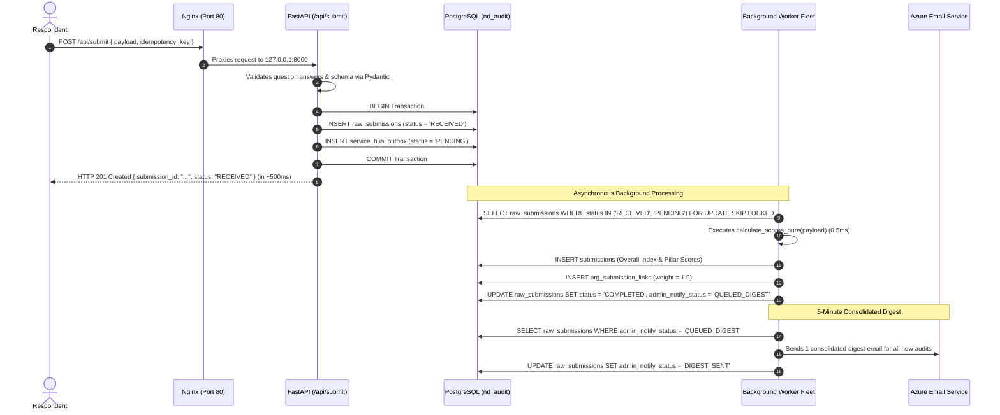

# System Architecture & Design Specification

> **In plain words:**  
> This document explains how all parts of NIWI fit together to form a reliable, high-speed platform. Using the analogy of a modern international airport: passengers (users) check in at the terminal counters (frontend), airport security checks their passports and tickets (authentication), baggage handlers route suitcases onto high-speed conveyor belts (asynchronous outbox queue), the flight control tower coordinates traffic (backend workers), and the central luggage facility stores everything safely (PostgreSQL).
>
> **Last updated:** November 5, 2026  
> **Document Status:** Active Canonical Specification  
> **Target Audience:** Systems Architects, Tech Leads, SRE Engineers, Security Auditors  

---

## Table of Contents
1. [In Plain Words: The Airport Analogy](#in-plain-words-the-airport-analogy)
2. [Guiding Architectural Principles & Constraints](#guiding-architectural-principles--constraints)
3. [High-Level System Architecture](#high-level-system-architecture)
4. [Component Responsibilities & Rationale](#component-responsibilities--rationale)
5. [End-to-End Request Walkthrough](#end-to-end-request-walkthrough)
6. [Data Flow Pipeline](#data-flow-pipeline)
7. [Architectural Decision Records (ADRs)](#architectural-decision-records-adrs)
8. [Deployment & Container Ingress Topology](#deployment--container-ingress-topology)
9. [Security Architecture & Threat Model](#security-architecture--threat-model)
10. [Scalability, High Availability & Fault Tolerance](#scalability-high-availability--fault-tolerance)
11. [Cost Optimization Profile](#cost-optimization-profile)
12. [Future Architectural Evolutions](#future-architectural-evolutions)

---

## 1. In Plain Words: The Airport Analogy

If you visit an international airport, you don't wait for your airplane to land before handing your suitcase to the ticket agent. You drop your bag at the counter, get your boarding pass in 30 seconds, and walk through security to your gate. Behind the scenes, an underground network of conveyor belts, automated scanners, and baggage handlers routes your suitcase to the airplane without holding you up in the lobby.

NIWI is built with the exact same architecture:
- When an employee finishes an assessment, they hand their answers to the front desk (`POST /api/submit`).
- The system checks their "boarding pass" (validates answers and prevents duplicate submissions) in **under 500 milliseconds** and gives them a success confirmation.
- The heavy luggage (calculating 8 complex dimension scores, linking the company, updating CRM, and sending emails) travels on an automated conveyor belt (the transactional outbox queue and background worker fleet).
- Even if 500 people drop off bags at the exact same minute, the front lobby never crashes or freezes.

*Why it exists:* Without an asynchronous pipeline, every user would be forced to wait 5 to 10 seconds while the server talks to external email providers and database locks, causing web browsers to time out during corporate survey campaigns.

---

## 2. Guiding Architectural Principles & Constraints

1. **Sub-Second User Responsiveness:** No public survey submission may take longer than 1,000ms to return an HTTP acknowledgment, regardless of background email or reporting workloads.
2. **Deterministic Mathematical Integrity:** Scoring algorithms must be 100% mathematical, repeatable, and verifiable. Scoring logic must never rely on probabilistic AI models that could hallucinate different scores for identical answers.
3. **Zero Data Loss Guarantee:** In the event of network timeouts, server reboots, or external cloud outages, every submitted audit must be preserved in transactional storage (`raw_submissions`) and retried automatically.
4. **Hardware-Adaptive Resource Safety:** Background workers must dynamically adapt to host VM resources, scaling processing power up to `Cores - 1` while strictly reserving CPU headroom so the web server never freezes.
5. **Two-Role Security Separation:** Plain administrative access (`admin`) must be strictly segregated from platform-level capabilities (`super`), such as database wiping and worker DLQ replaying.

---

## 3. High-Level System Architecture

```mermaid
flowchart TD
    subgraph Clients [Client Layer]
        BrowserUser[Public / Invited Respondent]
        BrowserAdmin[HR & System Administrator]
    end

    subgraph Ingress [Edge & Ingress (Port 80)]
        Nginx[Nginx Reverse Proxy & Static File Server]
        VueApp[Compiled Vue 3 SPA Assets]
    end

    subgraph AppServer [Application Layer (Port 8000)]
        Uvicorn[Uvicorn ASGI Web Server]
        FastAPI[FastAPI REST API Service]
        AuthEngine[JWKS & Token Security Engine]
        RouteHandlers[API Route Handlers]
    end

    subgraph AsyncPipeline [Asynchronous Worker Layer]
        OutboxDispatcher[Outbox Dispatcher Process]
        WorkerPool[Adaptive Multi-Process Worker Fleet (nproc - 1)]
        Tracker[Worker Heartbeat Coordinator]
    end

    subgraph CloudServices [Azure Cloud Infrastructure]
        PostgreSQL[(Azure PostgreSQL Flexible Server)]
        KeyVault[Azure Key Vault (Managed Identity)]
        EntraID[Microsoft Entra ID (OIDC / SSO)]
        ACS[Azure Communication Services (Email)]
        ServiceBus[Azure Service Bus (Optional)]
    end

    BrowserUser -->|HTTP / HTTPS| Nginx
    BrowserAdmin -->|HTTP / HTTPS| Nginx
    Nginx -->|Static Assets| VueApp
    Nginx -->|/api/* Reverse Proxy| Uvicorn

    Uvicorn --> FastAPI
    FastAPI --> AuthEngine
    AuthEngine -.->|Validate JWKS| EntraID
    FastAPI --> RouteHandlers

    RouteHandlers -->|Read Secrets at Boot| KeyVault
    RouteHandlers -->|Fast Ingestion (201 Created)| PostgreSQL
    
    PostgreSQL -.->|Transactional Outbox| OutboxDispatcher
    OutboxDispatcher -.->|Publish Event| ServiceBus
    ServiceBus -.->|Consume Job| WorkerPool
    PostgreSQL -.->|Fallback Direct Poll (SKIP LOCKED)| WorkerPool
    
    WorkerPool -->|Calculate Scores & Link Org| PostgreSQL
    WorkerPool -->|5-Min Consolidated Digest| ACS
    WorkerPool -->|Process Heartbeat| Tracker
```

---

## 4. Component Responsibilities & Rationale

| Component | Primary Responsibility | Why It Exists |
|---|---|---|
| **Nginx Ingress** | Serves compiled static frontend assets and reverse-proxies `/api` traffic. | Eliminates Python runtime overhead for static images and CSS; handles HTTP keep-alives and Gzip compression. |
| **FastAPI Core** | Validates payloads, handles routing, and provides OpenAPI contracts. | Sub-millisecond routing, asynchronous concurrency, and automatic Pydantic request validation. |
| **PostgreSQL Pool** | Central relational persistence with advisory locks and partial indexes. | ACID guarantees, complex relational aggregation, and atomic transaction locks. |
| **Outbox Dispatcher** | Monitors `service_bus_outbox` and safely relays events to background queues. | Solves the "Dual-Write Problem": ensures database state and messaging events are committed atomically in one transaction. |
| **Adaptive Worker Fleet** | Claims pending submissions, calculates scores, and queues email digests. | Performs scoring and third-party integrations asynchronously without blocking the user's web browser. |
| **Azure Key Vault** | Stores production database passwords and email keys. | Eliminates plaintext credentials on disk; complies with enterprise ISO 27001 and SOC 2 security standards. |
| **Microsoft Entra ID** | Authenticates administrative users using corporate Single Sign-On. | Eliminates weak admin passwords; ties platform access directly to corporate employee lifecycles. |

---

## 5. End-to-End Request Walkthrough

The following sequence details the full lifecycle of a survey submission:



---

## 6. Data Flow Pipeline

```
[Raw HTTP Payload]
       │
       ▼
[Pydantic Validation (app/models/audit.py)]
       │
       ▼
[Atomic Dual Insert (raw_submissions + service_bus_outbox)]
       │
       ▼
[Worker Claim (SELECT ... FOR UPDATE SKIP LOCKED)]
       │
       ▼
[Deterministic Scoring Engine (app/services/scoring_service.py)]
       │
       ▼
[Persistent Finalized Record (submissions + org_submission_links)]
       │
       ▼
[5-Minute Organization Batch Digest (Azure Communication Services)]
```

---

## 7. Architectural Decision Records (ADRs)

| Decision | Alternatives Considered | Reason Chosen | Trade-Off Accepted |
|---|---|---|---|
| **Deterministic Rule Scoring instead of LLM Scoring** | GPT-4o / Claude 3.5 Sonnet direct prompt scoring | Scoring compliance audits requires 100% mathematical consistency, zero hallucinations, and sub-millisecond execution at zero API cost. | Scoring algorithms must be maintained in Python code rather than adjusted via prompt engineering. |
| **Transactional Outbox Pattern** | Direct HTTP call to Azure Service Bus / Email during submission | Direct network calls during web requests cause timeouts if external cloud services experience network jitter. | Requires a background dispatcher loop polling PostgreSQL. |
| **Psycopg2 ThreadedConnectionPool** | SQLAlchemy ORM / Raw direct connections | SQLAlchemy introduces query compilation overhead; psycopg2 with pre-warmed pools delivers raw SQL performance and strict statement timeouts. | SQL queries are written in raw parameterized SQL rather than ORM abstractions. |
| **Hardware-Adaptive Worker Scaling (`nproc - 1`)** | Fixed hardcoded worker count | A fixed worker count either overwhelms small 1-core dev machines or leaves 16-core production servers underutilized. | Worker processes scale automatically on container startup; requires a custom entrypoint script. |
| **5-Minute Batched Admin Email Digest** | Immediate email sent on every audit submission | During corporate survey waves of 500 respondents, sending 500 emails blocks worker threads and triggers ACS rate limits. | Administrators receive a consolidated summary every 5 minutes rather than instant per-second email pings. |

---

## 8. Deployment & Container Ingress Topology

The entire platform compiles into a **single, multi-stage, production-hardened Docker container**:

```mermaid
flowchart TD
    subgraph HostVM [Host Virtual Machine / Azure Container Apps]
        Port80[Port 80 / 443 Ingress]
        
        subgraph Container [NIWI Multi-Stage Production Container]
            Supervisor[Supervisord Process Manager]
            NginxProc[Nginx Master & Worker Processes]
            UvicornProc[Uvicorn ASGI Web Server (Port 8000)]
            WorkerFleet[Adaptive Service Bus Workers (nproc - 1)]
            OutboxProc[Outbox Dispatcher Daemon]
        end
    end

    subgraph ManagedCloud [Azure Managed Services]
        AzurePG[(Azure Database for PostgreSQL Flexible Server)]
        AzureKV[Azure Key Vault]
        AzureACS[Azure Communication Services]
    end

    Port80 --> NginxProc
    NginxProc -->|/api/*| UvicornProc
    Supervisor --> NginxProc & UvicornProc & WorkerFleet & OutboxProc

    UvicornProc & WorkerFleet & OutboxProc --> AzurePG
    UvicornProc --> AzureKV
    WorkerFleet --> AzureACS
```

- **Process Supervision:** `supervisord` runs as PID 1, actively monitoring Nginx, Uvicorn, and background workers. If any process terminates unexpectedly, supervisord restarts it in under 500ms.
- **Port Exposure:** Only port 80 (HTTP) is exposed to the network. Uvicorn binds strictly to `127.0.0.1:8000`, completely hidden behind Nginx reverse-proxy rules.

---

## 9. Security Architecture & Threat Model

1. **Authentication Boundary:** 
   - Public respondents have zero administrative route access.
   - Administrative endpoints strictly enforce Microsoft Entra ID JWKS cryptographic verification. Tokens are validated against Microsoft's public key discovery endpoint with a 24-hour cache.
2. **Denial of Service (DoS) Defense:**
   - Public submission endpoints are protected by `SlowAPI` sliding-window rate limiters.
   - All database checkouts enforce `statement_timeout = 15000` (15 seconds), preventing resource exhaustion from runaway queries.
3. **Database Injection Defense:**
   - 100% of database queries use parameterized SQL placeholders (`%s`). String interpolation and raw format strings (`f"..."`) are strictly prohibited in database access layers.
4. **Data Isolation:**
   - Multi-tenant organization reports are filtered strictly by `organization_id` foreign keys, preventing cross-organization data leakage.

---

## 10. Scalability, High Availability & Fault Tolerance

| Failure Scenario | How the System Reacts | Impact on Users |
|---|---|---|
| **External Email Service (ACS) Down** | Email operations fail gracefully, mark outbox status as `FAILED`, and schedule retry in 5 minutes. | Zero impact on survey respondents; surveys submit and score normally. |
| **Azure Service Bus Disconnected** | Workers seamlessly fall back to polling `raw_submissions` and `service_bus_outbox` directly using `FOR UPDATE SKIP LOCKED`. | Zero dropped audits; processing continues uninterrupted via PostgreSQL queues. |
| **High Traffic Spike (e.g. 500 Concurrent Submissions)** | Submissions buffer into `raw_submissions` in 500ms; adaptive worker fleet drains the backlog in parallel across CPU cores. | No 504 Gateway Timeouts; queue drains cleanly to 0. |

---

## 11. Cost Optimization Profile

1. **Zero LLM Run-Rate Cost:** Deterministic scoring executes on existing host CPU cores at **$0.00 per audit**, avoiding external OpenAI API billing.
2. **PostgreSQL Connection Economy:** Shared `ThreadedConnectionPool` (max 25 connections) eliminates the need for expensive high-tier database instances.
3. **Batch Email Economy:** The 5-minute digest collapses hundreds of individual email calls into a single transaction, minimizing Azure Communication Services transaction fees.

---

## 12. Future Architectural Evolutions

1. **Read-Replica Database Splitting:** Route heavy administrative analytics and export queries to an Azure PostgreSQL read replica.
2. **Managed Redis Caching:** Replace in-memory `TTLCache` with distributed Redis to support multi-container horizontal scale-out.
3. **Azure OpenAI Commentary Pipeline:** Wire `app/services/ai_service.py` to Azure OpenAI inside the background worker fleet to enrich executive PDF exports with contextual narrative advice.

