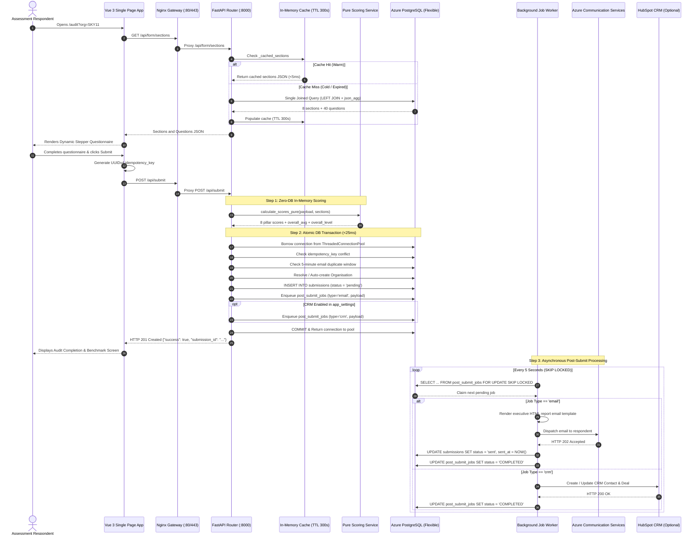
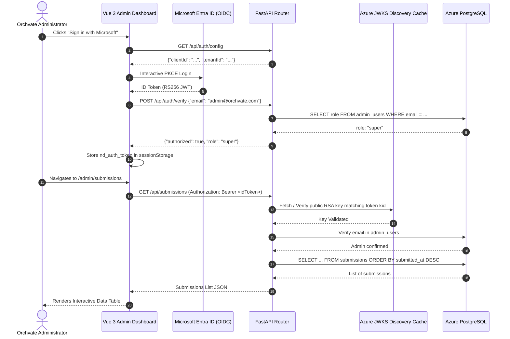
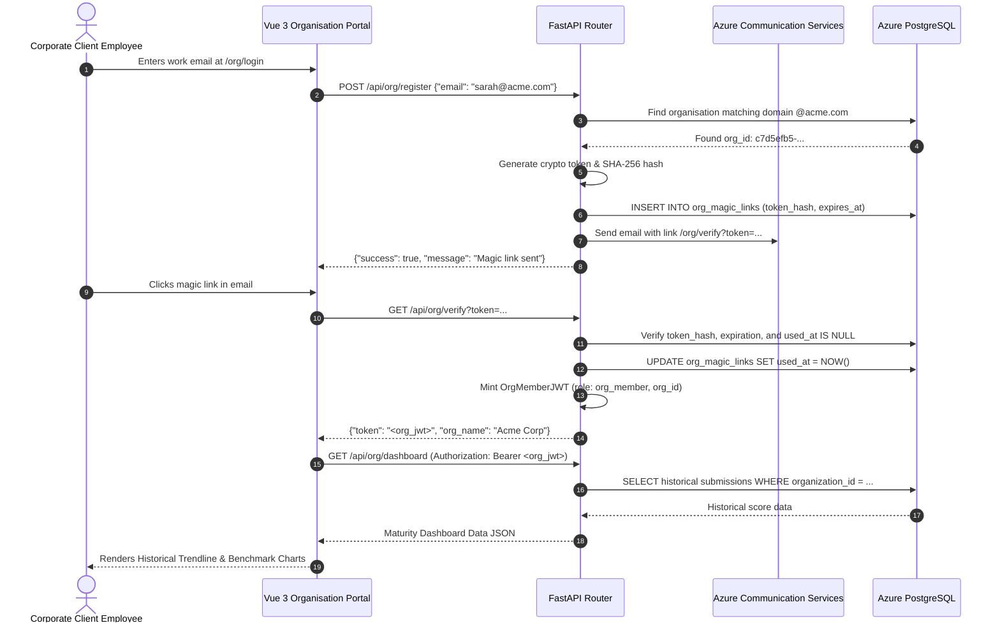

# NIWI — API Dependency Map & End-to-End Sequence Workflows

This document models the interaction flows, service choreography, database dependencies, and external integrations across the NIWI application.

---

## 1. End-to-End Submission Pipeline Flow

The following sequence diagram traces an audit assessment from public respondent entry, through dynamic schema retrieval, validation, pure scoring, short atomic database transaction, and asynchronous background worker processing:

---

## 2. Administrative Authentication & Review Workflow

This diagram maps how administrators authenticate using Microsoft Entra ID and perform report generation, score overrides, and email dispatches:

---

## 3. Client Organisation Portal Workflow (Passwordless Magic Link)

---

## 4. Frontend Component to Backend API Mapping Matrix

| Frontend Component / View | Trigger Event | Backend Endpoint | HTTP Method | Service / Persistence Layer |
| :--- | :--- | :--- | :---: | :--- |
| `AuditForm.vue` | Mount | `/api/form/sections` | `GET` | `form_sections` (Cached) |
| `AuditForm.vue` | Pre-submission | `/api/public/organisations/validate` | `POST` | `organizations` table |
| `AuditForm.vue` | Submit Click | `/api/submit` | `POST` | `calculate_scores_pure`, `submissions` |
| `useDraftSaving.js` | Stepper Change | `/api/drafts/save` | `POST` | `draft_submissions` |
| `ResumeDraft.vue` | Mount | `/api/drafts/resume` | `GET` | `draft_submissions` |
| `AdminLogin.vue` | MSAL Redirect | `/api/auth/verify` | `POST` | `admin_users` |
| `Overview.vue` | Mount | `/api/submissions` | `GET` | `submissions` table |
| `Submissions.vue` | Filter Apply | `/api/submissions/filter` | `POST` | `submissions` multi-column SQL |
| `SubmissionDetail.vue` | Score Edit | `/api/submissions/{id}/scores` | `PATCH` | `submissions`, `audit_logs` |
| `SubmissionDetail.vue` | Send Click | `/api/submissions/{id}/send` | `POST` | Azure Communication Services |
| `Organisations.vue` | Mount | `/api/manage/orgs` | `GET` | `organizations` with counts |
| `Organisations.vue` | Campaign Gen | `/api/manage/orgs/{id}/invitations` | `POST` | `organization_invitations` |
| `UserManagement.vue` | Add User | `/api/manage/users` | `POST` | `admin_users` (Super Admin) |
| `Settings.vue` | Save | `/api/settings` | `PUT` | `app_settings` |
| `FormBuilder.vue` | Add Question | `/api/form/sections/{id}/questions` | `POST` | `form_questions`, cache invalidation |

