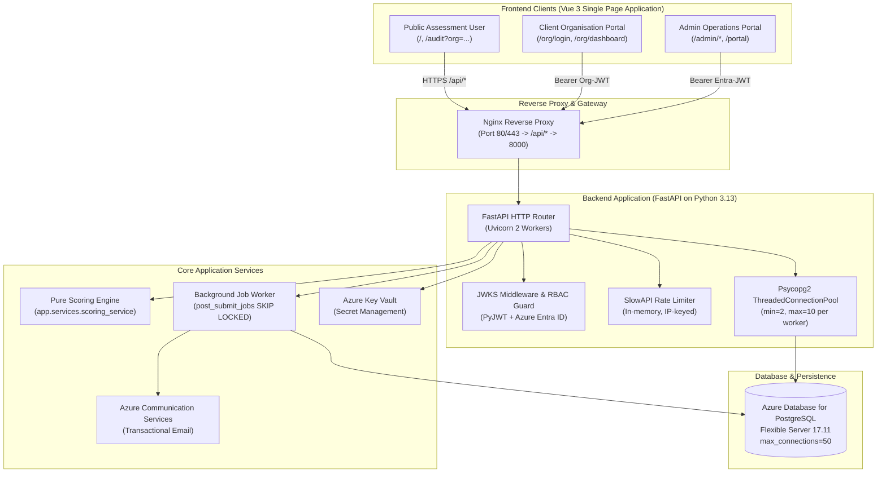

# NIWI — Complete API Documentation Index

Welcome to the official API documentation for **NIWI** (Neuroinclusive Workplace Index / Orchvate Maturity Assessment Platform).

This documentation package provides an exhaustive, verified reference for all **59 HTTP REST endpoints** implemented in the backend application and consumed across the client assessment SPA, the organisation maturity portal, and the executive administration dashboard.

---

## 1. Architecture & Platform Overview

### Key Technical Characteristics
* **Backend Runtime:** Python 3.13 with FastAPI 0.111+ and Starlette.
* **Process Model:** Multi-worker Uvicorn (2 OS worker processes managed via Supervisord).
* **Database Driver:** `psycopg2-binary` with process-local `ThreadedConnectionPool` (2–10 connections per worker; theoretical max 20).
* **Authentication Standards:**
  * **Public / Respondent:** Unauthenticated; rate-limited (SlowAPI, 100/hr, 1000/day).
  * **Organisation Member:** Stateless RS/HS256 JWT generated via passwordless magic-link verification.
  * **Platform Administrator:** Microsoft Entra ID (Azure AD) OAuth2 OpenID Connect Bearer JWT validated dynamically against Microsoft's public JWKS endpoint.
* **Reverse Proxy:** Single-container Nginx proxying `/api/*` to `127.0.0.1:8000` with static asset delivery for Vite Vue 3.

---

## 2. API Base URLs & Versioning

| Environment | Base URL | Gateway Routing |
| :--- | :--- | :--- |
| **Production** | `https://niwi.orchvate.in/api` | Nginx reverse-proxies `/api` to internal Uvicorn on port 8000. |
| **Local Full Container** | `http://localhost:8080/api` | Host port 8080 forwards to container Nginx port 80. |
| **Direct Backend (Dev)** | `http://127.0.0.1:8000/api` | Direct FastAPI service port. |

### Path Conventions
* All functional application endpoints are prefixed with `/api`.
* Dynamic dynamic form builder routes are namespaced under `/api/form`.
* Administrative management operations are namespaced under `/api/manage`.
* Client organisation member operations are namespaced under `/api/org`.
* Public pre-assessment validation helpers are namespaced under `/api/public`.

---

## 3. Documentation Package Structure

This API documentation package consists of eight specialized documents located in [`docs/api/`](file:///home/aakash.padyachi/apps/niwi/Audit/docs/api/):

| Document | Purpose & Contents |
| :--- | :--- |
| **[API_INDEX.md](file:///home/aakash.padyachi/apps/niwi/Audit/docs/api/API_INDEX.md)** | *(This document)* Executive overview, platform architecture, endpoint directory, and navigation index. |
| **[OPENAPI_SPECIFICATION.md](file:///home/aakash.padyachi/apps/niwi/Audit/docs/api/OPENAPI_SPECIFICATION.md)** | Full OpenAPI 3.1.0 specification with complete schemas, query/path parameters, request/response bodies, and status codes. |
| **[AUTHENTICATION_AND_AUTHORIZATION.md](file:///home/aakash.padyachi/apps/niwi/Audit/docs/api/AUTHENTICATION_AND_AUTHORIZATION.md)** | In-depth security guide covering Entra ID OIDC, JWKS validation, magic links, RBAC hierarchy (`super` vs `admin`), and token schemas. |
| **[API_REQUEST_RESPONSE_EXAMPLES.md](file:///home/aakash.padyachi/apps/niwi/Audit/docs/api/API_REQUEST_RESPONSE_EXAMPLES.md)** | Production-verified cURL commands, raw JSON request payloads, and full response payloads for every major API workflow. |
| **[API_ERROR_REFERENCE.md](file:///home/aakash.padyachi/apps/niwi/Audit/docs/api/API_ERROR_REFERENCE.md)** | Centralized error dictionary covering HTTP 400, 401, 403, 404, 409, 422, 429, 500, and database error states with remediation steps. |
| **[API_DEPENDENCY_MAP.md](file:///home/aakash.padyachi/apps/niwi/Audit/docs/api/API_DEPENDENCY_MAP.md)** | Sequence diagrams and dependency trees mapping frontend views to backend endpoints, background workers, and PostgreSQL tables. |
| **[API_TESTING_GUIDE.md](file:///home/aakash.padyachi/apps/niwi/Audit/docs/api/API_TESTING_GUIDE.md)** | Practical guide for QA and developers: Postman collections, cURL scripts, negative test assertions, and concurrency load harness instructions. |
| **[API_DOCUMENTATION_AUDIT.md](file:///home/aakash.padyachi/apps/niwi/Audit/docs/api/API_DOCUMENTATION_AUDIT.md)** | Verification manifest auditing 100% of discovered endpoints, matching frontend consumers, and noting dead or legacy endpoints. |

---

## 4. Complete Endpoint Directory

Across the NIWI codebase, exactly **59 endpoints** were discovered, verified, and mapped:

### 4.1 Assessment & Submission Pipeline (Public)
| Method | Path | Auth / Role | Description |
| :--- | :--- | :--- | :--- |
| `POST` | `/api/submit` | Public (Rate Limited) | Submit completed self-assessment; performs pure scoring, records transaction, and enqueues background jobs. |
| `GET` | `/api/form/sections` | Public | Fetch active questionnaire sections and questions (cached in-memory for 5 mins). |
| `POST` | `/api/public/organisations/validate` | Public | Validate existence and active status of an organisation name before audit entry. |
| `POST` | `/api/public/invitations/validate` | Public | Verify that an organisation invitation token is valid, active, and unexpired. |
| `POST` | `/api/drafts/save` | Public | Save in-progress self-assessment responses and issue a resume token via email. |
| `GET` | `/api/drafts/resume` | Public | Retrieve saved draft response state using an opaque email resume token. |
| `POST` | `/api/book-call` | Public | Submit an advisory call booking request with contact info and scheduled time. |
| `POST` | `/api/support` | Public | Submit a technical or user support ticket routed to administrative contacts. |
| `GET` | `/api/health` | Public | Container health probe verifying PostgreSQL connectivity and Azure ACS status. |
| `GET` | `/api/health/pool-metrics` | Public | Diagnostic endpoint reporting thread-safe, worker-local PostgreSQL pool metrics. |

### 4.2 Authentication & Identity Management
| Method | Path | Auth / Role | Description |
| :--- | :--- | :--- | :--- |
| `GET` | `/api/auth/config` | Public | Deliver public Entra ID Client ID and Tenant ID to bootstrap frontend MSAL. |
| `POST` | `/api/auth/verify` | Public | Verify user email against `admin_users` table to confirm portal authorization. |

### 4.3 Client Organisation Portal (Magic Link Auth)
| Method | Path | Auth / Role | Description |
| :--- | :--- | :--- | :--- |
| `POST` | `/api/org/register` | Public | Request an authentication magic link sent to an organisation employee's corporate email. |
| `GET` | `/api/org/verify` | Public | Verify magic link token, exchange for an `org_member` JWT, and set authentication cookie. |
| `GET` | `/api/org/dashboard` | `org_member` JWT | Deliver historical audit scores, submission timestamps, and benchmark aggregates for respondent's org. |

### 4.4 Admin Submission Review & Modification
| Method | Path | Auth / Role | Description |
| :--- | :--- | :--- | :--- |
| `GET` | `/api/submissions` | `admin` / `super` | List recent submissions with summary scores and statuses (supports search/sort). |
| `GET` | `/api/submissions/{submission_id}` | `admin` / `super` | Fetch exhaustive submission details including all 40 question responses and radar scores. |
| `POST` | `/api/submissions/filter` | `admin` / `super` | High-performance multi-column dynamic filter query with pagination and sort options. |
| `GET` | `/api/submissions/saved-filters` | `admin` / `super` | Retrieve saved filter presets created by the current admin user or system defaults. |
| `POST` | `/api/submissions/saved-filters` | `admin` / `super` | Save a new ServiceNow-style dynamic filter preset for quick recall. |
| `DELETE` | `/api/submissions/saved-filters/{filter_id}` | `admin` / `super` | Delete an admin-owned saved filter preset. |
| `PUT` | `/api/submissions/{submission_id}/email` | `admin` / `super` | Save modified report email body text prior to client dispatch. |
| `POST` | `/api/submissions/{submission_id}/send` | `admin` / `super` | Dispatch formatted assessment executive summary email via Azure Communication Services. |
| `POST` | `/api/submissions/{submission_id}/regenerate-email` | `admin` / `super` | Re-render HTML email template from stored submission scores and dimension breakdowns. |
| `PATCH` | `/api/submissions/{submission_id}/respondent` | `admin` / `super` | Update respondent contact attributes (name, email, role, phone, company name). |
| `PATCH` | `/api/submissions/{submission_id}/scores` | `admin` / `super` | Override individual pillar scores or overall maturity average with audit logging. |
| `PATCH` | `/api/submissions/{submission_id}/organisation` | `admin` / `super` | Reassign a submission to a different registered organisation entity. |

### 4.5 Admin Organisation Management (`/api/manage/orgs`)
| Method | Path | Auth / Role | Description |
| :--- | :--- | :--- | :--- |
| `GET` | `/api/manage/orgs` | `admin` / `super` | List all client organisations with submission counts, active status, and invitations. |
| `POST` | `/api/manage/orgs` | `admin` / `super` | Create a new client organisation entity. |
| `POST` | `/api/manage/orgs/create` | `admin` / `super` | Legacy alias for organisation creation. |
| `GET` | `/api/manage/orgs/unlinked` | `admin` / `super` | Retrieve submissions not yet formally bound to an organisation. |
| `GET` | `/api/manage/orgs/{org_id}` | `admin` / `super` | Get organisation metadata, members, and aggregated maturity statistics. |
| `PUT` | `/api/manage/orgs/{org_id}` | `admin` / `super` | Update organisation profile fields (name, industry, employee count, notes). |
| `DELETE` | `/api/manage/orgs/{org_id}` | `admin` / `super` | Soft-delete an organisation (marks `is_deleted = TRUE`). |
| `POST` | `/api/manage/orgs/{org_id}/restore` | `admin` / `super` | Restore a previously soft-deleted organisation entity. |
| `PATCH` | `/api/manage/orgs/{org_id}/status` | `admin` / `super` | Toggle an organisation's active status (`is_active: true/false`). |
| `GET` | `/api/manage/orgs/{org_id}/report-preview` | `admin` / `super` | Calculate live weighted organization maturity rollup for executive report rendering. |
| `POST` | `/api/manage/orgs/{org_id}/message` | `admin` / `super` | Broadcast a direct email communication to all confirmed organisation respondents. |
| `POST` | `/api/manage/orgs/{org_id}/link` | `admin` / `super` | Manually bind an unlinked submission to this organisation with custom weighting. |
| `PUT` | `/api/manage/orgs/{org_id}/links/{submission_id}` | `admin` / `super` | Update the statistical weighting factor (e.g. 0.0 to 1.0) of a linked submission. |
| `POST` | `/api/manage/orgs/{org_id}/invitations` | `admin` / `super` | Generate an audit invitation campaign token with expiration date and usage limits. |
| `GET` | `/api/manage/orgs/{org_id}/invitations` | `admin` / `super` | List all invitation tokens and redemptions generated for this organisation. |
| `PATCH` | `/api/manage/orgs/invitations/{invitation_id}` | `admin` / `super` | Modify invitation link constraints (expiration date, submission cap, active state). |
| `POST` | `/api/manage/orgs/invitations/{invitation_id}/revoke` | `admin` / `super` | Immediately revoke an active invitation campaign link. |
| `POST` | `/api/manage/orgs/invitations/{invitation_id}/regenerate` | `admin` / `super` | Invalidate previous link and generate fresh cryptographic token for invitation. |

### 4.6 Admin System Users & Audit Logs
| Method | Path | Auth / Role | Description |
| :--- | :--- | :--- | :--- |
| `GET` | `/api/manage/users` | `super` Only | List all provisioned administrative users and their assigned RBAC roles. |
| `POST` | `/api/manage/users` | `super` Only | Provision a new administrative user with `admin` or `super` privileges. |
| `DELETE` | `/api/manage/users/{email}` | `super` Only | Deprovision administrative access for the specified email address. |
| `GET` | `/api/manage/audit-logs` | `admin` / `super` | Query immutable audit log records documenting administrative changes and IP addresses. |

### 4.7 Platform Settings & Data Governance
| Method | Path | Auth / Role | Description |
| :--- | :--- | :--- | :--- |
| `GET` | `/api/settings` | `admin` / `super` | Fetch system configuration: notification recipients, CRM flags, thresholds, and sender profiles. |
| `PUT` | `/api/settings` | `admin` / `super` | Update global system settings and email dispatch preferences. |
| `POST` | `/api/settings/notifications/toggle` | `admin` / `super` | Quick-toggle submission notification delivery state. |
| `POST` | `/api/settings/delete-all-records` | `super` Only | Emergency governance endpoint requiring master secret password to purge all submissions. |

### 4.8 Questionnaire Form Builder
| Method | Path | Auth / Role | Description |
| :--- | :--- | :--- | :--- |
| `POST` | `/api/form/sections` | `admin` / `super` | Add a new assessment pillar/section with icon, description, and order index. |
| `PUT` | `/api/form/sections/{section_id}` | `admin` / `super` | Update section title, gating rules, tips, and sequence. |
| `DELETE` | `/api/form/sections/{section_id}` | `admin` / `super` | Delete a section and all its associated questions (invalidates metadata cache). |
| `POST` | `/api/form/sections/{section_id}/questions` | `admin` / `super` | Append a new multiple-choice assessment question with scoring weights. |
| `PUT` | `/api/form/questions/{question_id}` | `admin` / `super` | Update question wording, dependency conditions, and option score mappings. |
| `DELETE` | `/api/form/questions/{question_id}` | `admin` / `super` | Delete a question from a section (invalidates metadata cache). |

---

## 5. Security & Safety Guidelines

1. **Authentication Requirement:** All `/api/manage/*`, `/api/settings/*`, `/api/submissions/*` (except direct `/submit`), and `/api/form/*` mutations require a valid `Authorization: Bearer <token>` header.
2. **Super Admin Guard:** Endpoints managing user permissions (`/api/manage/users/*`) and data erasure (`/api/settings/delete-all-records`) strictly enforce `request.state.admin_role == "super"`.
3. **Sensitive Payload Sanitization:** Passwords, Azure Key Vault secrets, and database connection strings are never exposed over API interfaces.
4. **Idempotent Retries:** Primary submission endpoint `/api/submit` requires client-generated `idempotency_key` (UUIDv4) to guarantee zero duplicate submissions under high concurrency.

