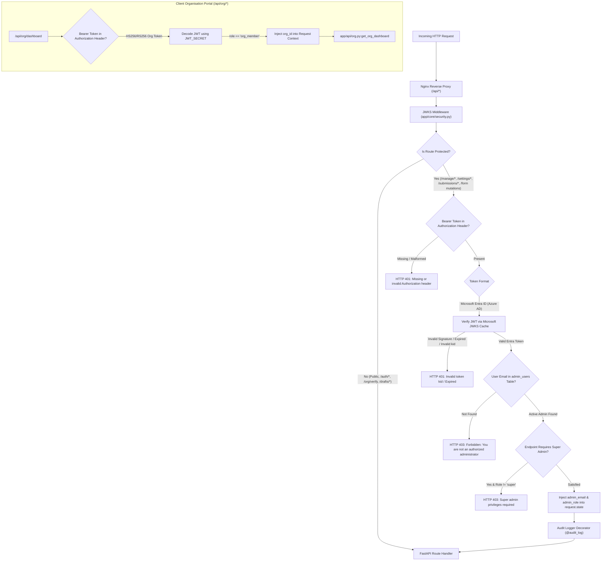

# NIWI — Authentication & Authorization Architecture Guide

## 1. Executive Summary & Security Model

The **NIWI** platform implements a dual-tier identity and access architecture designed for zero-trust isolation between public survey respondents, client organisation members, and Orchvate platform administrators:



---

## 2. Authentication Tiers & Identity Providers

| Identity Tier | Scope | Target Audience | Auth Protocol | Token Type | Invalidation Method |
| :--- | :--- | :--- | :--- | :--- | :--- |
| **Tier 1: Public / Respondent** | `/api/submit`, `/api/form/sections`, `/api/public/*`, `/api/drafts/*` | External assessment takers | None (Anonymous) | Session Draft UUID / Magic Token | Rate limiting (SlowAPI) |
| **Tier 2: Organisation Portal** | `/api/org/dashboard` | Corporate client employees | Passwordless Magic Link | RS/HS256 JWT | 7-day token expiration |
| **Tier 3: Platform Administrator** | `/api/manage/*`, `/api/settings/*`, `/api/submissions/*` | Orchvate consultants & admins | Microsoft Entra ID (OIDC) | RS256 Azure AD ID Token | Entra ID revocation & 1-hour expiry |

---

## 3. Microsoft Entra ID Integration (Admin Tier)

### 3.1 Flow & Architecture
1. **Frontend MSAL Bootstrap:**
   The frontend Vue SPA requests public Entra ID configuration parameters via:
   ```http
   GET /api/auth/config
   ```
   **Response:**
   ```json
   {
     "clientId": "2f900af5-c166-4fdb-90f1-1eaee09eeff2",
     "tenantId": "ea77fe37-fd2c-4294-87c3-8746bce6625a"
   }
   ```
2. **Interactive Sign-in:**
   The user clicks **"Sign in with Microsoft"**. The browser initiates an OAuth 2.0 authorization code flow with PKCE via Microsoft's login endpoint:
   `https://login.microsoftonline.com/{tenantId}/oauth2/v2.0/authorize`
3. **Pre-Authorization Check:**
   Upon redirect back to `/portal`, the client executes:
   ```http
   POST /api/auth/verify
   Content-Type: application/json

   {"email": "admin@orchvate.com"}
   ```
   The backend queries the `admin_users` table in PostgreSQL. If the email is enrolled, it returns `{"authorized": true, "role": "admin"|"super"}`.
4. **API Token Transmission:**
   All subsequent administrative requests transmit the Microsoft ID token in the standard HTTP header:
   ```http
   Authorization: Bearer <idToken>
   ```

### 3.2 Dynamic JWKS Validation & Key Rollover
In [`Audit/app/core/security.py`](file:///home/aakash.padyachi/apps/niwi/Audit/app/core/security.py), the backend validates Microsoft tokens against public JSON Web Key Sets:
* **JWKS Endpoint:** `https://login.microsoftonline.com/{tenantId}/discovery/v2.0/keys`
* **Cache Policy:** An in-memory `cachetools.TTLCache(maxsize=10, ttl=3600)` retains public keys for 1 hour to support Microsoft key rotation without admin lockout.
* **Header Matching:**
  The unverified token header is extracted via `jwt.get_unverified_header(token)`. The key ID (`kid`) is matched against the cached JWKS key set to retrieve the public RSA exponent (`e`) and modulus (`n`).
* **PyJWT Verification:**
  The token is verified using `RS256`. The audience (`aud`) is matched against `ENTRA_CLIENT_ID`. The issuer (`iss`) is verified against:
  * `https://sts.windows.net/{TENANT_ID}/` (v1 endpoint)
  * `https://login.microsoftonline.com/{TENANT_ID}/v2.0` (v2 endpoint)

---

## 4. Role-Based Access Control (RBAC)

The NIWI administration tier implements strict role-based authorization managed via the PostgreSQL `admin_users` table:

### Role Permissions Matrix

| Functional Capability | Super Admin (`super`) | Standard Admin (`admin`) | Org Member (`org_member`) | Public |
| :--- | :---: | :---: | :---: | :---: |
| Take Assessment (`POST /api/submit`) | Yes | Yes | Yes | **Yes** |
| Save / Resume Draft (`/api/drafts/*`) | Yes | Yes | Yes | **Yes** |
| View Org Maturity Rollup (`/api/org/dashboard`) | Yes | Yes | **Yes** | No |
| View Submissions List (`GET /api/submissions`) | **Yes** | **Yes** | No | No |
| View Single Submission (`GET /api/submissions/{id}`) | **Yes** | **Yes** | No | No |
| Override Assessment Scores (`PATCH .../scores`) | **Yes** | **Yes** | No | No |
| Dispatch Report Email (`POST .../send`) | **Yes** | **Yes** | No | No |
| Manage Organisations (`/api/manage/orgs/*`) | **Yes** | **Yes** | No | No |
| Manage Invitations (`/api/manage/orgs/.../invitations`) | **Yes** | **Yes** | No | No |
| Modify Form Questions (`/api/form/*`) | **Yes** | **Yes** | No | No |
| View Platform Audit Logs (`GET /api/manage/audit-logs`) | **Yes** | **Yes** | No | No |
| **User Provisioning (`/api/manage/users`)** | **YES** | **DENIED (403)** | Denied | Denied |
| **Deprovision User (`DELETE /api/manage/users/{email}`)** | **YES** | **DENIED (403)** | Denied | Denied |
| **Emergency Purge (`POST .../delete-all-records`)** | **YES** | **DENIED (403)** | Denied | Denied |

### Enforcement Mechanisms in Code
1. **General Admin Guard (`require_admin`):**
   ```python
   def require_admin(request: Request) -> dict:
       role = getattr(request.state, "admin_role", None)
       if not role:
           raise HTTPException(status_code=401, detail="Unauthorized")
       return {"email": request.state.admin_email, "role": role}
   ```
2. **Super Admin Guard (`require_super_admin`):**
   ```python
   def require_super_admin(request: Request) -> dict:
       user = require_admin(request)
       if user["role"] != "super":
           raise HTTPException(status_code=403, detail="Super admin privileges required")
       return user
   ```

---

## 5. Client Organisation Portal (Magic Link Auth)

### 5.1 Registration & Token Dispatch
1. An employee submits their corporate email at `/org/login`:
   ```http
   POST /api/org/register
   Content-Type: application/json

   {"email": "jane.smith@clientcorp.com"}
   ```
2. In [`Audit/app/api/org.py`](file:///home/aakash.padyachi/apps/niwi/Audit/app/api/org.py), the domain is extracted and matched against the domain of existing `organizations` or submissions.
3. If an organization match exists, an unguessable 32-byte cryptographic hex token is generated, hashed with SHA-256, and stored in `org_magic_links` with an expiration timestamp (`expires_at = NOW() + INTERVAL '15 minutes'`).
4. An invitation email containing the link `https://niwi.orchvate.in/org/verify?token=<raw_token>` is dispatched via Azure Communication Services.

### 5.2 Verification & Session Creation
1. The user opens the link, triggering:
   ```http
   GET /api/org/verify?token=<raw_token>
   ```
2. The server computes `sha256(raw_token)` and validates that:
   * The link exists in `org_magic_links`.
   * `used_at IS NULL`.
   * `expires_at > NOW()`.
3. An organisation member JWT is minted:
   ```json
   {
     "sub": "jane.smith@clientcorp.com",
     "org_id": "c7d5efb5-bd5a-4883-8bb4-6a8deab1c9b8",
     "role": "org_member",
     "exp": 1795000000
   }
   ```
4. The server marks `used_at = NOW()` and returns the token in JSON while setting an `HttpOnly`, `SameSite=Lax`, `Secure` cookie.

---

## 6. Authentication & Authorization Failure Scenarios

| Scenario | HTTP Status | Response Payload | Root Cause & Resolution |
| :--- | :---: | :--- | :--- |
| **Missing Bearer Header** | `401` | `{"detail": "Missing or invalid Authorization header"}` | Request to `/api/manage/*` lacked `Authorization: Bearer ...`. Include token. |
| **Invalid JWT Key ID** | `401` | `{"detail": "Invalid token kid"}` | Incoming Entra token was signed by a rotated key not in JWKS cache, or tenant mismatch. Refresh token or invalidate cache. |
| **Expired Microsoft Token** | `401` | `{"detail": "Token expired"}` | Azure AD token expired (> 1 hour). MSAL frontend will automatically acquire a fresh silent token. |
| **Unenrolled Admin Email** | `403` | `{"detail": "Forbidden: You are not an authorized administrator"}` | Entra authentication succeeded, but user email does not exist in `admin_users` table. Enrol email via super admin. |
| **Super Admin Privilege Breach** | `403` | `{"detail": "Super admin privileges required"}` | Standard admin attempted access to `/api/manage/users` or data purge. Role must be elevated in DB. |
| **Magic Link Expired / Reused** | `400` | `{"detail": "Invalid or expired magic link"}` | Magic link expired (> 15 minutes) or was already redeemed. Request a fresh magic link. |
| **Rate Limit Exceeded** | `429` | `{"error": "Rate limit exceeded: 100 per 1 hour"}` | Public submission or validation threshold exceeded from current IP address. Wait for cooldown. |

---

## 7. Audit Logging of Privileged Operations

Privileged modifications are monitored via the `@audit_log` Python decorator in [`Audit/app/core/security.py`](file:///home/aakash.padyachi/apps/niwi/Audit/app/core/security.py). Upon successful endpoint execution, a permanent record is inserted into `audit_logs`:

```sql
INSERT INTO audit_logs (admin_id, action_type, ip_address, timestamp)
VALUES ('admin@orchvate.com', 'edit_submission_scores', '192.168.1.1', NOW());
```

Monitored action types:
* `edit_submission_scores`
* `reassign_submission_organisation`
* `update_respondent_details`
* `send_audit_report`
* `create_organisation`
* `soft_delete_organisation`
* `toggle_organisation_status`
* `create_invitation`
* `revoke_invitation`
* `purge_all_records`

