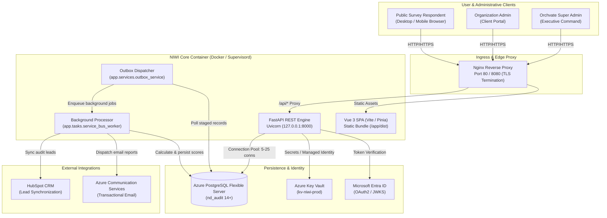
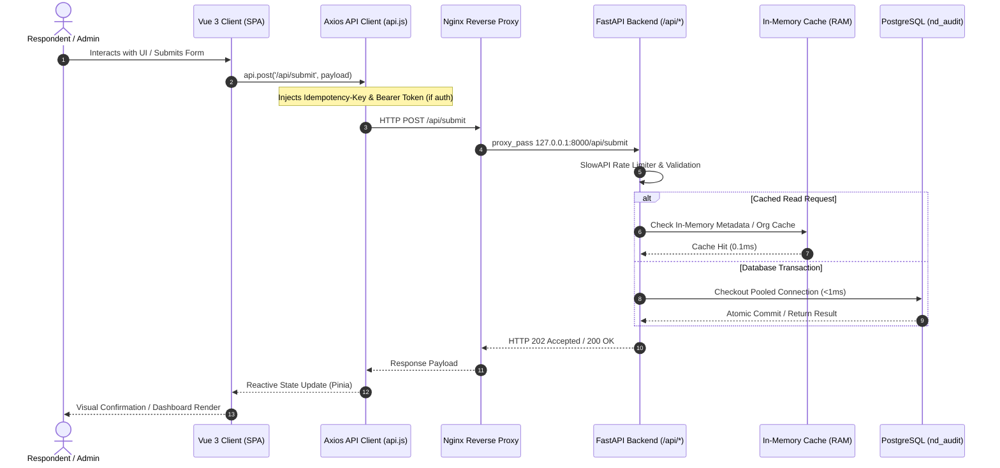
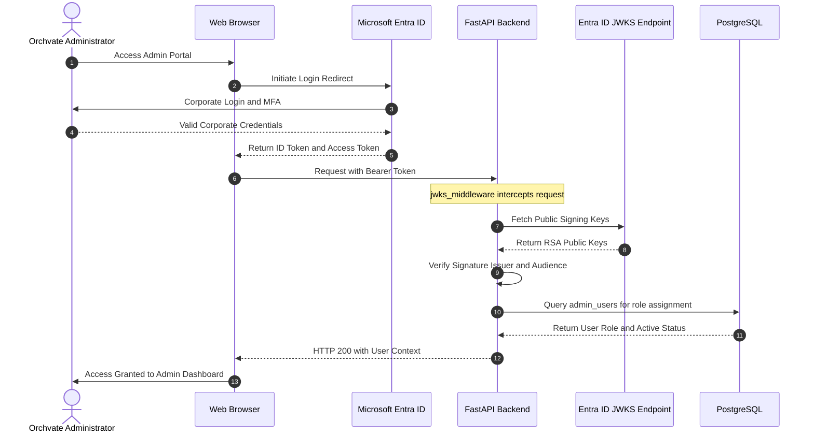
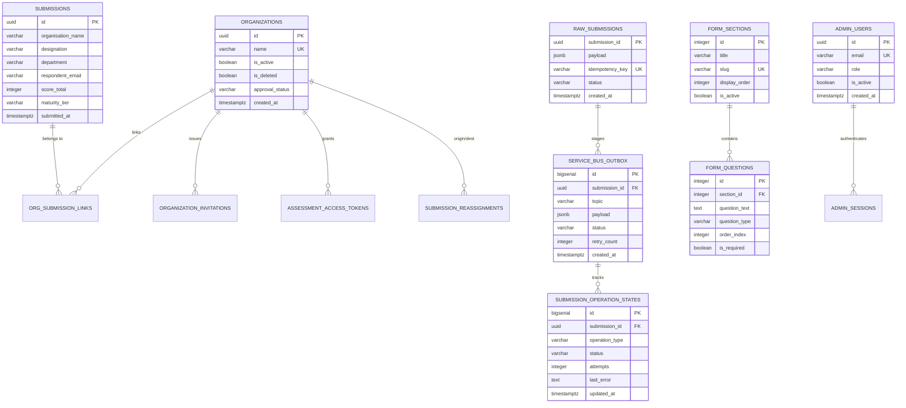
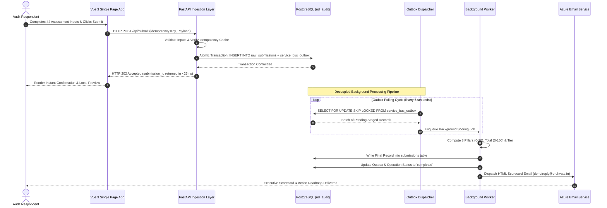
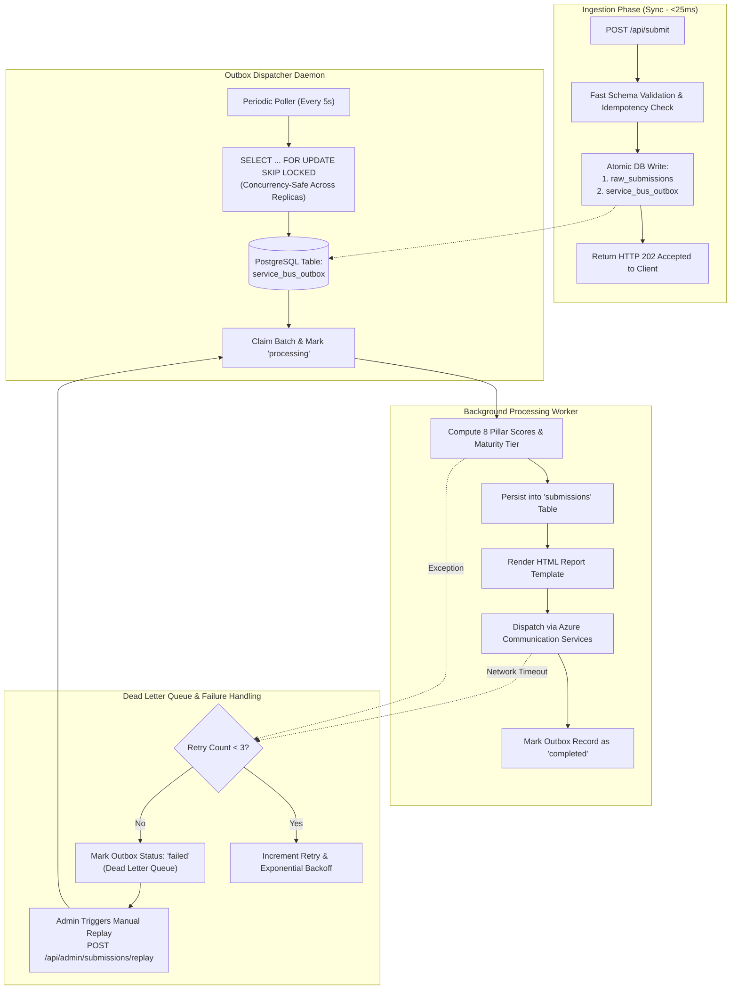
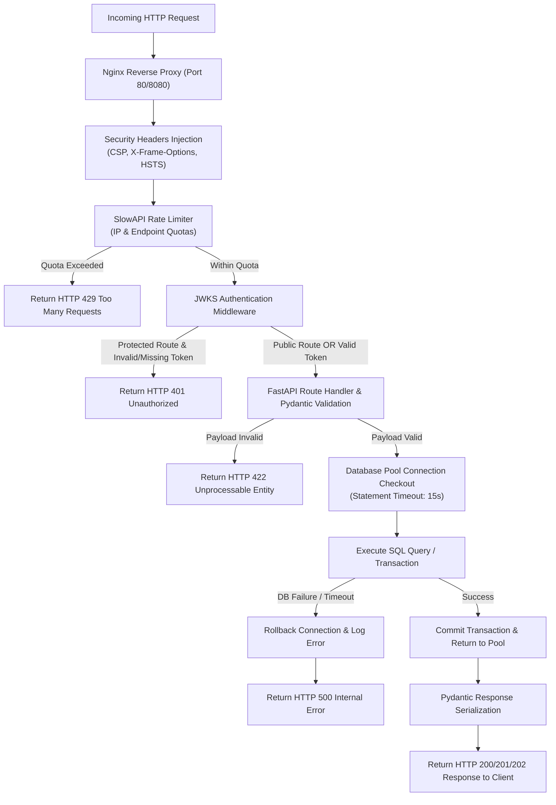
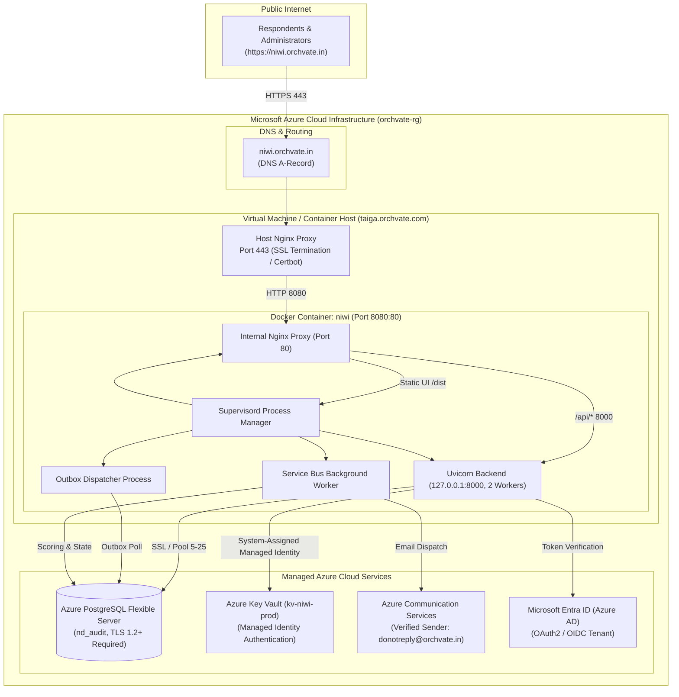
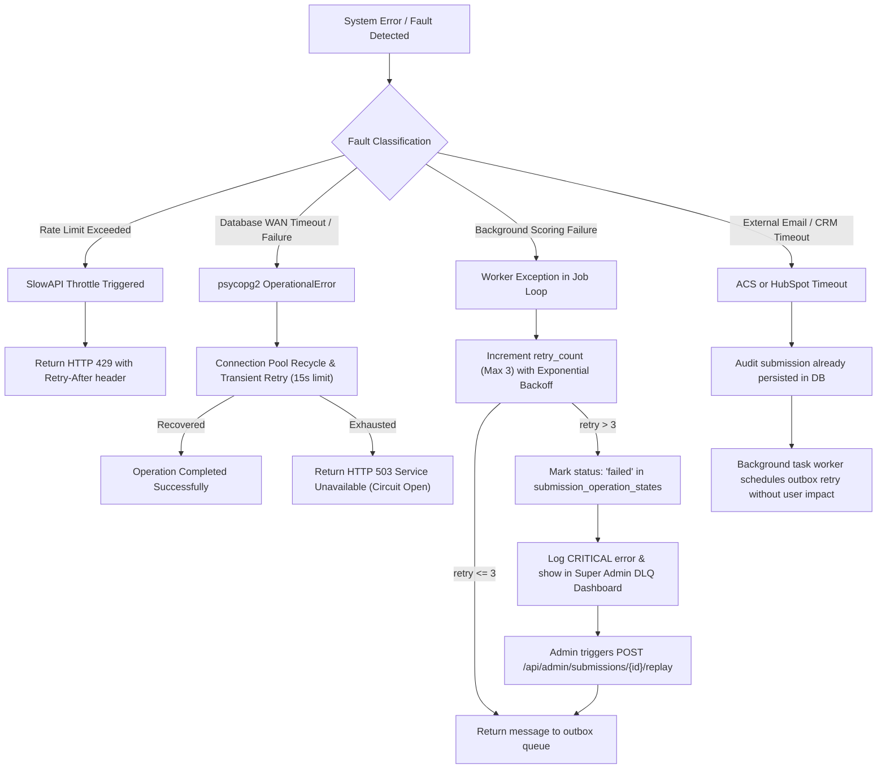

# System Architecture Diagrams

This document contains the visual architectural specifications for the Neuro-Inclusive Workplace Index (NIWI) platform, covering component topologies, communication protocols, authentication sequences, data models, and deployment infrastructure.

---

## 1. High-Level System Architecture

---

## 2. Frontend-Backend Communication Sequence

---

## 3. Microsoft Entra ID Authentication Flow

---

## 4. Database Entity-Relationship Diagram

---

## 5. Submission Lifecycle (Asynchronous Ingestion & 202 Flow)

---

## 6. Background Processing & Outbox Dispatch Architecture

---

## 7. API Request & Security Lifecycle

---

## 8. Azure Deployment Topology

---

## 9. Error Handling & Dead-Letter Queue Recovery

