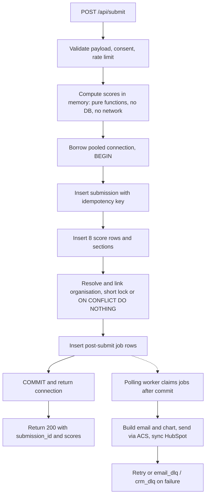

# NIWI Performance & Reliability Upgrade Plan (v3.1)

**Document type:** Technical upgrade specification (supersedes `upgrade.md`, `upgrade_v2.md`, `upgrade_v3.md`)
**Project:** NIWI, Neurodiversity Inclusion Workplace Index (NeuroMark Audit Platform v2.1)
**Target:** 100 employees of one organisation submitting audits at about the same time with zero lost submissions and fast acknowledgement; Admin Dashboard stays fast
**Status:** Proposed implementation specification. Items marked **[VERIFY]** are inferences from the audit documentation and must be confirmed in the repository before code changes.

**How to use this document:** Each rule appears once. Section 1 holds the goals and principles, Section 9 holds all test and acceptance numbers, and Section 6 holds all connection-pool rules. If two parts ever seem to conflict, stop and resolve the conflict before coding.

---

## 0. Why this plan differs from the first draft

The first draft was written from the upgrade goals alone. This plan is written from the full audit package (PRD, frontend, backend, architecture, QA/performance report, formula reference). Six findings shape it:

| # | Finding in the audit documents | Consequence |
|---|---|---|
| 1 | Pool is `minconn=2, maxconn=10` **per worker**, with 4 Uvicorn workers (about 40 connections in total). 10 users spread over 4 workers is about 2 to 3 per pool. | Pool exhaustion alone does not explain the failure. Raising `maxconn` or adding PgBouncer is not the first fix. |
| 2 | In the documented submit sequence, `pg_advisory_xact_lock(hashtext(company_name))` is taken **before** scoring, QuickChart encoding and email build, and held until commit. | A same-company burst (what a company-wide rollout is) is likely serialised end to end. This fits the 23.15 s average submit and the 30 s nginx cutoff. **[VERIFY]** |
| 3 | `GET /api/form-sections`, a trivial read, took 5,785 ms under load. | Suggests worker-level blocking (sync psycopg2 or `requests` inside `async def`). **[VERIFY]** |
| 4 | After submit, the frontend immediately renders the scorecard and radar summary from the response. | Keep the response contract. `202 Accepted` plus polling would force a UI redesign. |
| 5 | `submission_scores` and `overall_avg` are already persisted. The org score is a weighted average of linked respondents. No document measures dashboard latency. | Do not build precomputed aggregates before measuring. |
| 6 | `email_dlq` plus a polling `email_worker` already exists. | Extend that pattern instead of adding Celery and Redis. |

---

## 1. Goals, success criteria and principles

### 1.1 Success criteria

| Requirement | Acceptance condition |
|---|---|
| Submission response | Existing scorecard response contract preserved; response sent only after durable commit |
| Same-company burst | 100 same-organisation submissions tested against real PostgreSQL |
| Reliability | Zero acknowledged submissions missing; zero duplicate submissions or score rows |
| Connections | Bounded pool reused; no per-request connection creation; all connections returned, including under injected failures |
| Transaction scope | No scoring, chart, email, CRM or other network work while a transaction, lock or connection is held |
| Individual score | Calculated in memory before the write transaction and persisted in it, with exact regression match |
| Organisation score | Correct weighted result; freshness visible if updated asynchronously; no stale overwrite |
| Dashboard | Summary P95 target agreed and measured; skeleton and partial loading implemented |
| Background work | Durable, retryable, recoverable; integration failures never invalidate an audit or score |

Numeric targets and test scenarios are in Section 9.

### 1.2 Principles

1. **Diagnose before building.** Confirm the root cause with a trace and a real-Postgres reproduction.
2. **Keep the submit contract.** The respondent still gets their scorecard immediately.
3. **Hold locks and connections for milliseconds.**
4. **Persist first, then do slow work after commit,** using durable, retryable jobs.
5. **Reuse existing patterns** (the pool, `email_dlq`, `email_worker`, supervisord, the deployment process) before adding infrastructure. Do not add Celery, Redis, PgBouncer, a cache layer or a new service unless measured evidence justifies it.
6. **Never change scoring rules** in a performance change. Prove it with fixtures.
7. **Measured claims only.** Do not claim 100-user support until test results show it.

---

## 2. Evidence and hypotheses

### 2.1 Facts from the audit (k6 runs, 2026-11-02)

| Metric | 1 VU | 10 VUs |
|---|---|---|
| P95 latency | 2,698.75 ms | 30,000.73 ms |
| Average latency | 1,303.90 ms | 7,302.22 ms |
| HTTP failure rate | 0.00% | 13.95% (12/86) |
| Submissions succeeded | n/a | 4 / 10 |
| Submit endpoint, average | n/a | 23,152 ms |
| Form sections endpoint | n/a | 5,785 ms |

The 1-VU run was only 3 requests, so its P95 is not a per-endpoint baseline. Establish a proper per-endpoint baseline in Phase 0.

### 2.2 Hypotheses to verify

| ID | Hypothesis | How to verify |
|---|---|---|
| H1 | The company advisory lock is held across scoring, email build and QuickChart work, serialising same-company submissions. | Log timestamps for lock acquired, lock released, commit. Query `pg_locks` and `pg_stat_activity` during a k6 run. |
| H2 | The 6 "lost" submissions were client or nginx timeouts, and some may have been committed. | After a k6 run, count rows in `submissions` against attempts. Compare with nginx logs. |
| H3 | Handlers are `async def` and call blocking code, stalling each worker's event loop. | Inspect `routes.py`. Measure event-loop lag under load. |
| H4 | QuickChart work is an actual network call inside the request, not only URL encoding. | Read `scoring_service.py` around lines 262 to 287. Time `calculate_scores` and `build_email` separately. |
| H5 | The IP/email duplicate check and the rate limiter can block legitimate users sharing an office IP; the limiter may be per-worker in-memory. | Read the duplicate-check SQL and the SlowAPI storage config. |
| H6 | Scoring is pure (no DB or network call) and fast. | Read `scoring_service.py`. Time it in isolation. If it needs question metadata from the DB, that data can be loaded before the write transaction. |

---

## 3. Phase 0: Diagnose (required before Phase 1)

Deliverable: a one-page current-state audit committed to the repo.

1. Read: `app/api/routes.py`, `app/core/database.py`, `app/services/scoring_service.py`, `app/services/org_scoring_service.py`, `app/services/crm_service.py`, `app/tasks/email_worker.py`, `app/api/orgs.py`, `app/api/org.py`, `app/api/drafts.py`, `AuditForm.vue`, `api.js`, the Dockerfile, supervisord and nginx configs, and the migrations folder.
2. Record: Uvicorn worker count, ACA replica min and max, Postgres tier and `max_connections`, nginx `proxy_read_timeout`, rate-limiter storage, where `email_worker` is started (per Uvicorn worker or once).
3. Record how the stored email body is used by the admin UI (`PUT /submissions/{id}/email`, `regenerate-email`, `send`), because moving the email build after commit changes when the body exists.
4. Instrument one submit with phase timings: validation, duplicate check, lock wait, scoring, email build, chart work, each insert, org link, commit.
5. Reproduce with k6 against **real PostgreSQL** (not the pytest mocks) with two shapes: 10 users with the **same** company name, and 10 users with **different** company names.
6. Decision gate: record which hypotheses were confirmed. If H1 or H3 is not confirmed, revisit the Phase 1 and Phase 3 designs before proceeding. If H6 is not confirmed, isolate the slow dependency before keeping scoring in the request.

---

## 4. Phase 1: Fix the submit path (response contract unchanged)

### 4.1 Target flow



### 4.2 Required changes

1. **Split `calculate_scores`.** Scoring (CALC-001 to CALC-006) becomes a deterministic, side-effect-free function with no network calls. If it needs configuration or question metadata from the database, load that before opening the write transaction. Email HTML, QuickChart work and anything slow move into a separate `build_email` step that runs after commit.
2. **Compute before connecting.** Validation and scoring finish before a pooled connection is borrowed.
3. **Narrow the organisation lock.** Choose one:
   - **Option A (no schema change, lowest risk):** keep `pg_advisory_xact_lock(hashtext(normalised_name))`, but take it only around "find or create organisation and link", as the last step before commit, so it is held for milliseconds.
   - **Option B (needs a migration):** add a unique index on the normalised organisation name (check existing duplicates and `is_deleted` rows first) and use `INSERT ... ON CONFLICT DO NOTHING`, then `SELECT` the id. Do **not** use `ON CONFLICT DO UPDATE`, and do not update the organisation row on every submission. Either would take a row lock on the one shared organisation row and serialise a same-company burst again.
   Start with Option A. Move to Option B only if lock contention remains measurable.
4. **Bulk-insert score rows** (for example `execute_values`) if the code currently inserts them one at a time.
5. **One short transaction.** Submission, answers and sections, score rows, organisation link and job rows commit together. Nothing is acknowledged before commit. No external calls inside the transaction.
6. **Organisation aggregate is not part of this transaction.** The default is to leave the existing organisation score behaviour unchanged (Section 7.3). Only if measurement proves a stored aggregate is needed does an after-commit, coalesced aggregate job apply.
7. **Idempotency key.**
   - The frontend generates a UUID per submission attempt and sends it with `POST /api/submit`. The same key must be reused when the same attempt is retried. This is a small change in `AuditForm.vue` and `api.js`; the response contract is unchanged.
   - Add a unique index on the key. Insert the submission first with `ON CONFLICT (idempotency_key) DO NOTHING RETURNING id`.
   - **Retry while the first request is still running:** the second insert waits on the first transaction. When it commits, the second request sees the conflict and returns the original result; if the first rolls back, the second proceeds. Bound the wait with a statement timeout so it returns a clear error instead of hanging.
   - On a replay, return the original `submission_id` and the scores reconstructed from persisted rows. A replay must not create a second audit or enqueue duplicate jobs. Job creation uses `UNIQUE (submission_id, job_type)` with `ON CONFLICT DO NOTHING`.
   - A disabled submit button is not protection.
8. **Review the 5-minute duplicate check (H5).** Email-based protection is fine. IP-only blocking is not acceptable for offices behind one public IP.
9. **Proxy timeouts are a safety net, not the fix.** Document any nginx timeout change.

### 4.3 Response contract

Keep the current successful response (`submission_id`, `scores`, and so on) so `AuditForm.vue` needs no redesign. Produce `scores` from the pure scoring step. Do not introduce `202 Accepted` and status polling unless Phase 0 shows scoring itself is too expensive or the existing response cannot be preserved safely.

---

## 5. Phase 2: Post-commit background work

### 5.1 Design

Use a DB-backed job table and a polling worker, extending what `email_dlq` and `email_worker.py` already do. Conceptual table (adapt to the existing schema and naming):

```
post_submit_jobs
  id, submission_id, job_type ('email' | 'crm' | 'report'),
  status ('PENDING' | 'PROCESSING' | 'DONE' | 'RETRY' | 'FAILED'),
  attempts, next_attempt_at, last_error, created_at, updated_at
  UNIQUE (submission_id, job_type)
```

Worker rules:

1. Claim with `SELECT ... FOR UPDATE SKIP LOCKED` in a short transaction, then return the connection before any network call.
2. If every Uvicorn worker starts a poller, `SKIP LOCKED` makes that safe. Document how many pollers run and count them in the connection budget.
3. Build the email from **persisted scores** (the existing `regenerate-email` endpoint already shows this works). Call QuickChart with a timeout and fall back to the table-only layout the PRD specifies.
4. Retry with exponential backoff and jitter and a maximum attempt count. After the limit, mark `FAILED`, keep the row, and provide a way to inspect and replay it.
5. Add `crm_dlq` or an equivalent job type so HubSpot failures stop being silently discarded (DEF-006).
6. Reclaim jobs stuck in `PROCESSING` after a timeout so a worker crash does not strand work.

### 5.2 Failure isolation

A chart, email or HubSpot failure never undoes a saved audit or changes a correct score. Track job status separately. Do not add status columns that duplicate the existing `submissions.status`.

### 5.3 Admin email behaviour

Today the email body may exist as soon as the submission does. After this change it exists once the job has run. The admin UI needs a clear "email being prepared" state, and `send` must not send before the body exists. **[VERIFY]** the current behaviour (Section 3, item 3).

---

## 6. Phase 3: Connections and event loop

### 6.1 Pool lifecycle rules (single source of truth)

- Reuse the existing bounded pool. Never create a database connection per request.
- Initialise the pool once per application process at startup and close it at shutdown. Do not create a pool or raw connection inside a request handler.
- Do not create connections before forking and share them across workers. Each worker process initialises its own pool after it starts.
- Borrow a connection for one short unit of work and return it with a context manager or `try/finally` on every path, including errors, timeouts and cancellation. Never share one live connection concurrently across requests.
- Never hold a connection while doing chart, email, CRM or other network work.
- Set a bounded pool-acquire timeout and a statement timeout. When capacity is exhausted, fail fast with a clear error and log the wait, instead of letting requests sit until the proxy timeout.
- Track checkout wait, checked-out count, idle count, checkout timeouts and connections created. Connections should be created during warm-up or replenishment, not once per request.
- Use indexes only after reading query plans.

### 6.2 Blocking calls (H3)

If handlers are `async def` and call psycopg2 or `requests` directly, either declare them as plain `def` so FastAPI runs them in its threadpool, or wrap blocking calls with `run_in_threadpool`. An async driver is a larger change and is not required for this goal. Align the threadpool size with the pool size; if the threadpool is larger than the pool, requests queue on acquisition, so keep the acquire timeout short.

### 6.3 Pool budget

```
total_possible_connections = replicas × workers_per_replica × pool_max_per_worker
```

Add connections for the email and CRM pollers, migrations, monitoring and admin tools. Compare with the real `max_connections` of the Azure Postgres tier (small tiers allow only a limited number) and keep headroom. Do not set `maxconn=40` per worker by default: with 4 workers that could mean 160 connections per replica.

### 6.4 PgBouncer

Evaluate only if the load tests in Section 9 show connection churn or a hard connection limit after the Phase 1 fixes. Before using transaction pooling, check use of session state, prepared statements, temporary tables and advisory locks. `pg_advisory_xact_lock` is transaction-scoped and should be compatible, but verify.

---

## 7. Phase 4: Admin Dashboard

### 7.1 Measure first

The audit has no dashboard latency measurement. Before changing the backend:

1. Measure `GET /api/manage/orgs/{id}/scores`, `GET /api/submissions`, `GET /api/org/dashboard` and the analytics calls at realistic sizes (for example 100, 1,000 and 10,000 submissions).
2. Record queries per request and `EXPLAIN (ANALYZE, BUFFERS)` for the slow ones.
3. Agree a target with the product owner (proposed: summary P95 under 2 s in the staging-like environment). Record backend latency and frontend time to first useful content. Skeleton visibility alone does not count as a performance pass.

### 7.2 Backend: optimise in this order

1. Fix N+1 queries and repeated lookups.
2. Add only indexes supported by query plans and measured filter and join patterns.
3. Paginate respondent lists and large tables; do not send every answer to the browser for a summary view.
4. Return a compact initial summary. Load independent secondary sections (trends, respondent table, cohort breakdowns) separately or through a few section-oriented endpoints. Avoid one enormous response and avoid dozens of tiny requests.
5. Serve filtered and cohort views (`filter_service.py`) with SQL aggregation over persisted scores. They cannot be replaced by one static organisation aggregate.
6. **Only if measurement still misses the target after steps 1 to 5**, introduce a versioned aggregate per organisation (Section 7.3).
7. Cache only after measuring. Cache keys must include the verified organisation identity, filters and data or aggregate version. Never trust a client-supplied organisation ID alone.

### 7.3 Scoring and organisation-score timing contract

**Individual score.** Deterministic scoring runs in the submission request, in memory, before the write connection is borrowed, and is persisted in the same transaction (if H6 is confirmed). The employee never sees their score as "pending". Do not move scoring to a background worker unless Phase 0 shows it is slow or impure.

**Organisation score.** It is a weighted average across eligible linked submissions (CALC-010 to CALC-014). Measure the current calculation first.

- If it is already fast, **keep it as is.** Do not add an aggregate table for architectural neatness.
- If it is too slow, store a versioned aggregate updated after commit by a coalesced per-organisation job. The job must:
  - re-read the authoritative eligible submission and weight set when it runs
  - apply the existing weighting, exclusions and rounding exactly, including the CALC-014 reconciliation that currently lives in `Organisations.vue`
  - coalesce a burst so 100 submissions for one organisation schedule one effective refresh, not 100
  - publish a result only if it is still current, so a slower job on older data never overwrites a newer result
  - re-run when weights, eligibility or relevant submissions change
  - record source submission count, aggregate version and calculation timestamp
- Moving CALC-014 from `Organisations.vue` to the backend is a separate approved change, not an incidental performance refactor.
- Never block the employee's submission acknowledgement on organisation-wide aggregation.

### 7.4 Freshness contract (only where an aggregate is refreshed asynchronously)

Return `aggregate_version`, `source_submission_count`, `last_calculated_at` and `aggregation_status` (`CURRENT` or `UPDATING`). Show the last valid result with an unobtrusive "Updating results" indicator and a visible last-updated time. Never imply the aggregate includes submissions not yet incorporated. Agree the freshness expectation with the product owner (for example, updated within a few seconds of a completed submission) and test it.

### 7.5 Frontend skeleton and partial loading (required release scope)

This ships in parallel with the backend work because it needs no new scoring architecture.

1. Render the dashboard shell immediately, with layout-matched skeletons for score cards, pillar chart, summary metrics and table rows.
2. Fetch the summary promptly and independent sections in parallel. Replace each skeleton as its own data arrives; do not wait for every chart or table.
3. On refresh, keep the last valid data visible and show a subtle refreshing state.
4. Handle initial loading, partial loading, empty, stale or updating, and error states explicitly. Never leave an infinite skeleton.
5. A failure in one section must not blank the dashboard; show a local retry.
6. Cancel or ignore responses when the admin changes organisation or filters, so old responses cannot overwrite new context. Avoid duplicate requests and use sensible backoff for any freshness polling.
7. Accessibility: `aria-busy`, screen-reader status text, keyboard-usable retry actions and respect for `prefers-reduced-motion`. NIWI's design principles avoid distracting animation, so keep shimmer subtle or disable it for reduced-motion users.
8. Follow existing Vue conventions. Extract focused dashboard section components rather than adding to the 5,000+ line views.

---

## 8. Non-negotiable rules

1. **Scoring rules do not change.** Yes=4, Partially=2, No=0, Not Sure=0, N/A excluded; eight pillars out of 20; gating on `has_physical_workspace` and `has_suppliers`.
2. **Regression fixtures first.** Capture current outputs (rounding, N/A rescaling, gated pillars, low-visibility flags, weighted org scores and the CALC-014 adjustment) before refactoring. New results must match exactly, including the calculation in the Vue code.
3. **Tenant isolation stays intact.** Org member access derives from the verified JWT's `org_id`, never a submitted ID. Status and scorecard endpoints must not expose another respondent's data.
4. **No raw answers, tokens or secrets in logs.** Use correlation IDs and submission IDs.
5. **No acknowledgement before commit.** A success response means the submission and its job rows are committed.
6. **Backward-compatible migrations.** Do not drop old columns or routes in the same release that introduces the replacement.

---

## 9. Test plan and acceptance

Tests run against **real PostgreSQL** in a staging-like environment. The existing pytest suite uses an in-memory mock (`MockConnection`) and cannot reproduce lock or pool behaviour, so also run it against a containerised Postgres.

### 9.1 Scenarios

| Scenario | Purpose |
|---|---|
| Smoke, 1 user | Baseline correctness and per-endpoint latency |
| 10 users, **same company** | Reproduce the original failure |
| 10 users, different companies | Separate lock effects from other causes |
| 25, 50, **100 users, same company** | The principal acceptance scenario (a company-wide rollout) |
| 100 users, mixed companies | Normal multi-tenant load |
| Full journey | Open form, `GET form-sections`, org search, draft save, resume, submit |
| Stress, 150 to 200 | Find the saturation point |
| Soak, 50 to 100 over an extended period | Leaks and job backlog |
| Retry storm, including concurrent duplicates | Same idempotency key sent twice at once must produce one audit |
| Worker kill | Kill a worker mid-job; confirm jobs recover |
| Pool exhaustion and exceptions | Inject DB errors during a burst; confirm the pool stays bounded and connections return |
| Integration failure | Force QuickChart, ACS and HubSpot failures; confirm audits and scores stay valid |
| Dashboard partial failure | Fail one section; other sections stay visible and retry works |

Distinguish "100 active sessions" from "100 requests in the same instant", and test both.

### 9.2 Metrics

P50, P95 and P99 per endpoint; 4xx and 5xx rates; attempted vs persisted vs acknowledged submissions; duplicate submissions and score rows; lock wait time; pool acquire wait, timeouts and connections created during the test; Postgres active and idle connections; transaction duration; slow queries; CPU and memory per worker; event-loop lag; job backlog, oldest job age, and success, retry and failed counts; aggregate freshness (if used); dashboard API latency; frontend time to first useful content.

### 9.3 Proposed acceptance targets

| Metric | Target |
|---|---|
| Acknowledged submissions missing from the DB | 0 |
| Duplicate submissions and duplicate score rows | 0 |
| `POST /api/submit` P95, 100 users, same company | Under 2.5 s (measured on that endpoint alone) |
| HTTP 5xx during the agreed load test | Under 1% |
| New DB connections created per request | 0 |
| Scoring regression | 100% match to approved fixtures |
| Dashboard summary P95 | Product-agreed target (proposed under 2 s) |
| Email, chart or CRM failure | No effect on the saved audit or scores |
| Worker restart | Pending jobs recover |
| Tenant isolation | No cross-organisation exposure |

Record environment details and results. Do not claim success from a single run.

---

## 10. Monitoring

Use structured logs with a correlation ID and submission ID. Track: submissions accepted and failed, lock wait, pool utilisation and wait, Postgres connections, job backlog and oldest job age, retries and failed jobs, email and CRM failure counts, dashboard latency and errors. Alert on a growing backlog, old pending jobs, pool exhaustion, DB connection errors, repeated worker crashes and elevated submit errors.

---

## 11. Rollout and rollback

1. Feature branch; add scoring regression fixtures.
2. Phase 0 diagnostics and decision gate.
3. Phase 1 behind a feature flag or controlled rollout; test in staging.
4. Phase 2 job table migration (backward-compatible) and worker.
5. Phase 3 changes; retest.
6. Run the 1, 10, 25, 50 and 100 user scenarios (Section 9).
7. Roll out gradually in production with monitoring.
8. Keep a tested rollback path: turning the flag off returns to the old path, and the new tables are additive.
9. Avoid mixed-version behaviour in which old and new code interpret the same job differently.

---

## 12. Work breakdown

| Priority | Item | Deliverable |
|---|---|---|
| P0 | Current-state audit and hypothesis checks (H1 to H6) | Audit note and decision gate |
| P0 | Instrument response phases, lock duration and pool lifecycle | Evidence for the real bottleneck |
| P0 | Scoring regression fixtures (backend and CALC-014 in Vue) | Baseline suite |
| P0 | Pure scoring split; compute before connecting (if H6 holds) | Short transaction |
| P0 | Narrow the org lock (Option A) | Lock held for milliseconds |
| P0 | Server-side idempotency key, including concurrent duplicates | No duplicates on retry |
| P0 | Post-commit jobs; email and QuickChart moved out | Fast submit |
| P0 | Re-run k6 on real Postgres, same-company burst | Measured results |
| P1 | Fix blocking calls in handlers (if H3 holds) | Responsive workers |
| P1 | Job retry and reclaim; `crm_dlq` | No silent CRM loss |
| P1 | Pool budget and timeouts; PgBouncer only if needed | Controlled connections |
| P1 | JWKS `TTLCache` (DEF-003) | No admin lockout on key rotation |
| P1 | pytest against containerised Postgres | Verified test report |
| P1 | Monitoring and alerts | Operational visibility |
| P1 | Dashboard measurement and query optimisation | Evidence-based performance |
| P1 | Skeleton loading and partial states | Immediate visual feedback |
| P2 | Decompose `AuditForm.vue` and `Organisations.vue` | Maintainability |
| P2 | Standard PyJWT issuer validation (DEF-004) | Cleaner auth |

---

## 13. Deliberately deferred

Reintroduce only when the stated trigger occurs.

| Deferred item | Reconsider when |
|---|---|
| `202 Accepted` plus async scoring and status polling | Phase 0 shows scoring is slow or impure (H6 fails), or the existing response cannot be preserved |
| Celery and Redis | The DB-backed job worker cannot keep up at the load measured in Section 9 |
| Separate outbox dispatcher | Jobs must be published to an external broker |
| Precomputed organisation aggregates | Dashboard measurements miss the target after the query and index fixes in Section 7.2 |
| PgBouncer | Connection limits remain a problem after Phase 1 and the pool budget in Section 6.3 |

---

## 14. Definition of done

- A submission is acknowledged only after its data and job rows are committed.
- The company lock and DB connection are held only for short database work.
- The 100-user same-company burst passes on real PostgreSQL with zero lost and zero duplicate submissions and the agreed latency target.
- Retries, including concurrent duplicates, return the original result.
- The pool stays bounded, connections return on every path, and no connection is created per request.
- Scoring matches the fixtures exactly, including the CALC-014 reconciliation.
- Email, chart and CRM failures never affect saved audits; failed jobs are inspectable and replayable.
- Worker restarts recover pending jobs.
- Tenant isolation and authentication are unchanged.
- Dashboard measurements are recorded; any optimisation is justified by them; skeleton and partial states are implemented.
- Load-test results, migration steps and rollback instructions are documented.

---

## Appendix: Changes from v3

1. Removed the references to a non-existent "Phase 5"; they now point to the Section 9 load tests.
2. "Scoring is pure" is now hypothesis H6, not a stated fact.
3. Organisation aggregate default is now "leave current behaviour unchanged"; an aggregate only if measurement requires it.
4. Idempotency now covers a retry that arrives while the first request is still running.
5. Option B no longer uses `ON CONFLICT DO UPDATE`, to avoid re-serialising on the shared organisation row.
6. Consolidated duplicated material: principles, pool rules, dashboard targets and acceptance numbers each appear once.
7. Fixed heading levels and replaced the v1-to-v2 history in Section 0 with the evidence that shapes the plan.
8. Added a per-endpoint baseline requirement, since the 1-VU run had only 3 requests.
