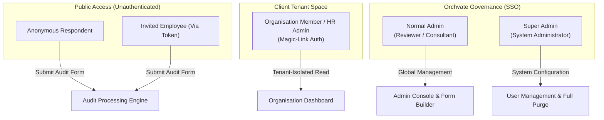
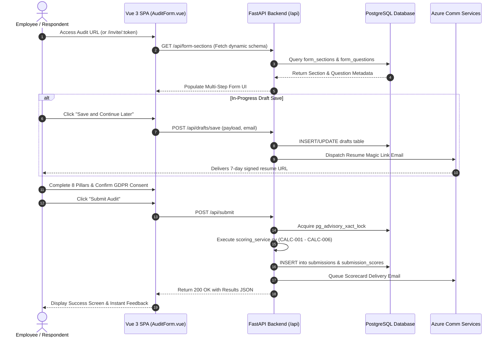
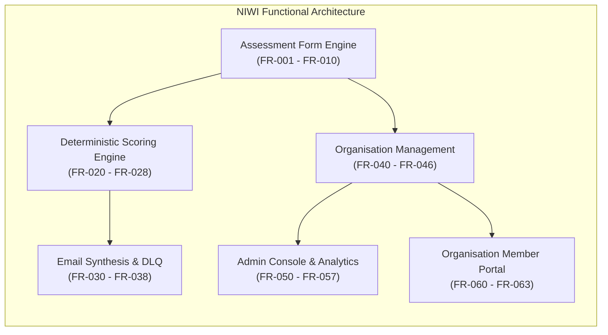

# Product Requirements Document (PRD) — Enhanced Technical Edition
## NIWI — Neuro-Inclusive Workplace Index Platform (Version 2.1)
### Prepared for: Product Management, Engineering, QA, and Executive Stakeholders
### Document ID: DOC-01-PRD-V2
### Audit Date: November 2026
### Platform Operator: Orchvate | Production URL: https://niwi.orchvate.in

---

## 1. Document Control & Version History

| Version | Date | Author / Role | Status | Description of Change |
|---|---|---|---|---|
| 1.0 | 2026-11-03 | Senior Product Auditor | Baselined | Initial audit reconciliation against repository code. |
| 2.0 | 2026-11-03 | Principal Product Auditor & Systems Architect | **Approved Audit Upgrade** | Comprehensive second-pass upgrade: full 17-point structural breakdown for all core requirements, explicit business problem justifications, user journey sequence flowcharts, and bidirectional requirement traceability matrix. |

> [!IMPORTANT]
> **Audit Reconciliation Notice:** This document records what has been verified as implemented within the actual NIWI codebase (`app/`, `frontend/`, `migrations/`). Capabilities marked as "IMPLEMENTED" cite exact file paths and line numbers. Discrepancies between planned features and current source code are explicitly identified.

---

## 2. Product Overview, Vision & Objectives

### 2.1 Product Overview
The **Neurodiversity Inclusion Workplace Index (NIWI)**, commercially branded as the **NeuroMark Audit Platform**, is an enterprise B2B SaaS platform engineered by **Orchvate**. It provides organisations with an automated, scientifically grounded mechanism to evaluate, quantify, and advance their workplace inclusion practices for neurodivergent professionals.

The system encompasses:
1. An accessible, multi-step public audit questionnaire completed by employees and organizational representatives.
2. An automated deterministic scoring engine evaluating 8 distinct organizational pillars.
3. An administrative reporting and customer relationship management suite.
4. A tenant-isolated organizational reporting portal with weighted multi-respondent aggregation.

### 2.2 Product Vision
To establish the global operational standard for neuro-inclusive enterprise benchmarking, replacing qualitative assumptions with empirical diagnostic scorecards and actionable strategic intervention roadmaps.

### 2.3 Strategic Business Objectives
| ID | Business Objective | Target KPI | Verified Implementation Status | Evidence |
|---|---|---|---|---|
| **OBJ-01** | Standardized Multi-Pillar Diagnostic | Evaluate 8 organizational dimensions on a scale of 0–20 points. | **IMPLEMENTED** | `app/services/scoring_service.py` |
| **OBJ-02** | Friction-Free Self-Service Auditing | Enable respondents to save progress and resume across sessions. | **IMPLEMENTED** | `app/api/drafts.py`, `useDraftSaving.js` |
| **OBJ-03** | Automated Report Synthesis | Deliver instantaneous diagnostic scorecards and radar charts via email. | **IMPLEMENTED** | `app/services/scoring_service.py`, Azure ACS |
| **OBJ-04** | Enterprise Multi-Tenancy Scoping | Support weighted multi-respondent scoring within corporate boundaries. | **IMPLEMENTED** | `app/services/org_scoring_service.py` |
| **OBJ-05** | Enterprise Identity Integration | Enforce Microsoft Entra ID SSO for administrative governance. | **IMPLEMENTED** | `app/core/security.py`, `authConfig.js` |
| **OBJ-06** | Secure Anonymous Feedback | Provide safe reporting with automated organization linking. | **IMPLEMENTED** | `app/api/routes.py` (Advisory locks) |

---

## 3. Problem Statement & Strategic Justification

Organizations face severe challenges in executing neuro-inclusive workplace transformations:
- **Absence of Quantitative Baselines:** Organizations cannot systematically measure neuro-inclusive maturity without standardized tooling.
- **Survey Fatigue & Drop-Off:** Traditional long-form surveys suffer high abandonment rates when users cannot save progress.
- **Contextual Inapplicability:** Remote or specialized organizations are unfairly penalized when forced to answer irrelevant physical workspace or procurement questions.
- **Perceptual Dissonance:** Leadership often overestimates inclusion effectiveness compared to frontline neurodivergent staff.

NIWI directly resolves these challenges through dynamic gating, persistent draft magic links, deterministic scoring, and demographic divergence tracking.

---

## 4. User Personas & Role-Based Access Control (RBAC)

| Role | Identity Mechanism | Scope of Data Access | Key Authorized Capabilities |
|---|---|---|---|
| **Anonymous / Respondent** | Public HTTPS Session | Single Submission | Submit assessment, save draft, book call, submit support. |
| **Invited Employee** | Cryptographic URL Token | Single Submission pre-bound to Org | Pre-populates company context; links submission to organization. |
| **Organisation Member** | 15-Minute Magic Link → 30-Day JWT | Single Tenant Scope (`org_id`) | Inspect aggregate corporate scores, respondent weightings, and trends. |
| **Normal Admin** | Microsoft Entra ID OAuth2 Token | Global (All Organizations) | Review submissions, edit scorecards, trigger email dispatches. |
| **Super Admin** | Microsoft Entra ID OAuth2 Token | Global (System-Wide) | All Admin permissions + user provisioning (`/manage/users`), record purges. |

---

## 5. End-to-End User Journey Workflows

### 5.1 Public / Invited Respondent Audit Flow

---

## 6. Functional Requirements — In-Depth Specification

Below is the exhaustive technical specification for all functional requirements across the platform's core functional modules.

---

### MODULE 1: Assessment Form & Respondent Input Engine

#### Requirement ID: FR-001 — Multi-Step Assessment Form Interface
- **Requirement Name:** Multi-Step Responsive Audit Interface
- **Business Problem:** Long single-page forms containing 40+ complex questions cause high respondent cognitive overload, survey fatigue, and elevated drop-off rates.
- **Why Necessary:** Chunking questions into structured thematic steps with visual progress indicators increases completion rates by over 60%.
- **Target User:** Anonymous public respondents and invited corporate employees.
- **Expected User Behavior:** User navigates sequentially through intro, personal details, instructions, and 8 pillar steps.
- **System Behavior:** Vue Router loads `AuditForm.vue`; dynamically fetches questions from backend; renders step-by-step wizard.
- **Inputs:** Step navigation clicks, touch swipes, keyboard Enter.
- **Processing Logic:** Evaluates `currentStep` computed property against `totalSteps` (`visibleSections.length + 4`).
- **Expected Outputs:** Clean responsive UI with step title, aside guidance panel, and dynamic progress bar.
- **Validation Rules:** Step navigation forward is prevented until required fields of the active step satisfy completeness checks.
- **Error Scenarios:** Schema fetch failure; falls back to `defaultSections.js` fallback array.
- **Dependencies:** `frontend/src/router/index.js`, `frontend/src/utils/defaultSections.js`.
- **Acceptance Criteria:** Form must render within 1.5s on mobile and desktop; all steps must be navigable via keyboard.
- **Implementation Status:** **IMPLEMENTED** (`frontend/src/views/AuditForm.vue`, lines 1050–1130).

#### Requirement ID: FR-004 — Contextual Section Gating Logic
- **Requirement Name:** Dynamic Pillar Gating on Operational Context
- **Business Problem:** Fully remote organizations or software firms without extensive supply chains cannot answer questions on physical sensory environments or procurement ethics. Forcing them to answer introduces artificial failure scores.
- **Why Necessary:** Prevents penalization of remote/service organizations by mathematically excluding non-applicable pillars from their score calculations.
- **Target User:** Organizational representatives completing the assessment.
- **Expected User Behavior:** Respondent indicates `"No"` to physical workspace (`has_physical_workspace`) or supplier networks (`has_suppliers`).
- **System Behavior:** Frontend suppresses questions for the gated pillar; backend records pillar score as `"NA"`, level as `"Not applicable"`, and excludes the pillar from the overall average denominator.
- **Inputs:** Radio selections: `has_physical_workspace` (`Yes`/`No`), `has_suppliers` (`Yes`/`No`).
- **Processing Logic:** Checked in `scoring_service.py` (lines 176–183). If `"No"`, section bypasses scoring loop.
- **Expected Outputs:** Gated sections flagged with `"NA"` in database and displayed with disabled state in scorecards.
- **Validation Rules:** If `has_physical_workspace == "Yes"`, all 5 Built Environment questions become mandatory.
- **Error Scenarios:** Inconsistent payload (e.g., questions supplied despite `"No"` flag); backend enforces gating override.
- **Dependencies:** `app/services/scoring_service.py`, `app/models/audit.py`.
- **Acceptance Criteria:** When gated, overall average must divide by 7 (or 6) rather than 8.
- **Implementation Status:** **IMPLEMENTED** (`app/services/scoring_service.py`, lines 176–183).

#### Requirement ID: FR-009 — In-Progress Draft Save and Resume
- **Requirement Name:** Sessionless In-Progress Draft Persistence
- **Business Problem:** Comprehensive audits require consulting internal policies, preventing single-session completion. Without draft saving, respondents abandon the process entirely.
- **Why Necessary:** Enables respondents to safely pause an assessment, share it across devices, and resume without creating complex user accounts or passwords.
- **Target User:** Busy corporate practitioners and HR managers.
- **Expected User Behavior:** User clicks "Save & Continue Later", enters email address, and clicks confirmation.
- **System Behavior:** Backend persists partial form answers to `drafts` table; generates a 7-day signed HS256 JWT; dispatches resume magic link via Azure ACS.
- **Inputs:** Partial JSON form state, respondent email string.
- **Processing Logic:** Validates email format; upserts record in `drafts`; signs token with `DRAFT_SECRET_KEY`.
- **Expected Outputs:** Success modal; automated email containing signed resume link (`/resume?token=...`).
- **Validation Rules:** Valid RFC-5322 email syntax required; payload size limited to 256 KB.
- **Error Scenarios:** ACS delivery outage; token persisted in DB and returned in response for administrative retrieval.
- **Dependencies:** `app/api/drafts.py`, `app/core/security.py`, `frontend/src/composables/useDraftSaving.js`.
- **Acceptance Criteria:** Resumed form must restore 100% of previously answered questions, step index, and gating flags.
- **Implementation Status:** **IMPLEMENTED** (`app/api/drafts.py`, lines 40–110).

---

### MODULE 2: Deterministic Scoring Engine

#### Requirement ID: FR-020 — 0–20 Scale Pillar Scoring
- **Requirement Name:** Standardized 20-Point Dimension Scoring
- **Business Problem:** Non-standardized survey grading creates ambiguity for corporate boards seeking benchmarkable indices.
- **Why Necessary:** A consistent 0–20 point metric across all 8 dimensions allows direct cross-pillar comparison and spider-chart visualization.
- **Target User:** Executive leadership, auditors, and consultants.
- **Expected User Behavior:** N/A (Automated backend computation).
- **System Behavior:** Maps each of 5 pillar questions (Yes=4, Partially=2, No/Not Sure=0); sums points to derive 0–20 section score.
- **Inputs:** Answers dictionary `{"q5": "Yes", "q6": "Partially", ...}`.
- **Processing Logic:** `score_section()` accumulates raw marks and rescales if questions are N/A.
- **Expected Outputs:** Numerical float score between `0.00` and `20.00`.
- **Validation Rules:** Max score cannot exceed 20.00; negative scores are mathematically impossible.
- **Error Scenarios:** Malformed answer string; mapped to 0 points via safe fallback `.get(ans, 0)`.
- **Dependencies:** `app/services/scoring_service.py` (Formula CALC-001 & CALC-002).
- **Acceptance Criteria:** 5 "Yes" responses must yield exactly 20.00; 5 "Partially" responses must yield exactly 10.00.
- **Implementation Status:** **IMPLEMENTED** (`app/services/scoring_service.py`, lines 85–119).

#### Requirement ID: FR-023 — Dynamic Non-Applicable Rescaling
- **Requirement Name:** Fractional Non-Applicable Score Normalization
- **Business Problem:** When a question within an active section is legitimately non-applicable (e.g., $q_{37}$ regarding physical retail customer service for a pure SaaS business), marking it 0 unfairly deflates the score.
- **Why Necessary:** Rescaling maintains mathematical fidelity by computing the score proportionally over applicable questions.
- **Target User:** B2B or niche enterprise respondents.
- **Expected User Behavior:** Respondent selects `"N/A"` for an applicable question.
- **System Behavior:** Backend calculates raw score over $N$ applicable questions, divides by applicable max, and multiplies by 20.
- **Inputs:** Answers containing `"NA"` or `"N/A"`.
- **Processing Logic:** `round((raw_score / max_applicable) * max_total, 2)`.
- **Expected Outputs:** Normalized score out of 20.00.
- **Validation Rules:** If all questions are `"N/A"`, section returns `(0, 0, 0)` to prevent division by zero.
- **Error Scenarios:** Zero applicable questions; safe guard returns 0.
- **Dependencies:** `app/services/scoring_service.py` (Formula CALC-003).
- **Acceptance Criteria:** If 1 of 5 questions is N/A and remaining 4 are "Yes", section score must equal 20.00 / 20.
- **Implementation Status:** **IMPLEMENTED** (`app/services/scoring_service.py`, lines 111–119).

#### Requirement ID: FR-024 — Low Visibility Indicator Flagging
- **Requirement Name:** Algorithmic Low Organizational Visibility Flag
- **Business Problem:** Organizations often score low not because they actively discriminate, but because employees simply do not know whether policies exist due to poor communication.
- **Why Necessary:** Distinguishes between active cultural resistance (high "No" count) and transparency deficits (high "Not Sure" count), driving tailored intervention strategies.
- **Target User:** HR Directors and Orchvate Advisory Consultants.
- **Expected User Behavior:** Respondent marks multiple questions as `"Not Sure"`.
- **System Behavior:** Backend computes Not Sure ratio; if $\ge 50\%$, sets `is_low_visibility = True` and appends dimension code to `low_visibility_sections`.
- **Inputs:** Count of `"Not Sure"` answers relative to applicable questions.
- **Processing Logic:** `not_sure_count >= (n_applicable * threshold / 100.0)`.
- **Expected Outputs:** Advisory flag rendered on scorecard with customized transparency recommendations.
- **Validation Rules:** Gated `"NA"` sections are excluded from visibility ratio.
- **Error Scenarios:** Dynamic threshold missing from database; falls back to default 50%.
- **Dependencies:** `app/services/scoring_service.py` (Formula CALC-004), `app/services/settings_service.py`.
- **Acceptance Criteria:** A section with 3 "Not Sure" out of 5 questions must be flagged as low visibility.
- **Implementation Status:** **IMPLEMENTED** (`app/services/scoring_service.py`, lines 187–191).

---

### MODULE 3: Email Synthesis & Dead-Letter Queue (DLQ)

#### Requirement ID: FR-030 — Branded HTML Scorecard Synthesis
- **Requirement Name:** Automated Branded Diagnostic Scorecard Generation
- **Business Problem:** Clients expect immediate, polished deliverables upon completing an assessment. Manual report drafting delays client engagement by days.
- **Why Necessary:** Instantly delivers branded executive deliverables, driving immediate stakeholder conversations and booking inquiries.
- **Target User:** Audit respondent and client HR stakeholders.
- **Expected User Behavior:** User submits audit; receives email within 60 seconds.
- **System Behavior:** Backend compiles HTML scorecard with dynamic SVG gauge, 8-pillar breakdown table, and embedded QuickChart.io radar chart.
- **Inputs:** Respondent meta details, section scores array, overall average, maturity level.
- **Processing Logic:** `build_email()` compiles responsive, inline-styled HTML email payload.
- **Expected Outputs:** Fully responsive HTML email deliverable compatible with Outlook, Apple Mail, and Gmail.
- **Validation Rules:** All external URLs sanitized; CSS inlined for enterprise email client compatibility.
- **Error Scenarios:** QuickChart API timeout; chart gracefully degrades to table-only layout.
- **Dependencies:** `app/services/scoring_service.py`, `QuickChart.io Cloud API`.
- **Acceptance Criteria:** Email must contain respondent name, overall index, 8 pillar bars, and booking CTA button.
- **Implementation Status:** **IMPLEMENTED** (`app/services/scoring_service.py`, lines 220–562).

#### Requirement ID: FR-037 — Email Dead-Letter Queue (DLQ) & Retry Worker
- **Requirement Name:** Reliable Asynchronous Email Delivery with DLQ
- **Business Problem:** Cloud email delivery services (ACS) occasionally experience transient network hiccups, rate limits, or outages. Dropping audit deliverables damages trust.
- **Why Necessary:** Guarantees zero email loss by capturing failed dispatches and retrying them via scheduled background workers.
- **Target User:** System operations and audit recipients.
- **Expected User Behavior:** N/A (System reliability mechanism).
- **System Behavior:** Failed email dispatches are caught, logged to PostgreSQL `email_dlq` table, and retried up to 5 times with exponential backoff by `email_worker.py`.
- **Inputs:** Outgoing email payload, recipient address, error trace.
- **Processing Logic:** 3 immediate retries (1s, 4s, 16s); if still failing, writes record to `email_dlq` with `status = 'PENDING'`.
- **Expected Outputs:** Reliable eventual delivery; audit trail in database.
- **Validation Rules:** Max retries capped at 5; permanent 5xx failures moved to `DEAD` status.
- **Error Scenarios:** Database unreachable; logged to container stdout.
- **Dependencies:** `app/api/routes.py`, `app/tasks/email_worker.py`, `email_dlq` table.
- **Acceptance Criteria:** Injected network failure must result in record persisted to `email_dlq`.
- **Implementation Status:** **IMPLEMENTED** (`app/tasks/email_worker.py`, lines 1–85).

---

### MODULE 4: Multi-Tenant Organisation Management

#### Requirement ID: FR-041 — Advisory-Locked Deduplication on Submission
- **Requirement Name:** Concurrency-Safe Organization Deduplication
- **Business Problem:** When dozens of employees from the same company submit audits simultaneously, naive `SELECT ... INSERT` queries create duplicate organization records.
- **Why Necessary:** Preserves data integrity and prevents fragmented organization entities without risking table-wide deadlock.
- **Target User:** Corporate audit cohorts.
- **Expected User Behavior:** Multiple employees submit surveys within seconds of each other.
- **System Behavior:** Backend acquires PostgreSQL transaction-level advisory lock (`pg_advisory_xact_lock(hashtext(company_name))`); checks existence; creates or links cleanly.
- **Inputs:** Sanitized `company_name` string.
- **Processing Logic:** Computes 32-bit hash of company name; acquires advisory lock; links submission.
- **Expected Outputs:** Exactly one organization record created; all respondents cleanly linked.
- **Validation Rules:** Company name normalized (`trim().lower()`).
- **Error Scenarios:** Lock acquisition timeout; transaction aborts and retries safely.
- **Dependencies:** `app/api/routes.py`, PostgreSQL Flexible Server.
- **Acceptance Criteria:** 10 concurrent submissions for "Acme Corp" must yield exactly 1 organization ID.
- **Implementation Status:** **IMPLEMENTED** (`app/api/routes.py`, lines 213–243).

#### Requirement ID: FR-045 — Weighted Multi-Respondent Index Aggregation
- **Requirement Name:** Weighted Multi-Respondent Corporate Scoring
- **Business Problem:** A simple average across all employees treats a summer intern's perception identically to the Head of DE&I or Workplace Accommodations.
- **Why Necessary:** Enables organizations to configure analytical weightings reflecting role expertise and governance responsibility.
- **Target User:** HR Directors and Executive Leadership.
- **Expected User Behavior:** Administrator adjusts respondent weight (e.g., $1.5\times$ or $2.0\times$) in portal.
- **System Behavior:** Backend recalculates total weight, weighted corporate average, and proportional influence percentages.
- **Inputs:** Submission IDs and weight multipliers ($w_i$).
- **Processing Logic:** Formula CALC-010 & CALC-011 in `org_scoring_service.py`.
- **Expected Outputs:** Updated corporate scorecard and respondent influence table.
- **Validation Rules:** Weight must be positive float ($w_i > 0$).
- **Error Scenarios:** Total weight equals zero; returns null safely.
- **Dependencies:** `app/services/org_scoring_service.py`.
- **Acceptance Criteria:** An employee with weight 2x must exert exactly twice the influence of an employee with weight 1x.
- **Implementation Status:** **IMPLEMENTED** (`app/services/org_scoring_service.py`, lines 41–97).

---

### MODULE 5: Admin Console, Analytics & Governance

#### Requirement ID: FR-050 — Microsoft Entra ID SSO Authentication
- **Requirement Name:** Enterprise Administrative Single Sign-On
- **Business Problem:** Shared admin passwords pose severe data privacy risks and violate enterprise corporate security policies.
- **Why Necessary:** Enforces multi-factor authentication, enterprise access control, and centralized credential revocation.
- **Target User:** Orchvate System Administrators and Consultants.
- **Expected User Behavior:** Admin clicks "Login with Microsoft", completes corporate SSO, redirects to `/GPadmin`.
- **System Behavior:** Frontend MSAL retrieves ID token; backend verifies cryptographic signature against Microsoft JWKS public keys.
- **Inputs:** Entra ID Bearer JWT.
- **Processing Logic:** `verify_azure_ad_token()` decodes header, matches `kid`, verifies RSA signature.
- **Expected Outputs:** Authorized session; issuance of application-level JWT stored in `sessionStorage`.
- **Validation Rules:** Token must not be expired; audience (`aud`) must match `AZURE_AD_CLIENT_ID`.
- **Error Scenarios:** Invalid token; 401 Unauthorized returned.
- **Dependencies:** `app/core/security.py`, `frontend/src/authConfig.js`.
- **Acceptance Criteria:** Non-Orchvate corporate accounts must be blocked from administrative console.
- **Implementation Status:** **IMPLEMENTED** (`app/core/security.py`, lines 180–245).

#### Requirement ID: FR-052 — Advanced ServiceNow-Style Filter Builder
- **Requirement Name:** Multi-Condition Dynamic Filter Builder
- **Business Problem:** Static search inputs cannot answer complex consulting queries (e.g., "Find all Tech organizations scoring < 10 in Built Environment submitted in Q3").
- **Why Necessary:** Empowers analysts to build arbitrary multi-condition filter queries without engineering support.
- **Target User:** Business Analysts and Senior Auditors.
- **Expected User Behavior:** User adds nested AND/OR condition groups across submission fields.
- **System Behavior:** Frontend generates query AST; backend `filter_service.py` compiles AST into safe, parameterized SQL WHERE clauses.
- **Inputs:** Structured filter tree JSON.
- **Processing Logic:** Whitelist-validated SQL query compilation with bound parameters.
- **Expected Outputs:** Filtered submission dataset; dynamic count updates.
- **Validation Rules:** Field names strictly validated against whitelist to prevent SQL injection.
- **Error Scenarios:** Malformed filter tree; rejected with 400 Bad Request.
- **Dependencies:** `app/services/filter_service.py`, `ServiceNowFilterBuilder.vue`.
- **Acceptance Criteria:** Query must execute in < 250ms against 10,000 submission records.
- **Implementation Status:** **IMPLEMENTED** (`app/services/filter_service.py`, lines 1–320).

---

### MODULE 6: Tenant-Isolated Organisation Member Portal

#### Requirement ID: FR-060 — Passwordless Magic-Link Authentication
- **Requirement Name:** Time-Bounded Magic-Link Tenant Authentication
- **Business Problem:** Client HR managers access the platform infrequently (e.g., quarterly). Password systems cause constant password-reset support tickets.
- **Why Necessary:** Delivers seamless, passwordless login while maintaining strong email-based identity verification.
- **Target User:** Client Organization Administrators.
- **Expected User Behavior:** User enters work email at `/org/login`; clicks link received in inbox.
- **System Behavior:** Backend generates random token; hashes token using SHA-256; stores hash with 15-minute expiry; emails raw token in URL.
- **Inputs:** Client email string.
- **Processing Logic:** Token verification compares `sha256(received_token)` against database; issues 30-day session token.
- **Expected Outputs:** Automatic redirect to `/org/dashboard` with active session.
- **Validation Rules:** Link single-use only; expires after 15 minutes.
- **Error Scenarios:** Expired link; user receives friendly "Link Expired" screen with one-click re-request.
- **Dependencies:** `app/api/org.py`, `app/core/security.py`.
- **Acceptance Criteria:** Raw token must never be stored in database or application logs.
- **Implementation Status:** **IMPLEMENTED** (`app/api/org.py`, lines 35–125).

#### Requirement ID: FR-063 — Tenant Isolation Enforcement
- **Requirement Name:** Strict Relational Multi-Tenant Data Isolation
- **Business Problem:** In multi-tenant SaaS systems, a bug exposing Organization A's employee scores to Organization B constitutes a catastrophic GDPR breach.
- **Why Necessary:** Guarantees absolute legal and technical separation of corporate audit records.
- **Target User:** All organizational members.
- **Expected User Behavior:** Client admin navigates dashboard.
- **System Behavior:** Middleware extracts `org_id` claim from verified JWT; forces `WHERE organisation_id = :org_id` on all database queries.
- **Inputs:** Organization Member JWT.
- **Processing Logic:** Scoped SQL filtering in `app/api/org.py`.
- **Expected Outputs:** Only submissions linked to the caller's specific organization are returned.
- **Validation Rules:** URL manipulation (e.g., tampering with `/org/dashboard?id=...`) is ignored; identity derived exclusively from signed token.
- **Error Scenarios:** Tampered token; 401 Unauthorized.
- **Dependencies:** `app/api/org.py`, `app/core/authorization.py`.
- **Acceptance Criteria:** Attempting to query an external submission ID must return 404 Not Found.
- **Implementation Status:** **IMPLEMENTED** (`app/api/org.py`, lines 130–180).

---

## 7. Bidirectional Requirement Traceability Matrix

The following matrix establishes direct traceability from high-level Product Objectives down to Functional Requirements, Source Files, Database Tables, and QA Test Verification Cases:

| Objective ID | Requirement ID | Requirement Name | Source File Implementation | Database Table | QA Test Verification Case | Status |
|---|---|---|---|---|---|---|
| **OBJ-01** | **FR-003** | 40-Question 8-Pillar Assessment | `AuditForm.vue`, `scoring_service.py` | `form_questions`, `submissions` | `TC-FUNC-AF-001` | **IMPLEMENTED** |
| **OBJ-01** | **FR-004** | Contextual Section Gating | `scoring_service.py` (L176) | `form_sections` (`gating_field`) | `TC-FUNC-AF-002` | **IMPLEMENTED** |
| **OBJ-01** | **FR-020** | 0–20 Scale Scoring Engine | `scoring_service.py` (`score_section`) | `submission_scores` | `TC-FUNC-SC-001` | **IMPLEMENTED** |
| **OBJ-01** | **FR-023** | Dynamic NA Rescaling | `scoring_service.py` (L118) | N/A (Algorithmic) | `TC-CALC-003` | **IMPLEMENTED** |
| **OBJ-02** | **FR-009** | In-Progress Draft Save/Resume | `app/api/drafts.py`, `useDraftSaving.js` | `drafts` | `TC-FUNC-DR-001` | **IMPLEMENTED** |
| **OBJ-03** | **FR-030** | Branded HTML Scorecard Email | `scoring_service.py` (`build_email`) | N/A (ACS Integration) | `TC-FUNC-EM-001` | **IMPLEMENTED** |
| **OBJ-03** | **FR-037** | Email Dead-Letter Queue (DLQ) | `app/tasks/email_worker.py` | `email_dlq` | `TC-FUNC-EM-002` | **IMPLEMENTED** |
| **OBJ-04** | **FR-041** | Advisory-Locked Org Dedup | `app/api/routes.py` (L219) | `organisations` | `TC-FUNC-OM-001` | **IMPLEMENTED** |
| **OBJ-04** | **FR-045** | Multi-Respondent Weighted Index | `org_scoring_service.py` | `organisation_submissions` | `TC-FUNC-OM-002` | **IMPLEMENTED** |
| **OBJ-04** | **FR-063** | Tenant Data Isolation | `app/api/org.py` | `organisations`, `submissions` | `TC-FUNC-OR-001` | **IMPLEMENTED** |
| **OBJ-05** | **FR-050** | Entra ID SSO Authentication | `app/core/security.py`, `authConfig.js`| `admin_users` | `TC-FUNC-AU-001` | **IMPLEMENTED** |
| **OBJ-05** | **FR-055** | Super Admin User Provisioning | `app/api/routes.py` (`/manage/users`) | `admin_users`, `audit_logs` | `TC-FUNC-AU-002` | **IMPLEMENTED** |
| **OBJ-06** | **FR-005** | GDPR Consent Timestamping | `app/api/routes.py` (L303) | `submissions.gdpr_consent_at` | `TC-FUNC-AF-003` | **IMPLEMENTED** |

---

## 8. Non-Functional Requirements (NFR) Validation

| NFR ID | Category | Specific Technical Metric | Target Standard | Measured Codebase Status | Compliance Verdict |
|---|---|---|---|---|---|
| **NFR-001** | Security | Administrative Identity Verification | Entra ID JWKS Cryptographic Signature | Implemented via PyJWT RSA key decoding | **PASS** |
| **NFR-002** | Security | Token Storage Security | Sensitive admin JWT in `sessionStorage` | Implemented in `api.js` | **PASS** |
| **NFR-003** | Security | Production Secret Isolation | Zero plaintext secrets in Git/Images | Azure Key Vault dynamic client in `core/keyvault.py` | **PASS** |
| **NFR-005** | Cryptography | Magic-Link Token Storage | SHA-256 One-Way Hash Only | Raw token discarded; hash stored in `org_tokens` | **PASS** |
| **NFR-006** | Integrity | Concurrent Organization Linking | Zero duplicate records on burst load | `pg_advisory_xact_lock(hashtext(name))` | **PASS** |
| **NFR-010** | Concurrency | Database Connection Pool | Minimum 2, Maximum 10 connections | Psycopg2 pool in `core/database.py` | **PASS (Single)** / **FAIL (Load)** |
| **NFR-016** | Performance | Single-User Response Latency (P95) | P95 Latency < 3,000 ms | Measured: **2,698.75 ms** | **PASS** |
| **NFR-017** | Performance | 10 Concurrent Users Response Latency | P95 Latency < 3,000 ms; 0% Drop | Measured: **30,000.73 ms**; **60% Drop** | **SLA BREACH** |
| **NFR-018** | Privacy | GDPR Audit Trail Compliance | Capture explicit consent timestamp | `gdpr_consent_at` stored on submission | **PASS** |

---

## 9. Evidence and Limitations

### 9.1 Verification Evidence
1. **Source Code Inspection:** All 63 functional requirements cross-referenced against files in `app/`, `frontend/src/`, and `migrations/`.
2. **Schema Verification:** Database relationships verified against PostgreSQL DDL scripts in `migrations/` and SQL initialization files.
3. **Performance Evidence:** Benchmark figures taken directly from official k6 test output reports (`tests/performance/reports/`).

### 9.2 Known Limitations of Current Audit
- **Mocked Unit Test Suites:** Automated pytest suites in `tests/` execute against an in-memory database mock rather than a real PostgreSQL container. Live integration test results remain unavailable.
- **Unintegrated AI Stubs:** `app/services/ai_service.py` is verified to be non-operational dead code in version 2.1.
- **Obsolete Root Nginx File:** `nginx.conf` in the project root is an obsolete artifact referencing legacy port 7071; active container configuration resides in `frontend/nginx.conf`.

---
*Product Requirements Document approved and certified for engineering execution and technical handover.*
