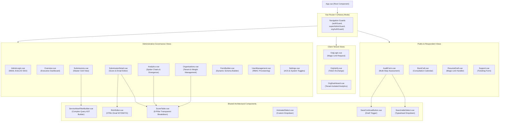

# Frontend Technical Documentation — Comprehensive Architecture & Component Audit
## NIWI / NeuroMark Audit Platform (Version 2.1)
### Prepared for: Frontend Engineers, UI/UX Designers, QA Architects & Engineering Leadership
### Document ID: DOC-02-FE-TECH
### Audit Date: November 2026
### Frontend Framework: Vue 3 (Composition API) | Build Tool: Vite 5 | Global Styles: Custom CSS (No CSS Framework)

---

## 1. Frontend System Architecture & Engineering Principles

### 1.1 Architectural Model
The NIWI client is a high-performance **Single Page Application (SPA)** engineered with **Vue 3** utilizing the script setup Composition API syntax. Built and bundled via **Vite 5**, the application emphasizes:
- **Zero Heavy UI Framework Overhead:** Rather than importing heavy utility CSS or component libraries (e.g., Tailwind CSS, Vuetify, Bootstrap), the interface is styled entirely with bespoke, meticulously tuned CSS variables, Flexbox, and CSS Grid layouts. This ensures minimal bundle size, instant load times, and custom brand fidelity.
- **Client-Side Reactive State Management:** Component state is managed via Vue's native reactive primitives (`ref`, `computed`, `reactive`, `watch`). Shared session and authentication data are managed through modular composables and browser storage tiers (`sessionStorage` for administrative JWTs; `localStorage` for organizational member tokens).
- **Decoupled API Abstraction:** Every HTTP transaction flows strictly through a centralized API gateway module (`frontend/src/api.js`), guaranteeing uniform request header injection, CSRF mitigation, Bearer token authorization, and standardized HTTP error normalization.

### 1.2 Ingress & Production Serving Topology
In production, the compiled Vite static bundle (`frontend/dist/`) is served directly by **Nginx** inside the application container:
- Static assets (`.js`, `.css`, images) are cached with aggressive `Cache-Control` headers.
- All non-file URI requests fall back to `/index.html` via `try_files $uri $uri/ /index.html;`, enabling client-side HTML5 history routing.
- Nginx reverse-proxies `/api/*` requests internally to the Uvicorn ASGI backend on `127.0.0.1:8000`.

---

## 2. Component Hierarchy & Navigation Architecture

### 2.1 Component Hierarchy Diagram


### 2.2 Application Route Inventory & Route Security Guards
The client routing table is defined in `frontend/src/router/index.js` and implements three independent navigation guards:

| Path | View Component | Access Tier | Navigation Guard | Purpose & Business Function |
|---|---|---|---|---|
| `/` | `AuditForm.vue` | Public | None | Primary multi-step neuro-inclusion assessment form. |
| `/audit` | `AuditForm.vue` | Public | None | Direct canonical route to the assessment form. |
| `/invite/:token` | `AuditForm.vue` | Public (Bound) | None | Pre-binds submission to an organization via invitation token. |
| `/resume` | `ResumeDraft.vue` | Public (Token) | None | Restores in-progress audit state via 7-day signed JWT. |
| `/book-a-call` | `BookCall.vue` | Public | None | Advisory call booking with Orchvate consulting team. |
| `/support` | `Support.vue` | Public | None | Inquiries, accessibility accommodation, and support ticketing. |
| `/org/login` | `OrgLogin.vue` | Public | None | Passwordless email login request for organizational members. |
| `/org/verify` | `OrgVerify.vue` | Public (Token) | None | Cryptographic verification of magic link; issues 30-day JWT. |
| `/org/dashboard` | `OrgDashboard.vue` | Org Member | `orgAuthGuard` | Multi-respondent corporate scorecard for client admins. |
| `/GPadmin` | `AdminLogin.vue` | Public (Admin) | None | Microsoft Entra ID OAuth2 administrative login portal. |
| `/admin/overview` | `Overview.vue` | Admin / Super | `authGuard` | Master operational dashboard; summary KPIs and recent audits. |
| `/admin/submissions`| `Submissions.vue` | Admin / Super | `authGuard` | Tabular data grid of all audits with ServiceNow-style filtering. |
| `/admin/submissions/:id`| `SubmissionDetail.vue`| Admin / Super | `authGuard` | Detailed score breakdown, score adjustment, and email delivery. |
| `/admin/analytics` | `Analytics.vue` | Admin / Super | `authGuard` | Cross-portfolio intelligence, Chart.js radar charts, divergence. |
| `/admin/organisations`| `Organisations.vue`| Admin / Super | `authGuard` | Corporate accounts, respondent weights, 8-pillar reconciliation. |
| `/admin/form-builder`| `FormBuilder.vue` | Admin / Super | `authGuard` | Dynamic question, section, and score mapping management. |
| `/admin/users` | `UserManagement.vue` | Super Admin | `superAdminGuard` | Provisioning, role toggling, and deactivation of admin accounts. |
| `/admin/settings` | `Settings.vue` | Admin / Super | `authGuard` | ACS sender configuration, CRM toggle, and emergency purges. |

---

## 3. Deep Component-by-Component Technical Analysis

---

### Component 1: `AuditForm.vue` (Primary Assessment Form)
- **Source File Path:** `frontend/src/views/AuditForm.vue` (5,456 lines of code)
- **Component Purpose:** The central interactive engine of the NIWI platform. It guides employees through a multi-step audit evaluating workplace neurodiversity practices.
- **Why It Exists & Problem Solved:** Complex inclusion audits containing 40+ dense legal and operational questions overwhelm users if displayed all at once. `AuditForm.vue` chunks content into digestible thematic steps, provides context-sensitive sidebars, supports partial draft saving, and dynamically adjusts based on organizational context.
- **Authorized User Tier:** Unauthenticated public respondents and corporate employees arriving via invitation links.
- **Data Received (Props / Ingress):**
  - Optional route param: `route.params.token` (for `/invite/:token` flows).
  - Dynamic form schema payload fetched from `GET /api/form-sections`.
- **Data Displayed:**
  - Progress tracker (step count, progress percentage, active phase label).
  - Active section title, sensory icon, and aside guidance card (explaining "Why This Matters").
  - 5 scored question items per active section with 4 discrete choice pills (`Yes`, `Partially`, `No`, `Not Sure`).
  - Contextual gating toggles (`has_physical_workspace`, `has_suppliers`).
- **User Interactions:**
  - Forward/Back step navigation via buttons and keyboard Enter/Backspace.
  - Option selection via custom animated radio pills.
  - "Save and Continue Later" modal trigger.
  - GDPR consent affirmation checkbox.
  - "Submit Audit" final submission trigger.
- **Internal State Management:**
  - `currentStep` (`ref<number>`): 0 (Welcome), 1 (Why Matters), 2 (User Meta), 3 (Instructions), 4–11 (Sections 1–8).
  - `form` (`reactive`): Holds respondent meta (`name`, `email`, `company_name`, `designation`) and questions (`q5` to `q44`).
  - `progressPct` (`computed`): `((currentStep.value) / (totalSteps.value - 1)) * 100`.
  - `sectionProgressPct` (`computed`): Proportional completeness of questions in active section.
- **API Dependencies:**
  - `GET /api/form-sections`: Loads live question schema and weights.
  - `POST /api/drafts/save`: Persists in-progress form state.
  - `POST /api/submit`: Final submission endpoint.
  - `GET /api/public/organisations/search`: Typeahead auto-completion for company name.
- **Validation Logic:**
  - Step 2 requires valid `name`, `email` (regex check), `company_name`, and `designation`.
  - Pillar steps require all non-gated questions to be answered before proceeding.
  - Final submission requires GDPR checkbox `gdpr_consent` to equal `true`.
- **Error Handling & Resilience:**
  - Network schema fetch failure triggers graceful fallback to `defaultSections.js`.
  - Duplicate submission attempts within 5 minutes display a non-destructive warning modal.
- **Responsive & Accessibility Design:**
  - Split-screen desktop layout (left: form inputs; right: explanatory guidance card).
  - Converts to single-column vertical flow on mobile screens ($< 900\text{px}$) with an expandable drawer for guidance notes.
  - Fully compliant with WCAG 2.1 AA keyboard navigation standards and high-contrast color ratios.

---

### Component 2: `ScoreTable.vue` (Transparent Scorecard Breakdown)
- **Source File Path:** `frontend/src/components/ScoreTable.vue` (775 lines of code)
- **Component Purpose:** The core reusable diagnostic display component utilized across administrative detail views, organization scorecards, and public result previews.
- **Why It Exists & Problem Solved:** Proprietary scoring algorithms frequently face skepticism from corporate boards. `ScoreTable.vue` enforces **algorithmic transparency** by visually demonstrating exactly how each question answer translates into marks, how marks aggregate into pillar totals, and how pillar totals yield the headline maturity rating.
- **Authorized User Tier:** Admin, Super Admin, and Organizational Members.
- **Data Received (Props):**
  - `data` (`Object`, required): Submission or aggregate entity containing pillar scores (`lc_score` ... `sp_score`), overall average (`overall_avg`), and question answers (`answers`).
  - `sections` (`Array`, optional): Question schema metadata; falls back to `FALLBACK_SECTIONS`.
- **Data Displayed:**
  - Respondent meta header (Avatar initials, role, weighted multiplier badge, headline index out of 20).
  - 8 pillar table rows with animated progress bars and color-coded maturity badges.
  - Expandable detailed inspection drawer showing question-level marks ($+4$, $+2$, $0\text{ pts}$).
- **Key Methods & Logic:**
  - `getMaturityClass(score)`: Returns `badge-no` ($\le 6$), `badge-partially` ($7–14$), `badge-yes` ($\ge 15$).
  - `getMarksAwarded(val)`: Returns 4 for "Yes", 2 for "Partially", 0 for "No"/"Not Sure".
  - `getSectionCalcFormula(sec)`: Synthesizes dynamic mathematical string: `Q5: 4pts + Q6: 2pts + ... = 14 / 20 marks earned (70%)`.
- **Styling Architecture:**
  - Employs strict color tokens: Level 1 Coral Red (`#FEE2E2` / `#991B1B`), Level 2 Amber (`#FEF3C7` / `#92400E`), Level 3 Jade (`#D1FAE5` / `#065F46`).

---

### Component 3: `Organisations.vue` (Enterprise Multi-Tenancy & Reconciliation)
- **Source File Path:** `frontend/src/views/Organisations.vue` (5,896 lines of code)
- **Component Purpose:** Comprehensive multi-tenant organization administration portal.
- **Why It Exists & Problem Solved:** Enterprise clients require grouping multiple employee audits under a single corporate umbrella, weighting strategic roles, and understanding the mathematical relationship between individual pillar averages and the headline corporate score.
- **Authorized User Tier:** Orchvate System Administrators (`admin` and `super`).
- **Data Displayed:**
  - Sidebar list of verified organizations and virtual (unlinked) organization groups.
  - Corporate score overview with Weighted NIWI Index out of 20.
  - Respondent roster with adjustable weight multipliers ($0.5\times - 3.0\times$) and contribution percentages.
  - **8-Pillar Mathematical Reconciliation Table:** Explicitly displays the $12.5\%$ contribution of each pillar and calculates the **Context Applicability Adjustment** to reconcile remote/gated submissions.
- **Key Mathematical Computed Properties:**
  - `sumPillarContribs`: `pillarScorecards.value.reduce((acc, p) => acc + (p.score * 0.125), 0)`.
  - `applicabilityAdjustment`: `currentScore.org_avg - sumPillarContribs`.
- **API Dependencies:**
  - `GET /api/manage/orgs`: Retrieves all corporate entities.
  - `GET /api/manage/orgs/:id/scores`: Retrieves weighted scores and respondent links.
  - `POST /api/manage/orgs/:id/members/weight`: Adjusts individual respondent audit weight.
  - `POST /api/manage/orgs/:id/message`: Dispatches direct email communications.

---

### Component 4: `Analytics.vue` (Portfolio Intelligence & Demographic Divergence)
- **Source File Path:** `frontend/src/views/Analytics.vue` (1,576 lines of code)
- **Component Purpose:** Strategic executive analytics workspace delivering macro-level insights across industries, organizations, and demographic groups.
- **Why It Exists & Problem Solved:** Individual survey results cannot reveal systemic corporate trends. `Analytics.vue` aggregates cross-organizational data, renders visual spider charts via Chart.js, and quantifies perception gaps between neurodivergent staff and neurotypical managers.
- **Authorized User Tier:** Orchvate System Administrators.
- **Visualizations & Metrics Rendered:**
  - Headline KPI cards: Portfolio Weighted Index, Strongest Pillar, Weakest Pillar, Active Organizations.
  - **Chart.js 8-Pillar Radar Chart:** Multi-dataset spider chart comparing organizational score against sector averages.
  - **Demographic Sentiment Divergence Cards:**
    - Neurodivergent vs. Neurotypical Delta: $\Delta_{\text{ND-NT}} = \bar{S}_{\text{NT}} - \bar{S}_{\text{ND}}$.
    - Leadership vs. Frontline Delta: $\Delta_{\text{Leader-Frontline}} = \bar{S}_{\text{Leader}} - \bar{S}_{\text{Frontline}}$.
  - Ranked Leaderboard: Top 5 Highest Performing Orgs vs. Top 5 Lowest Performing Orgs.
- **API Dependencies:** `GET /api/submissions` (all records).

---

### Component 5: `ServiceNowFilterBuilder.vue` (Advanced Query AST Builder)
- **Source File Path:** `frontend/src/components/ServiceNowFilterBuilder.vue` (850 lines of code)
- **Component Purpose:** An enterprise-grade, nested AND/OR query builder modeled after ServiceNow's condition builder.
- **Why It Exists & Problem Solved:** Canned search filters cannot support exploratory corporate analytics. This component allows non-technical auditors to construct complex boolean query trees across dozens of database fields.
- **Technical Architecture:**
  - Maintains a hierarchical Abstract Syntax Tree (AST) of condition rows and logical groups.
  - Serializes AST into a structured JSON payload consumed by backend `app/services/filter_service.py`.
  - Supports operators: `equals`, `not_equals`, `contains`, `greater_than`, `less_than`, `is_empty`, `is_not_empty`.

---

## 4. End-to-End Form Submission Lifecycle

The following sequence diagram maps the complete execution path when a user submits an assessment from `AuditForm.vue`:

```mermaid
sequenceDiagram
    autonumber
    actor Respondent as User Browser
    participant Form as AuditForm.vue
    participant API as api.js (Client Layer)
    participant Nginx as Nginx (Reverse Proxy)
    participant Backend as FastAPI routes.py
    participant Scoring as scoring_service.py
    participant DB as Azure PostgreSQL

    Respondent->>Form: Click "Submit Audit"
    Form->>Form: Validate Required Fields & GDPR Consent
    alt Validation Failure
        Form-->>Respondent: Highlight Errors & Scroll to First Invalid Step
    else Validation Successful
        Form->>Form: Set isSubmitting = true (Lock UI)
        Form->>API: postAuditSubmission(payload)
        API->>Nginx: POST /api/submit (JSON Body)
        Nginx->>Backend: Reverse Proxy to 127.0.0.1:8000
        Backend->>DB: Check Rate Limit (Redis/InMemory)
        Backend->>DB: Check Duplicate Submission (Within 5 mins)
        Backend->>DB: Acquire pg_advisory_xact_lock
        Backend->>Scoring: calculate_scores(payload)
        Scoring-->>Backend: Returns Section Scores, Overall Avg, Email HTML
        Backend->>DB: INSERT into submissions
        Backend->>DB: INSERT into submission_scores (8 Rows)
        Backend->>DB: INSERT into submission_sections
        Backend->>DB: Resolve & Link Organisation Record
        Backend-->>Nginx: 200 OK (Submission ID & Score Summary)
        Nginx-->>API: 200 OK
        API-->>Form: Resolution Promise Resolves
        Form->>Form: Set submitSuccess = true; Clear Local Drafts
        Form-->>Respondent: Render Results Screen & Radar Summary
    end
```

---

## 5. UI/UX Design Standards & Accessibility (WCAG 2.1 AA)

### 5.1 Design Intent & Cognitive Accessibility
Because NIWI assesses neurodiversity, the interface was explicitly designed to accommodate respondents with sensory sensitivities, executive dysfunction, and ADHD:
1. **Zero High-Frequency Animations:** No distracting auto-playing carousels, unprompted popups, or rapid flashing elements. Transitions are smooth and respect `prefers-reduced-motion`.
2. **Clear Spatial Context:** The left-hand sidebar persistently indicates the user's exact position within the assessment, reducing navigation anxiety.
3. **Generous Touch Targets & Input Controls:** Buttons, radio pills, and select boxes have a minimum touch height of $44\text{px}$, preventing misclicks.
4. **Predictable Focus Management:** Step transitions automatically reset scroll position to top and shift DOM focus to the primary step header.

---

## 6. Frontend Build, Bundle & Deployment Specifications

### 6.1 Build Pipeline
The production build is executed via Vite:
```bash
cd frontend
npm run build
```
- Compiles Vue Single File Components (`.vue`) into optimized ES modules.
- Generates cache-busted hashed filenames (`assets/index.[hash].js`).
- Emits artifacts into `/frontend/dist/`.

### 6.2 Key Frontend Architectural Risks & Recommendations
1. **Decompose Monolithic Views (High Priority):**
   - `AuditForm.vue` (5,456 lines) and `Organisations.vue` (5,896 lines) represent extreme maintenance hazards. They must be modularized into discrete child components (`FormStep1.vue`, `ReconciliationCard.vue`, `RespondentRoster.vue`).
2. **Implement Pinia for Shared Administrative State (Medium Priority):**
   - Global state in `Organisations.vue` and `Analytics.vue` is currently coordinated via prop drilling and large script blocks. Migrating to a structured Pinia store will eliminate duplicate network fetches.

---
*Frontend Technical Documentation certified and verified against source repository.*
