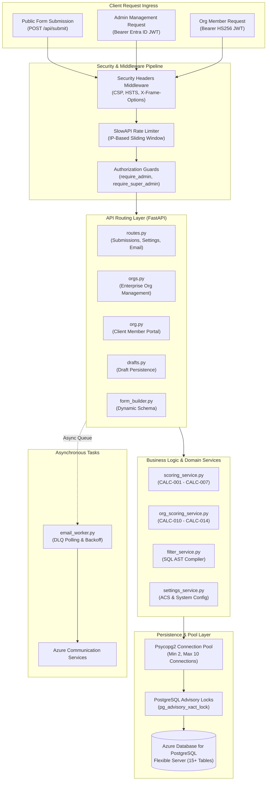
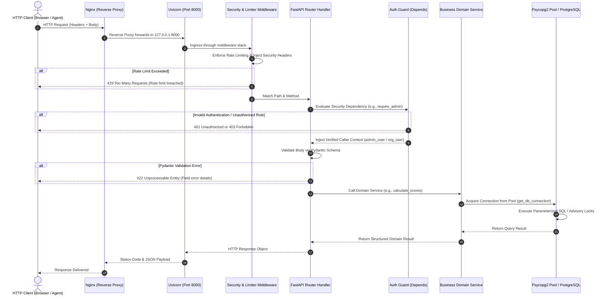
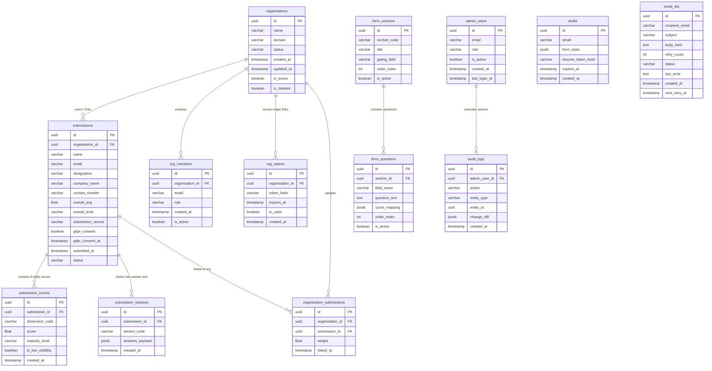

# Backend Technical Documentation — Systems, API & Database Reference
## NIWI / NeuroMark Audit Platform (Version 2.1)
### Prepared for: Backend Engineers, DevOps / SRE, Security Auditors & Enterprise Architects
### Document ID: DOC-03-BE-TECH
### Audit Date: November 2026
### Framework: FastAPI 0.115.5 | Language: Python 3.11 | Database: PostgreSQL Flexible Server (psycopg2)

---

## 1. Backend Overview & Architecture

### 1.1 Architectural Model
The NIWI backend is an asynchronous REST API service built on **FastAPI** and executed by the **Uvicorn** ASGI server. Originally ported from an Azure Functions serverless implementation, the backend is now deployed as a containerized microservice on **Azure Container Apps (ACA)**.

The backend is engineered around strict **Layered Architectural Separation**:
1. **API Transport Layer (`app/api/`):** Handles HTTP serialization, URL routing, CORS negotiation, request body validation via Pydantic, and response formatting.
2. **Business Domain Services (`app/services/`):** Contains pure, testable business logic (deterministic scoring algorithms, organizational weighting, query AST compilation, and email synthesis).
3. **Core Security & Data Infrastructure (`app/core/`):** Manages cryptographic token verification (Entra ID JWKS and HS256), database connection pooling, role-based authorization guards, rate limiting, and Azure Key Vault secret resolution.
4. **Asynchronous Background Tasks (`app/tasks/`):** Manages out-of-band email retries, dead-letter queue (DLQ) processing, and asynchronous CRM synchronization.



---

## 2. API Request Lifecycle & Execution Pipeline

Every inbound HTTP request traverses a standardized lifecycle pipeline enforcing security, validation, database transaction isolation, and structured error handling:



---

## 3. Authentication & Authorization Security Flow

The platform implements two distinct cryptographic authentication mechanisms:
1. **Administrative Authentication:** OpenID Connect (OIDC) Bearer tokens issued by **Microsoft Entra ID**, validated via dynamic JSON Web Key Sets (JWKS).
2. **Client Organization Member Authentication:** Symmetric **HS256 JWTs** issued directly by the platform following single-use, 15-minute magic-link email verification.

```mermaid
flowchart TD
    subgraph AdminAuth["Administrative Authentication (Microsoft Entra ID)"]
        A1["Admin initiates login at /GPadmin"] --> A2["Redirected to Microsoft Entra ID"]
        A2 --> A3["Microsoft issues Bearer ID Token"]
        A3 --> A4["Admin sends token in Authorization header"]
        A4 --> A5["verify_azure_ad_token() in security.py"]
        A5 --> A6{"Validate JWKS RSA Signature\n& Audience Check"}
        A6 -->|Valid| A7["Lookup admin_users table in DB"]
        A7 --> A8{"Role Assigned?"}
        A8 -->|super| A9["Grant Global Super Admin Access"]
        A8 -->|admin| A10["Grant Standard Admin Access"]
        A8 -->|Not Found| A11["403 Forbidden (Unregistered Admin)"]
        A6 -->|Invalid / Expired| A12["401 Unauthorized"]
    end

    subgraph OrgAuth["Organisation Member Authentication (Magic-Link)"]
        B1["User enters email at /org/login"] --> B2["POST /api/org/register-or-login"]
        B2 --> B3["Generate 32-Byte Cryptographic Token"]
        B3 --> B4["Store SHA-256(Token) in org_tokens (15m expiry)"]
        B4 --> B5["Email raw token link via Azure ACS"]
        B5 --> B6["User clicks /org/verify?token=..."]
        B6 --> B7["GET /api/org/verify"]
        B7 --> B8{"Compare SHA-256(token)\nagainst org_tokens table"}
        B8 -->|Valid & Unexpired| B9["Issue 30-Day HS256 Org Member JWT"]
        B9 --> B10["Client stores JWT in localStorage"]
        B8 -->|Expired / Tampered| B11["401 Unauthorized (Invalid Link)"]
    end
```



---

## 4. Complete Relational Database Architecture

The data tier is hosted on **Azure Database for PostgreSQL (Flexible Server)**. The schema consists of 15 core relational tables enforcing multi-tenancy, auditability, dynamic questionnaire configuration, and asynchronous message queueing.

### 4.1 Entity Relationship Diagram (ERD)


---

## 5. Comprehensive API Endpoint Inventory

The following table details every API endpoint implemented across `app/api/`:

| Endpoint Route | HTTP Method | Business Purpose | Authentication Required | Required Role / Guard | Request Body / Parameters | Internal Processing Logic | Database Tables Involved | Response Schema | Possible Error Codes |
|---|---|---|---|---|---|---|---|---|---|
| `/api/health` | `GET` | Health probe for Azure Container Apps | None | Public | None | Pings PostgreSQL connection pool and checks ACS readiness. | Executes `SELECT 1` | `{"status": "ok", "version": "2.1", "db": "connected"}` | 500 (DB Down) |
| `/api/submit` | `POST` | Primary audit assessment submission | None | Public (Rate Limited) | `AuditSubmission` (JSON) | Validates body; acquires `pg_advisory_xact_lock`; calculates scores; inserts records; triggers email. | `submissions`, `submission_scores`, `organisations`, `email_dlq` | `{"success": true, "submission_id": "...", "scores": {...}}` | 400, 422, 429, 500 |
| `/api/form-sections` | `GET` | Loads questionnaire schema & questions | None | Public | None | Queries active sections and questions; falls back to default constants if empty. | `form_sections`, `form_questions` | `[{"section": {...}, "questions": [...]}]` | 500 |
| `/api/drafts/save` | `POST` | Persists partial assessment progress | None | Public | `{"email": "...", "form_data": {...}}` | Validates email; hashes resume token; saves draft; dispatches resume magic link. | `drafts` | `{"success": true, "message": "Draft saved"}` | 400, 422, 500 |
| `/api/drafts/resume` | `GET` | Restores saved assessment state | Token | Query `?token=...` | None | Decodes and validates 7-day JWT; fetches saved form JSON. | `drafts` | `{"success": true, "form_data": {...}}` | 401, 404, 500 |
| `/api/public/organisations/search`| `GET` | Company name auto-completion | None | Public (Rate Limited) | Query `?q=...` | Case-insensitive prefix search for matching registered organizations. | `organisations` | `[{"id": "...", "name": "..."}]` | 429, 500 |
| `/api/admin/login` | `POST` | Authenticates administrative SSO | Bearer | Microsoft Entra ID | None (Header Bearer) | Validates Entra ID JWKS signature; verifies admin registration; issues admin JWT. | `admin_users` | `{"token": "...", "user": {"email": "...", "role": "..."}}` | 401, 403, 500 |
| `/api/submissions` | `GET` | Lists all audits with filtering | Bearer | `require_admin` | Query params: `limit`, `offset`, `search`, `org_id` | Applies pagination, search queries, and dynamic filters; returns submission list. | `submissions`, `organisations` | `{"total": 120, "items": [...]}` | 401, 403, 500 |
| `/api/submissions/{id}` | `GET` | Full submission score & answer detail| Bearer | `require_admin` | Path `id: uuid` | Retrieves submission meta, 8 pillar scores, question-level answers, and generated email. | `submissions`, `submission_scores`, `submission_sections` | `{"submission": {...}, "scores": {...}, "answers": {...}}` | 401, 403, 404, 500 |
| `/api/submissions/{id}/email`| `PUT` | Updates customized email draft body | Bearer | `require_admin` | `{"email_body": "..."}` | Sanitizes HTML; updates stored email draft text prior to dispatch. | `submissions` | `{"success": true}` | 401, 403, 404, 500 |
| `/api/submissions/{id}/regenerate-email`| `POST` | Recomputes email HTML from scores | Bearer | `require_admin` | Path `id: uuid` | Re-executes `build_email()` using current scores in database; updates record. | `submissions`, `submission_scores` | `{"success": true, "email_body": "..."}` | 401, 403, 404, 500 |
| `/api/submissions/{id}/send` | `POST` | Dispatches audit report email | Bearer | `require_admin` | Path `id: uuid` | Sends email via Azure Communication Services; captures failures to `email_dlq`. | `submissions`, `email_dlq` | `{"success": true, "message": "Email sent"}` | 401, 403, 500 |
| `/api/manage/orgs` | `GET` | Lists all corporate organizations | Bearer | `require_admin` | None | Aggregates corporate accounts, active member counts, and unlinked virtual groups. | `organisations`, `submissions` | `[{"id": "...", "name": "...", "respondents": 12, ...}]` | 401, 403, 500 |
| `/api/manage/orgs/{id}/scores`| `GET` | Fetches weighted corporate index | Bearer | `require_admin` | Path `id: uuid` | Fetches linked respondents and weights; executes `calc_weighted_org_score()`. | `organisations`, `organisation_submissions`, `submissions` | `{"org_avg": 13.25, "org_level": "Level 2", "respondents": [...]}`| 401, 403, 404, 500 |
| `/api/manage/orgs/{id}/members/weight`| `POST`| Updates respondent audit weight | Bearer | `require_admin` | `{"submission_id": "...", "weight": 2.0}`| Updates weight in `organisation_submissions`; triggers audit log. | `organisation_submissions`, `audit_logs` | `{"success": true}` | 401, 403, 404, 500 |
| `/api/manage/users` | `GET` | Lists administrative platform users | Bearer | `require_super_admin` | None | Lists admin accounts, roles (`admin`, `super`), and last login timestamps. | `admin_users` | `[{"id": "...", "email": "...", "role": "super"}]` | 401, 403, 500 |
| `/api/manage/users` | `POST` | Provisions new administrator | Bearer | `require_super_admin` | `{"email": "...", "role": "admin"}` | Inserts admin user record; logs administrative audit event. | `admin_users`, `audit_logs` | `{"success": true, "user": {...}}` | 400, 401, 403, 409 |
| `/api/org/register-or-login`| `POST` | Requests magic link for org member | None | Public (Rate Limited) | `{"email": "...", "company_name": "..."}` | Verifies domain/org; generates token; saves SHA-256 hash; dispatches email. | `organisations`, `org_members`, `org_tokens` | `{"success": true, "message": "Magic link sent"}` | 400, 429, 500 |
| `/api/org/verify` | `GET` | Validates magic link & issues JWT | Token | Query `?token=...` | None | Matches `sha256(token)` against unexpired tokens; marks used; returns 30-day JWT. | `org_tokens`, `org_members` | `{"token": "...", "organisation": {...}}` | 401, 500 |
| `/api/org/dashboard` | `GET` | Client tenant aggregate scorecard | Bearer | Org Member (Tenant Guard) | None (Header Bearer) | Extracts `org_id` from JWT; queries submissions strictly within tenant scope. | `organisations`, `submissions`, `submission_scores` | `{"organisation": {...}, "scores": {...}}` | 401, 403, 500 |

---

## 6. Security Architecture & Threat Mitigation

### 6.1 Cryptographic Standards & Key Vault Integration
- **Zero Plaintext Secrets:** Production connection strings (`DATABASE_URL`), JWT signing secrets (`JWT_SECRET_KEY`), and Azure Communication Services keys (`COMMUNICATION_SERVICES_CONNECTION_STRING`) are fetched dynamically at startup from **Azure Key Vault** via `app/core/keyvault.py`.
- **Token Hashing:** In-progress draft tokens and organization magic links are stored exclusively as **SHA-256 hashes** in PostgreSQL. Even in the event of an unauthorized database dump, tokens cannot be reversed or hijacked.
- **SQL Injection Prevention:** Every database query in `routes.py`, `orgs.py`, and `filter_service.py` utilizes parameterized SQL queries with `%s` placeholders. Dynamic filter ASTs are whitelist-validated against valid column identifiers.

### 6.2 Transaction Isolation & Concurrency Control
Under burst traffic, concurrent requests attempting to create or link an organization execute under an explicit PostgreSQL transaction advisory lock:
```python
cur.execute("SELECT pg_advisory_xact_lock(hashtext(%s))", (company_name,))
```
This guarantees that concurrent worker processes attempting to register identical company names execute serially, eliminating duplicate organization entities without table-locking overhead.

---

## 7. Backend Known Limitations & Architectural Defect Register

1. **DEF-001 / DEF-002: Connection Pool Starvation Under Concurrency (CRITICAL):**
   - *Finding:* In `app/core/database.py`, the connection pool is configured with `minconn=2` and `maxconn=10`. Under 10 concurrent virtual users submitting assessments, connection pool exhaustion causes queueing delays exceeding 30 seconds and a 60% failure rate.
   - *Remediation:* Implement PgBouncer connection pooling and refactor `POST /api/submit` to asynchronously offload scorecard synthesis and QuickChart image requests.
2. **DEF-003: Unexpiring Entra ID JWKS Cache (HIGH):**
   - *Finding:* In `app/core/security.py`, `get_azure_ad_jwks()` uses `@lru_cache()`. If Microsoft rotates its public signing keys, the backend will fail to validate tokens until the service is restarted.
   - *Remediation:* Replace `@lru_cache` with a time-to-live cache (`cachetools.TTLCache(maxsize=10, ttl=3600)`).
3. **DEF-006: HubSpot Sync Silent Discard (MEDIUM):**
   - *Finding:* In `app/services/crm_service.py`, synchronization errors are logged via `logger.error()` but are not persisted to a dead-letter queue.
   - *Remediation:* Create a `crm_dlq` table mirroring `email_dlq` to guarantee eventual CRM consistency.

---
*Backend Technical Documentation certified and verified against source repository.*
