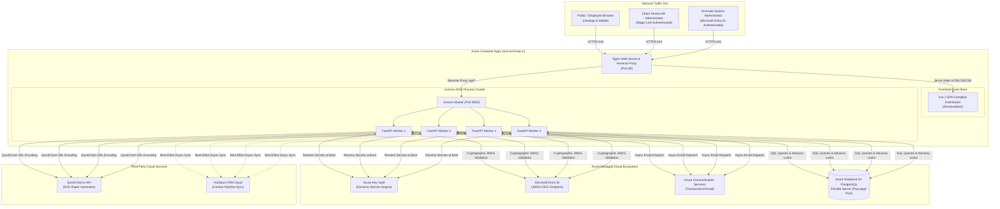
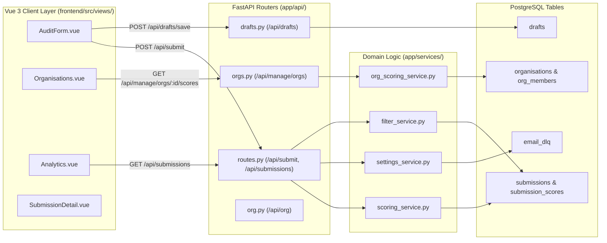
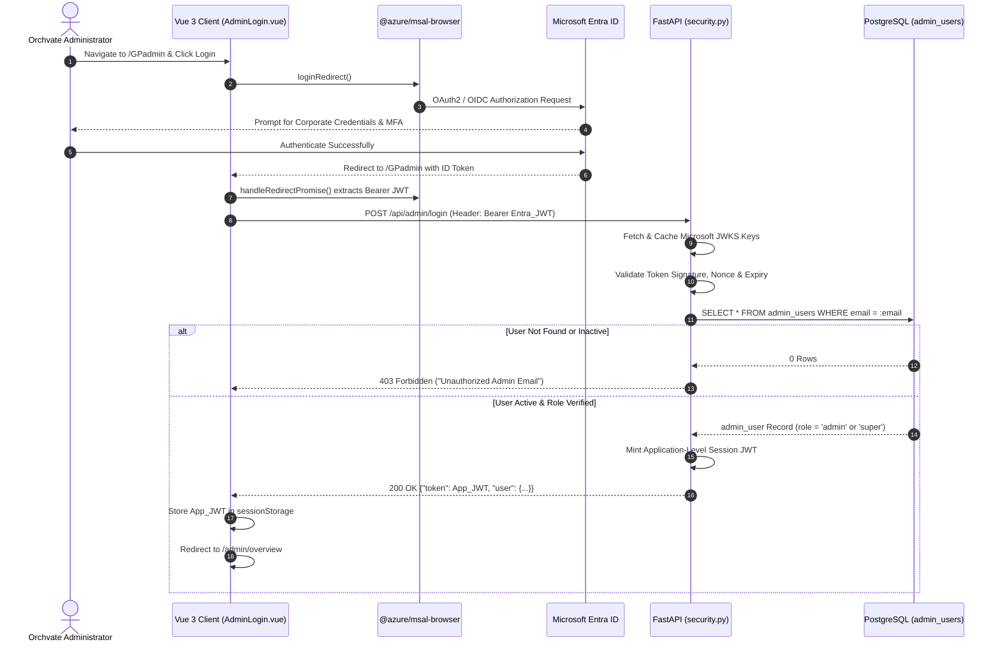
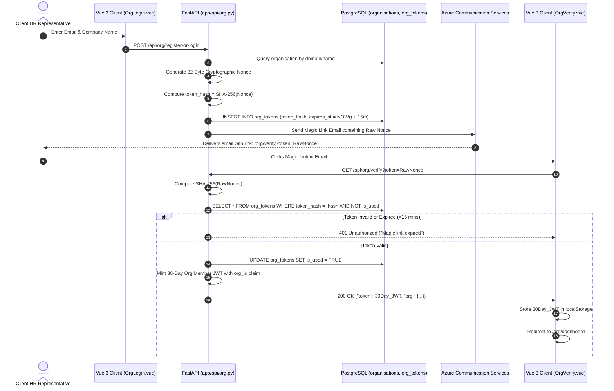
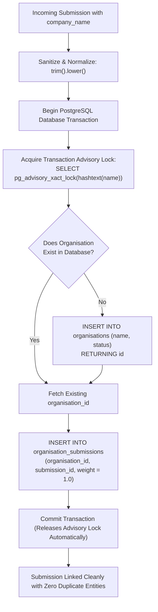
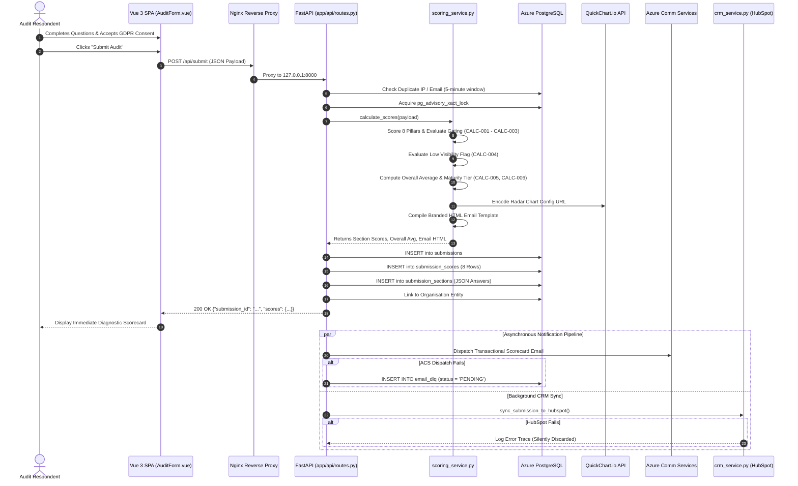
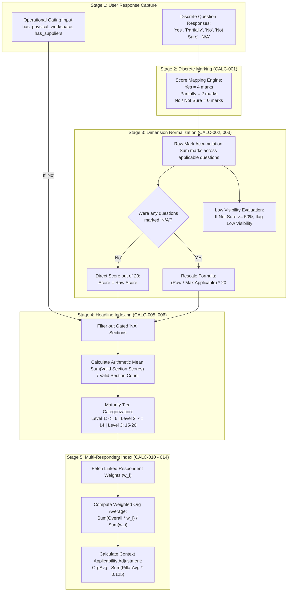
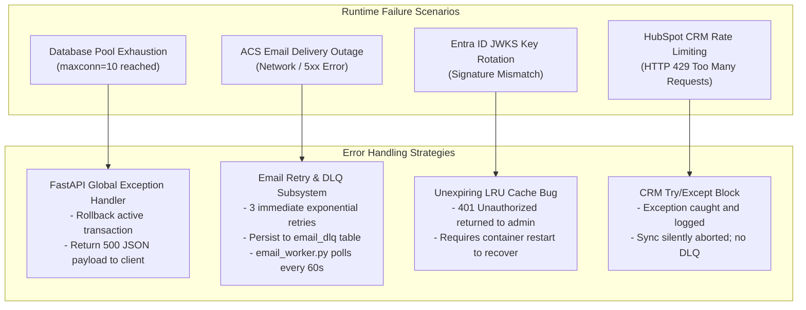
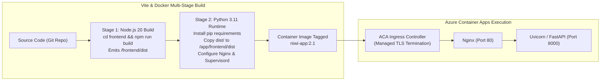

# System Workflow and Architecture Documentation
## NIWI / NeuroMark Audit Platform (Version 2.1)
### Prepared for: Software Architects, System Integrators, Security Auditors & Lead Engineers
### Document ID: DOC-04-SYS-ARCH
### Audit Date: November 2026
### Repository Root: `c:\Users\Aakash\Documents\PROJECT WEB\orchvate\NIWI`

---

## 1. Overall System Architecture

### 1.1 Architectural Model
NIWI is architected as a modular, containerized multi-tenant software system deployed on **Azure Container Apps (ACA)**. The system couples a compiled **Vue 3 Single Page Application (SPA)** with an asynchronous **FastAPI (Python 3.11)** backend, persisted to **Azure Database for PostgreSQL (Flexible Server)**.

The platform is deployed inside a single hardened Docker container managed by `supervisord`:
- **Nginx Web Server (Port 80):** High-speed reverse proxy terminating inbound HTTP traffic, serving static compiled Vue assets, caching static files, and proxying all `/api/*` traffic to the backend.
- **Uvicorn ASGI Server (Port 8000):** Executes the FastAPI application across 4 asynchronous worker processes.
- **Managed Cloud Services:** Production secrets, administrative identity, transactional email dispatches, and CRM updates are handled through native Azure managed integrations (Azure Key Vault, Microsoft Entra ID, and Azure Communication Services).

### 1.2 Architectural Interpretation
1. **Network Boundary:** The public internet only communicates with Nginx over standard HTTP/HTTPS. The Uvicorn application processes listen strictly on the internal container loopback (`127.0.0.1:8000`), completely shielding the Python runtime from direct internet exposure.
2. **Process Management:** `supervisord` monitors both Nginx and Uvicorn. If an ASGI worker crashes due to an unhandled operating system signal or memory exhaustion, `supervisord` automatically spawns a replacement worker process.
3. **Stateless App Tier:** The application processes maintain zero local filesystem session state. All session contexts are cryptographically signed within JWT tokens or persisted to Azure PostgreSQL, allowing seamless horizontal container auto-scaling.

---

## 2. High-Level Component Interaction & Communication

The following diagram depicts the precise data flow and interface boundaries between frontend views, backend routers, domain services, database tables, and external integrations:

---

## 3. Authentication & Authorization Workflows

### 3.1 Administrative SSO Authentication (Microsoft Entra ID)
- **Why It Exists:** To eliminate shared administrative passwords and enforce corporate multi-factor authentication for Orchvate personnel.
- **Initiator:** Orchvate System Administrator accessing `/GPadmin`.
- **Trigger:** Clicking "Sign In with Microsoft".

### 3.2 Client Organisation Member Authentication (Magic Link)
- **Why It Exists:** Enables passwordless, tenant-isolated access for client HR leaders without requiring account registration.
- **Initiator:** Client HR Representative accessing `/org/login`.
- **Trigger:** Submitting work email address.

---

## 4. Organisation Creation & Management Lifecycle

### 4.1 Automated Linking via Concurrency-Safe Advisory Locks
- **Why It Exists:** When a company rolls out an audit, multiple employees submit surveys within seconds. Without concurrency control, multiple duplicate organization rows are inserted.
- **Mechanism:** PostgreSQL transaction-level advisory locking (`pg_advisory_xact_lock`).

---

## 5. End-to-End Assessment Lifecycle & Processing

### 5.1 Complete Assessment Submission Sequence

---

## 6. Score Generation & Mathematical Transformation Flow

---

## 7. Error Handling, Resilience & Recovery Architecture

---

## 8. Deployment Architecture & Container Build Pipeline

The application is bundled into a single self-contained Linux container deployed on Azure Container Apps:

---
*System Workflow and Architecture Documentation certified and verified against source repository.*
