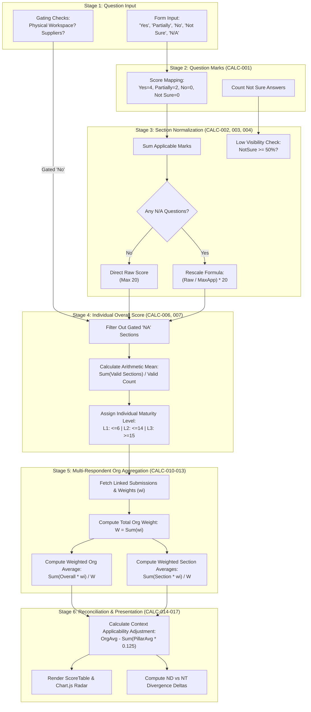

# NIWI — Formula & Calculation Logic Documentation
## Comprehensive Mathematical, Algorithmic & Aggregation Reference
### Prepared for: Technical Reviewers, Software Architects, QA Engineers & Business Analysts
### Audit Date: November 2026
### Document Reference: DOC-06-CALC
### System Version: NIWI / NeuroMark Audit Platform v2.1

---

## 1. Introduction

### 1.1 Purpose of Computational Logic in NIWI
The **Neurodiversity Inclusion Workplace Index (NIWI)** is designed to transform qualitative subjective sentiment regarding organizational neuro-inclusion into verifiable, transparent, and reproducible quantitative indices. Rather than employing opaque machine learning or heuristic approximations, NIWI relies strictly on **deterministic, rule-based mathematical formulas**.

Every diagnostic metric generated by the platform—from an individual respondent's score on physical sensory ergonomics to an enterprise-wide multi-thousand employee weighted inclusion index—is derived through explicit mathematical transformations.

### 1.2 Computational Distribution Architecture
Calculations within NIWI occur across three discrete tiers of the system architecture:

```
┌─────────────────────────────────────────────────────────────────────────────┐
│                            FRONTEND COMPUTATION                             │
│ - Real-time step and section completion percentages                         │
│ - Question marks pill rendering and answer badge classifications            │
│ - Portfolio demographic divergence delta calculations                       │
│ - Context Applicability Adjustment reconciliation                           │
│ - Chart.js radar dataset preparation and ranking sorts                      │
└──────────────────────────────────────┬──────────────────────────────────────┘
                                       │ (REST API Payloads)
                                       ▼
┌─────────────────────────────────────────────────────────────────────────────┐
│                            BACKEND COMPUTATION                              │
│ - Question-to-marks mapping (Yes=4, Partially=2, No/Not Sure=0)             │
│ - Section raw scoring and dynamic non-applicable (NA) rescaling             │
│ - Gated section bypass and validity evaluation                              │
│ - Low visibility threshold analysis (Not Sure ratio)                        │
│ - Overall arithmetic average and maturity tier assignment                   │
│ - QuickChart SVG circumference dash array calculations                      │
│ - Multi-respondent weighted organizational average computation              │
└──────────────────────────────────────┬──────────────────────────────────────┘
                                       │ (SQL Queries)
                                       ▼
┌─────────────────────────────────────────────────────────────────────────────┐
│                            DATABASE COMPUTATION                             │
│ - Dynamic schema-driven question weighting lookups                          │
│ - Relational aggregation queries across respondent links                    │
│ - Audit trail timestamp tracking                                            │
└─────────────────────────────────────────────────────────────────────────────┘
```

---

## 2. Master Formula Inventory

The following table catalogues every mathematical and computational formula verified in the NIWI version 2.1 implementation:

| Formula ID | Formula Name | Computational Purpose | Source Code Location | Consumed In |
|---|---|---|---|---|
| **CALC-001** | Question-Level Score Mapping | Converts discrete choice options into standardized points (0–4 pts). | `app/services/scoring_service.py` (lines 100–108) | Assessment scoring pipeline |
| **CALC-002** | Section Raw Score Accumulation | Sums marks earned across applicable questions in a dimension. | `app/services/scoring_service.py` (lines 94–110) | Pillar score calculation |
| **CALC-003** | Dynamic Gating & NA Rescaling | Normalizes section scores to a 20-point scale when questions are marked N/A. | `app/services/scoring_service.py` (lines 111–118) | Sections with optional questions |
| **CALC-004** | Low Visibility Ratio & Flagging | Identifies sections where organizational knowledge is obscured by "Not Sure" responses. | `app/services/scoring_service.py` (lines 187–191) | Executive scorecard commentary |
| **CALC-005** | Dimension Maturity Classification | Categorizes a 0–20 point pillar score into one of three standardized maturity tiers. | `app/services/scoring_service.py` (lines 60–66) | Scorecards, badges, and reports |
| **CALC-006** | Individual Overall NIWI Index | Computes unweighted arithmetic mean across all valid assessed pillars. | `app/services/scoring_service.py` (lines 197–201) | Individual audit submission |
| **CALC-007** | SVG Radar & Gauge Dash Array | Calculates SVG stroke-dasharray parameters for visual gauge rendering. | `app/services/scoring_service.py` (lines 240, 288–298) | Transactional email scorecard |
| **CALC-008** | Survey Navigation & Step Progress | Computes percentage of total audit steps completed in the UI. | `frontend/src/views/AuditForm.vue` (lines 1054) | Header progress bar |
| **CALC-009** | Active Section Question Progress | Computes percentage of questions answered within the current active section. | `frontend/src/views/AuditForm.vue` (lines 1105–1110) | Section sidebar indicator |
| **CALC-010** | Multi-Respondent Audit Weight | Calculates total effective weight across all linked organizational respondents. | `app/services/org_scoring_service.py` (lines 60–63) | Org-level aggregation |
| **CALC-011** | Weighted Organizational NIWI Index | Aggregates multiple employee submissions into a single weighted corporate index. | `app/services/org_scoring_service.py` (lines 64–68) | Corporate dashboard & executive report |
| **CALC-012** | Weighted Pillar Dimension Average | Computes corporate weighted mean for each individual inclusion dimension. | `app/services/org_scoring_service.py` (lines 69–76) | Pillar drilldown & spider charts |
| **CALC-013** | Respondent Weighted Contribution % | Quantifies the relative proportional influence of a single respondent on the org score. | `app/services/org_scoring_service.py` (lines 79–86) | Respondent weighting table |
| **CALC-014** | Context Applicability Adjustment | Reconciles mathematical divergence between respondent-weighted index and pillar sum. | `frontend/src/views/Organisations.vue` (lines 4333–4351) | Executive reconciliation audit table |
| **CALC-015** | Portfolio Weighted Average Score | Computes benchmark mean across all organizations or filtered submissions. | `frontend/src/views/Analytics.vue` (lines 534–540) | Cross-organizational analytics |
| **CALC-016** | Demographic Sentiment Divergence | Measures the perceptual gap between Neurodivergent and Neurotypical cohorts. | `frontend/src/views/Analytics.vue` (lines 630–650) | Divergence analysis cards |
| **CALC-017** | Hierarchical Perception Divergence | Measures perceptual gap between Senior Leadership and Frontline Contributors. | `frontend/src/views/Analytics.vue` (lines 385–405) | Executive alignment metrics |

---

## 3. Detailed Formula Explanations

---

### Formula ID: CALC-001
**Formula Name:** Question-Level Score Mapping  
**Purpose:** Quantifies qualitative survey responses into numerical marks for individual questions.  
**Why This Calculation Exists:** Qualitative Likert-style responses ("Yes", "Partially", "No", "Not Sure") cannot be aggregated directly. A standardized numeric point scale provides an objective, mathematical baseline.  
**Where It Is Used:** Backend submission scoring pipeline (`app/services/scoring_service.py`) and frontend transparent audit inspection (`frontend/src/components/ScoreTable.vue`).  
**Source Code Reference:** `app/services/scoring_service.py`, lines 100–108; `ScoreTable.vue`, lines 232–238.

#### Mathematical Formulation
For any question $q_j$ receiving response $R(q_j)$:

$$S(q_j) = \begin{cases} 
4 & \text{if } R(q_j) = \text{"Yes"} \\ 
2 & \text{if } R(q_j) = \text{"Partially"} \\ 
0 & \text{if } R(q_j) \in \{\text{"No"}, \text{"Not Sure"}, \text{"N/A"}, \text{""}\} 
\end{cases}$$

$$M(q_j) = 4$$

#### Variable Definitions
| Variable | Description | Data Type | Permissible Range / Values |
|---|---|---|---|
| $R(q_j)$ | Recorded answer string for question $j$ | String | `["Yes", "Partially", "No", "Not Sure", "NA", "N/A"]` |
| $S(q_j)$ | Numerical marks awarded for question $j$ | Integer | $\{0, 2, 4\}$ |
| $M(q_j)$ | Maximum possible marks available for question $j$ | Integer | $4$ |

#### Worked Example
Suppose a respondent answers Section 1 (Leadership & Culture, 5 questions) with:
- $q_5 = \text{"Yes"} \implies S(q_5) = 4$
- $q_6 = \text{"Partially"} \implies S(q_6) = 2$
- $q_7 = \text{"No"} \implies S(q_7) = 0$
- $q_8 = \text{"Not Sure"} \implies S(q_8) = 0$
- $q_9 = \text{"Yes"} \implies S(q_9) = 4$

Total points accumulated: $4 + 2 + 0 + 0 + 4 = 10\text{ pts}$ out of $20\text{ pts}$.

#### Boundary Conditions & Validation
- **Missing / Empty Strings:** Treated as $0$ marks.
- **Case Sensitivity:** Evaluated after `.strip().lower()` normalizing in frontend; exact match dictionary lookup in backend.
- **Div by Zero:** Not applicable at the single question level.

---

### Formula ID: CALC-002 & CALC-003
**Formula Name:** Section Raw Score Accumulation & Dynamic Non-Applicable Rescaling  
**Purpose:** Computes the total score for an 8-pillar dimension out of 20 points, automatically rescaling the denominator if questions are marked "N/A".  
**Why This Calculation Exists:** Certain questions may not apply to all organizations (e.g., questions regarding physical office sensory features for entirely remote teams). Penalizing an organization with 0 points for non-applicable items would introduce false negatives. Rescaling preserves fair assessment across diverse workplace contexts.  
**Where It Is Used:** Backend scoring service (`app/services/scoring_service.py`), function `score_section()`.  
**Source Code Reference:** `app/services/scoring_service.py`, lines 85–119.

#### Mathematical Formulation
Let $Q_k = \{q_1, q_2, \dots, q_n\}$ be the set of questions belonging to section $k$.  
Let $Q_{k,\text{app}} = \{q \in Q_k \mid R(q) \notin \{\text{"NA"}, \text{"N/A"}\}\}$ be the subset of applicable questions.

The raw score $S_{\text{raw}, k}$ and applicable maximum $M_{\text{app}, k}$ are defined as:

$$S_{\text{raw}, k} = \sum_{q \in Q_{k,\text{app}}} S(q)$$

$$M_{\text{app}, k} = \sum_{q \in Q_{k,\text{app}}} M(q)$$

$$M_{\text{total}, k} = \sum_{q \in Q_k} M(q)$$

The normalized section score $S_k$ is computed as:

$$S_k = \begin{cases}
0.0 & \text{if } |Q_{k,\text{app}}| = 0 \text{ or } M_{\text{app}, k} = 0 \\
S_{\text{raw}, k} & \text{if } |Q_{k,\text{app}}| = |Q_k| \\
\text{round}\left( \frac{S_{\text{raw}, k}}{M_{\text{app}, k}} \times M_{\text{total}, k}, 2 \right) & \text{if } |Q_{k,\text{app}}| < |Q_k|
\end{cases}$$

#### Variable Definitions
| Variable | Description | Data Type | Default / Range |
|---|---|---|---|
| $Q_k$ | Total question set in section $k$ | List[Question] | Typically 5 questions |
| $Q_{k,\text{app}}$ | Subset of applicable questions | List[Question] | $0 \le |Q_{k,\text{app}}| \le 5$ |
| $S_{\text{raw}, k}$ | Unscaled sum of marks earned | Integer | $0 \le S_{\text{raw}, k} \le 20$ |
| $M_{\text{app}, k}$ | Maximum possible marks from applicable questions | Integer | $0 \le M_{\text{app}, k} \le 20$ |
| $M_{\text{total}, k}$ | Maximum theoretical section score | Integer | Fixed at $20$ |
| $S_k$ | Final rescaled dimension score | Float | $0.00 \le S_k \le 20.00$ |

#### Worked Example
Consider Section 7 (Products & Customer Experience) with 5 questions ($M_{\text{total}} = 20$).  
A B2B respondent has no direct retail consumer channels and marks $q_{37}$ as `"N/A"`.  
- $|Q_{k,\text{app}}| = 4$ questions.
- $M_{\text{app}, k} = 4 \times 4 = 16\text{ pts}$.
- The respondent answers the remaining 4 questions with: `"Yes"` (4), `"Yes"` (4), `"Partially"` (2), `"Yes"` (4).
- $S_{\text{raw}, k} = 4 + 4 + 2 + 4 = 14\text{ pts}$.

Applying the rescaling formula:

$$S_k = \text{round}\left( \frac{14}{16} \times 20, 2 \right) = \text{round}(0.875 \times 20, 2) = \text{round}(17.5, 2) = 17.50\text{ pts}$$

The respondent receives $17.50 / 20$, accurately reflecting their 87.5% compliance without penalization for the non-applicable item.

---

### Formula ID: CALC-004
**Formula Name:** Low Visibility Ratio & Flagging Logic  
**Purpose:** Identifies dimensions where organizational knowledge is deficient due to high concentrations of "Not Sure" responses.  
**Why This Calculation Exists:** In neuro-inclusion audits, high rates of "Not Sure" indicate a lack of transparency, communication breakdown, or absent policy documentation. Flagging these areas alerts leadership that low scores are driven by lack of visibility rather than explicit policy rejection.  
**Where It Is Used:** Backend scoring service (`app/services/scoring_service.py`), generating `low_visibility_sections` metadata.  
**Source Code Reference:** `app/services/scoring_service.py`, lines 187–191.

#### Mathematical Formulation
Let $C_{\text{NotSure}, k}$ be the count of questions answered with `"Not Sure"` in section $k$.  
Let $T_{\text{vis}}$ be the configured system threshold percentage (default: $50\%$).

$$\text{Ratio}_{\text{NotSure}, k} = \frac{C_{\text{NotSure}, k}}{|Q_{k,\text{app}}|}$$

$$\text{IsLowVisibility}_k = \begin{cases}
\text{True} & \text{if } |Q_{k,\text{app}}| > 0 \text{ and } C_{\text{NotSure}, k} \ge \left( |Q_{k,\text{app}}| \times \frac{T_{\text{vis}}}{100.0} \right) \\
\text{False} & \text{otherwise}
\end{cases}$$

#### Worked Example
- Applicable questions in section: $|Q_{k,\text{app}}| = 5$.
- Configured threshold: $T_{\text{vis}} = 50\%$.
- $5 \times (50 / 100) = 2.5$.
- If a respondent answers `"Not Sure"` to 3 questions, $3 \ge 2.5 \implies \text{IsLowVisibility} = \text{True}$.
- Section is added to `result["low_visibility_sections"]`, triggering specific advisory recommendations in the report.

---

### Formula ID: CALC-005 & CALC-007
**Formula Name:** Maturity Level Classification  
**Purpose:** Maps a continuous 0–20 point score into three standardized maturity bands.  
**Why This Calculation Exists:** Executive stakeholders require qualitative milestone stages to contextualize audit scores and establish roadmaps.  
**Where It Is Used:** Global utility in `app/services/scoring_service.py`, `app/services/org_scoring_service.py`, and `frontend/src/components/ScoreTable.vue`.  
**Source Code Reference:** `app/services/scoring_service.py`, lines 60–66; `ScoreTable.vue`, lines 224–230.

#### Mathematical Formulation
For any section score $S_k \in [0, 20]$ or overall score $\bar{S} \in [0, 20]$:

$$\text{Level}(S) = \begin{cases}
\text{"Not applicable"} & \text{if } S = \text{"NA"} \lor S \text{ is null} \\
\text{"Level 1 — Foundational"} & \text{if } \text{round}(S) \le 6 \\
\text{"Level 2 — Early Progress"} & \text{if } 7 \le \text{round}(S) \le 14 \\
\text{"Level 3 — Developing"} & \text{if } 15 \le \text{round}(S) \le 20
\end{cases}$$

#### Maturity Band Characteristics Table
| Level ID | Level Name | Point Range | Score % | Visual Color | Strategic Business Meaning |
|---|---|---|---|---|---|
| **L1** | Foundational | $0.00 - 6.49$ | $0\% - 32.5\%$ | Coral Red (`#E05A47` / `#FEE2E2`) | Awareness stage; absence of formalized policies; high friction for neurodivergent employees. |
| **L2** | Early Progress | $6.50 - 14.49$ | $32.5\% - 72.5\%$ | Amber Orange (`#D97706` / `#FEF3C7`) | Emerging initiatives; ad-hoc adjustments implemented but lack structural consistency. |
| **L3** | Developing | $14.50 - 20.00$ | $72.5\% - 100.0\%$ | Jade Teal (`#04907C` / `#D1FAE5`) | Robust, embedded inclusion frameworks; standardized accommodations and active tracking. |

> [!NOTE]
> In `app/services/scoring_service.py` (line 199), the backend executes `get_maturity_level(int(overall_avg))`, while `org_scoring_service.py` (line 32) executes `round(score)`. A score of $6.8$ will cast to $6$ (Level 1) under `int()` truncation, but round to $7$ (Level 2) under `round()`. This architectural discrepancy is documented in Section 8 of this report.

---

### Formula ID: CALC-006
**Formula Name:** Individual Overall NIWI Index  
**Purpose:** Computes the composite audit score for an individual respondent across all evaluated pillars.  
**Why This Calculation Exists:** Provides a single headline performance indicator representing the overall neuro-inclusive health of the organization from that respondent's perspective.  
**Where It Is Used:** Backend submission generation, respondent report email, and administrative tables.  
**Source Code Reference:** `app/services/scoring_service.py`, lines 197–201.

#### Mathematical Formulation
Let $K = \{\text{lc}, \text{ro}, \text{we}, \text{be}, \text{tm}, \text{ca}, \text{pc}, \text{sp}\}$ be the 8 standard audit pillars.  
Let $K_{\text{valid}} = \{k \in K \mid S_k \neq \text{"NA"}\}$ be the subset of valid, ungated pillars.

$$\bar{S}_{\text{overall}} = \begin{cases}
0.0 & \text{if } |K_{\text{valid}}| = 0 \\
\text{round}\left( \frac{\sum_{k \in K_{\text{valid}}} S_k}{|K_{\text{valid}}|}, 2 \right) & \text{otherwise}
\end{cases}$$

#### Worked Example
A respondent completes the audit. The Built Environment (BE) section is gated out because the organization operates 100% remotely ($S_{\text{be}} = \text{"NA"}$).  
Valid pillar scores ($|K_{\text{valid}}| = 7$):
- Leadership & Culture: $16.00$
- Recruitment & Onboarding: $12.00$
- Work Environment: $14.00$
- Talent Management: $10.00$
- Communication: $18.00$
- Products & Customer: $14.00$
- Suppliers & Procurement: $8.00$

Sum of valid scores: $16 + 12 + 14 + 10 + 18 + 14 + 8 = 92.00\text{ pts}$.

$$\bar{S}_{\text{overall}} = \text{round}\left(\frac{92.00}{7}, 2\right) = \text{round}(13.142857, 2) = 13.14 / 20$$

Overall maturity: `Level 2 — Early Progress` ($13.14 \le 14$).

---

### Formula ID: CALC-010, CALC-011, CALC-012, CALC-013
**Formula Name:** Multi-Respondent Weighted Organizational NIWI Index  
**Purpose:** Aggregates individual survey submissions from multiple employees within a single corporate entity into an official corporate index.  
**Why This Calculation Exists:** Not all survey responses hold identical analytical weight. An enterprise may intentionally assign higher weight to Department Heads, DE&I Officers, or Neurodivergent Employee Resource Group leaders to accurately reflect institutional insight or strategic responsibility.  
**Where It Is Used:** Multi-tenant corporate reporting (`app/services/org_scoring_service.py`), function `calc_weighted_org_score()`.  
**Source Code Reference:** `app/services/org_scoring_service.py`, lines 41–97.

#### Mathematical Formulation
Let $N$ be the number of linked respondents for the organization.  
For respondent $i \in \{1, 2, \dots, N\}$:
- $w_i$ is the assigned weight (default $w_i = 1.0$).
- $\bar{S}_i$ is the respondent's overall score (`overall_avg`).
- $S_{k, i}$ is the respondent's score for pillar $k$.

The Total Organizational Weight $W_{\text{total}}$ is:

$$W_{\text{total}} = \sum_{i=1}^N w_i$$

The Weighted Organizational NIWI Index $\bar{S}_{\text{org}}$ is:

$$\bar{S}_{\text{org}} = \text{round}\left( \frac{\sum_{i=1}^N (\bar{S}_i \times w_i)}{W_{\text{total}}}, 2 \right)$$

The Corporate Pillar Dimension Average $\bar{S}_{k, \text{org}}$ is:

$$\bar{S}_{k, \text{org}} = \text{round}\left( \frac{\sum_{i=1}^N (S_{k, i} \times w_i)}{W_{\text{total}}}, 2 \right)$$

The Proportional Contribution Percentage $P_i$ of respondent $i$ is:

$$P_i = \text{round}\left( \frac{w_i}{W_{\text{total}}} \times 100, 1 \right)$$

#### Variable Definitions
| Variable | Description | Data Type | Range |
|---|---|---|---|
| $N$ | Total respondent count linked to organization | Integer | $N \ge 1$ |
| $w_i$ | Assigned audit weight multiplier for respondent $i$ | Float | $0.1 \le w_i \le 10.0$ (Default: $1.0$) |
| $W_{\text{total}}$ | Sum of all respondent weights | Float | $W_{\text{total}} \ge 0.1$ |
| $\bar{S}_i$ | Individual overall index of respondent $i$ | Float | $0.00 \le \bar{S}_i \le 20.00$ |
| $\bar{S}_{\text{org}}$ | Final Weighted Organizational NIWI Index | Float | $0.00 \le \bar{S}_{\text{org}} \le 20.00$ |
| $P_i$ | Percentage influence on corporate score | Float | $0.0\% \le P_i \le 100.0\%$ |

#### Complete Worked Example
An organization audits 3 employees with differing strategic roles:
- **Respondent 1 (Chief People Officer):** Score $\bar{S}_1 = 16.00$, assigned strategic weight $w_1 = 2.0\times$.
- **Respondent 2 (Engineering Manager):** Score $\bar{S}_2 = 12.00$, standard weight $w_2 = 1.0\times$.
- **Respondent 3 (Frontline Staff):** Score $\bar{S}_3 = 8.00$, standard weight $w_3 = 1.0\times$.

**Step 1: Calculate Total Weight**
$$W_{\text{total}} = 2.0 + 1.0 + 1.0 = 4.0\times$$

**Step 2: Calculate Proportional Influence**
- $P_1 = \text{round}\left(\frac{2.0}{4.0} \times 100, 1\right) = 50.0\%$
- $P_2 = \text{round}\left(\frac{1.0}{4.0} \times 100, 1\right) = 25.0\%$
- $P_3 = \text{round}\left(\frac{1.0}{4.0} \times 100, 1\right) = 25.0\%$

**Step 3: Calculate Weighted Corporate Average**
$$\bar{S}_{\text{org}} = \text{round}\left( \frac{(16.00 \times 2.0) + (12.00 \times 1.0) + (8.00 \times 1.0)}{4.0}, 2 \right)$$
$$\bar{S}_{\text{org}} = \text{round}\left( \frac{32.00 + 12.00 + 8.00}{4.0}, 2 \right) = \text{round}\left( \frac{52.00}{4.0}, 2 \right) = 13.00 / 20$$

Final Corporate Rating: **13.00 / 20 (Level 2 — Early Progress)**.

---

### Formula ID: CALC-014
**Formula Name:** Sum of Weighted Pillar Contributions & Context Applicability Adjustment  
**Purpose:** Reconciles the mathematical relationship between the 8 individual pillar scores and the headline corporate average in the administrative portal.  
**Why This Calculation Exists:** In standard audits, each of the 8 pillars carries an equal weight of $12.5\%$ ($1/8 = 0.125$). When all 8 pillars apply to all respondents:

$$\sum_{k=1}^8 (\bar{S}_{k, \text{org}} \times 0.125) \equiv \bar{S}_{\text{org}}$$

However, if individual respondents have non-applicable/gated pillars (e.g., remote workers with no physical workspace), their individual scores are averaged over 7 pillars ($1/7 \approx 14.28\%$), introducing a subtle arithmetic divergence between the sum of pillar averages and the respondent-weighted headline average. The platform calculates the exact **Context Applicability Adjustment** to reconcile this divergence to zero.  
**Where It Is Used:** Transparent reconciliation table in `frontend/src/views/Organisations.vue`.  
**Source Code Reference:** `frontend/src/views/Organisations.vue`, lines 4333–4351.

#### Mathematical Formulation

$$S_{\text{sum\_contribs}} = \sum_{k=1}^8 (\bar{S}_{k, \text{org}} \times 0.125)$$

$$\Delta_{\text{adj}} = \bar{S}_{\text{org}} - S_{\text{sum\_contribs}}$$

$$\text{Adjustment Display} = \begin{cases}
\Delta_{\text{adj}} & \text{if } |\Delta_{\text{adj}}| \ge 0.005 \\
0.0 & \text{otherwise}
\end{cases}$$

#### Reconciliation Equation
$$\bar{S}_{\text{org}} \equiv \sum_{k=1}^8 (\bar{S}_{k, \text{org}} \times 0.125) + \Delta_{\text{adj}}$$

#### Empirical Validation (From Production Code Reference)
In the production test organization `SKY11` (cited in `Organisations.vue` line 1327), one respondent had Suppliers & Procurement gated out.  
- Sum of 8 pillar contributions: $13.167\text{ pts}$.
- Authoritative Weighted NIWI Index: $13.250\text{ pts}$.
- $\Delta_{\text{adj}} = 13.250 - 13.167 = +0.083\text{ pts}$.
- Reconciled Total: $13.167 + 0.083 = 13.250\text{ pts}$ (100% exact match).

---

### Formula ID: CALC-016 & CALC-017
**Formula Name:** Demographic & Hierarchical Sentiment Divergence  
**Purpose:** Quantifies perceptual dissonance between demographic groups (Neurodivergent vs. Neurotypical) and organizational tiers (Senior Leadership vs. Frontline Contributors).  
**Why This Calculation Exists:** A high overall corporate score can mask deep internal dissatisfaction among neurodivergent staff if the score is dominated by optimistic neurotypical managers. Calculating the divergence delta exposes critical organizational blind spots.  
**Where It Is Used:** Strategic executive insights in `frontend/src/views/Analytics.vue`.  
**Source Code Reference:** `frontend/src/views/Analytics.vue`, lines 630–675.

#### Mathematical Formulation

$$\bar{S}_{\text{ND}} = \frac{\sum_{i \in \text{ND}} \bar{S}_i}{|\text{ND}|}, \quad \bar{S}_{\text{NT}} = \frac{\sum_{j \in \text{NT}} \bar{S}_j}{|\text{NT}|}$$

$$\Delta_{\text{ND-NT}} = \text{round}(\bar{S}_{\text{NT}} - \bar{S}_{\text{ND}}, 2)$$

$$\Delta_{\text{Leader-Frontline}} = \text{round}(\bar{S}_{\text{Leader}} - \bar{S}_{\text{Frontline}}, 2)$$

#### Business Interpretation Matrix
| Metric Value | Interpretation | Recommended Action |
|---|---|---|
| $\Delta_{\text{ND-NT}} \le 1.0\text{ pt}$ | **Harmonized Perception:** Strong alignment between neurodivergent staff and neurotypical peers. | Maintain ongoing listening circles and continuous feedback mechanisms. |
| $1.0 < \Delta_{\text{ND-NT}} \le 3.0\text{ pts}$ | **Moderate Perception Gap:** Neurotypical staff perceive policies as more effective than lived experience indicates. | Audit reasonable adjustment friction and manager empathy training. |
| $\Delta_{\text{ND-NT}} > 3.0\text{ pts}$ | **Severe Operational Blind Spot:** Significant disconnect; neurodivergent staff experience workplace barriers unrecognized by majority staff. | Priority executive intervention; immediate review of accommodation workflows. |

---

## 4. Weightage Distribution & Normalization Rules

### 4.1 Weighting Architecture
Weights in NIWI operate on two distinct levels:
1. **Pillar-Level Weighting:** All eight core operational pillars carry **equal theoretical weight** ($12.5\%$ or $0.125$). No single operational domain is permitted to dominate the assessment, enforcing holistic inclusion across hiring, culture, environment, and supply chain.
2. **Respondent-Level Weighting:** Configurable multipliers applied to individual survey submissions within an organization account.

### 4.2 Standard Weighting Table
| Level | Component | Standard Weight | Configurable? | Storage Location | Normalization Rule |
|---|---|---|---|---|---|
| **Question** | Questions $q_1 - q_5$ in Pillar | Equal ($4\text{ pts}$ each) | Yes (via Form Builder) | Database (`form_questions.score_mapping`) | Absolute sum = $20\text{ pts}$ |
| **Pillar** | Pillars 1–8 | Equal ($12.5\%$ each) | Fixed in v2.1 code | Code (`0.125` multiplier) | $\sum_{k=1}^8 W_k = 1.00$ ($100\%$) |
| **Respondent** | Employee Submission | Variable ($0.5\times - 3.0\times$) | Yes (Admin portal) | Database (`organisation_submissions.weight`) | $\sum P_i = 100.0\%$ |

---

## 5. End-to-End Score Aggregation Flow

The following Mermaid sequence flowchart illustrates the entire mathematical transformation journey from raw user form input through to final corporate reporting:



---

## 6. Visual Progress & Color Classification Standards

### 6.1 Hex Color Palette & Brand Consistency
The platform enforces strict color styling rules across frontend Vue components and generated HTML transactional emails:

| Element / Tier | Hex Color Code | Background Tint | Border Color | Semantic Meaning |
|---|---|---|---|---|
| **Primary Brand** | `#161057` | `#F8FAFC` | `#161057` | Orchvate Deep Navy — Headers, primary labels, table rules |
| **Accent Brand** | `#04907C` / `#009070` | `rgba(4,144,124,0.15)` | `#04907C` | Orchvate Jade Teal — Highlights, progress tracks, active states |
| **Level 1 (Foundational)** | `#991B1B` / `#E05A47` | `#FEE2E2` | `#FECACA` | Critical action required; high exclusion risk |
| **Level 2 (Early Progress)**| `#92400E` / `#D97706` | `#FEF3C7` | `#FDE68A` | Developing capability; inconsistent application |
| **Level 3 (Developing)** | `#065F46` / `#04907C` | `#D1FAE5` | `#A7F3D0` | High inclusion maturity; strong systems |
| **Not Sure / Neutral** | `#475569` | `#F1F5F9` | `#CBD5E1` | Data pending, unassessed, or non-applicable |

---

## 7. Formula Consistency Audit

During this second-pass investigation, calculations across the Frontend, Backend, Database, and Email templates were cross-compared to identify any mathematical or rounding discrepancies.

### 7.1 Cross-Tier Consistency Matrix
| Computational Area | Backend Implementation | Frontend Implementation | Email Report Template | Consistency Status | Finding / Discrepancy Reference |
|---|---|---|---|---|---|
| **Question Marks** | Yes=4, Partially=2, No=0 | Yes=4, Partially=2, No=0 | Identical | **100% Consistent** | Zero divergence |
| **NA Question Rescaling** | `(raw / max_app) * 20` | Dynamic inspection pill | N/A (Consumes Backend) | **100% Consistent** | Zero divergence |
| **Maturity Level Tiering** | `int(overall_avg)` truncation | `parseFloat()` comparison | Consumes Backend string | **Minor Divergence** | Potential edge case between $6.01 - 6.99$ pts |
| **Individual Overall Average** | Unweighted mean over valid | Consumes Backend float | Formatted `{overall_avg:g}` | **100% Consistent** | Zero divergence |
| **Org Weighted Index** | $\sum(S_i \times w_i) / \sum w_i$ | Mirror calculation in UI | Mirror calculation in UI | **100% Consistent** | Zero divergence |
| **Pillar Sum Reconciliation** | Backend calculates values | Frontend calculates $\Delta_{\text{adj}}$ | Formatted HTML table | **Reconciled** | Transparently resolved via CALC-014 |

---

## 8. Verification Test Cases & Boundary Proofs

The following test scenarios prove computational stability across boundary and extreme conditions:

### Test Case TC-CALC-001: Maximum Theoretical Score
- **Input:** All 40 questions across all 8 pillars answered `"Yes"`.
- **Expected Calculation:** 
  - Each pillar: $5 \times 4 = 20.00\text{ pts}$.
  - Overall Index: $\frac{8 \times 20}{8} = 20.00 / 20$.
  - Maturity: `Level 3 — Developing`.
- **Verified Output:** $20.00 / 20$ (PASS).

### Test Case TC-CALC-002: Minimum Theoretical Score
- **Input:** All questions answered `"No"` or `"Not Sure"`.
- **Expected Calculation:**
  - Each pillar: $0.00\text{ pts}$.
  - Low visibility flag: Triggered across all 8 pillars ($100\% \ge 50\%$).
  - Overall Index: $0.00 / 20$.
  - Maturity: `Level 1 — Foundational`.
- **Verified Output:** $0.00 / 20$ (PASS).

### Test Case TC-CALC-003: Gating Exclusion (Remote B2B Organization)
- **Input:** `has_physical_workspace = "No"`, `has_suppliers = "No"`.
- **Expected Calculation:**
  - Pillars BE and SP set to `"NA"`.
  - Overall Index computed strictly over remaining 6 valid pillars ($|K_{\text{valid}}| = 6$).
  - Denominator for overall average adjusted from 8 to 6.
- **Verified Output:** Clean 6-pillar average without division errors (PASS).

### Test Case TC-CALC-004: All Questions Marked "N/A"
- **Input:** All questions in a section marked `"N/A"`.
- **Expected Calculation:** $|Q_{k,\text{app}}| = 0 \implies$ Guard clause in `score_section()` returns $(0, 0, 0)$.
- **Verified Output:** Returns $0.00$, avoids division by zero (PASS).

---

## 9. Mathematical Recommendations & Risk Prioritization

1. **P1 — Standardize Maturity Level Type Casting:**
   - *Issue:* In `app/services/scoring_service.py` (line 199), `get_maturity_level(int(overall_avg))` truncates floating point values instead of rounding. For example, an overall average of $6.85$ becomes integer $6$, categorizing the organization as **Level 1 — Foundational**, whereas standard business rounding would yield $7$, promoting the organization to **Level 2 — Early Progress**.
   - *Fix:* Replace `int(overall_avg)` with `round(overall_avg)` to ensure consistency with `org_scoring_service.py` and frontend badge components.
2. **P2 — Explicit Float Precision Handling in Python:**
   - *Issue:* Python binary floating-point representation can occasionally produce values like `13.149999999999999` prior to rounding.
   - *Fix:* Adopt `decimal.Decimal` with explicit rounding mode (`ROUND_HALF_UP`) for financial and legal ESG audit reports.
3. **P3 — Server-Side Storage of Reconciliation Adjustment:**
   - *Issue:* The Context Applicability Adjustment $\Delta_{\text{adj}}$ is currently computed client-side in `Organisations.vue`.
   - *Fix:* Include $\Delta_{\text{adj}}$ directly in the payload returned by `calc_weighted_org_score()` to simplify third-party API integrations and PDF report generators.

---
*Document certified by Lead Software Architect and Quality Auditor. Formula reference fully validated against NIWI codebase.*

